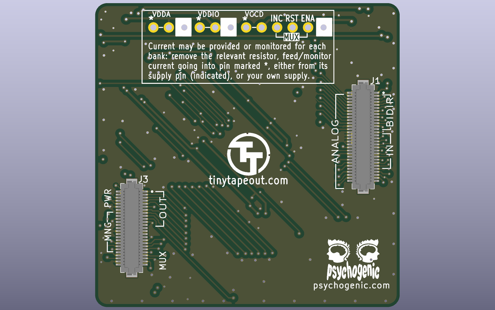

# Bringing up a chip

This page answers: *the first time you power a board with one of the team's chips on it, what do you do, and in what order, so that a mistake costs you a resistor and not the chip?*

**Bring-up** is the first power-up and first test of new hardware. For a board of your own it's mostly a matter of patience. For one of the team's Tiny Tapeout chips it's worth more care, because you can't replace the chip. Tiny Tapeout's FAQ says of the devkit, "You only get 1 chip", they don't sell bare dies ("We don't ship bare dies either"), and another chip means another kit. This page is about making each step small enough that when something is wrong, you find out before it costs the chip.

In [Lab 04](../labs/lab-04-protect-and-plan-overview.md) you write a `BRINGUP.md` for your Pmod: the checks before power, the current limit, the firmware mode and switch positions, the order of the steps, an expected reading with units for every step, and what to do when a reading is wrong. This page explains what goes in each part and why.

*The order of a first power-up. Each step has a reading you write down before you do it; any step that doesn't give that reading sends you back to the bench with the power off. Made by [`scripts/figures/bringup_order.py`](https://github.com/uoftasic/pb101/blob/main/scripts/figures/bringup_order.py).*

## Before any power

### The review

Nobody powers a kit from a board whose `BRINGUP.md` hasn't been read by a second member against the checklist in [Reviewing and ordering a board](reviewing-and-ordering-a-board.md). Until the team has someone who has reviewed boards before, that second reader is the review.

### Handling

Static can damage a chip before it has ever been powered. The standard model of a person touching a part, the human body model, is 100 pF discharged through 1.5 kΩ, charged to typically 1 to 2.5 kV and sometimes to 15 kV (Horowitz and Hill, *The Art of Electronics*, 3rd ed., §12.1.5). At 1 kV that's a peak of 0.67 A into whatever pin you touch first. At team sessions, work on an ESD mat with a wrist strap, and hold the breakout by its edges.

### Unpowered checks

With nothing connected, measure the resistance from each supply rail of your board to ground with a multimeter. A rail that reads close to 0 Ω is a short, and you stop there: a short found with an ohmmeter costs nothing, and the same short found with a power supply may cost a trace or a part. Write down beforehand what you expect from the schematic, so that you're comparing the reading with something.

### Orientation

Check that every connector goes in the right way round. Tiny Tapeout's breakouts are keyed, "such that direction of insertion onto hosts is made clear", in their README's words; your Pmod's connectors and any header you add may not be, so mark pin 1 on the silkscreen and look at it before you plug anything in.

## The kit alone, with a current limit

Power the kit first without your board, from a supply whose current you can see and limit. That tells you two things: whether the kit works at all, and how much current it draws, which you can compare with a figure Tiny Tapeout publishes: running the factory test project, "you should see a draw of around 180-200 milliAmps, on the 5V supply" ([demo board guide](https://tinytapeout.com/guides/get-started-demoboard-etr/)). Run that project first, before your own, so that you know the chip, the breakout and the demo board work before anything of yours is involved.

Your Pmod can't measure the chip's current, and it's worth understanding why before you plan around it. The chip's three supply rails, `VCCD` (1.8 V, from the breakout's regulator), `VDD_IO` and `VDDA` (both 3.3 V), stay on the breakout. The two DF12 connectors that join it to the demo board carry only +3V3, +5V and GND among their power pins, and a Pmod sees only what the demo board passes on. So the chip's current is part of the kit's total at the USB input, and that's where you read it.

*The bottom of Tiny Tapeout's SKY130 QFN breakout, rev 3.2 (`breakout-pcb` at 91a2bf1, Apache-2.0), rendered by `kicad-cli` in the course image, which draws no parts. J1 and J3 are the DF12 connectors to the demo board. The row of pads at the top is J2, a header that isn't fitted on the boards Tiny Tapeout ships, and the silkscreen under it explains how per-rail measurement would work: "remove the relevant resistor, feed/monitor current going into pin marked \*". Made by [`scripts/figures/board_renders.sh`](https://github.com/uoftasic/pb101/blob/main/scripts/figures/board_renders.sh).*

Measuring one rail on its own means taking an 0805 link off the breakout and fitting J2, which is rework on the board that holds the kit's only chip. [Measuring current](measuring-current.md) covers when that's worth it; if it is, practise it first on a breakout without a chip.

What your Pmod can measure is its own draw. A 10 Ω resistor in your board's supply, which Horowitz and Hill call a "current spy" (§10.7.1), turns its current into a voltage you can read with a meter, and they recommend one on every board because it makes a static-damaged chip easy to find. Write down what your board should draw: the switches, pull-downs and anything else on it, from their values.

## The order of the supplies

We looked for a rule about which supply has to come up first, and didn't find one for the Tiny Tapeout chip. SkyWater's [user guide for its I/O cells](https://skywater-pdk.readthedocs.io/en/main/contents/libraries/sky130_fd_io/docs/user_guide.html), the cells around the chip's edge, gives no required order between `VDDIO`, `VCCD` and `VDDA`. What it does say is:

- "no single power supply will be grounded while another supply is active", and "It is OK to float a supply while another is active though";
- before `VCCD` is taken to 0 or left floating, "the hold mode must be asserted";
- during power-up, `enable_h` is low and "the output driver is forced to a known state (Hi-Z)", so the pads don't drive anything while the supplies come up.

We found no statement about sequencing from Tiny Tapeout or ChipFoundry for the chip itself. On the breakout as it's built, every rail comes from the demo board's +3V3: `VDD_IO` and `VDDA` directly through 0 Ω links, and `VCCD` through the 1.8 V regulator, so by our reading of the board `VCCD` comes up a little after the other two, by however long the regulator takes to start. That's the arrangement Tiny Tapeout ships, and a board of yours that powers the kit through the demo board inherits it.

## A known firmware state

The demo board's RP2350 runs Tiny Tapeout's MicroPython firmware, and what it drives depends on its mode ([firmware README](https://github.com/TinyTapeout/tt-micropython-firmware)):

| Mode | What the RP2350 does |
|---|---|
| `RPMode.SAFE` | "all RP2 pins are inputs"; a comment in the README's example calls it "the default" |
| `RPMode.ASIC_RP_CONTROL` | drives the project's inputs: "ui_in pins are OUTPUTS for the RP2" |
| `RPMode.ASIC_MANUAL_INPUTS` | drives only the management pins, so that you can "twiddle inputs and clock using on-board DIP switches and buttons" |

The README's example configuration shows `mode: ASIC_RP_CONTROL` as the default, so a kit set up that way drives every `ui_in` line from the RP2350. The DIP switches drive them too: each switch, when closed, ties its `ui_in` line to +3V3 through a 1 kΩ resistor. A Pmod that also drives a `ui_in` line fights whichever of those is active. Your `BRINGUP.md` says which mode and which switch positions your board assumes, and step 3 of the figure is checking that they're set before your board is connected.

## Select, clock, reset, test

On the demo board, "The RP2350 is responsible for selecting projects, by controlling the project MUX that's on the ASIC and, under most circumstances, providing the clock for the projects" (`tt-demo-pcb` README). In the firmware, enabling a project "does all the control signal twiddling needed to select and enable the project"; `reset_project(True)` holds `rst_n` LOW, and "The button on the demoboards does the same job"; and the project clock can be stepped one cycle at a time or run continuously. So steps 4 and 5 are: select the project, start its clock, hold reset, release it.

Step 6 is the first functional test, the smallest thing that shows the design is alive, with its expected result written down. Make it something you can see without your board if you can. For SimProc, the demo board already shows the halt and done flags: `uo_out[1]` and `uo_out[2]` each drive a segment of the 7-segment display, B and C, so a reset and a few clocks should leave those segments in the state the RTL predicts.

## Things with their own power

Your board connects to the kit with nothing powered, and anything with a supply of its own, such as a USB-UART dongle powered from your laptop, connects only once the kit is up. Disconnect in the reverse order.

The reason is the chip's input protection. A CMOS input has clamp diodes to its supply, and if something drives the input HIGH while the chip is unpowered, current flows through the clamp into the chip's supply rail, enough to partly power it (Horowitz and Hill, §12.1.2). Enough of that current can also trigger latch-up, and since what matters is the input current, a series resistor on the line prevents it (§10.8.3). That resistor is on your board after Lab 04. The order on this page is the second line of defence. [Supplies, back-powering and ESD](supplies-back-powering-and-esd.md) goes through the cases.

## When a reading is wrong

Turn the power off first, then work out why. It's tempting to raise the current limit and watch, and that's how a fault that was costing a few milliamps becomes one that costs the chip. Write down the reading you got next to the one you expected; those two numbers side by side are the first thing anyone helping you will ask for.

Two things about measuring:

- **The scope's ground.** A bench oscilloscope's probe ground is connected to mains earth through its 3-wire power cord. Clipping the ground lead to a node that isn't at ground shorts that node to ground (Horowitz and Hill, Appendix O, §O.1.6). Clip it only to GND.
- **Fast edges.** The standard 10× probe's 6-inch ground lead makes fast edges ring on the screen, ringing that isn't in the circuit; a short ground tip touching ground right beside the signal gives a much cleaner picture (§12.2).

## Check yourself

1. You power the kit alone, running the factory test project, and it draws 450 mA from 5 V. What do you do next?

   

   
Answer

   Turn it off. Tiny Tapeout's guide expects about 180 to 200 mA for that project, so more than twice that is a fault in the kit, and none of your board is connected yet. Write the reading down and find out why before going further.

   

2. Your Pmod has a 10 Ω current spy in its supply. Why can't it tell you how much current the chip draws?

   

   
Answer

   The chip's rails, `VCCD`, `VDD_IO` and `VDDA`, stay on the breakout, and the DF12 connectors carry only +3V3, +5V and GND to the demo board. Your Pmod's supply feeds only your Pmod. The chip's current is part of the kit's total at its USB input, and a single rail can be measured only after rework on the breakout.

   

3. A friend plugs a laptop-powered USB-UART dongle into your Pmod while the kit is still unplugged. What can happen, and what on your board limits it?

   

   
Answer

   The dongle's TX drives a `ui_in` pin of an unpowered chip, so current flows through the input's clamp diode into the chip's supply, partly powering it, and enough of it can cause latch-up. The series resistor on that line limits the current; connecting the dongle only after the kit is powered avoids the case.

   

4. You want to see the ripple on your board's 3.3 V rail, so you clip the scope probe's tip to ground and its ground lead to 3.3 V. What happens?

   

   
Answer

   The ground lead is connected to mains earth through the scope, so you short the 3.3 V rail to ground. The tip goes on the rail and the ground lead on GND.

   

Next: [Lab 04: Protect and plan](../labs/lab-04-protect-and-plan-overview.md).
