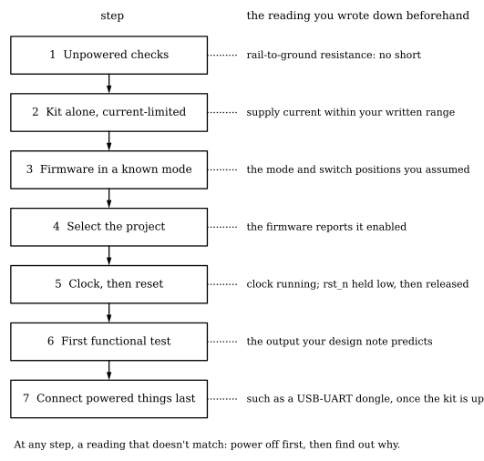

# Bringing up a chip

This page answers: *the first time you power a board with one of the team's chips on it, what do you do, and in what order, so that a mistake costs you a resistor and not the chip?*

**Bring-up** is the first power-up and first test of new hardware. For a board of your own it's mostly a matter of patience, but one of the team's Tiny Tapeout chips needs more care. Tiny Tapeout's FAQ says "You only get 1 chip", and that if you want more you have to order more devkits. It also says "We don't ship bare dies either", so you can't buy the chip by itself. Because of that, bring-up with a team chip goes in small steps, each small enough that if something is wrong, a reading shows it before the chip is damaged.

In [Lab 04](../labs/lab-04-protect-and-plan-overview.md) you write a `BRINGUP.md` for your Pmod. It opens with a table of every line that leaves your board, which says what drives each line, what it drives, and what happens when one side is powered and the other isn't. Then come your settings (the current limit, the firmware mode, the switch positions and the clock), the checks you make before anything is powered, and the steps in order, each with the reading you expect and its unit. It ends with what to do when a reading is wrong. This page explains what goes in each part after the table, and why.

*The order of a first power-up. Each step has a reading that you write down before you do it. If a step doesn't give that reading, you turn the power off and find out why before you go on. Made by [`scripts/figures/bringup_order.py`](https://github.com/uoftasic/pcb101/blob/main/scripts/figures/bringup_order.py).*

## Before any power

### The review

Nobody powers a kit from your board until a second member of the team has read its `BRINGUP.md`. The team doesn't yet have anyone who has reviewed boards before, so until it does, that reading and the checklist in [Reviewing and ordering a board](reviewing-and-ordering-a-board.md) are the review.

### Handling

Static can damage a chip before it has ever been powered. Chip makers model a charged person touching a part as 100 pF discharging through 1.5 kΩ, which is called the human body model. They usually test with it charged to 1 to 2.5 kV, and some ICs are rated up to 15 kV (Horowitz and Hill, *The Art of Electronics*, 3rd ed., §12.1.5). Charged to 1 kV, the model puts a peak of 0.67 A into whatever pin you touch first. At team sessions, work on an ESD mat with a wrist strap, and hold the breakout by its edges.

### Unpowered checks

Before you measure anything, work out from the schematic what each reading should be and write it down, so that you have something to compare each measurement with. Then, with nothing connected, use a multimeter to measure the resistance from each supply rail of your board to ground. A capacitor on the rail, such as C1, the 100 nF capacitor that you put beside the UART lines' buffer in Lab 04, makes the reading start low and climb for a moment while the meter charges it, so read the value once it settles. On Lab 04's board, with every switch off, it settles above 1 MΩ. A rail that stays close to 0 Ω is shorted, and you stop there, because a short that you find with a meter costs you nothing, while the same short found by powering the board may cost you a trace or a part.

### Orientation

Check that every connector goes in the right way round. Tiny Tapeout's breakouts are keyed "such that direction of insertion onto hosts is made clear", in the words of their README. Your Pmod's connectors and any header you add may not be keyed, so mark pin 1 on your board's silkscreen when you draw it, and look at the mark before you plug anything in.

## The kit alone, with a current limit

Power the kit first without your board, from a supply whose current you can see and limit. That tells you whether the kit works at all, and how much current it draws. Tiny Tapeout's [demo board guide](https://tinytapeout.com/guides/get-started-demoboard-etr/) says that with the factory test project running, "you should see a draw of around 180-200 milliAmps, on the 5V supply", so you have a number to compare with. Run that project before your own, so that you know the chip, the breakout and the demo board all work before anything of yours is involved.

Your Pmod can't measure the chip's current, because the chip's current never flows through your board. The chip has three supply rails, and all three stay on the breakout: `VCCD`, at 1.8 V from the breakout's regulator, and `VDD_IO` and `VDDA`, both at 3.3 V. The only power pins on the two DF12 connectors that join the breakout to the demo board are +3V3, +5V and GND, and a Pmod gets only what the demo board passes on to its sockets. The chip's current is therefore part of the kit's total, and you read it at the USB input.

*The bottom of Tiny Tapeout's SKY130 QFN breakout, rev 3.2 (`breakout-pcb` at 91a2bf1, Apache-2.0), rendered by `kicad-cli` with the parts' 3D models. J1 and J3 are the DF12 connectors to the demo board. The row of pads at the top is J2, a header that isn't fitted on the boards Tiny Tapeout ships, so the render leaves out its part and shows only the pads. To measure one supply, the note on the silkscreen under it says to "remove the relevant resistor, feed/monitor current going into pin marked \*". Made by [`scripts/figures/board_renders.sh`](https://github.com/uoftasic/pcb101/blob/main/scripts/figures/board_renders.sh).*

Measuring one rail on its own means taking an 0805 link off the breakout and fitting J2. That's rework on the board that holds the kit's only chip, so the course doesn't ask you to do it ([Measuring current](measuring-current.md) describes the links and J2). If the team ever needs per-rail readings, practise the rework first on a breakout without a chip.

Your Pmod can measure its own draw. A 10 Ω resistor in your board's supply turns your board's current into a voltage that you can read with a meter. Horowitz and Hill call this a "current spy" (§10.7.1), and they recommend one on every board, because a chip damaged by static can draw too much current, and the spy makes that easy to find. Work out from the part values what the spy should read, and write it down. It sees only the current of the parts on the far side of the resistor from the sockets. On Lab 04's board those are the switches and their pull-downs, and the buffer U1 that you add in Lab 04, with its capacitor C1 and the pull-up R4. In the kit, current also leaves your board through the RP2350's pull-downs, which the demo board's firmware turns on for the `ui_in` and `uio` pins in the mode your plan sets: U1's output drives one through R1, and each switch that's on drives another. That current comes through the spy too, so the spy reads more with your board in the kit than on a bench supply on its own.

If you power your board on its own from a bench supply, before it goes into the kit, first hold at a fixed level each buffer input that the chip would drive. A floating input on a powered buffer can switch back and forth, and TI's [datasheet](https://www.ti.com/lit/ds/symlink/sn74lvc2g17.pdf) for U1, a 74LVC2G17, says that "All unused inputs of the device must be held at VCC or GND". On Lab 04's board that's the input on pin 1 of your Pmod's J3, its connector for the chip's outputs. A 10 kΩ resistor from that pin to GND holds it low during the bench test, and comes off before the board goes into the kit.

## The order of the supplies

SkyWater's [user guide for its I/O cells](https://skywater-pdk.readthedocs.io/en/main/contents/libraries/sky130_fd_io/docs/user_guide.html), the cells around the edge of the chip, gives no required order in which `VDDIO`, `VCCD` and `VDDA` have to come up, and we found no statement about sequencing for the chip itself from Tiny Tapeout or ChipFoundry. The guide does say three things about the supplies:

- "no single power supply will be grounded while another supply is active", and "It is OK to float a supply while another is active though";
- before `VCCD` is taken to 0 or left floating, "the hold mode must be asserted";
- during power-up, `enable_h` is low and "the output driver is forced to a known state (Hi-Z)", so the pads' outputs don't drive anything while the supplies come up.

On the breakout as it's built, every rail comes from the demo board's +3V3. `VDD_IO` and `VDDA` are connected to it directly through 0 Ω links, and `VCCD` comes through the 1.8 V regulator. By our reading of the board, that means `VCCD` comes up a little after the other two, by however long the regulator takes to start. Tiny Tapeout ships the breakout that way, and a board of yours that powers the kit through the demo board gets the same order.

## A known firmware state

The demo board's RP2350 runs Tiny Tapeout's MicroPython firmware, and which pins it drives depends on the firmware's mode ([firmware README](https://github.com/TinyTapeout/tt-micropython-firmware)):

| Mode | What the RP2350 does |
|---|---|
| `RPMode.SAFE` | "all RP2 pins are inputs"; a comment in the README's example calls it "the default" |
| `RPMode.ASIC_RP_CONTROL` | drives the project's inputs ("ui_in pins are OUTPUTS for the RP2") |
| `RPMode.ASIC_MANUAL_INPUTS` | drives only the management pins, so that you can "twiddle inputs and clock using on-board DIP switches and buttons" |

The mode a kit starts in comes from the DEFAULT section of its `config.ini`, and the README's example configuration has `mode: ASIC_RP_CONTROL` there, so a kit set up that way drives every `ui_in` line from the RP2350. The DIP switches can drive the same lines, because each switch, when it's closed, ties its `ui_in` line to +3V3 through a 1 kΩ resistor. A Pmod that also drives a `ui_in` line fights whichever of those is active. Your `BRINGUP.md` says which mode and which switch positions your board assumes, and step 3 in the figure is where you check that the kit is set up that way, before your board is connected.

## Select, clock, reset, test

The demo board's README (`tt-demo-pcb`) says, "The RP2350 is responsible for selecting projects, by controlling the project MUX that's on the ASIC and, under most circumstances, providing the clock for the projects". In the firmware, enabling a project "does all the control signal twiddling needed to select and enable the project". `reset_project(True)` holds `rst_n` LOW, and "The button on the demoboards does the same job". The firmware can step the project's clock one cycle at a time or run it continuously. So in steps 4 and 5 you select the project, start its clock, hold the project in reset, and then release it.

Step 6 is the first functional test, which should be the smallest test that shows the design is alive. Write down its expected result, and if you can, choose a test whose result you can see without your board. SimProc's halt and done flags are on `uo_out[1]` and `uo_out[2]`, which drive segments B and C of the demo board's 7-segment display. After a reset, `uo_out` should read 0x03, so segments A (TX, which idles high) and B (`halt`) are lit and C (done) is dark. Lab 04 takes that value from SimProc's documentation.

## Things with their own power

Connect your board to the kit while nothing is powered. Connect anything with a supply of its own, such as a USB-UART dongle powered from your laptop, only once the kit is up. Disconnect in the reverse order.

This order keeps a powered dongle from feeding current into the kit while the kit is off. On the board as Lab 03 leaves it, nothing sits between the dongle and the chip, so that current goes into the chip's pins. A CMOS input has clamp diodes to its supply, and if something drives the input HIGH while the chip is unpowered, current flows through the clamp into the chip's supply rail, enough to power it partly (Horowitz and Hill, §12.1.2). Enough of that current can also trigger latch-up, and because latch-up depends on the input current rather than the voltage, a series resistor on the line prevents it (§10.8.3). SkyWater allows a pin to be driven above its supply only if the current into it is limited to 100 µA, though. On `ui_in[0]`, the line the dongle drives, that takes a resistor of at least (3.3 V − 0.6 V) / 100 µA = 27 kΩ, and a resistor that big can leave the high too low for the chip to read, because the demo board's firmware turns on the RP2350's pull-down on the same line. So after Lab 04 your board has a buffer, U1, between the dongle and `ui_in[0]`. With the kit off, U1 is unpowered as well, and TI specifies at most 10 µA through each of its pins in that state (its Ioff), so the current into the chip stays under SkyWater's 100 µA even if you connect the dongle before the kit is up. On Lab 04's board the order is a second protection. It keeps the dongle's TX off U1's unpowered input, and stops R4, the pull-up on that input, from passing up to 33 µA into the kit's +3V3. [Supplies, back-powering and ESD](supplies-back-powering-and-esd.md) goes through the cases.

## When a reading is wrong

Turn the power off first, then work out why. It's tempting to raise the current limit and watch what happens, but then a fault that was drawing a few milliamps can draw enough to damage the chip. Write down the reading you got next to the one you expected, because those two numbers are the first thing anyone helping you will ask for.

Two things to watch when you measure with an oscilloscope:

- A bench oscilloscope's probe ground is connected to mains earth through the scope's 3-wire power cord, so clipping the ground lead to a node that isn't at ground shorts that node to ground (Horowitz and Hill, Appendix O, §O.1.6). Clip it only to GND.
- The 6-inch ground lead of the standard 10× probe makes fast edges ring on the screen even though they don't ring in your circuit. A short ground tip that touches ground right beside the signal gives a much cleaner picture (§12.2).

## Check yourself

1. You power the kit alone, running the factory test project, and it draws 450 mA from 5 V. What do you do next?

   

   
Answer

   Turn it off. Tiny Tapeout's guide expects about 180 to 200 mA for that project, and 450 mA is more than twice that. None of your board is connected yet, so the fault is in the kit. Write the reading down and find out why before you go any further.

   

2. Your Pmod has a 10 Ω current spy in its supply. Why can't it tell you how much current the chip draws?

   

   
Answer

   The chip's rails, `VCCD`, `VDD_IO` and `VDDA`, stay on the breakout, and the only power pins on the DF12 connectors between the breakout and the demo board are +3V3, +5V and GND. Your Pmod's supply feeds only your Pmod. The chip's current is part of the kit's total at its USB input, and you can measure a single rail only after rework on the breakout.

   

3. A friend plugs a laptop-powered USB-UART dongle into your Pmod while the kit is still unplugged. What can happen, and what on your board limits it?

   

   
Answer

   On the board as Lab 03 leaves it, nothing sits between the dongle and the chip, so the dongle's TX drives a `ui_in` pin of an unpowered chip. Current flows through the input's clamp diode into the chip's supply and partly powers it, and enough of that current can cause latch-up. On your board after Lab 04, the TX drives U1's input instead. U1 is unpowered too, and passes at most 10 µA (its Ioff) on to `ui_in[0]`, a tenth of SkyWater's 100 µA limit. R4, the pull-up on U1's input, passes up to 33 µA from the TX into the kit's +3V3. Connecting the dongle only after the kit is powered keeps both from flowing.

   

4. You want to see the ripple on your board's 3.3 V rail, so you clip the scope probe's tip to ground and its ground lead to 3.3 V. What happens?

   

   
Answer

   The ground lead is connected to mains earth through the scope, so you short the 3.3 V rail to ground. The tip goes on the rail and the ground lead on GND.

   

Next: [Lab 04: Protect and plan](../labs/lab-04-protect-and-plan-overview.md).
