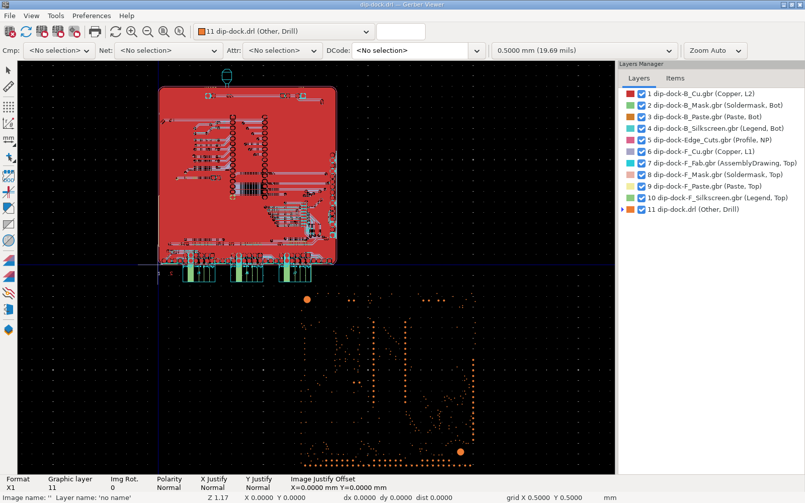
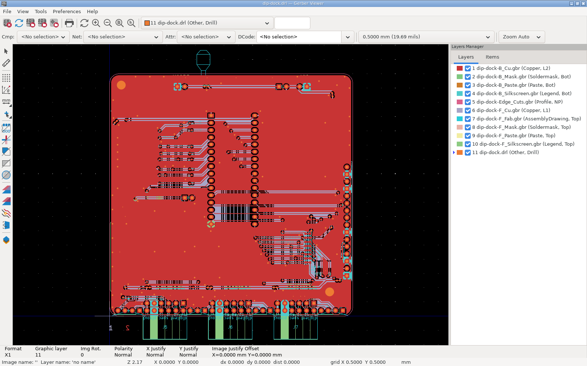

# Fabrication outputs

This page answers: *what does a fabricator actually need from you to make a board, and what is in each of those files?*

To have a board made, you normally send the board house a set of plain files that any CAM (computer-aided manufacturing) program can read, rather than your `.kicad_pcb`. The set has one Gerber file for each layer the board house has to make and a drill file that says where the holes go, and if the board house also assembles the board, it needs a bill of materials (BOM) and a position file as well. KiCad writes all of them, either from its editors' menus or from `kicad-cli`, and in [Lab 05](../labs/lab-05-fab-outputs-in-ci-overview.md) you set up a CI workflow that writes them for you on every push. This page goes through each of them on a real 2-layer board, so that when you open your own outputs you know what you're looking at.

The board is Tiny Tapeout's DIP dock (`TinyTapeout/breakout-pcb` at 91a2bf1, Apache-2.0). It's the 2-layer board that Tiny Tapeout's DIP carriers plug into, and of their boards it's the closest to the Pmod you draw in Lab 03. According to its Gerber job file, the dock is 85.05 × 85.05 mm and 1.561 mm thick, with 2 copper layers, and the PCB Editor counts 370 pads, 111 vias and 535 track segments on it. Every file name, size and line quoted below comes from exports we ran with `kicad-cli` 10.0.5 in the course's pinned image, on the evening of November 16, 2026, in Toronto. The files record the time in UTC, and in UTC it was already November 17.

## One Gerber per layer

A Gerber file describes one layer as flat 2D shapes (lines with a width, pads and filled regions), placed in millimetres (or inches) from an origin. There are no parts or footprints in a Gerber file, although the newer version of the format can label each shape with the net it belongs to, and each pad with the part and pin it belongs to. The fabricator lines the layers up on top of each other, so every file has to use the same origin and the same orientation.

For the DIP dock, the board's own Gerber settings produce ten files:


*Six of the DIP dock's ten Gerber layers, plotted by `kicad-cli pcb export svg` from the same board, in black on white. Under each panel are the name of the Gerber file and the file function that KiCad records for it. Holes aren't drawn, because they go in the drill file and none of the Gerbers holds them. Made by [`scripts/figures/dip_dock_layers.py`](https://github.com/uoftasic/ic103/blob/main/scripts/figures/dip_dock_layers.py).*

| File | What the fabricator does with it |
|---|---|
| `dip-dock-F_Cu.gbr`, `dip-dock-B_Cu.gbr` | Etches the copper on the top and bottom: tracks, pads and the ground pour. |
| `dip-dock-F_Mask.gbr`, `dip-dock-B_Mask.gbr` | Makes the solder mask, the coloured coating. These files are *negative*: each shape is an opening in the mask, where the copper stays bare so that it can be soldered. |
| `dip-dock-F_Silkscreen.gbr`, `dip-dock-B_Silkscreen.gbr` | Prints the legend: reference designators, outlines, labels and logos. |
| `dip-dock-F_Paste.gbr`, `dip-dock-B_Paste.gbr` | Cuts the stencil that puts solder paste on the surface-mount pads. Only an assembled order uses these. |
| `dip-dock-Edge_Cuts.gbr` | Routes the board outline, which here is a square with rounded corners. |
| `dip-dock-F_Fab.gbr` | Doesn't need it to make the bare board. It holds the assembly drawing from the front fabrication layer. |

It's easy to read the mask layers backwards. In the F.Mask panel above, the black shapes are where there *won't* be any mask. So if a pad is missing from the mask layer, the pad ends up covered and can't be soldered, and if there's a mask opening with no pad under it, the opening exposes whatever copper is there, which is usually the ground pour.

Next to the Gerbers, KiCad writes a job file, `dip-dock-job.gbrjob`. It's a JSON file that lists every Gerber with its function and polarity, along with the board's size, number of layers and thickness.

## Inside a Gerber file

A Gerber file is plain text, and its first few lines describe the file itself. These are the first ten lines of `dip-dock-F_Cu.gbr`:

```text
G04 #@! TF.GenerationSoftware,KiCad,Pcbnew,10.0.5*
G04 #@! TF.CreationDate,2026-11-17T01:02:51+00:00*
G04 #@! TF.ProjectId,dip-dock,6469702d-646f-4636-9b2e-6b696361645f,1.0*
G04 #@! TF.SameCoordinates,PX3fe56c0PY5cfbb60*
G04 #@! TF.FileFunction,Copper,L1,Top*
G04 #@! TF.FilePolarity,Positive*
%FSLAX46Y46*%
G04 Gerber Fmt 4.6, Leading zero omitted, Abs format (unit mm)*
G04 Created by KiCad (PCBNEW 10.0.5) date 2026-11-17 01:02:51*
%MOMM*%
```

The `TF` lines are **file attributes**, which come from the extended version of the format, called Gerber X2. `TF.FileFunction,Copper,L1,Top` says that this is copper layer 1, the top layer, so a fabricator's software doesn't have to guess the layer from the file name. `TF.SameCoordinates` marks all the files of one export as sharing a coordinate system. `%MOMM*%` sets the unit to millimetres, and `%FSLAX46Y46*%` sets the number format, with four integer digits and six decimal digits.

The DIP dock's plot settings have "Use extended X2 format" turned off, so KiCad writes the attributes inside `G04` comments, which software that doesn't know X2 skips like any other comment. When we exported without the board's settings, `kicad-cli`'s defaults wrote the same attributes as X2 commands instead, for example `%TF.FileFunction,Copper,L1,Top*%`, so the information is the same either way.

## The board's plot settings

The board file stores which layers become Gerbers, and with what options. In the PCB Editor you set them in the Plot dialog, under File → Plot:


*The PCB Editor's Plot dialog (File → Plot) with the DIP dock open, in KiCad 10.0.5. Under "Include Layers" the designer ticked F.Cu and B.Cu, the paste, silkscreen and mask layers on both sides, Edge.Cuts and F.Fab. On the right, "Use drill/place file origin" is ticked and "Use extended X2 format (recommended)" isn't. "Generate Drill Files..." at the bottom opens a second dialog for the drill file.*

`kicad-cli pcb export gerbers` uses those settings only when you pass `--board-plot-params`, and otherwise uses its own defaults. On the DIP dock, with `--board-plot-params`, it wrote the ten `.gbr` files above. Without it, it wrote a job file and 26 Gerbers, one for every layer the board has, including the courtyards, the margin and ten user layers such as `dip-dock-User_Eco1.gbr`. It also gave the main layers the old Protel extensions instead of `.gbr`, such as `dip-dock-F_Cu.gtl`, `dip-dock-B_Cu.gbl`, `dip-dock-F_Mask.gts` and `dip-dock-Edge_Cuts.gm1`. The layers the fab needs are in both sets, but with the second set a fabricator has to work out which 10 of the 26 Gerbers matter. The silkscreen is different too, because the board's settings subtract the solder mask from the silkscreen and `kicad-cli`'s defaults don't.

The simplest way to avoid both problems is to set up the Plot dialog once, save the board, and pass `--board-plot-params` to every `kicad-cli` export, whether you run it yourself or CI does. Then CI makes the same files that the Plot dialog makes in the GUI.

## The drill file

The holes go in a separate drill file, which KiCad writes in the Excellon format unless you ask for Gerber (`--format gerber`). For the DIP dock, `kicad-cli pcb export drill` wrote one file, `dip-dock.drl`, and its header lists the drill sizes, which are called tools:

```text
M48
; DRILL file KiCad 10.0.5 date 2026-11-17T01:03:09
; FORMAT={-:-/ absolute / metric / decimal}
; #@! TF.CreationDate,2026-11-17T01:03:09+00:00
; #@! TF.GenerationSoftware,Kicad,Pcbnew,10.0.5
; #@! TF.FileFunction,MixedPlating,1,2
FMAT,2
METRIC
; #@! TA.AperFunction,Plated,PTH,ViaDrill
T1C0.300
```

The header goes on to list six tools, all plated, in four sizes, because KiCad gives via holes and component holes of the same size a tool each: 0.3 mm (90 via holes and 4 component holes), 0.4 mm (21 via holes and 103 component holes), 1.0 mm (106 component holes) and 3.2 mm (2 component holes, the mounting holes). The 4 component holes at 0.3 mm and the 103 at 0.4 mm are stitching vias that the designer placed as footprints, which is why the file counts them as component holes. The 90 and 21 via holes add up to the 111 vias that the PCB Editor counts, which is a quick check that no via is missing from the file. `MixedPlating` means that the file is allowed to hold plated and unplated holes together; `--excellon-separate-th` writes them to separate files instead.

The drill file and the Gerbers line up only through their coordinates, so the drill file has to use the same origin as the Gerbers. In our first export of the DIP dock it used a different one. The board's plot settings tick "Use drill/place file origin", so its Gerbers are drawn from an origin that the designer placed at the board's bottom-left corner, but `kicad-cli pcb export drill` defaults to `--drill-origin absolute`, which is the page origin. When we opened the two together in GerbView, KiCad's Gerber viewer, the holes landed below the board and to the right of it:



*The DIP dock's ten Gerbers and a drill file made with `kicad-cli`'s default drill origin, in GerbView (KiCad 10.0.5). The board sits above and to the right of the origin, and the orange holes from `dip-dock.drl` sit below and to the right of it. Both exports succeeded, and neither printed a warning about the origin.*

When we exported the drill file again with `--drill-origin plot`, which uses the same origin as the plot, the holes sat in their pads:



*The same Gerbers with a drill file made with `--drill-origin plot`. The Layers Manager on the right lists all eleven files, each with the function that GerbView read from it, such as "Copper, L2", "Soldermask, Bot" and "Profile, NP". Both screenshots were made by [`scripts/figures/shots/fab-outputs-dip-dock.sh`](https://github.com/uoftasic/ic103/blob/main/scripts/figures/shots/fab-outputs-dip-dock.sh).*

Opening the whole set in GerbView before you upload it takes a minute, and it shows you the files the fab will get rather than the board they were made from. Lab 05 has you do it with the files your CI built. Lab 05's check catches this offset as well, because it checks that every hole in the drill file lies inside the outline in the Edge.Cuts Gerber.

## Files for assembly: BOM and position

Whoever assembles the board uses these two files, so they're for you if you solder the board yourself, and for the fab if it assembles the board for you.

The **BOM** comes from the schematic (`kicad-cli sch export bom`). With the default columns, `Refs`, `Value`, `Footprint`, `Qty` and `DNP`, the DIP dock's BOM has one row per part, 67 rows in all. One row, R15, is marked `DNP` (do not populate). R15 is a 0 Ω resistor in an 0805 footprint, and the board has room for it but doesn't fit it. If a BOM leaves out the `DNP` column, R15 looks like any other part on it, and an assembler can end up fitting a part that the designer meant to leave off. In Lab 01, Part 2 you list the DNP parts on the SKY130 breakout and compare your list with Tiny Tapeout's production BOM, which leaves them out.

The **position file** (`kicad-cli pcb export pos`), also called a pick-and-place or centroid file, gives each part's reference, value, package, X and Y position, rotation and side. The DIP dock's position file lists 80 parts, 72 on the top and 8 on the bottom (the solder jumpers JP1 to JP8). By default the command writes inches, in a fixed-width text format, so ask for `--format csv --units mm` if your assembler wants a spreadsheet in millimetres, and for `--use-drill-file-origin` if the Gerbers use that origin.

## One-file formats: IPC-2581, ODB++ and STEP

Gerbers and a drill file are the usual set. IPC-2581 and ODB++ each put the whole board in one file, with its stackup, nets and parts, and `kicad-cli` writes both. For the DIP dock, `pcb export ipc2581` wrote a 5.1 MB XML file (IPC-2581 revision C, the default), and `pcb export odb` wrote ODB++ as a 292 kB zip of 113 entries. The ODB++ export also printed 88 warnings like the one below, because the board's stitching vias are footprints that share reference designators:

```text
Warning: Component 'STITCH12' has an ambiguous designator after conversion; renamed to 'STITCH12_1' for ODB++ export.
```

`pcb export step` writes a 3D model of the board for mechanical work, such as checking that it fits a case. In the course image it wrote a 2.2 MB file that holds the board and one part, the DIP switch SW3, whose 3D model is in Tiny Tapeout's own library, `tinytapeout-kicad-libs`, which the course fetches next to the board. For each of 66 other parts it printed a message like this one:

```text
Could not add 3D model for R29.
File not found: ${KICAD10_3DMODEL_DIR}/Resistor_SMD.3dshapes/R_0402_1005Metric.step
```

The paths in those messages point into KiCad's own library of 3D models, which the image doesn't include. A KiCad installed with its 3D models, such as the full Linux AppImage, fills those parts in.

## Dates in the files

We exported the same board's Gerbers twice, 11 seconds apart. Every Gerber differed in exactly two lines, the `TF.CreationDate` attribute and the `Created by KiCad ... date` comment, and the job file differed in its `CreationDate`. The drill file has the date in its header too. Turning off X2 doesn't remove these lines, and when we exported with `--no-x2` they were still there.

So two exports of the same commit, made at different times, are never identical byte for byte. If you want CI to tell you whether a commit changed the fabrication files, compare them with the date lines taken out. [Outputs in CI](outputs-in-ci.md) comes back to this.

## Check yourself

1. In the F.Mask panel of the figure, the pads of the DIP socket are black. Is there solder mask on them?

   <details>
   <summary>Answer</summary>

   No. The mask files are negative, so a shape in `dip-dock-F_Mask.gbr` is an opening in the mask. The black pads are where the mask is left off, so that the pads can be soldered.

   </details>

2. You open your Gerbers and drill file in GerbView, and every hole is shifted the same distance away from its pad. What happened, and what would you change?

   <details>
   <summary>Answer</summary>

   The Gerbers and the drill file were made with different origins, as in the first GerbView screenshot. If your Gerbers use the drill/place file origin (`--board-plot-params` with that box ticked), make the drill file with `--drill-origin plot`, or untick "Use drill/place file origin" so that both use the absolute origin.

   </details>

3. CI builds Gerbers from the same commit on Monday and on Tuesday, and their checksums differ. Did the board change?

   <details>
   <summary>Answer</summary>

   No. Both builds are of the same commit, so the board is the same. Every Gerber, the job file and the drill file carry the date of the export, and that's enough to change their checksums. Compare the files with the date lines removed before you conclude that anything else changed.

   </details>

4. You're ordering bare boards and will solder them yourself. Which of the files on this page does the fabricator need?

   <details>
   <summary>Answer</summary>

   The copper, mask, silkscreen and Edge.Cuts Gerbers and the drill file, plus the job file if their upload page reads it. The paste layers, the BOM and the position file are for assembly, and F.Fab is a drawing for people.

   </details>

Next: [Outputs in CI](outputs-in-ci.md).
