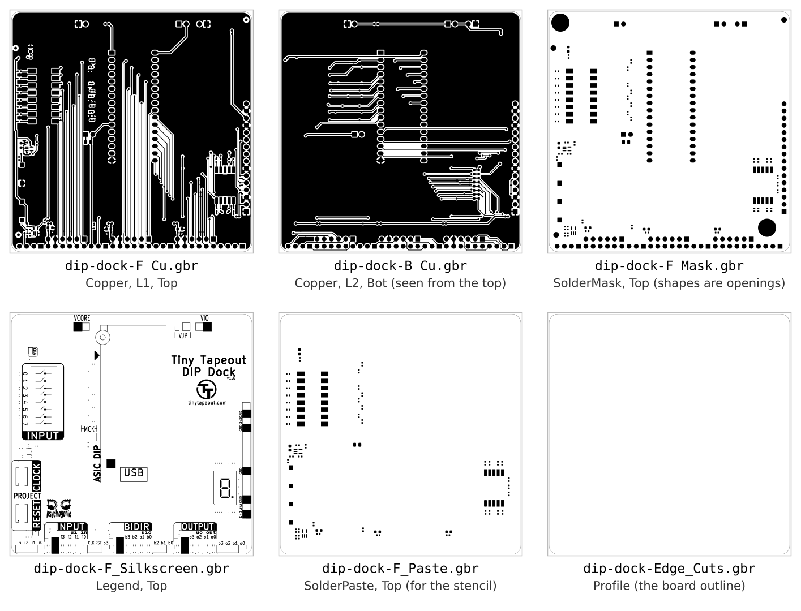
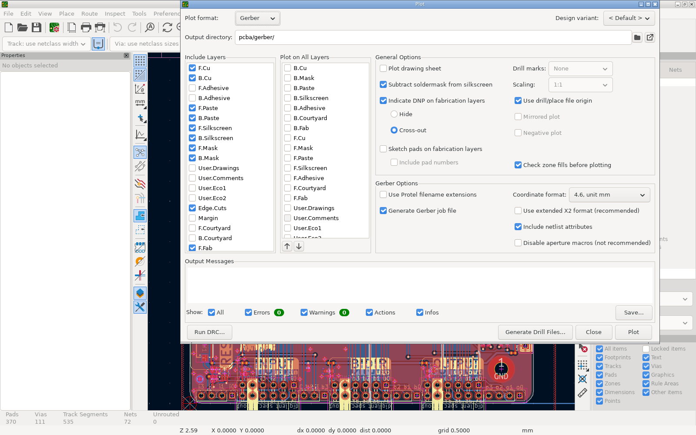

# Fabrication outputs

This page answers: *what does a fabricator actually need from you to make a board, and what is in each of those files?*

A board house doesn't open your `.kicad_pcb`. It works from a set of plain files that any CAM program can read: one Gerber file for each layer it has to make, a drill file that says where the holes go, and, if it also assembles the board, a bill of materials (BOM) and a position file. KiCad writes all of them, from the PCB Editor's menus or from `kicad-cli`, and in [Lab 05](../labs/lab-05-fab-outputs-in-ci-overview.md) a CI workflow writes them for you on every push. This page goes through them on a real 2-layer board, so that when you open your own outputs you know what you are looking at.

The board is Tiny Tapeout's DIP dock (`TinyTapeout/breakout-pcb` at 91a2bf1, Apache-2.0), the 2-layer host board for their DIP carriers, which the course uses as the closest reference for the Pmod you draw in Lab 03. Its Gerber job file gives it as 85.05 × 85.05 mm, 2 copper layers and 1.561 mm thick, and the PCB Editor counts 370 pads, 111 vias and 535 track segments. Every file name, size and line quoted below comes from `kicad-cli` 10.0.8 in the course's pinned image, run on November 16, 2026.

## One Gerber per layer

A Gerber file describes one layer as flat 2D shapes: lines with a width, pads, and filled regions, in millimetres (or inches) from an origin. It describes shapes, not parts or footprints, although the newer version of the format can label each shape with the net it belongs to. The fabricator builds the board by stacking the layers on top of each other, which is why every file has to use the same origin and the same orientation.

For the DIP dock, the board's own Gerber settings produce ten files:



*Six of the DIP dock's ten Gerber layers, plotted by `kicad-cli pcb export svg` from the same board, in black on white. Under each panel is the Gerber file name and the file function KiCad records for it. Holes aren't drawn, because none of the Gerbers holds them. Made by [`scripts/figures/dip_dock_layers.py`](https://github.com/uoftasic/pb101/blob/main/scripts/figures/dip_dock_layers.py).*

| File | What the fabricator does with it |
|---|---|
| `dip-dock-F_Cu.gbr`, `dip-dock-B_Cu.gbr` | Etches the copper on the top and bottom: tracks, pads and the ground pour. |
| `dip-dock-F_Mask.gbr`, `dip-dock-B_Mask.gbr` | Makes the solder mask, the coloured coating. These files are *negative*: each shape is an opening in the mask, where copper stays bare so it can be soldered. |
| `dip-dock-F_Silkscreen.gbr`, `dip-dock-B_Silkscreen.gbr` | Prints the legend: reference designators, outlines, labels and logos. |
| `dip-dock-F_Paste.gbr`, `dip-dock-B_Paste.gbr` | Cuts the stencil that puts solder paste on the surface-mount pads. Only an assembled order uses these. |
| `dip-dock-Edge_Cuts.gbr` | Routes the board outline, here a square with rounded corners. |
| `dip-dock-F_Fab.gbr` | The assembly drawing on the front fabrication layer. A fab doesn't need it to make the bare board. |

The mask polarity is the one that catches people out. In the F.Mask panel above, the black shapes are where there *won't* be mask, so a pad that's missing from the mask layer ends up covered and can't be soldered, and a mask opening with no pad under it exposes whatever copper is there, usually the ground pour.

Next to the Gerbers, KiCad writes a job file, `dip-dock-job.gbrjob`. It's JSON, and it lists every Gerber with its function and polarity, along with the board's size, layer count and thickness, so the whole set is described in one place.

## Inside a Gerber file

A Gerber file is text, and the first lines say what it is. These are the first ten lines of `dip-dock-F_Cu.gbr`:

```text
G04 #@! TF.GenerationSoftware,KiCad,Pcbnew,10.0.8*
G04 #@! TF.CreationDate,2026-11-16T07:27:55+00:00*
G04 #@! TF.ProjectId,dip-dock,6469702d-646f-4636-9b2e-6b696361645f,1.0*
G04 #@! TF.SameCoordinates,PX3fe56c0PY5cfbb60*
G04 #@! TF.FileFunction,Copper,L1,Top*
G04 #@! TF.FilePolarity,Positive*
%FSLAX46Y46*%
G04 Gerber Fmt 4.6, Leading zero omitted, Abs format (unit mm)*
G04 Created by KiCad (PCBNEW 10.0.8) date 2026-11-16 07:27:55*
%MOMM*%
```

The `TF` lines are **file attributes**, from the extended version of the format called Gerber X2. `TF.FileFunction,Copper,L1,Top` says that this is copper layer 1, the top, so a fabricator's software doesn't have to guess from the file name, and `TF.SameCoordinates` marks all the files of one export as sharing a coordinate system. `%FSLAX46Y46*%` and `%MOMM*%` set the number format and the unit: millimetres, with four integer and six decimal digits.

The DIP dock's settings have "Use extended X2 format" turned off, so KiCad writes the attributes inside `G04` comments, which a reader that doesn't know X2 passes over. When we exported without the board's settings, `kicad-cli`'s own default wrote the same attributes as X2 commands, for example `%TF.FileFunction,Copper,L1,Top*%`. The information is the same either way.

## The board's plot settings

Which layers become Gerbers, and with what options, is a setting stored in the board file. In the PCB Editor it's the Plot dialog, under File → Plot:



*The PCB Editor's Plot dialog (File → Plot) with the DIP dock open, in KiCad 10.0.8. Under "Include Layers" the designer ticked F.Cu, B.Cu, both paste, silkscreen and mask layers, Edge.Cuts and F.Fab. On the right, "Use drill/place file origin" is ticked and "Use extended X2 format (recommended)" isn't. "Generate Drill Files..." at the bottom opens a second dialog for the drill file.*

`kicad-cli pcb export gerbers` uses those settings only when you pass `--board-plot-params`. Without it, it uses its own defaults, and on the DIP dock the difference was large. With `--board-plot-params` it wrote the ten `.gbr` files above. Without it, it wrote 26 files, one for every layer the board has, including the courtyards, the margin and eight user layers such as `dip-dock-User_Eco1.gbr`, and it gave the main layers the old Protel extensions instead of `.gbr`: `dip-dock-F_Cu.gtl`, `dip-dock-B_Cu.gbl`, `dip-dock-F_Mask.gts`, `dip-dock-Edge_Cuts.gm1` and so on. The layers the fab needs are in both sets, but from the second a fabricator has to work out which 10 of the 26 files matter, and its silkscreen isn't the same: the board's settings subtract the solder mask from the silkscreen, and `kicad-cli`'s defaults don't.

The simplest rule is to set the Plot dialog up once, save the board, and have every export, by hand or in CI, use `--board-plot-params`. Then the files you looked at in the GUI are the files CI sends to the fab.

## The drill file

Holes aren't in the layer Gerbers. They go in a drill file, which KiCad writes in the Excellon format unless you ask for Gerber (`--format gerber`). `kicad-cli pcb export drill` wrote one file for the DIP dock, `dip-dock.drl`, and its header lists the drill sizes, called tools:

```text
M48
; DRILL file KiCad 10.0.8 date 2026-11-16T07:27:55
; FORMAT={-:-/ absolute / metric / decimal}
; #@! TF.CreationDate,2026-11-16T07:27:55+00:00
; #@! TF.GenerationSoftware,Kicad,Pcbnew,10.0.8
; #@! TF.FileFunction,MixedPlating,1,2
FMAT,2
METRIC
; #@! TA.AperFunction,Plated,PTH,ViaDrill
T1C0.300
```

There are six tools, all plated: 0.3 mm (90 via holes and 4 component holes), 0.4 mm (21 via holes and 103 component holes), 1.0 mm (106 component holes) and 3.2 mm (2 component holes, the mounting holes). The 90 and 21 via holes add up to the 111 vias the PCB Editor counts, which is a quick check that the file has everything. `MixedPlating` means the file is allowed to hold plated and unplated holes together; `--excellon-separate-th` writes them to separate files instead.

The drill file has to use the same origin as the Gerbers, and in our first export of the DIP dock it used a different one. The board's plot settings tick "Use drill/place file origin", so its Gerbers are drawn from an origin the designer placed at the board's bottom-left corner. `kicad-cli pcb export drill` defaults to `--drill-origin absolute`, the page origin. Opened together in GerbView, KiCad's Gerber viewer, the holes land beside the board:


*The DIP dock's ten Gerbers and a drill file made with `kicad-cli`'s default drill origin, in GerbView (KiCad 10.0.8). The board sits above and to the right of the origin; the orange holes from `dip-dock.drl` are below and to the right of it. Nothing warned us: both exports succeeded.*

Exported again with `--drill-origin plot`, which uses the same origin as the plot, the holes sit in their pads:


*The same Gerbers with a drill file made with `--drill-origin plot`. The Layers Manager on the right lists all eleven files with the function GerbView read from each: "Copper, L2", "Soldermask, Bot", "Profile, NP" and so on. Both screenshots are from [`scripts/figures/shots/fab-outputs-dip-dock.sh`](https://github.com/uoftasic/pb101/blob/main/scripts/figures/shots/fab-outputs-dip-dock.sh).*

The files share nothing but their coordinates, so the drill file and the Gerbers can only line up if they use the same origin. Opening the whole set in GerbView before you upload it takes a minute, and it's the only check that looks at exactly the files the fab will get. Lab 05 has you do it with the files your CI built.

## Files for assembly: BOM and position

If you solder the board yourself, these are for you; if the fab assembles it, they're for the fab.

The **BOM** comes from the schematic (`kicad-cli sch export bom`). For the DIP dock, the default columns are `Refs`, `Value`, `Footprint`, `Qty` and `DNP`, with one row per part, 67 rows in all. One of them is marked `DNP`, do not populate: R15, a 0 Ω resistor in an 0805 footprint that the board has room for but doesn't fit. A BOM that leaves out the DNP column is how an assembler ends up fitting a part the designer meant to leave off, and Lab 01 has you read DNP marks on the SKY130 breakout for the same reason.

The **position file** (`kicad-cli pcb export pos`, also called a pick-and-place or centroid file) gives each part's reference, value, package, X and Y, rotation and side. The DIP dock's has 80 parts, 72 on the top and 8 on the bottom (the solder jumpers JP1 to JP8). The command's defaults are inches and a fixed-width text format, so ask for `--format csv --units mm` if your assembler wants a spreadsheet, and for `--use-drill-file-origin` if the Gerbers use that origin.

## One-file formats: IPC-2581, ODB++ and STEP

Gerbers and a drill file are the usual set. Two other formats put the whole board, stackup, nets and parts included, in one file, and `kicad-cli` writes both. For the DIP dock, `pcb export ipc2581` wrote a 5.1 MB XML file (IPC-2581 revision C, the default), and `pcb export odb` wrote ODB++ as a 291 kB zip of 113 entries. The ODB++ export printed 88 warnings like this one, because the board's stitching vias are footprints that share reference designators:

```text
Warning: Component 'STITCH12' has an ambiguous designator after conversion; renamed to 'STITCH12_1' for ODB++ export.
```

`pcb export step` writes a 3D model of the board for mechanical work, such as checking that it fits a case. In the course image it wrote a 2.2 MB file with the bare board and printed a message for each of 66 parts, such as

```text
Could not add 3D model for R29.
File not found: ${KICAD10_3DMODEL_DIR}/Resistor_SMD.3dshapes/R_0402_1005Metric.step
```

because the image doesn't include KiCad's 3D models. A KiCad installed with its 3D models, such as the full Linux AppImage, fills the parts in.

## Dates in the files

We exported the same board's Gerbers twice, 11 seconds apart. Every Gerber differed in exactly two lines, the `TF.CreationDate` attribute and the `Created by KiCad ... date` comment, and the job file in its `CreationDate`. The drill file has a date in its header too. Turning off X2 doesn't remove them: with `--no-x2`, the date lines were still there.

So two correct exports of the same commit are never byte-identical. If you want CI to tell you whether a commit changed the fabrication files, compare them with the date lines taken out. [Outputs in CI](outputs-in-ci.md) comes back to this.

## Check yourself

1. In the F.Mask panel of the figure, the pads of the DIP socket are black. Is there solder mask on them?

   <details>
   <summary>Answer</summary>

   No. The mask files are negative: a shape in `dip-dock-F_Mask.gbr` is an opening in the mask. The black pads are where the mask is left off so that the pads can be soldered.

   </details>

2. You open your Gerbers and drill file in GerbView, and every hole is shifted the same distance away from its pad. What happened, and what would you change?

   <details>
   <summary>Answer</summary>

   The Gerbers and the drill file were made from different origins, as in the first GerbView screenshot. If your Gerbers use the drill/place file origin (`--board-plot-params` with that box ticked), make the drill file with `--drill-origin plot`, or untick "Use drill/place file origin" so that both use the absolute origin.

   </details>

3. CI builds Gerbers from the same commit on Monday and on Tuesday, and their checksums differ. Did the board change?

   <details>
   <summary>Answer</summary>

   Not necessarily. Every Gerber, the job file and the drill file carry the date of the export, so files from the same board differ in those lines. Compare the files with the date lines removed before you conclude that anything else changed.

   </details>

4. You're ordering bare boards and will solder them yourself. Which of the files on this page does the fabricator need?

   <details>
   <summary>Answer</summary>

   The copper, mask, silkscreen and Edge.Cuts Gerbers and the drill file, plus the job file if their upload page reads it. The paste layers, the BOM and the position file are for assembly, and F.Fab is a drawing for people.

   </details>

Next: [Outputs in CI](outputs-in-ci.md).
