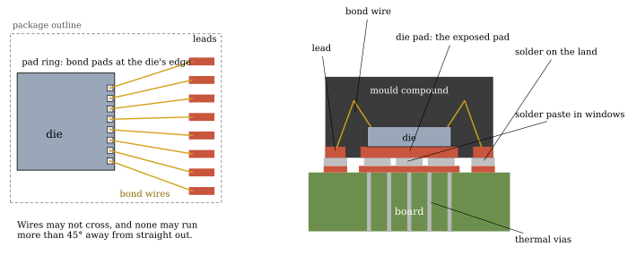

# From die to package: pads, bond wires, QFN, QFP and BGA

This page answers: *a chip is a small square of silicon whose connections are a fraction of a millimetre apart. How does it become something you can solder to a board, and how do you draw the copper it lands on?*

A fab makes a chip as a **die**, a thin piece of silicon with the circuit on its top surface. The die's connections are its **bond pads**, which sit in a ring around its edge. You can't solder a die to a circuit board the way you solder other parts, because its pads are far too small and too close together, and the silicon is fragile. A **package** holds and protects the die, and carries each bond pad out to a lead or a solder ball that is big enough to solder to a board. This page follows one connection from the die out to the board. The copper on the board that a package is soldered to is its **land pattern**, and the second half of the page shows how to work it out from the dimensions on the package's drawing. You'll do that yourself for a different package in [Lab 02](../labs/lab-02-a-footprint-from-a-datasheet-overview.md).

## The pad ring

The pads around a die's edge make up its **pad ring** (or padframe). The chip's designers choose which signal or supply each pad carries, and the board has to be wired to match. wafer.space runs shuttles on GF180 and offers chip-on-board packaging as an option. It publishes its padframe in its repository [`chip-on-board-wire-bonded-pcbs`](https://github.com/wafer-space/chip-on-board-wire-bonded-pcbs) (Apache 2.0, commit 5cb4668). The padframe "follow[s] the Tiny Tapeout convention of 74 pads", and a table in `run-1/README.md` maps the bond pads on the die to pads on wafer.space's breakout board and to their Tiny Tapeout functions. Here are some of its rows:

| Bond pad (die) | Breakout pad (board) | Tiny Tapeout function |
|---|---|---|
| 0 | 1 | `ctrl_ena` |
| 8 | 9 | GND IO |
| 9–16 | 10–17 | `uo[0–7]` |
| 17 | 18 | VDD IO |
| 19–24 | 20–25 | `analog[0–5]` |
| 73 | 74 | VDD IO |

The board is drawn from a table like this one, so a mistake in a row becomes a wrong connection on the board. The die's pads are numbered from 0 and the board's from 1, so each breakout pad's number is one more than its bond pad's. When you review a board, check which of the two columns each connection was taken from.

## Bond wires

Each bond pad is connected to the package, or directly to a board, by a **bond wire**, which is a fine wire that a wire-bonding machine welds in place at both ends. Bond wires have to follow layout rules, and wafer.space lists the rules for its breakouts in `run-1/wirebonding/README.md`:

- "No wires may cross."
- "Wire angle must be not greater than 45°."
- "Maximum wire length must be less than 3 mm — though a wire that long would already add a significant amount of inductance, so keep them as short as practical."
- "Minimum wire length is 1 mm from the die, or 2× the die thickness (whichever is greater)."
- "No solder mask is allowed in the area to be bonded."

The same file explains how wafer.space matches the pads on the die to the pads on the board. It says that "Wirebonding is still a very manual process — there are no real exchange formats yet that tie the die layout to the breakout PCB", so wafer.space wrote a script that reads the die's layout (its GDS file) and the breakout's KiCad file "and walks pin-for-pin around the padframe".

Services that package dies publish rules of the same kind for their packages. Europractice's [ASIC Package Design Rules](https://europractice-ic.com/wp-content/uploads/2020/06/ASIC_Prototype_Packaging_Design_Rules_2024.pdf) give limits on bond pad size and pitch, wire length and angle, crossing wires and die thickness for each package it offers. Every page of that document is marked "strictly confidential", even though it's posted publicly, so we link to it rather than repeat its numbers. One of its guidelines is useful for any wire-bonded package, though. You draw the die together with the package's bond pins, split the die's edge into equal segments, and keep each bond pad in the same segment as the bond pin it's wired to. Each pad then faces the pin it goes to, so its wire runs roughly straight out, which keeps the wires inside the angle limit and stops them crossing.

{fig-alt="Two sketches. Left: the corner of a die, a grey square, with eight small bond pads along its right edge. Eight gold bond wires fan out from the pads to eight copper leads on the right, which are spaced further apart, inside a dashed package outline. A note reads: wires may not cross, and none may run more than 45 degrees away from straight out. Right: a cross-section. A dark mould compound block sits on a green board. Inside it, the die sits on a copper die pad, the exposed pad, and gold bond wires arch from the top of the die to copper leads at both ends of the package. Under the leads and the die pad are copper lands on the board with solder between them, the solder under the die pad in separate windows, and thermal vias running down through the board under the die pad."}

*Not to scale. Left: a die's pad ring wired out to the leads of its package. Right: a QFN soldered to a board. Drawn by [`scripts/figures/qfn_package.py`](https://github.com/uoftasic/pcb101/blob/main/scripts/figures/qfn_package.py).*

## Packages

Packages differ in how their connections leave the body. Of the four kinds below, only the QFN is on the boards in this course.

- A **QFN** (quad flat no-lead) has no legs. Its leads are flat pads around the edge of the body, flush with its bottom face, and the die sits on a metal **die pad**, whose underside shows in the middle of the package's bottom as the **exposed pad**. Europractice's notes on its open-cavity plastic packages describe the same construction, with a copper die attach pad and a lead frame, and its rules say that by default the die is attached to the frame with a conductive die attach. The exposed pad is soldered to the board, which gives the die's heat a path into the board. On the SKY130 breakout the exposed pad is a ground connection as well. It's pin 65 of the chip's symbol, `ThermalPad`, and the board puts that pin on the `GND` net. Tiny Tapeout's SKY130 and IHP breakouts both carry the chip in a QFN-64. The SKY130 breakout's footprint has a 7.65 mm exposed pad, and the IHP breakout's has a 4.7 mm one.
- A **QFP** (quad flat package) has gull-wing leads, which bend out and down from the sides of the body. Because the leads stick out past the body, you can see every solder joint and reach it with a soldering iron.
- A **BGA** (ball grid array) has its connections in a grid of solder balls across the whole of its underside, so even a small package can have a lot of connections. For example, KiCad's footprint generator describes `BGA-624_21x21mm_Layout25x25_P0.8mm` (from NXP's SOT1529-1 drawing) as having a 0.8 mm pitch, 0.5 mm balls and 0.4 mm pads. To get signals out from the inner balls you need vias between the pads or in them. JLCPCB's capabilities page says that "Vias can be placed within BGA pads using filled and plated-over vias", and that BGA pads of 0.2 to 0.25 mm require an ENIG finish. Laying out a BGA is beyond this course.
- **Chip-on-board** (COB) does without a package. The die is mounted on a small board and its bond wires land on pads on that board, which is why wafer.space forbids solder mask in the area to be bonded. Tiny Tapeout's FAQ says its GF180 shuttles work this way, with "the die bonded to a PCB directly (called chip-on-board, or COB)", so the chip "cannot be removed". Tiny Tapeout's TT08 chips were bonded this way too. The [news post](https://tinytapeout.com/news/tt08-arrives/) about them says "The bare dies are now mounted and wire-bonded", and that the first tests of the chip, which carries 135 designs, show working silicon. wafer.space's COB module is 14 × 16 mm and plugs into a motherboard through a 70-pin connector with 0.4 mm pitch (LCSC C19089236, mating part C19089262).

If the team ever has a die of its own to package, it could use the university's own wire bonder or send the die to CMC Microsystems. The University of Toronto's Nanofabrication Centre lists a "TPT HB16 Wire Bonder" in its January 2026 [pricing chart](https://www.ece.utoronto.ca/wp-content/uploads/2026/01/TNFC-Pricing-Chart.pdf) at $49 an hour for UofT users. Staff service there costs $60 an hour from 9 am to 5 pm, and equipment training $60 an hour. CMC Microsystems [packages dies](https://www.cmc.ca/package-assembly/) in DIP 40, CFP 24, CQFP 44, 80 and 120, and CPGA packages from 69 to 209 pins, and says its services "are also accessible to non-subscribers", by quotation.

## Package parasitics

Every signal to or from the die passes through the package, so the package's own electrical properties become part of the signal's path. Hall and Heck's *Advanced Signal Integrity for High-Speed Digital Designs* notes that bond wires, vias, lead frames, sockets and connectors are inductive and that CMOS inputs are capacitive (section 3.5.7). It also says that a package often adds 0.25 to 1.0 inch of transmission line to the path (section 3.5.5). wafer.space's warning that a 3 mm bond wire "would already add a significant amount of inductance" makes the same point. For an analog pin on a SKY130 Tiny Tapeout chip, the [analog spec](https://tinytapeout.com/specs/analog/) says that the whole path from the pad to your project, which includes an analog switch, has under 500 Ω of resistance and under 5 pF of capacitance. At the speeds in this course you'll mostly use these numbers in calculations, such as working out how long an analog input takes to settle.

## Land patterns from a package drawing

A package's datasheet has a drawing of it, and most of the dimensions on that drawing are given as a minimum and a maximum, because no two packages come out exactly alike. (A few, such as the pitch, are basic dimensions, which are exact by definition.) The board's copper has to work for every package within those limits, and it also has to allow for a board maker and an assembly machine that are each a little off themselves. KiCad's own footprints follow IPC's method, which is set out in two standards: IPC-7351B, "Generic Requirements for Surface Mount Design and Land Pattern Standard", dated June 2010, and IPC-7352, "Generic Guideline for Land Pattern Design", dated May 2023, which supersedes the June 2010 IPC-7352. Both are sold by IPC, so we teach the method through KiCad's footprint generator, which implements it and publishes its numbers ([`kicad-footprint-generator`](https://gitlab.com/kicad/libraries/kicad-footprint-generator) at commit 090252c).

The method aims for a **solder fillet** of a chosen size at each edge of each lead, which means at its outer end (the **toe**), at its inner end (the **heel**) and along its sides. Each pad is the size of the lead, plus those goals, plus an allowance for tolerances. The generator's configuration copies the goals from IPC-7351B, with the comment "sadly no openly accessible document available", and gives them at three **density levels**, called least, nominal and most, for each kind of lead. For a flat no-lead part such as a QFN, they are:

| Goal | Least | Nominal | Most |
|---|---|---|---|
| Toe | 0.20 mm | 0.30 mm | 0.40 mm |
| Heel | 0 | 0 | 0 |
| Side | −0.04 mm | −0.04 mm | −0.04 mm |
| Courtyard | 0.10 mm | 0.25 mm | 0.50 mm |

For gull-wing leads at a pitch above 0.625 mm, such as a QFP's or an SOIC's, the toe goals are 0.15, 0.35 and 0.55 mm, the heel goals 0.25, 0.35 and 0.45 mm, and the side goals 0.01, 0.03 and 0.05 mm. (At a pitch of 0.625 mm or less the side goals drop to −0.04, −0.02 and 0.01 mm, because there's less room between the leads.) A negative side goal takes width off the pad, which leaves more room between pads at a fine pitch. In the example below it makes the pads 0.25 mm wide, for leads that can be up to 0.30 mm wide.

The generator then works out three numbers for each pair of opposite rows of pads. In the notation of its own comments, they are:

$$Z_{max} = L_{min} + 2J_T + \sqrt{C_L^2 + F^2 + P^2}$$
$$G_{min} = S_{max} - 2J_H - \sqrt{C_S^2 + F^2 + P^2}$$
$$X_{max} = W_{min} + 2J_S + \sqrt{C_W^2 + F^2 + P^2}$$

$Z$ is the distance between the outer edges of two opposite pads, $G$ the distance between their inner edges, and $X$ a pad's width. $L$ is the span across the leads' outer ends, $S$ the span across their inner ends and $W$ a lead's width, and each $C$ is the tolerance of one of those (its maximum minus its minimum). $J_T$, $J_H$ and $J_S$ are the toe, heel and side goals. $F$ and $P$ are the tolerances of the board's fabrication and of the part's placement, which the generator sets at 0.1 mm and 0.05 mm. The square roots add the tolerances as a root sum of squares, which assumes that they're independent and rarely all at their worst at once. The generator rounds the results to 0.05 mm.

### A worked example: the breakout's QFN-64

Tiny Tapeout's SKY130 breakout uses KiCad's footprint `QFN-64-1EP_9x9mm_P0.5mm_EP7.65x7.65mm`, and the generator's entry for it takes its dimensions from page 415 of Atmel's ATmega2560 datasheet. The entry gives a body of 8.9 to 9.1 mm, leads 0.35 to 0.45 mm long and 0.18 to 0.30 mm wide, and an exposed pad of 7.5 to 7.8 mm (7.65 mm nominal). A QFN's leads end at the body's edge, so $L$ is the body size, 8.9 to 9.1 mm, and $C_L = 0.2$ mm. The inner span $S$ is the body less two lead lengths, 8.0 to 8.4 mm. The generator adds the tolerances of the body (0.2 mm) and of the two leads (0.1 × √2 mm) as a root sum of squares, which gives $C_S$ = 0.245 mm rather than the full 0.4 mm range. It then puts $S_{max}$ at the nominal 8.2 mm plus half of $C_S$, which is 8.32 mm. With the nominal goals, the three numbers are:

$$Z = 8.9 + 2(0.30) + \sqrt{0.2^2 + 0.1^2 + 0.05^2} = 9.73 \rightarrow 9.75\ \text{mm}$$
$$G = 8.32 - 0 - \sqrt{0.245^2 + 0.1^2 + 0.05^2} = 8.05\ \text{mm}$$
$$X = 0.18 + 2(-0.04) + \sqrt{0.12^2 + 0.1^2 + 0.05^2} = 0.26 \rightarrow 0.25\ \text{mm}$$

Each pad is then $(Z - G)/2$ = 0.85 mm long and 0.25 mm wide, centred $(Z + G)/4$ = 4.45 mm from the middle. The footprint in KiCad 10.0.5's library has the same pads, 64 of them at 0.85 × 0.25 mm, with pad 1 at x = −4.45 mm. The exposed pad is drawn at its nominal size, 7.65 mm, which leaves (8.05 − 7.65)/2 = 0.20 mm between it and the inner ends of the pads. KLC rule F6.3 and the generator both ask for at least 0.2 mm, so this footprint meets the minimum exactly. (If the gap had come out smaller, the generator would have moved the pads' inner ends outward to make it 0.2 mm, and the pads would have come out shorter.)

{fig-alt="A footprint drawn to scale: sixteen narrow copper pads along each side of a 9 by 9 mm dashed package outline, and a large pale copper square in the middle labelled exposed pad, 7.65 by 7.65 mm. A dimension below the footprint reads Z = 9.75 mm, outer edge to outer edge. A dimension across the middle reads G = 8.05 mm, inner edge to inner edge. A leader to the top pad of the left column reads X = 0.25 mm wide, 0.85 mm long."}

*The land pattern worked out above, drawn by [`scripts/figures/qfn_land_pattern.py`](https://github.com/uoftasic/pcb101/blob/main/scripts/figures/qfn_land_pattern.py), which also prints the working.*

The generator's entry also gives the exposed pad 6 × 6 separate paste openings. A second version of the footprint, with `_ThermalVias` at the end of its name, adds a 7 × 7 grid of thermal vias with 0.2 mm drills, which carry heat down into the board as in the cut through the QFN above. Add the silkscreen, the outline on the fab layer and the courtyard, and you have the whole footprint that [Symbols, footprints and libraries](symbols-footprints-and-libraries.md) showed, which was the version without thermal vias. In Lab 02 you do the same calculation for a package that KiCad's library doesn't have, and then check your footprint against your own numbers. In the lab, the formula for $G$ and the course's check both take the worst case for $S$, instead of adding its tolerances as a root sum of squares the way the generator does.

## Check yourself

1. Work out $Z$ for the same QFN-64 at the "most" density level, where the toe goal is 0.40 mm. How much longer does each pad get?

   

   
Answer

   $Z = 8.9 + 2(0.40) + 0.229 = 9.93$ mm, which rounds to 9.95 mm, 0.2 mm more than at nominal. $G$ doesn't change, because the heel goal is 0 at every level, so each pad becomes (9.95 − 8.05)/2 = 0.95 mm long. That's 0.1 mm longer than at nominal, and all of the extra length is at the toe.

   

2. Why might a padframe table number the die's pads from 0 and the board's pads from 1, and why does it matter to you?

   

   
Answer

   The table doesn't give a reason, and you can use it without one, because it lists both numberings side by side and each column is right for its own side. It matters because the board is drawn from the table. If you read the wrong column, every connection moves along by one pad, and no check that looks only at the board can find that, because the schematic and the board were both drawn from the same wrong column.

   

3. A signal leaves a QFN through a bond wire and goes into the input of another CMOS chip. Which of those two looks inductive to a fast edge, and which capacitive?

   

   
Answer

   The bond wire is inductive and the CMOS input is capacitive (Hall and Heck, section 3.5.7). Lead frames, vias, sockets and connectors are inductive too.

   

4. On a chip-on-board module, what takes the place of a QFN's leads, and what rule does that put on the board's solder mask?

   

   
Answer

   Pads on the module's own board take the place of the leads, because the wires go from the die straight to copper on the PCB. The wires are bonded to that copper, so wafer.space's rule is that "No solder mask is allowed in the area to be bonded."

   

Next: [Lab 02: A footprint from a datasheet](../labs/lab-02-a-footprint-from-a-datasheet-overview.md).
