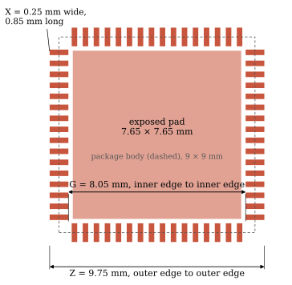

# From die to package: pads, bond wires, QFN, QFP and BGA

This page answers: *a chip is a small square of silicon whose connections are a fraction of a millimetre apart. How does it become something you can solder to a board, and how do you draw the copper it lands on?*

The chip a fab makes is a **die**: a thin piece of silicon with the circuit on top and its connections, the **bond pads**, in a ring around its edge. Nothing about a die suits a circuit board. Its pads are far too small and too close together to solder to, and the silicon is fragile. A **package** solves both problems: it holds the die, protects it, and carries each bond pad out to a lead or ball big enough for a board. This page follows a connection from the die to the board, then shows how the copper under a package, its **land pattern**, is worked out from the package's drawing, which is what you do in [Lab 02](../labs/lab-02-a-footprint-from-a-datasheet-overview.md).

## The pad ring

The pads around a die's edge make up its **pad ring** (or padframe), and every one of them is a decision the chip's designers made about what the board will see. wafer.space, which runs chip-on-board shuttles on GF180, publishes its padframe in its repository [`chip-on-board-wire-bonded-pcbs`](https://github.com/wafer-space/chip-on-board-wire-bonded-pcbs) (Apache 2.0, commit 5cb4668). It "follow[s] the Tiny Tapeout convention of 74 pads", and a table in `run-1/README.md` maps each bond pad on the die to a pad on their breakout board and to its Tiny Tapeout function. A few of its rows:

| Bond pad (die) | Breakout pad (board) | Tiny Tapeout function |
|---|---|---|
| 0 | 1 | `ctrl_ena` |
| 8 | 9 | GND IO |
| 9–16 | 10–17 | `uo[0–7]` |
| 17 | 18 | VDD IO |
| 19–24 | 20–25 | `analog[0–5]` |
| 73 | 74 | VDD IO |

A table like this is the hand-off between the chip and the board. The board designer never sees the die's layout, only this mapping, so a mistake in it carries straight onto the board. Notice that the numbering differs by one between the two sides (the die counts from 0 and the board from 1), which is exactly the kind of thing a review has to check.

## Bond wires

Each bond pad is joined to the package, or straight to a board, by a **bond wire**, a fine wire welded at both ends by a wire-bonding machine. Bonding is mechanical work with rules of its own. wafer.space lists theirs in `run-1/wirebonding/README.md`:

- "No wires may cross."
- "Wire angle must be not greater than 45°."
- "Maximum wire length must be less than 3 mm — though a wire that long would already add a significant amount of inductance, so keep them as short as practical."
- "Minimum wire length is 1 mm from the die, or 2× the die thickness (whichever is greater)."
- "No solder mask is allowed in the area to be bonded."

The same file explains how they match die pads to board pads: "Wirebonding is still a very manual process — there are no real exchange formats yet that tie the die layout to the breakout PCB", so they wrote a script that reads the die's GDS file and the breakout's KiCad file "and walks pin-for-pin around the padframe".

Packaging houses publish rules of the same kind for their packages. Europractice's [ASIC Package Design Rules](https://europractice-ic.com/wp-content/uploads/2020/06/ASIC_Prototype_Packaging_Design_Rules_2024.pdf) give limits on bond pad size and pitch, wire length and angle, crossing wires and die thickness for each package they offer. Every page of that document is marked "strictly confidential", even though it's posted publicly, so we link to it rather than repeat its numbers. One of its guidelines is worth knowing in general, though: draw the die together with the package's bond pins, split the die's edge into equal segments, and keep each bond pad in the same segment as the pin it goes to. The wire-angle and crossing rules then follow almost by themselves.

{fig-alt="Two sketches. Left: the corner of a die, a grey square, with eight small bond pads along its right edge. Eight gold bond wires fan out from the pads to eight copper leads on the right, which are spaced further apart, inside a dashed package outline. A note reads: wires may not cross, and none may run more than 45 degrees away from straight out. Right: a cross-section. A dark mould compound block sits on a green board. Inside it, the die sits on a copper die pad, the exposed pad, and gold bond wires arch from the top of the die to copper leads at both ends of the package. Under the leads and the die pad are copper lands on the board with solder between them, the solder under the die pad in separate windows, and thermal vias running down through the board under the die pad."}

*Not to scale. Left: a die's pad ring wired out to the leads of its package. Right: a QFN soldered to a board. Drawn by [`scripts/figures/qfn_package.py`](https://github.com/uoftasic/pb101/blob/main/scripts/figures/qfn_package.py).*

## Packages

The packages you'll meet on the team's boards differ in how their connections leave the body.

- A **QFN** (quad flat no-lead) has no legs. Its leads are flat pads flush with the bottom of the body around its edge, and the die sits on a metal **die pad** whose underside is exposed in the middle of the package's bottom: the **exposed pad**. Europractice's notes describe the same build, with a copper die attach pad and a lead frame, and say that by default the die is attached to the frame with a conductive die attach. The exposed pad is soldered to the board, which gives the die's heat a path into the board. On the SKY130 breakout it's also a ground connection: it's pin 65 of the chip's symbol, `ThermalPad`, and it's on the `GND` net. Every Tiny Tapeout chip on a SKY130 or IHP breakout is a QFN-64.
- A **QFP** (quad flat package) has gull-wing leads, bent out and down from the sides of the body. Because the leads stick out from the sides, every solder joint can be seen and reached.
- A **BGA** (ball grid array) puts its connections in a grid of solder balls under the whole body, which fits many connections under a small body. KiCad's footprint generator describes `BGA-624_21x21mm_Layout25x25_P0.8mm` (from NXP's SOT1529-1 drawing) with 0.8 mm pitch, 0.5 mm balls and 0.4 mm pads. Getting signals out from the inner balls needs vias between the pads or in them: JLCPCB's capabilities page says "Vias can be placed within BGA pads using filled and plated-over vias", and that 0.2 to 0.25 mm BGA pads require an ENIG finish. Laying out a BGA is beyond this course.
- **Chip-on-board** (COB) skips the package. The die is mounted on a small board and its bond wires land on pads on that board, which is why wafer.space forbids solder mask in the area to be bonded. Tiny Tapeout's FAQ says its GF180 shuttles work this way, with "the die bonded to a PCB directly (called chip-on-board, or COB)", so the chip "cannot be removed". Tiny Tapeout bonded its TT08 chips this way too; its [news post](https://tinytapeout.com/news/tt08-arrives/) says "The bare dies are now mounted and wire-bonded" and that the chip, with 135 designs, showed working silicon in its first tests. wafer.space's COB module is 14 × 16 mm and plugs into a motherboard through a 70-pin connector with 0.4 mm pitch (LCSC C19089236, mating part C19089262).

If the team ever packages a die of its own, there are local routes. The University of Toronto's Nanofabrication Centre lists a "TPT HB16 Wire Bonder" at $49 an hour for UofT users in its January 2026 [pricing chart](https://www.ece.utoronto.ca/wp-content/uploads/2026/01/TNFC-Pricing-Chart.pdf), with staff service at $60 an hour from 9 am to 5 pm and equipment training at $60 an hour. CMC Microsystems [packages dies](https://www.cmc.ca/package-assembly/) in DIP 40, CFP 24, CQFP 44, 80 and 120, and CPGA packages from 69 to 209 pins, and says its services "are also accessible to non-subscribers", by quotation.

## What the package adds to a signal

A package is part of every signal's path, and not a neutral one. Hall and Heck's *Advanced Signal Integrity for High-Speed Digital Designs* (section 3.5.7) notes that bond wires, vias, lead frames, sockets and connectors are inductive, and CMOS inputs capacitive, and (section 3.5.5) that a package adds a stretch of line of roughly 0.25 to 1.0 inch to the path. wafer.space's remark about inductance in a 3 mm bond wire is the same point. For an analog pin on a SKY130 Tiny Tapeout chip, the [analog spec](https://tinytapeout.com/specs/analog/) puts the whole path from pad to project, switch included, at under 500 Ω and under 5 pF. At the speeds in this course, these mostly matter as numbers to put in a calculation, such as how long an analog input takes to settle. On faster boards they set what's possible.

## Land patterns from a package drawing

A package's datasheet has a drawing of it with every dimension given as a minimum and a maximum, because no two packages come out exactly alike. The board's copper has to work for every package within those limits, and for a board maker and an assembly machine that are themselves a little off. The method KiCad's own footprints follow is IPC's: IPC-7351B, "Generic Requirements for Surface Mount Design and Land Pattern Standard", dated June 2010, and IPC-7352, "Generic Guideline for Land Pattern Design", dated May 2023, which supersedes the June 2010 IPC-7352. Both are sold by IPC, so we teach the method through KiCad's footprint generator, which implements it and publishes its numbers ([`kicad-footprint-generator`](https://gitlab.com/kicad/libraries/kicad-footprint-generator) at commit 090252c).

The method aims for a **solder fillet** of a chosen size at each edge of each lead: at its outer end (the **toe**), its inner end (the **heel**) and its sides. A pad is the lead's footprint plus those goals plus an allowance for tolerance. The generator's configuration, which transcribes the goals from IPC-7351B (with the comment "sadly no openly accessible document available"), gives three **density levels**, least, nominal and most, for each kind of lead. For a flat no-lead part, a QFN, they are:

| Goal | Least | Nominal | Most |
|---|---|---|---|
| Toe | 0.20 mm | 0.30 mm | 0.40 mm |
| Heel | 0 | 0 | 0 |
| Side | −0.04 mm | −0.04 mm | −0.04 mm |
| Courtyard | 0.10 mm | 0.25 mm | 0.50 mm |

and for gull-wing leads at a pitch above 0.625 mm, a QFP's or an SOIC's, the toe goals are 0.15, 0.35 and 0.55 mm, the heel 0.25, 0.35 and 0.45 mm, and the side 0.01, 0.03 and 0.05 mm. (At a pitch of 0.625 mm or less the side goals drop to −0.04, −0.02 and 0.01 mm, because there's less room between leads.) A negative side goal takes width off the pad, which leaves more room between pads at a fine pitch. In the example below, it makes the pads 0.25 mm wide for leads that can be up to 0.30 mm wide.

The generator then works out three numbers for each row of pads, in its own comments' notation:

$$Z_{max} = L_{min} + 2J_T + \sqrt{C_L^2 + F^2 + P^2}$$
$$G_{min} = S_{max} - 2J_H - \sqrt{C_S^2 + F^2 + P^2}$$
$$X_{max} = W_{min} + 2J_S + \sqrt{C_W^2 + F^2 + P^2}$$

$Z$ is the distance between the outer edges of two opposite pads and $G$ between their inner edges, and $X$ is a pad's width. $L$ is the span across the leads' outer ends, $S$ the span across their inner ends and $W$ a lead's width; $C$ is each one's tolerance (maximum minus minimum), and $J_T$, $J_H$ and $J_S$ are the toe, heel and side goals. $F$ and $P$ are the tolerances of the board's fabrication and of the part's placement, which the generator sets at 0.1 mm and 0.05 mm. The square roots add the tolerances as a root sum of squares, which assumes they're independent and rarely all at their worst at once. The results are rounded to 0.05 mm.

### A worked example: the breakout's QFN-64

The generator's entry for `QFN-64-1EP_9x9mm_P0.5mm_EP7.65x7.65mm`, the footprint on Tiny Tapeout's SKY130 breakout, takes its dimensions from page 415 of Atmel's ATmega2560 datasheet: a body of 8.9 to 9.1 mm, leads 0.35 to 0.45 mm long and 0.18 to 0.30 mm wide, and an exposed pad of 7.5 to 7.8 mm (7.65 mm nominal). A QFN's leads end at the body's edge, so $L$ is the body: 8.9 to 9.1 mm, $C_L = 0.2$ mm. The inner span is the body less two lead lengths, $S$ = 8.0 to 8.4 mm, and adding the tolerances of the body (0.2 mm) and the two leads (0.1 × √2 mm) as a root sum of squares gives $C_S$ = 0.245 mm, which the generator uses to bring $S_{max}$ in to 8.32 mm. With the nominal goals:

$$Z = 8.9 + 2(0.30) + \sqrt{0.2^2 + 0.1^2 + 0.05^2} = 9.73 \rightarrow 9.75\ \text{mm}$$
$$G = 8.32 - 0 - \sqrt{0.245^2 + 0.1^2 + 0.05^2} = 8.05\ \text{mm}$$
$$X = 0.18 + 2(-0.04) + \sqrt{0.12^2 + 0.1^2 + 0.05^2} = 0.26 \rightarrow 0.25\ \text{mm}$$

Each pad is then $(Z - G)/2$ = 0.85 mm long and 0.25 mm wide, centred $(Z + G)/4$ = 4.45 mm from the middle. That is exactly the footprint in KiCad 10.0.8's library: 64 pads of 0.85 × 0.25 mm, with pad 1 at x = −4.45 mm. The exposed pad uses its nominal size, 7.65 mm, which leaves (8.05 − 7.65)/2 = 0.20 mm between it and the inner ends of the pads, exactly the 0.2 mm minimum that KLC rule F6.3 and the generator ask for. (Had it come out smaller, the generator would have shortened the pads at the heel to restore it.)

{fig-alt="A footprint drawn to scale: sixteen narrow copper pads along each side of a 9 by 9 mm dashed package outline, and a large pale copper square in the middle labelled exposed pad, 7.65 by 7.65 mm. A dimension below the footprint reads Z = 9.75 mm, outer edge to outer edge. A dimension across the middle reads G = 8.05 mm, inner edge to inner edge. A leader to the top pad of the left column reads X = 0.25 mm wide, 0.85 mm long."}

*The land pattern worked out above, drawn by [`scripts/figures/qfn_land_pattern.py`](https://github.com/uoftasic/pb101/blob/main/scripts/figures/qfn_land_pattern.py), which also prints the working.*

The exposed pad needs more than copper. The generator's entry gives it 6 × 6 separate paste openings and, in a second version of the footprint with `_ThermalVias` at the end of its name, a 7 × 7 grid of 0.2 mm thermal vias to carry heat down into the board, as in the cut through the QFN above. Together with the courtyard and the silkscreen, that's everything [Symbols, footprints and libraries](symbols-footprints-and-libraries.md) showed in the finished footprint. In Lab 02 you do this calculation for a package that KiCad's library doesn't have, and then check your footprint against your own numbers.

## Check yourself

1. Work out $Z$ for the same QFN-64 at the "most" density level, where the toe goal is 0.40 mm. How much longer does each pad get?

   

   
Answer

   $Z = 8.9 + 2(0.40) + 0.229 = 9.93$ mm, which rounds to 9.95 mm, 0.2 mm more than at nominal. $G$ doesn't change (the heel goal is 0 at every level), so each pad gets (9.95 − 8.05)/2 = 0.95 mm long, 0.1 mm longer, and all of the extra length is at the toe.

   

2. Why might a padframe table number the die's pads from 0 and the board's pads from 1, and why does it matter to you?

   

   
Answer

   The table doesn't say why, and it doesn't need to: it shows both conventions side by side, and each column is right for its own side. It matters because the board designer works only from the table: reading the wrong column shifts every connection by one pad, and no check on the board alone can find that.

   

3. A signal leaves a QFN through a bond wire and goes into the input of another CMOS chip. Which of those two looks inductive to a fast edge, and which capacitive?

   

   
Answer

   The bond wire is inductive and the CMOS input is capacitive (Hall and Heck, section 3.5.7). Leads, vias, sockets and connectors are inductive too.

   

4. On a chip-on-board module, what takes the place of a QFN's leads, and what rule does that put on the board's solder mask?

   

   
Answer

   Bond pads on the module's own board: the wires go from the die straight to copper on the PCB. Because the wires are bonded to that copper, wafer.space's rule is that "No solder mask is allowed in the area to be bonded."

   

Next: [Lab 02: A footprint from a datasheet](../labs/lab-02-a-footprint-from-a-datasheet-overview.md).
