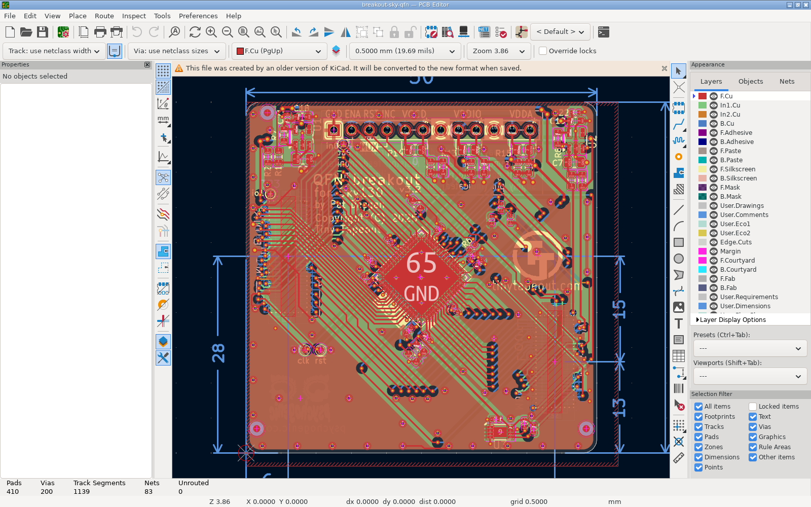

# Getting started

Everything you draw in PB101 you draw in **KiCad**, a free, open-source suite for schematics and printed circuit boards. It has a Schematic Editor, a PCB Editor, a Symbol Editor and a Footprint Editor, and a command-line program, `kicad-cli`, that runs the same checks and exports without opening a window. You'll use all five.

This course is set up differently from the others you have taken. The analog and digital courses run in the workbench, but PB101 doesn't: you install KiCad on your own computer and do all your drawing there, and the course's checks run `kicad-cli` in KiCad's own Docker image. This page explains why it's done that way, which version of KiCad to install and where to get it on Windows, macOS and Linux, and how the numbers you see in your own KiCad relate to the ones on the lab pages. You won't install anything while you read it. You'll do the installing in [Lab 01](../labs/lab-01-open-a-board-you-didnt-design-overview.md), Part 1.

The facts about KiCad's downloads on this page come from kicad.org, read on November 16, 2026, and each section links the page it comes from. KiCad updates those pages with every release, so if a version number there has moved on since, believe kicad.org.

## Requirements

- **A computer that runs KiCad 10.** KiCad's [system requirements](https://www.kicad.org/help/system-requirements/) ask for a 64-bit processor, 1 GB of RAM (">2G RAM recommended"), up to 10 GB of disk space, and a graphics card with OpenGL 2.1 or greater that supports hardware shaders. A screen of 1280 × 1024 works, but KiCad recommends 1920 × 1080 or more, because at lower resolutions some toolbar buttons are hidden and you have to reach those commands through the menus.
- **Docker**, which you set up in [IC101](https://uoftasic.com/ic101/). The checks pull the KiCad image the first time they run, which is a download of 812 MB and takes 2.6 GB on disk once it's unpacked.
- **git and a GitHub account**, from IC101 and IC102. From Lab 03 on you keep your board in a repository of your own on GitHub, and in Lab 05 GitHub Actions checks it on every push.

## KiCad and the workbench

The workbench image doesn't include KiCad. We checked `asic-edu/gui-rig:2026.08`, and it has no `kicad`, `pcbnew` or `kicad-cli`, and the student account in it can't install packages. KiCad's own Docker image doesn't help with drawing either. KiCad's [Docker page](https://www.kicad.org/download/docker/) says its images are "intended for usage of the kicad-cli binary" and that "Using the GUI environment via Docker is not supported."

So the course splits the work in two. You draw in a native KiCad, which is the supported way to run the editors, and the checks run `kicad-cli` in the official image, which is what that image is for. The checks don't need `kicad-cli` or `make` on your own machine, only Docker.

## Which version to install

Install KiCad 10.0, the newest 10.0 release you can get. On November 16, 2026, that was 10.0.8 on every platform's download page. KiCad 10.0.0 came out on March 20, 2026.

The major version matters because a KiCad file doesn't open in an older major version than the one that saved it. KiCad's [Linux packages page](https://www.kicad.org/download/linux-distros/) puts it this way: every year a new major release "comes out, bringing new features and bug fixes, but also usually bringing file format changes that prevent downgrading. In other words, once you update to 9.x and start modifying a project, you will no longer be able to open that project in any 8.x version." The same is true one step later. When we gave a board saved by KiCad 10 to `kicad-cli` 9.0.9, it printed `Failed to load board` and exited with status 3. Everything you make in this course is saved in the 10.0 format, so KiCad 9 can't open your work.

Going the other way works. KiCad 10 opens boards saved by KiCad 9, and Tiny Tapeout's SKY130 breakout, the first board you open in Lab 01, is one of those. KiCad tells you so in a bar across the top of the canvas:

*Tiny Tapeout's SKY130 QFN breakout, rev 3.2 (`TinyTapeout/breakout-pcb` at 91a2bf1, Apache-2.0), open in the PCB Editor of KiCad 10.0.8. The bar under the toolbars says "This file was created by an older version of KiCad. It will be converted to the new format when saved." The board itself is 50 × 50 mm with four copper layers, which is why the Appearance panel on the right lists In1.Cu and In2.Cu as well as F.Cu and B.Cu.*

The conversion happens only if you save. Once you have saved the board, it's a 10.0 file and KiCad 9 can't open it any more, which is harmless for a copy you fetched for a lab but worth knowing before you open someone else's project.

Within the 10.0 series, the patch releases (10.0.1, 10.0.2 and so on) share a file format. The three we checked in KiCad's source, 10.0.0, 10.0.5 and 10.0.8, all write boards as version 20260206 and schematics as version 20260306, so a 10.0 release opens files from any other, and KiCad encourages everyone to keep up with the latest bugfix release. Every count and message on the lab pages, though, comes from one particular build, `kicad/kicad:10.0.8`. We haven't compared outputs across patch releases, so in some other build a message or a count may not match the page, and that's why the checks always run in the pinned image, whatever you have installed.

## Installing on Windows

KiCad's [Windows page](https://www.kicad.org/download/windows/) says "KiCad supports Windows 10 and 11", and it offers two installers for each release:

- `kicad-10.0.8-x86_64.exe`, for the Intel and AMD processors that most Windows laptops have;
- `kicad-10.0.8-arm64.exe`, for a Windows computer with an ARM processor.

Each installer is code-signed, and Windows checks the signature when you run it. The page says a valid signature names KiCad Services Corporation as the signer, and links a guide to checking that yourself.

If you're still on Windows 10, read KiCad's [system requirements](https://www.kicad.org/help/system-requirements/) as well. Its table gives Windows 10 a support date of 14 October 2025, and KiCad's policy is that once an operating system's maker stops releasing updates for it, KiCad isn't tested on it any more, and a bug has to be reproduced on a supported system before the KiCad team will look at it. KiCad may well keep working on Windows 10, but Windows 11 is the supported choice.

## Installing on macOS

KiCad's [macOS page](https://www.kicad.org/download/macos/) has one download for all Macs, a disk image named `kicad-unified-universal-10.0.8.dmg`, and says "The current stable release of KiCad is supported on macOS 12 and newer."

The [system requirements](https://www.kicad.org/help/system-requirements/) page is stricter. It says KiCad supports the macOS versions that Apple currently supports, which it takes to be the three most recent major releases, and its table gives approximate end-of-support dates of 1 November 2025 for macOS 13, 1 November 2026 for macOS 14 and 1 November 2027 for macOS 15. The two pages don't agree. By the system requirements page's own dates, only macOS 15 was still supported on November 16, 2026, and its table lists no newer macOS at all, so it looks out of date. If your Mac runs a recent macOS, both pages cover you. On an older one, KiCad still offers you the download, but a bug you hit there may have to be reproduced on a supported version before the KiCad team looks at it.

## Installing on Linux

KiCad publishes its own Linux build on its [Linux page](https://www.kicad.org/download/linux/): "The current stable release of KiCad is available as an AppImage for Linux x86-64 systems." It comes in two versions, each packed in a `.tar` file:

- Full, `kicad-10.0.8-x86_64.AppImage.tar`, which includes the 3D packages (the 3D models of parts that the 3D viewer draws);
- Lite, `kicad-10.0.8-x86_64-lite.AppImage.tar`, without them.

You can also install KiCad through your distribution. The [Linux packages page](https://www.kicad.org/download/linux-distros/) lists what KiCad supports:

- Ubuntu: KiCad runs its own PPA for each release series, and for 10.0 it's `ppa:kicad/kicad-10.0-releases`. KiCad recommends it over Ubuntu's own package, because "the latter is usually outdated". The system requirements give Ubuntu 24.04 LTS support until April 2029, and list Ubuntu 22.04's support as ending in May 2025.
- Fedora: the `kicad` package in your Fedora release, or the newest stable build from KiCad's Copr repository, `@kicad/kicad-stable`.
- Flatpak: KiCad on Flathub, which the page calls "our recommended way to install the latest version of KiCad on any distribution other than Ubuntu and Fedora".
- Debian: a package in Trixie and in Trixie's backports. The page doesn't say which KiCad version each one is, so check that it's 10.0 before you install it.

Arch Linux, FreeBSD, Gentoo, openSUSE and Linux Mint are listed too, as platforms the KiCad team doesn't officially support.

Whichever way you install it, run KiCad in an X11 session if you can. The same page says "The KiCad team does not support running KiCad on Wayland due to the much higher incidence of related bugs and problems", and that bug reports about freezes, crashes, window size and position, focus and similar problems "will not be investigated unless they can be reproduced on an X11 system".

## Your KiCad and the course's checks

Every lab checks your work the same way. A script in [`labs/common/`](https://github.com/uoftasic/pb101/tree/main/labs/common) runs `kicad-cli` in `kicad/kicad:10.0.8`, named by its digest (`sha256:3f4a01786dfb…`, in full in `labs/common/kicad-image.txt`) so that it's the same build on every machine. It runs ERC on your schematic and DRC on your board, compares the board with the schematic, and prints the counts, followed by PASS or FAIL. Each lab shows you the command.

Your own KiCad can run the same ERC and DRC from its menus, and you'll do both in Lab 01. The errors it finds should be the same as the checker's. The warnings may not be, because many of KiCad's warnings compare the parts in your design with the libraries KiCad knows about, and which libraries those are depends on how KiCad was set up on that machine. Here is the same board, Tiny Tapeout's SKY130 breakout, checked in two setups:

| | ERC errors | ERC warnings | DRC errors | DRC warnings |
|---|---|---|---|---|
| The course's checker | 10 | 103 | 0 | 123 |
| The same image with no library tables at all, and without Tiny Tapeout's own library beside the board | 10 | 236 | 0 | 130 |

The error counts are the same in both setups and the warning counts aren't, so the labs give warning counts only for the checker's setup, and ask you about kinds of warning rather than numbers when you look at a board in your own KiCad. If your KiCad shows a different number of errors from the lab page, though, something is different, and it's worth finding out what.

## Course layout

The [course path](../index.md#course-path) on the home page lists every page in the order you should work through them. Each row is one of two kinds:

- A Read row points to guide pages like this one, which explain the ideas with figures and worked examples. You don't need KiCad open to read them.
- A Do row points to a lab, and the labs are where you run things.

Each lab is split into numbered parts with numbered steps. Most parts open with the question they answer, and end with a "You should see" check, which tells you whether what you did worked. In at least one part of every lab you make something yourself, such as a footprint, a schematic, a routed board or a bring-up plan, and the lab's final check runs on what you made, never on files the course ships.

Some steps ask you to write down what you expect before you run something, so that you have a prediction of your own to compare the result with. When a step asks a question, its answer is in a collapsed block right under it; try to answer it yourself before you open the block. (In the PDF version of a page, the answers are collected at the end of the page instead.) A part marked "(optional)" comes after all the required parts, no later part needs it, and the lab's time estimate leaves it out.

Every lab ends with a Finishing section that tells you how you'll know you're done, asks any questions you can answer from your own work, and says what to submit. The files each lab uses, including the Tiny Tapeout boards it opens, are in the course's [GitHub repo](https://github.com/uoftasic/pb101) under `labs/`. The Tiny Tapeout boards aren't stored in the repo. A script fetches them from Tiny Tapeout's own repositories at fixed commits, so you always get the same version of each board, and Lab 01 has you run it.

## Getting help

The course is self-paced, but you don't have to work through it alone.

- **Ask in the [team Discord](https://discord.gg/hrJnP5UsGz).** No question is too basic.
- **Quote the exact message, and say where you saw it**: a dialog in KiCad, the checker's output, or a report file. Paste the text rather than paraphrasing it, along with the command you ran, if there was one.
- **Say which KiCad you used.** For your own install, that's the version in KiCad's About dialog. For the checker, it's the `kicad` and `image` lines at the top of its output.
- **Post a screenshot.** A wiring or placement problem that's obvious in a picture can be very hard to describe in words.
- **If a page doesn't match what you see, tell us.** We ran every command in the labs before writing it down and copied every number from a real run, so a mismatch means something has changed, and we want to know.

## Check yourself

Answer these before you start Lab 01.

1. A friend on the team has KiCad 9.0 installed and wants to look at your Lab 03 board. What happens when they open it?

   

   
Answer

   It doesn't open. Your board is saved in KiCad 10.0's file format, and KiCad 9 can't read a newer format: `kicad-cli` 9.0.9 printed `Failed to load board` on a 10.0 board. Your friend needs KiCad 10.0, or you can send them the PDF and image exports you'll make in Lab 05.

   

2. You run DRC in your own KiCad on the board from a lab, and it reports a different number of warnings from the lab page, but the same number of errors. Is something wrong?

   

   
Answer

   Probably not. Many warnings compare the board's footprints with the libraries your KiCad has set up, so the count depends on your installation. The lab page's counts come from the checker's setup. The errors don't depend on the libraries, so a different error count would be worth looking into.

   

3. Why do the checks run in Docker when you draw in a KiCad installed on your own computer?

   

   
Answer

   KiCad's Docker image is made for `kicad-cli`, and KiCad doesn't support running its editors in Docker, so you draw natively. The checks use the image because it's pinned to one build by its digest, so they give the same counts on your laptop, on everyone else's and in CI.

   

4. You open Tiny Tapeout's SKY130 breakout and KiCad says the file was created by an older version. What changes if you save it?

   

   
Answer

   KiCad converts it to the 10.0 format when it saves, and from then on KiCad 9 can't open that copy.

   

Next: [What a board does for a chip](what-a-board-does-for-a-chip.md).
