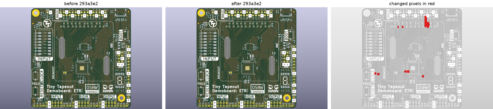

# KiCad files in git

This page answers: *which of the files in a KiCad project belong in your repository, and how does anyone review a change to a board when its diff runs to thousands of lines?*

KiCad's design files are plain text, so git can store them, show their history and merge them like source code, which is what lets a board live in a repository with CI at all. KiCad also writes files that aren't part of the design next to the ones that are, and a small change to a board can rewrite thousands of lines of its file. This page is about both. From Lab 03 on your board lives in your own repository, and in [Lab 05](../labs/lab-05-fab-outputs-in-ci-overview.md) you add the `.gitignore` this page describes.

## What's in a project folder

We copied Tiny Tapeout's DIP dock to a scratch folder, opened its board in KiCad 10.0.5's PCB Editor, saved it without changing anything, and closed the editor, listing the folder after each step. Opening the board created two lock files, `~dip-dock.kicad_pcb.lck` and `~dip-dock.kicad_pro.lck`, which tell another copy of KiCad that the files are in use. Saving created a folder named `.history`. Closing the editor removed the lock files. And every `kicad-cli` run on the project, even a check, had already written a `dip-dock.kicad_prl` next to it.

The table lists each kind of file and whether it belongs in git.

| File | What it is | In git? |
|---|---|---|
| `name.kicad_pro` | The project: design rules, net classes, ERC and DRC severities, and which checks the designer turned off. JSON. | Yes |
| `name.kicad_sch` | The schematic, one file per sheet. | Yes |
| `name.kicad_pcb` | The board. | Yes |
| `name.kicad_dru` | Custom design rules, if the board has any. | Yes |
| `fp-lib-table`, `sym-lib-table` | The project's own library tables, which say where its footprint and symbol libraries are. | Yes |
| your own `.kicad_sym` and `.pretty` libraries | Symbols and footprints you made for this board. | Yes |
| `name.kicad_prl` | Local settings: which layers are visible, and other choices about your own view of the board. | No |
| `~name.kicad_pcb.lck` and other `.lck` files | Lock files, present only while a file is open. | No |
| `.history/` | KiCad 10's local history, a folder of automatic snapshots. | No |
| `fp-info-cache` | A cache of what's in the footprint libraries, which KiCad can build again. | No |
| `*-backups/`, `_autosave-*` | Backup and autosave files. | No |
| Gerbers, drill files, BOMs, renders | [Outputs](fabrication-outputs.md), made from the files above. | No: CI makes them |

The rule behind the table is that a file belongs in git if you made it and it can't be made again from the others. Everything in the "No" rows is either about one person's session or can be regenerated.

The `.history` folder is new in KiCad 10, and it explains itself in a `README.txt`:

```text
This directory contains automatic snapshots of your project files.
KiCad periodically saves copies of your work here, allowing you to
recover from accidental changes or data loss.
```

It's a git repository of its own, with its own `.gitignore` (which lists `fp-info-cache` and `*-backups/`), and the README says it can be turned off in Preferences → Common → Project Backup. It's useful on your own machine, but your board's repository already keeps the board's history, so `.history/` stays out of it.

Outputs stay out because they go stale. Tiny Tapeout's `breakout-pcb` repository, for example, tracks `dip-dock/dip-dock.xml`, an export from the Schematic Editor that records the date it was made (2026-10-29) and the full path of the schematic on the designer's own computer. The moment the schematic changes, the export describes a board that no longer exists, unless someone remembers to make it again. When you do want to keep the files that went to the fab, keep them per order, the way Tiny Tapeout's separate `pcb-files` repository archives the production files of each run.

## A `.gitignore` for a board

Tiny Tapeout's demo board repository (`TinyTapeout/tt-demo-pcb` at bbf3dd1) has a `.gitignore` written for KiCad, and it's a good place to start:

```text
# For PCBs designed using KiCad: https://www.kicad.org/
# Format documentation: https://kicad.org/help/file-formats/

# Temporary files
*.000
*.bak
*.bck
*.kicad_pcb-bak
*.kicad_sch-bak
*-backups
*.kicad_prl
*.sch-bak
*.lck
*~
_autosave-*
*.tmp
*-save.pro
*-save.kicad_pcb
fp-info-cache

# Netlist files (exported from Eeschema)
*.net

# Autorouter files (exported from Pcbnew)
*.dsn
*.ses

# Exported BOM files
*.xml
*.csv
```

It covers the lock files (`*.lck`), the local settings (`*.kicad_prl`), the footprint cache and the backups. It predates KiCad 10, so it doesn't list `.history/`, and a board repository for this course needs that line too.

## Ignoring a file that git already tracks

The same demo board repository shows a common mistake with `.gitignore`. Line 19 of that file is `fp-info-cache`, and yet `fp-info-cache` is in the repository: at the pinned commit it's a 3,924,749-byte file that git tracks like any other. The history shows how. The file was committed on October 14, 2023 at 16:49 (commit 974c613, 93,108 lines), and the `.gitignore` that lists it arrived four minutes later, at 16:53 (commit 0e63c95). Counting that first one, 20 commits have changed the cache, adding 306,006 lines and removing 198,254, and none of those lines is part of the design.

git is doing what its documentation describes. It says it "specifies intentionally untracked files that Git should ignore. Files already tracked by Git are not affected." A pattern in `.gitignore` stops git from *adding* a file; it does nothing to a file git already has. To stop tracking one, the documentation says to "use `git rm --cached` to remove the file from the index", which leaves your copy on disk and records its removal in the next commit, after which the ignore rule takes effect.

The demo board's `.kicad_prl` was in the same first commit and was ignored by the same `.gitignore`. It stayed tracked through 31 commits, until it was removed in September 2025 (commit 3b4873f). So write the `.gitignore` before the first commit, and if `git status` ever lists a file you meant to ignore, check whether git is already tracking it.

## A save with no edits

When we saved the DIP dock in the course's pinned image without touching anything, git saw 111 lines added and 225 removed in `dip-dock.kicad_pcb`. Every changed line was inside the `render_cache` of three silkscreen labels, `ui_in`, `uio` and `uo_out`. The designer set those in the FreeMono font, KiCad stores the outline of each such label in the board file, and the image doesn't have FreeMono, so KiCad drew them again in the font it substituted and saved the new outlines. ([Outputs in CI](outputs-in-ci.md#fonts-and-3d-models) has the warning it printed.)

Your own machine can do the same with a font, and a KiCad 9 board saved in KiCad 10 is rewritten in the newer format, as [Getting started](getting-started.md#which-version-to-install) explains. None of this is harmful, but it puts lines in a commit that have nothing to do with what you meant to change. Read `git diff --stat` before you commit, and when a file shows up that you didn't mean to touch, find out why before it goes in.

## Reviewing a change to a board

A board file diff is text, but it isn't readable. Commit ecb636a of the demo board, "Reworked manual clocking circuit, Iref current source for analog, TVS diodes on analog lines", changed 60,318 lines of `tinytapeout-demo.kicad_pcb` and 12,558 of its schematic. Even a commit its author called "minor pcb cleanup" (293a3e2, the same day) changed 5,770 lines of the board, far more than a reviewer can read line by line.

A reviewer can compare pictures instead. Here is that "minor" commit as two `kicad-cli` renders, with the pixels that differ marked:



*Tiny Tapeout's demo board (`tt-demo-pcb`, Apache-2.0) before and after commit 293a3e2, rendered from the top, with the parts' 3D models, by `kicad-cli pcb render` in `kicad/kicad:10.0.5-full`. 934 of the 1,542,912 pixels in a render changed, about 0.1 %. The red marks are thickened so that they show at this size: a track near the analog header and a spot at its right-hand end, a few spots along the row of small parts below it and around the RP2350, two on the left edge and one on the right. Made by [`scripts/figures/review_diff.py`](https://github.com/uoftasic/ic103/blob/main/scripts/figures/review_diff.py).*

That's the reason Lab 05's workflow makes renders and layer plots on every push: the reviewer of a pull request compares the images from the two commits, and opens the board in KiCad only where a picture raises a question. A top render shows only the top, so a change on an inner or bottom layer needs the layer plots too.

Two habits make this work. First, keep a commit to one change, because a commit that moves a part and also re-annotates the schematic is as hard to review as a picture as it is as text. (On the demo board, "re-annotated entire schem", 9c07f7f, changed 2,102 lines of the board file by itself.) Second, write in the commit message what changed and why, since the message is the only part of the commit a reviewer reads without opening anything.

A browser viewer for KiCad files, KiCanvas, would let a reviewer look at the board without KiCad, but its last commit was on April 28, 2026, and we haven't confirmed that it reads KiCad 10 files. Until someone does, use the CI images and KiCad itself.

## Libraries in the repository

A board needs its libraries to be checked properly, so keep them where the board can find them on any machine. KiCad's project library tables (`fp-lib-table` and `sym-lib-table`) can name a path relative to the project with `${KIPRJMOD}`, which is the project's own folder, so a library inside the repository is found wherever the repository is cloned.

Tiny Tapeout does this with a git submodule. The SKY130 breakout's tables reach Tiny Tapeout's library through `${KIPRJMOD}/../tinytapeout-kicad-libs/`, a folder beside the board's own, and `breakout-pcb`'s `.gitmodules` makes that folder a submodule pointing at `psychogenic/tinytapeout-kicad-libs`. A plain `git clone` leaves a submodule's folder empty until you ask git to fetch it, which is one reason the course fetches its boards with a script ([Getting started](getting-started.md#course-layout)).

A board opens even when its libraries are missing, because the board and schematic files carry copies of every footprint and symbol they use. What changes is the warnings: DRC and ERC compare those copies with the libraries and report the ones they can't find or that differ. The SKY130 breakout's stitching vias use a footprint library named `flyingcarsfootprints`, which isn't in either of Tiny Tapeout's library repositories, and we couldn't find it published anywhere, so the warnings about it stay whatever you do. Your own board shouldn't need anything that isn't in your repository or in KiCad's standard libraries.

## Check yourself

1. After an evening's work, `git status` lists `board.kicad_prl`, `~board.kicad_pcb.lck` and a new `.history/` folder as untracked. Which of them do you commit?

   <details>
   <summary>Answer</summary>

   None. The `.kicad_prl` is your local view settings, the lock file exists only while the board is open, and `.history/` is KiCad's own snapshots. All three belong in `.gitignore`.

   </details>

2. You add `fp-info-cache` to your `.gitignore`, but `git status` still shows it as modified after every session. Why, and what fixes it?

   <details>
   <summary>Answer</summary>

   git is already tracking the file, and `.gitignore` doesn't affect tracked files. `git rm --cached fp-info-cache` removes it from the index without deleting your copy; after you commit that, the ignore rule applies. This is what happened to Tiny Tapeout's demo board, where the cache was committed four minutes before the `.gitignore` that lists it.

   </details>

3. You opened your board, changed nothing, saved it, and `git diff --stat` shows 300 changed lines in the `.kicad_pcb`. Name two things that could cause that.

   <details>
   <summary>Answer</summary>

   KiCad redrawing text in a font your machine doesn't have and saving the new outlines, as the DIP dock did in the course image, and KiCad converting a file saved by an older major version to its own format. Look at which lines changed before you commit them.

   </details>

4. A teammate's pull request changes 5,000 lines of the board file. How do you review it?

   <details>
   <summary>Answer</summary>

   Not by reading the diff. Compare the renders and layer plots that CI made for the two commits, open the board in KiCad where a picture raises a question, and read the commit messages for what was meant to change. If the pull request mixes several changes, ask for it to be split.

   </details>

Next: [Lab 05: Fab outputs in CI](../labs/lab-05-fab-outputs-in-ci-overview.md).
