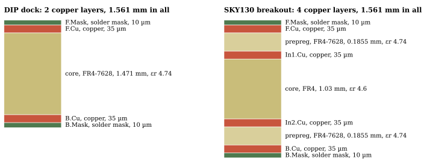
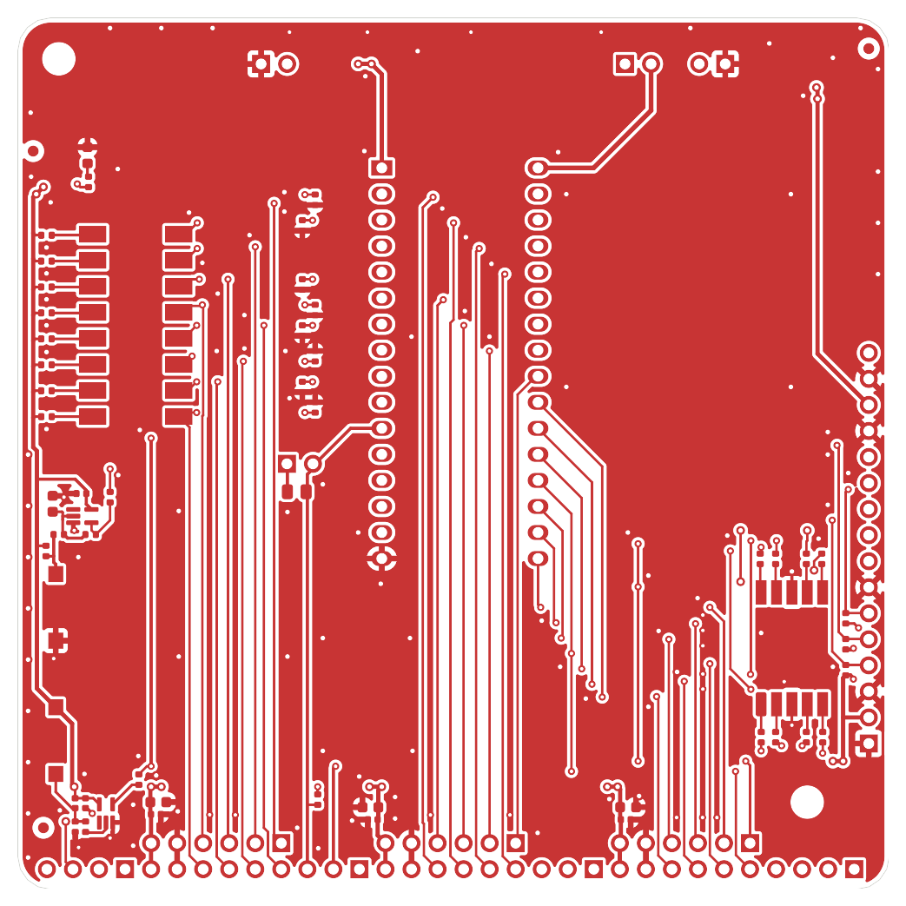
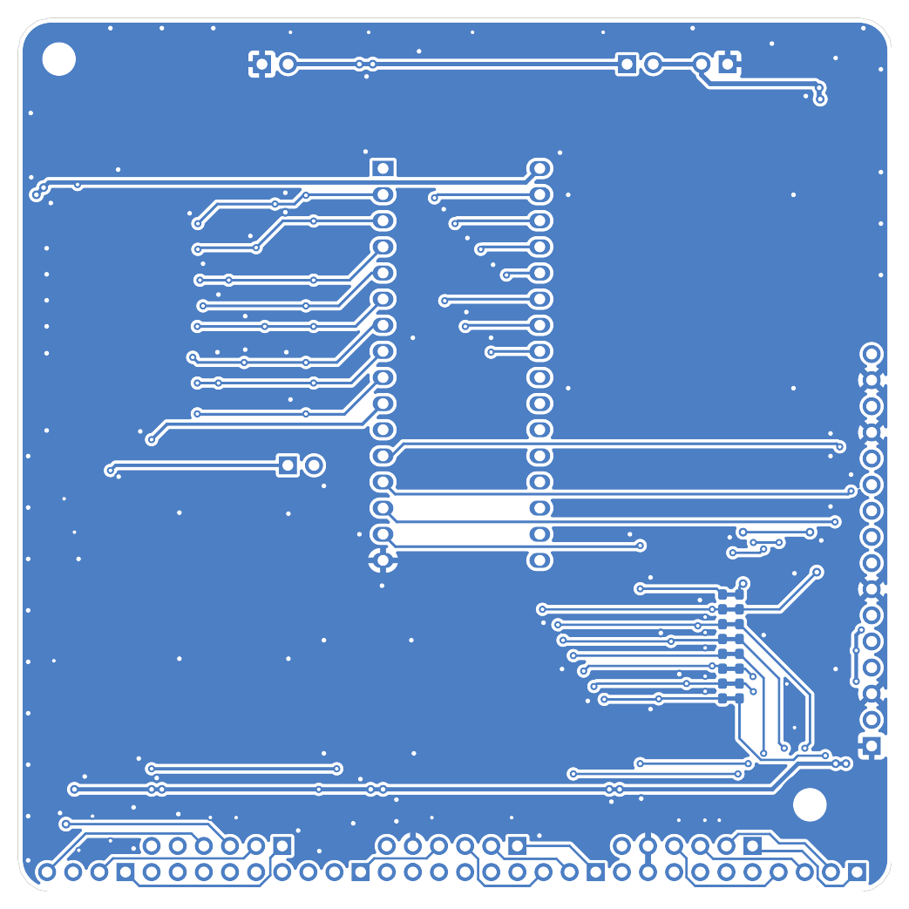
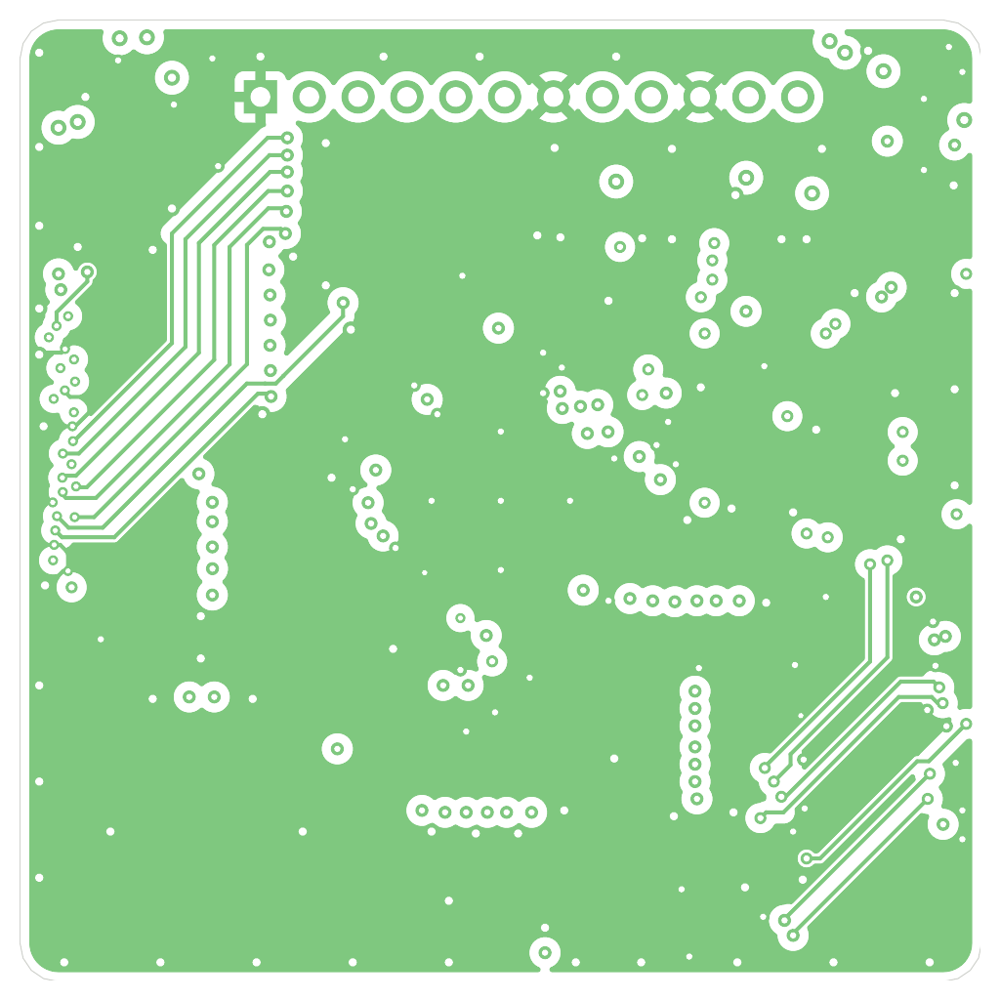

# Layers and fabricator rules

This page answers: *what is a circuit board made of, and how do I tell KiCad what my fabricator can actually make?*

A board design in KiCad is a description that a fabricator turns into fibreglass and copper. It has to describe something the fabricator can make, with no track narrower, no gap smaller and no hole smaller than the fabricator's machines allow, and it has to say what goes on each layer. This page starts with the layers of two of Tiny Tapeout's boards, as their board files record them. Next it sets what three fabricators say they can make beside the numbers that KiCad's own footprint libraries use. The last two sections show how you write a fabricator's limits into a board so that DRC checks them, and what DRC found when we did that to Tiny Tapeout's DIP dock. In [Lab 03](../labs/lab-03-a-pmod-for-one-projects-pins-overview.md) you draw a 2-layer board that already has JLCPCB's limits set in it.

The fabricators' numbers on this page come from their own pages, read on November 16, 2026. They change from time to time, so check the page of the fabricator you're ordering from before you rely on them.

## Stackups

A board is a stack of copper layers separated by sheets of dielectric, with solder mask over the outer copper and silkscreen printed over the mask. KiCad records this stack, which is called the **stackup**, in the board file. Here are the stackups of two of Tiny Tapeout's boards, drawn from their board files:

{fig-alt="Two stacks of coloured bands, not to scale. Left, DIP dock, 2 copper layers, 1.561 mm in all: F.Mask solder mask 10 micrometres, F.Cu copper 35 micrometres, core FR4-7628 1.471 mm with relative permittivity 4.74, B.Cu copper 35 micrometres, B.Mask solder mask 10 micrometres. Right, SKY130 breakout, 4 copper layers, 1.561 mm in all: F.Mask 10 micrometres, F.Cu 35 micrometres, prepreg FR4-7628 0.1855 mm with permittivity 4.74, In1.Cu 35 micrometres, core FR4 1.03 mm with permittivity 4.6, In2.Cu 35 micrometres, prepreg FR4-7628 0.1855 mm with permittivity 4.74, B.Cu 35 micrometres, B.Mask 10 micrometres."}

*The stackups of Tiny Tapeout's DIP dock and SKY130 breakout, from the `(stackup …)` section of each board file at `breakout-pcb` 91a2bf1. Copper and mask are drawn thicker than they are, so that you can see them. Drawn by [`scripts/figures/stackups.py`](https://github.com/uoftasic/pcb101/blob/main/scripts/figures/stackups.py).*

Both boards are 1.561 mm thick in all, which is the sum of the thicknesses of their layers. The copper on every layer is 35 µm thick, which PCBWay's capabilities page calls "1oz", because fabricators give copper thickness as a weight per square foot. The dielectric between the copper layers is FR4, a laminate of glass fibre and epoxy. A fabricator makes a board by pressing together two kinds of FR4 sheet, **core** and **prepreg**, and the board files list each dielectric layer as one or the other, with its relative permittivity, εr. A 2-layer board is one core with copper on both sides. The 4-layer breakout has a 1.03 mm core in the middle and a thin 0.1855 mm prepreg between each outer layer and the inner layer next to it, so each outer layer has an inner layer only 0.1855 mm away.

That closeness is the main reason to use a 4-layer board. At high frequencies, a signal's return current flows in the nearest conductor under its track. When a gap in that conductor makes the return current detour, the loop that the current flows around gets bigger. Hall and Heck (*Advanced Signal Integrity for High-Speed Digital Designs*, chapter 10) say that the most fundamental effect of such a detour is an increase in the series inductance of the path, by an amount that depends on how far the current has to go out of its way. A solid ground layer 0.19 mm under the top layer gives every top-layer signal a return path right below it.

## The copper layers in use

On the 2-layer DIP dock, tracks run on both copper layers (the board file has 353 track segments on F.Cu and 182 on B.Cu), and a zone on the `GND` net fills the space that's left on both:

::: {layout-ncol=2}
{fig-alt="The top copper layer of the DIP dock: almost the whole board is filled with red ground copper, cut through by many vertical tracks and by the round pads of through-hole parts."}

{fig-alt="The bottom copper layer of the DIP dock: mostly filled with ground copper, cut by tracks and by the round pads of through-hole parts."}
:::

*The two copper layers of the DIP dock, plotted by `kicad-cli` 10.0.5 with the board outline. Made by [`scripts/figures/kicad_figures.sh`](https://github.com/uoftasic/pcb101/blob/main/scripts/figures/kicad_figures.sh), as is the next plot.*

On the 4-layer SKY130 breakout, most of the tracks are on the outer layers (590 segments on F.Cu and 404 on B.Cu), and a few are on the inner ones (104 on In1.Cu and 41 on In2.Cu). A ground zone fills all four layers around the tracks. The first inner layer, In1.Cu, lies 0.19 mm under the top layer, which is where the chip is, and it's almost solid ground:

{fig-alt="The first inner copper layer of the SKY130 breakout: an almost unbroken green ground plane over the whole board, with holes around vias, the pads of the header along the top edge, and a few groups of tracks routed through it on the left and lower right."}

*In1.Cu of the SKY130 breakout: a ground plane, broken only by vias, the through-hole header along the top edge, and a few tracks.*

The fabricator works from more layers than the copper. As [Symbols, footprints and libraries](symbols-footprints-and-libraries.md) showed, the mask layers say where the solder mask is opened, the paste layers become the stencil, and the silkscreen layers are printed onto the board. `Edge.Cuts` holds the board's outline, which the fabricator routes out. The fab and courtyard layers aren't made into anything on the board. The fab layers are drawings for people, and DRC uses the courtyards to check that parts don't overlap.

## Fabricators' minimums

Each fabricator publishes its own minimums, and they differ. The table gives them for three fabricators that students often use, beside the numbers that the KiCad Library Convention (KLC) sets for KiCad's own footprints:

| | JLCPCB | PCBWay | OSH Park | KLC footprints |
|---|---|---|---|---|
| Track width and spacing | 0.10 / 0.10 mm on 1 and 2 layers, 0.09 / 0.09 mm on more (1 oz copper) | 0.1 mm / 0.1 mm | 2 layers: 6 mil (0.1524 mm) / 6 mil; 4 layers: 5 mil (0.127 mm) / 5 mil | |
| Smallest drill | 0.15 mm (0.1 mm only for boards ≤ 1 mm thick with an ENIG or OSP finish, "more costly") | 0.15 mm | 10 mil (0.254 mm) | |
| Plated through-hole annular ring | 2 layers: "Recommended 0.25 mm or above; absolute minimum 0.18 mm"; more layers: 0.20 mm recommended, 0.15 mm minimum | 0.15 mm | 2 layers: 5 mil (0.127 mm); 4 layers: 4 mil (0.1016 mm) | at least 0.15 mm (F7.5) |
| Via | 0.15 mm hole in a 0.25 mm pad at least | | | |
| Silkscreen line | "≥0.15mm" | character width 0.15 mm | | 0.10 to 0.15 mm, nominally 0.12 mm (F5.1) |
| Silkscreen text height | 1.0 mm | 0.8 mm | | reference text 1.00 mm (F5.1) |
| Pad to silkscreen | 0.15 mm | | | 0.2 mm recommended (F5.1) |

Sources: JLCPCB's [capabilities page](https://jlcpcb.com/capabilities/pcb-capabilities), PCBWay's [capabilities page](https://www.pcbway.com/capabilities.html), OSH Park's [services page](https://docs.oshpark.com/services/), and KLC's source at commit 6e8cbad. An empty cell means that page doesn't give the number, not that there's no limit.

In two of the rows, KLC is looser than a fabricator. KLC's footprints draw silkscreen at 0.12 mm, under JLCPCB's 0.15 mm minimum line width and PCBWay's 0.15 mm minimum character width, and JLCPCB's page adds that "Characters width less than 0.15mm will be unidentifiable". KLC's minimum annular ring of 0.15 mm is also under JLCPCB's 2-layer absolute minimum of 0.18 mm. So a board made from KiCad's own footprints can still break a fabricator's rules. To find out where, you give DRC the fabricator's rules and let it check the board against them, as the next two sections show.

## Telling KiCad the rules

KiCad keeps a board's rules in two places. **Board Setup** has a Constraints section with the board-wide minimums: clearance, track width, via size and annular ring, hole sizes and clearances, copper-to-edge clearance, and silkscreen text height and thickness. They're saved in the project's `.kicad_pro` file, together with the **net classes**, which set the clearance, track width and via size for groups of nets. For example, the DIP dock's constraints ask for clearances of at least 0.16 mm, tracks at least 0.16 mm wide, vias at least 0.5 mm across with an annular ring of at least 0.125 mm, holes at least 0.25 mm across, 0.5 mm between copper and the board edge, and silkscreen text at least 0.8 mm high and 0.08 mm thick. Its Default net class asks for 0.2 mm clearance and 0.22 mm tracks, and a Power class for 0.25 mm of each.

**Custom rules** go in a `.kicad_dru` file beside the project, written in KiCad's rules language. Each rule has a name, an optional condition that picks the objects it applies to, and one or more constraints. Here is one of the SKY130 breakout's own rules. It's meant to let tracks and gaps shrink to 0.16 mm where they have to squeeze between the pins of a fine-pitch QFN, while the rest of the board keeps the wider values of its net classes:

```
(rule "neckdown QFN48"
   (constraint track_width (min 0.16mm) (opt 0.2mm) (max 0.25mm))
   (constraint clearance (min 0.16mm) (opt 0.16mm) (max 0.2mm))
   (condition "A.intersectsCourtyard('Package_DFN_QFN:QFN-48*') && A.Type != 'Zone'")
)
```

Its condition limits it to objects, other than zones, that overlap the courtyard of a footprint whose name starts with `QFN-48`. The breakout's chip is a QFN-64, so on this board the rule matches nothing. Rules files get copied from board to board. The DIP dock's `.kicad_dru` is byte for byte the same as the demo board's, and it has rules for a QFN-80 and a USB-C connector, neither of which is on the dock. A rule that matches nothing is harmless, but it isn't checking what its name says, so read the rules you inherit before you rely on them.

KiCad 10 added a graphical editor for these rules. The announcement of KiCad 10.0.0 describes it as "a new rule editor dialog that enables users to create custom design rules in a graphical workflow". The KiCad 10 manual says that you open it from **Tools → Design Rule Editor**, and that it stores its rules in the same `.kicad_dru` file as rules written by hand, so you can write rules either way.

## The DIP dock against JLCPCB's rules

To see what a fabricator's numbers do to a real board, we added JLCPCB's 2-layer minimums to a copy of the DIP dock's `.kicad_dru` and ran DRC on it in the course's pinned image. These are the rules we added, after the dock's own:

```
(rule "JLCPCB track width"
   (constraint track_width (min 0.10mm)))
(rule "JLCPCB clearance"
   (constraint clearance (min 0.10mm)))
(rule "JLCPCB copper to board edge"
   (constraint edge_clearance (min 0.2mm)))
(rule "JLCPCB PTH annular ring"
   (condition "A.Type == 'Pad' && A.Pad_Type == 'Through-hole'")
   (constraint annular_width (min 0.18mm)))
(rule "JLCPCB silkscreen text"
   (condition "A.Layer == 'F.Silkscreen' || A.Layer == 'B.Silkscreen'")
   (constraint text_height (min 1.0mm))
   (constraint text_thickness (min 0.15mm)))
(rule "JLCPCB silkscreen lines"
   (condition "A.Type == 'Graphic' && (A.Layer == 'F.Silkscreen' || A.Layer == 'B.Silkscreen')")
   (constraint assertion "A.Line_Width >= 0.15mm"))
```

KiCad's rules language has constraints for track width, clearance, edge clearance, annular width and silkscreen text, but none for the width of a silkscreen line, so the last rule uses an **assertion** instead. An assertion is a constraint that, in the manual's words, "Checks that the boolean expression is true". Here the expression tests the line width of each silkscreen shape.

Without the added rules, DRC finds no errors on the dock apart from six courtyard overlaps that its designer marked as excluded. With them, it reports:

- No track, clearance or edge-clearance violations. The dock's own minimums (0.16 mm tracks and gaps, 0.5 mm from the edge) are all well inside JLCPCB's.
- 4 `annular_width` errors, each "Annular width (rule 'JLCPCB PTH annular ring' min annular width 0.1800 mm; actual 0.1600 mm)", on four stitching vias that the board draws as footprints (`StitchingVia-0.3mm`, a 0.62 mm pad with a 0.3 mm hole). They work as vias, and JLCPCB's via rule (a 0.15 mm hole in a 0.25 mm pad) would pass them, but the board file records them as through-hole pads, and DRC can only check them as what the file says they are.
- 101 `text_thickness` warnings, 98 of them for text 0.14 mm thick and the other 3 for "TrueType font characters with insufficient stroke weight". There are also 38 `text_height` warnings, for text 0.8 mm (29) or 0.9 mm (9) high, which is within PCBWay's 0.8 mm minimum but under JLCPCB's 1.0 mm.
- 199 `assertion_failure` errors for silkscreen shapes thinner than 0.15 mm. DRC lists no more than 199 violations of one kind, and the board has more of these than that. When we ran the same assertion on smaller groups of footprints, each with fewer than 199 such shapes, every group reported all of its shapes, and together they came to 486. One of them is drawn on the board itself, 0.1 mm wide. 284 are in footprints from Tiny Tapeout's library: 168 in the three Pmod sockets, 64 in the eight solder jumpers, 30 in the DIP switch and 22 in the 7-segment display. 167 are in footprints from KiCad's own libraries: 74 in resistors, 42 in pin headers, 20 in capacitors, 12 in pin sockets, 8 in SOT packages, 8 in the DIP socket and 3 in an LED. Every one of those footprint shapes is 0.12 mm wide, KLC's nominal width. The last 34 are the filled shapes of two logos, each of which is on both sides of the board. They have an outline 0.01 mm wide or none at all, and the assertion counts them too.

None of this means that the DIP dock can't be made. JLCPCB's page warns that characters thinner than 0.15 mm will be "unidentifiable", but it doesn't say that it will refuse a board that has them, and the dock was designed with Tiny Tapeout's own rules. With a fabricator's rules in the file, DRC lists the places where the board falls short of that fabricator's numbers, up to 199 of each kind, and you can fix each one or accept it with a reason. Without those rules, you'd be finding them by eye.

## Check yourself

1. A through-hole pad is 1.4 mm across with a 1.0 mm hole. What's its annular ring, and is it within JLCPCB's 2-layer numbers?

   <details>
   <summary>Answer</summary>

   (1.4 − 1.0) / 2 = 0.2 mm. That's above JLCPCB's 2-layer absolute minimum of 0.18 mm but below its recommended 0.25 mm, so it can be made, but JLCPCB would rather you made the pad 1.5 mm or more.

   </details>

2. Your Lab 03 board uses KiCad's 0805 hand-soldering resistor footprints, whose silkscreen lines are 0.12 mm wide, and you plan to order from JLCPCB. Will DRC warn you that those lines are too thin?

   <details>
   <summary>Answer</summary>

   Only if your rules ask it to. KiCad has no built-in check of silkscreen line width, so DRC says nothing about it unless your `.kicad_dru` includes an assertion like the one on this page. The Lab 03 template's `pmod.kicad_dru` has only the annular-ring rule, so as shipped it won't warn you. If you add the assertion and it does warn you, you can thicken the lines in a copy of the footprint, or accept that JLCPCB may print them poorly.

   </details>

3. On the SKY130 breakout, why does it help that In1.Cu is almost solid ground and sits 0.19 mm below F.Cu, rather than at the middle of the board?

   <details>
   <summary>Answer</summary>

   At high frequencies, a signal's return current flows in the nearest conductor under its track. With a ground plane 0.19 mm below the top layer, every top-layer track has its return path right underneath it, and the loop that the current makes is small. If the plane were at the middle of the board, about 0.7 mm below F.Cu, or if it were broken by gaps, the return current would spread out or detour, which adds inductance to the path.

   </details>

4. You inherit a `.kicad_dru` with a rule whose condition is `A.intersectsCourtyard('Package_DFN_QFN:QFN-48*')`, and your board has no QFN-48. What does the rule do?

   <details>
   <summary>Answer</summary>

   Nothing. No object on your board matches its condition, so its constraints are never applied. The rule is harmless, but it isn't checking what its name suggests, so read the conditions of the rules you inherit.

   </details>

Next: [Placement and routing](placement-and-routing.md).
