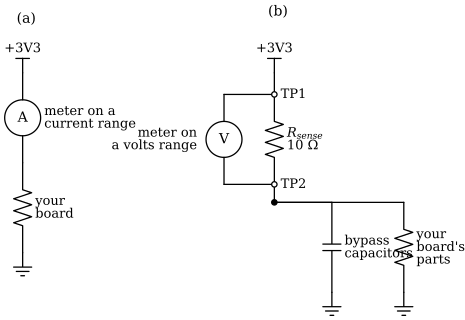

# Measuring current

<!--
  Sources for this page (row 7 of the course path):
  - Horowitz and Hill, The Art of Electronics, 3rd ed. (printed pages): 10 (a current
    range puts a small resistor across the meter, 0.1 V to 0.25 V at full scale, "voltage
    burden"), 754 (Fig. 10.93, a 10 ohm "current spy" in VDD), 760 (1 ohm per chip, 0.1 ohm
    for power drivers, with downstream bypassing), 802 (Fig. 12.13, 10k pull-down),
    1161 (the scope's ground is mains earth).
  - Tiny Tapeout ETR demo board guide, read Nov 16, 2026: "around 180-200 milliAmps, on the
    5V supply". Analog spec, read Nov 16, 2026: about 20 mA gives 0.1 V of drop in the chip's
    power network.
  - SKY130 breakout (breakout-pcb 91a2bf1): connector nets, R13/R14/R15 (0805, 0 ohm), J2
    (1 x 12 header, DNP), schematic note "popping off the relevant resistor (0805s for
    easier manip)".
  - Diodes Inc., AP2112 datasheet DS39724 Rev. 2-2: 55 uA typical quiescent current.
-->

This page answers: *how do you measure the current a board draws, and how much does the measurement change what you're measuring?*

Current is the first thing you read when you power a new board. A board that draws far more than you expected may have a short, a latched-up chip or a damaged part, and one that draws nothing may not be powered at all. [Bringing up a chip](bringing-up-a-chip.md) puts these readings into a bring-up plan, with the value you expect at each step. In [Lab 04](../labs/lab-04-protect-and-plan-overview.md) you'll add a current-sense point to your Pmod and write down what it should read.

## A meter in series, or a sense resistor

There are two ordinary ways to measure a current on the bench. Both put a resistor in the current's path and read the voltage across it. On a multimeter's current range the resistor is inside the meter, and the other way is to build one into your board as a sense resistor.

*(a) A multimeter on a current range, in series with the supply. (b) A sense resistor in the supply, with a test point at each end and a multimeter on a volts range across them. In (b) the bypass capacitors are on the board's side of the resistor, as in Horowitz and Hill's Figure 10.93.*

**A meter in series.** Selecting a current range on a multimeter "puts a small resistor across the meter's input terminals", Horowitz and Hill write (*The Art of Electronics*, 3rd ed., p. 10). The resistor is typically chosen to drop 0.1 V to 0.25 V at the range's full-scale current, and the meter displays that voltage as a current. They note that the drop is sometimes called the "voltage burden". Because the meter sits in series with your board, the drop comes off the supply voltage the board sees. A meter in series is convenient because nothing on the board has to be built for it, but the board does need a place where you can break the supply and put the meter in.

**A sense resistor on the board.** You build the resistor into the board's supply, put a test point at each end, and read the voltage across it with a meter on a volts range. Horowitz and Hill recommend one on CMOS boards (p. 754). A CMOS chip damaged by static can start drawing excess quiescent current, and "a 10 Ω resistor in series with VDD on each board" makes it easy to see when that happens. The caption of their Figure 10.93 calls the resistor a "current spy". Elsewhere they suggest 1 Ω in series with each chip's supply lead "(with downstream bypassing)" to find a faulty chip, and 0.1 Ω "for power drivers or chips driving many outputs" (p. 760). The bypass capacitors go on the board's side of the resistor, so that the fast pulses of current at each logic edge come from the capacitors and the resistor carries mostly the average current, which is the one you want to read.

## Choosing the resistor

The voltage across the resistor is $V = IR$. You want it large enough for your meter to read, and small enough that the board is still left with the supply voltage it needs.

*$V = IR$ for 0.1 Ω, 1 Ω and 10 Ω, drawn by [`scripts/figures/shunt_drop.py`](https://github.com/uoftasic/pcb101/blob/main/scripts/figures/shunt_drop.py). The blue band is the 0.1 V to 0.25 V that a multimeter drops at full scale, and the grey band is the 180 mA to 200 mA that the whole kit draws from USB on its factory test.*

The figure gives these numbers for three cases:

- A Pmod that draws 1 mA through a 10 Ω spy drops 10 mV across it. A multimeter reads 10 mV easily, and 10 mV is too small a part of the board's 3.3 V to matter.
- If the whole kit's draw, about 200 mA, went through the same 10 Ω, the resistor would drop 2 V, and a 3.3 V rail would be left with 1.3 V. At that current you'd use 1 Ω (0.2 V) or 0.1 Ω (20 mV), the values Horowitz and Hill suggest for single chips and for heavy drivers.
- A board that idles at 10 µA and runs at 10 mA covers three decades of current. A resistor that drops 10 mV at 10 mA drops only 10 µV at 10 µA, and you'd need a meter that resolves microvolts to read that. So either measure the two cases with different resistors, as a meter does when you change its range, or choose the resistor for one case and accept that it won't give a useful reading of the other.

## What you can measure on a Tiny Tapeout kit

**The whole kit.** Tiny Tapeout's ETR demo board guide says that with the factory test project running, "you should see a draw of around 180-200 milliAmps, on the 5V supply and not much more". That's the current into the USB connector, for the demo board and the breakout together, and it's the only reading you can take without a board of your own or rework on the breakout. You can read it with a USB power meter, or with any other current meter in series with the USB cable. If it reads well above that range, switch off.

**The breakout's total.** The breakout takes all of its power through its two connectors. They carry +3V3 and +5V, but on the fitted breakout +5V goes nowhere, because R1 and R3 aren't fitted, and those are the links that would take it to the regulators. +3V3 feeds `VDD_IO` and `VDDA` through 0 Ω links, and `VCCD` through the regulator U1. So a motherboard, a board of your own in the demo board's place, can measure the breakout's total current on +3V3. That total includes U1's own quiescent current, which the AP2112 datasheet gives as 55 µA typical.

**One of the chip's rails.** You can measure a single rail only after rework on the breakout. Its schematic says each supply pin "may be monitored or fed through these headers by popping off the relevant resistor (0805s for easier manip)". The resistors are the 0 Ω links R13 (`VDD_IO`), R14 (`VCCD`) and R15 (`VDDA`), and the header is J2, a 1 × 12 header that the board marks as not fitted. To measure `VCCD`, for example, you'd remove R14, fit J2, and connect a meter or a sense resistor between the J2 pins on the regulator's side and on the chip's side.

*A 12.5 mm strip along the top edge of Tiny Tapeout's SKY130 breakout, drawn to scale from the board file by [`scripts/figures/sky_breakout_map.py`](https://github.com/uoftasic/pcb101/blob/main/scripts/figures/sky_breakout_map.py), with pads coloured by supply. R14, R13 and R15 each join a regulator net (red) to one of the chip's rails. J2's twelve pads, and U2's, are grey because those parts aren't fitted.*

That rework is on the board that carries the kit's only chip, which is why the course doesn't ask you to do it. The current a project draws lowers the supply voltage that reaches it inside the chip. Tiny Tapeout's [analog page](https://tinytapeout.com/specs/analog/) says that "A draw of around 20mA from the power supply will result in a 0.1V drop through the PDN", where the PDN is the chip's internal power network. If the team needs per-rail readings, practise the rework first on a breakout made from Tiny Tapeout's open files, with its passives and no chip.

**Your Pmod.** The current-sense point you'll add in Lab 04 sits in your Pmod's own supply, the +3V3 it takes from pins 6 and 12 of the sockets. It measures the current drawn by the parts on the far side of its resistor. The buffer on the UART lines isn't one of them, because it takes its 3.3 V from the sockets' side of the resistor. The chip's rails don't reach the Pmod, so it can't tell you what the chip draws. You can still work out what the sense point should read, and a reading far from that number means there's a mistake on your board. In Lab 03 you gave each of the eight baud-rate switches a 10 kΩ pull-down, which is also the value in Horowitz and Hill's switch circuit (p. 802). Every switch that's on draws 3.3 V / 10 kΩ = 0.33 mA through its pull-down, so all eight together draw 2.64 mA.

## Reading the voltage

To read a sense resistor, put a multimeter on its millivolt range, with its leads on the two test points. A bench oscilloscope can show how the current changes over time, but its probe's ground clip is connected to mains earth, so clipping it to either end of a resistor in the supply shorts that point to ground. [Bringing up a chip](bringing-up-a-chip.md) covers probing safely.

## Check yourself

1. You put a 10 Ω current spy in the +3V3 that feeds the whole kit, which draws about 200 mA. What happens?

   

   
Answer

   The resistor drops 200 mA × 10 Ω = 2 V, which leaves about 1.3 V for the kit. A 10 Ω spy is for a board that draws a few milliamps. For the whole kit you'd use 0.1 Ω or 1 Ω, or measure at the USB input.

   

2. Your multimeter's 200 mA range drops 0.25 V at full scale. About how much does it drop while it measures your Pmod's 2.6 mA?

   

   
Answer

   The drop is proportional to the current through the meter's internal resistor, so it's 0.25 V × 2.6 / 200 ≈ 3.3 mV, far too little to affect the Pmod.

   

3. Can you measure the chip's `VCCD` current on a kit as it comes, without rework?

   

   
Answer

   No. `VCCD` doesn't reach the two connectors that join the breakout to the demo board. The most you can measure without rework is the whole kit at USB, or the breakout's total on +3V3 from a board of your own. Measuring `VCCD` alone means removing R14 and fitting J2.

   

4. Why do the bypass capacitors go on the board's side of a sense resistor rather than on the supply's side?

   

   
Answer

   So that the fast current pulses at each logic edge come from the capacitors, and the resistor carries mostly the average current you want to read. With the capacitors on the supply's side, the resistor would sit between the board and the nearest stored charge, and every pulse would have to come through it.

   

Next: [Bringing up a chip](bringing-up-a-chip.md).
