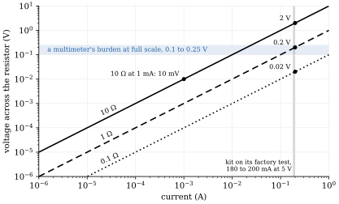
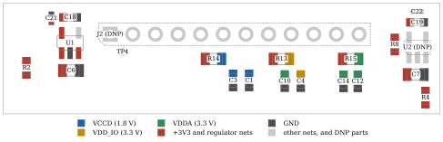

# Measuring current

<!--
  Sources for this page (row 7 of the course path):
  - Horowitz and Hill, The Art of Electronics, 3rd ed. (printed pages): 10 (a current
    range puts a small resistor across the meter, 0.1 V to 0.25 V at full scale, "voltage
    burden"), 754 (Fig. 10.93, a 10 ohm "current spy" in VDD), 760 (1 ohm per chip, 0.1 ohm
    for power drivers, with downstream bypassing), 802 (Fig. 12.13, 10k pull-down),
    1161 (the scope's ground is mains earth).
  - Tiny Tapeout ETR demo board guide, read Nov 16, 2026: "around 180-200 milliAmps, on the
    5V supply". Analog spec, read Nov 16, 2026: about 20 mA gives 0.1 V of drop in the chip's
    power network.
  - SKY130 breakout (breakout-pcb 91a2bf1): connector nets, R13/R14/R15 (0805, 0 ohm), J2
    (1 x 12 header, DNP), schematic note "popping off the relevant resistor (0805s for
    easier manip)".
  - Diodes Inc., AP2112 datasheet DS39724 Rev. 2-2: 55 uA typical quiescent current.
-->

This page answers: *how do you measure the current a board draws, and how much does the measurement change what you're measuring?*

Current is the first thing you read when a new board is powered. A board that draws far more than you expected may have a short, a latched-up chip or a damaged part, and one that draws nothing may not be powered at all. [Bringing up a chip](bringing-up-a-chip.md) builds the bring-up plan around such readings; this page is about taking them. In [Lab 04](../labs/lab-04-protect-and-plan-overview.md) you'll add a current-sense point to your Pmod and write down what it should read.

## A meter in series, or a sense resistor

There are two ordinary ways to measure a current on a bench, and both put a resistor in its path and read the voltage across it.

*(a) A multimeter on a current range, in series with the supply. (b) A sense resistor in the supply, with a test point at each end and a multimeter on a volts range across them. In (b) the bypass capacitors are on the board's side of the resistor, as in Horowitz and Hill's Figure 10.93.*

**A meter in series.** Horowitz and Hill explain what's inside the meter (*The Art of Electronics*, 3rd ed., p. 10). Selecting a current range "puts a small resistor across the meter's input terminals", chosen so that it drops 0.1 V to 0.25 V at the range's full-scale current, and the meter displays that voltage as a current. That drop, which they note is sometimes called the "voltage burden", subtracts from the supply your board sees. It's convenient, because nothing on the board has to be built for it, but the board has to have a place where you can break the supply and put the meter in.

**A sense resistor on the board.** You build the resistor in, put a test point at each end, and read the voltage across it with a meter on a volts range. Horowitz and Hill recommend this for CMOS boards: "a 10 Ω resistor in series with VDD on each board" makes it easy to see when a chip damaged by static starts drawing excess current, and they call it a "current spy" (p. 754). Elsewhere they suggest 1 Ω in each chip's supply lead "(with downstream bypassing)", and 0.1 Ω "for power drivers or chips driving many outputs" (p. 760). Keeping the bypass capacitors on the board's side matters, because then the fast pulses of current at each logic edge come from the capacitors and the resistor carries mostly the average, which is what you want to read.

## Choosing the resistor

The voltage across the resistor is $V = IR$, and it has to do two jobs at once: it has to be large enough for your meter to read, and small enough that the board still has the supply it needs.

*$V = IR$ for three resistors, drawn by [`scripts/figures/shunt_drop.py`](https://github.com/uoftasic/pb101/blob/main/scripts/figures/shunt_drop.py). The blue band is a multimeter's burden at full scale, and the grey band is the current the whole kit draws from USB on its factory test.*

Some numbers from the figure:

- A Pmod that draws 1 mA through a 10 Ω spy drops 10 mV, which a multimeter reads easily and the board's 3.3 V doesn't notice.
- The kit's whole draw, about 200 mA, through the same 10 Ω would drop 2 V, and a 3.3 V rail would be left with 1.3 V. At that current you'd use 1 Ω (0.2 V) or 0.1 Ω (20 mV), the values Horowitz and Hill suggest for single chips and for heavy drivers.
- A board that idles at 10 µA and runs at 10 mA covers three decades. A resistor that drops 10 mV at the top drops 10 µV at the bottom, and you'd need a meter that resolves microvolts to read it. Either measure the two cases on different ranges, or accept that one resistor serves one range.

## What you can measure on a Tiny Tapeout kit

**The whole kit.** Tiny Tapeout's ETR demo board guide says that with the factory test project running, "you should see a draw of around 180-200 milliAmps, on the 5V supply and not much more". That's the current into the USB connector, for the demo board and the breakout together, and it's the one reading any kit offers without modification. Anything in series with the USB cable that reads current will measure it, and a reading well above that range is a reason to switch off.

**The breakout's total.** The breakout takes all of its power through its two connectors, on +3V3 and +5V. A board of your own in place of the demo board, a motherboard, can measure the current on +3V3, which on the fitted breakout feeds `VDD_IO` and `VDDA` directly and `VCCD` through the regulator U1. That total includes U1's own quiescent current, which the AP2112 datasheet gives as 55 µA typical.

**One of the chip's rails.** The breakout lets you do this only after rework. Its schematic says each supply pin "may be monitored or fed through these headers by popping off the relevant resistor (0805s for easier manip)". The resistors are the 0 Ω links R13 (`VDD_IO`), R14 (`VCCD`) and R15 (`VDDA`), and the header is J2, a 1 × 12 header that the board marks as not fitted. To measure `VCCD`, for example, you'd remove R14 and fit J2, and put a meter or a sense resistor between the regulator side and the chip side through J2's pins.

*The top 12.5 mm of Tiny Tapeout's SKY130 breakout, drawn to scale from the board file by [`scripts/figures/sky_breakout_map.py`](https://github.com/uoftasic/pb101/blob/main/scripts/figures/sky_breakout_map.py), with pads coloured by supply. R14, R13 and R15 each join a regulator net (red) to one of the chip's rails. J2's twelve pads, and U2's, are grey because those parts aren't fitted.*

That rework is on the board that carries the kit's only chip, which is why the course doesn't ask you to do it. If the team needs per-rail readings, practise the rework first on a breakout made from Tiny Tapeout's open files, with its passives and no chip. Tiny Tapeout's [analog page](https://tinytapeout.com/specs/analog/) adds a reason to care about the chip's own currents: "A draw of around 20mA from the power supply will result in a 0.1V drop through the PDN", the chip's internal power network.

**Your Pmod.** The current-sense point you'll add in Lab 04 sits in your Pmod's own supply, the +3V3 it takes from pins 6 and 12 of the sockets. It measures your board's parts, not the chip's, because the chip's rails don't reach the Pmod. That's still worth having: you can work out what your Pmod should draw, and a reading far from it means a mistake on your board. For example, if the eight baud-rate switches each have a 10 kΩ pull-down, the value in Horowitz and Hill's switch circuit (p. 802), then every switch that's on draws 3.3 V / 10 kΩ = 0.33 mA, and all eight together draw 2.64 mA.

## Reading the voltage

A multimeter on its millivolt range, with its leads on the two test points, is all a sense resistor needs. An oscilloscope can show the current's shape over time, but its probe's ground clip is connected to mains earth, so clipping it to either end of a resistor in the supply shorts that point to ground. [Bringing up a chip](bringing-up-a-chip.md) covers probing safely.

## Check yourself

1. You put a 10 Ω current spy in the +3V3 that feeds the whole kit, which draws about 200 mA. What happens?

   

   
Answer

   The resistor drops 200 mA × 10 Ω = 2 V, leaving the kit about 1.3 V. A 10 Ω spy suits a board drawing milliamps. For the whole kit you'd use 0.1 Ω or 1 Ω, or measure at the USB input.

   

2. Your multimeter's 200 mA range drops 0.25 V at full scale. About how much does it drop while it measures your Pmod's 2.6 mA?

   

   
Answer

   The drop is proportional to the current through the meter's internal resistor: 0.25 V × 2.6 / 200 ≈ 3.3 mV, which the Pmod won't notice.

   

3. Can you measure the chip's `VCCD` current on a kit as it comes, without rework?

   

   
Answer

   No. `VCCD` never reaches the breakout's connectors. The most you can measure without rework is the whole kit at USB, or the breakout's total on +3V3 from a board of your own. Measuring `VCCD` alone means removing R14 and fitting J2.

   

4. Why do the bypass capacitors go on the board's side of a sense resistor rather than on the supply's side?

   

   
Answer

   So that the fast current pulses at each logic edge come from the capacitors, and the resistor carries mostly the average current you want to read. Capacitors on the supply's side would leave the resistor between the board and its nearest charge, in the path of every pulse.

   

Next: [Bringing up a chip](bringing-up-a-chip.md).
