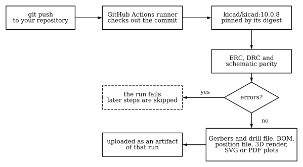
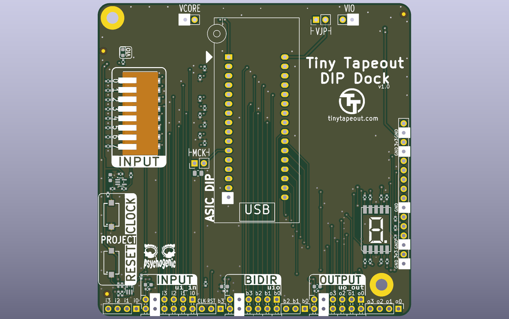

# Outputs in CI

This page answers: *how can a computer check your board and build its fabrication files on every push, and how do you know it ran the same KiCad, with the same settings, as the numbers on the lab pages?*

Continuous integration (CI) means that every time you push, a fresh machine checks out your commit and runs a fixed list of commands on it. You met it in IC102 for code. For a board, the commands are the checks you'd otherwise run by hand, ERC, DRC and schematic parity, followed by the [fabrication outputs](fabrication-outputs.md) and some images a reviewer can look at without opening KiCad. In [Lab 05](../labs/lab-05-fab-outputs-in-ci-overview.md) you add a workflow that does this to your board repository, then break the board on purpose and watch the run go red.



*One CI run for a board. If ERC, DRC or schematic parity finds an error, the step fails and GitHub Actions skips the later steps, so a broken board never produces a set of Gerbers that looks ready to order. Made by [`scripts/figures/ci_flow.py`](https://github.com/uoftasic/pb101/blob/main/scripts/figures/ci_flow.py).*

Other KiCad projects already work this way. wafer.space's chip-on-board repository, for example, has a GitHub Actions workflow that runs in the `kicad/kicad:10.0` container, renders the top and bottom of each board with `kicad-cli pcb render`, plots the copper and silkscreen layers with `kicad-cli pcb export svg`, exports each schematic with `kicad-cli sch export pdf`, and commits the results back to the repository (`.github/workflows/release-docs.yml` and `.github/scripts/gen_docs.py` in `wafer-space/chip-on-board-wire-bonded-pcbs`). This course's own repository does the checking half: its [`labs.yml`](https://github.com/uoftasic/pb101/blob/main/.github/workflows/labs.yml) workflow runs the board check on every lab's reference solution whenever `labs/` changes, and once a week in case something outside the repository has moved.

## Checks that fail the run

A CI step fails when its command exits with a status other than 0, so the whole job comes down to choosing commands whose exit status means what you want. By default `kicad-cli` exits 0 even when it finds problems: on the DIP dock, ERC found 2 violations and DRC 165, and both exited 0. With `--exit-code-violations` it exits 5 when anything is reported, and the `--severity-...` options decide what counts. Here are both checks on Tiny Tapeout's DIP dock (`breakout-pcb` at 91a2bf1), in the course's pinned image. We've shortened the paths and left out the line that says where each report was saved:

```text
$ kicad-cli sch erc --severity-error --exit-code-violations -o erc.rpt dip-dock.kicad_sch
Found 2 violations
exit status 5
$ kicad-cli pcb drc --severity-error --schematic-parity --exit-code-violations -o drc.rpt dip-dock.kicad_pcb
Found 0 violations
Found 0 unconnected items
Found 0 schematic parity issues
exit status 0
```

ERC fails, on two `power_pin_not_driven` errors, and DRC passes. Run with `--severity-all` instead, the same DRC reports:

```text
Found 165 violations
Found 0 unconnected items
Found 3 schematic parity issues
exit status 5
```

The three parity issues were there in the first run too. KiCad reports schematic parity problems as warnings, so `--severity-error` filters them out, and in every project the course checked, that included a footprint that is in the schematic and missing from the board. On the DIP dock the three are about a logo (one footprint, `PSYLOGO01`, placed twice and not in the schematic), which is harmless. On your board the same filter would let a missing connector through with a green run.

That is why the labs don't use the plain `kicad-cli` flags as their "done when". They run [`labs/common/check_board.py`](https://github.com/uoftasic/pb101/blob/main/labs/common/check_board.py), which runs ERC and DRC with every severity, reads the JSON reports, and fails on any error, any unconnected item, and any parity item at all. On the DIP dock it took 18 s and ended like this:

```text
                errors  warnings  excluded
  ERC                2        44         0
  DRC                0       159         6
  unconnected        0         0         0
  parity             0         3         0
...
FAIL  erc.error: 2 (want 0)
FAIL  parity.warning: 3 (want 0)
```

It exits 1 on a FAIL, so a workflow step that runs it fails the run. The 159 DRC warnings don't fail it: they are `lib_footprint_issues` and `lib_footprint_mismatch`, comparisons between the board and the libraries installed where the check runs, which is the subject of the next two sections.

## Pinning the image

A Docker image name such as `kicad/kicad:10.0` is a tag, and a tag is a pointer that the publisher moves. On Docker Hub, `kicad/kicad:10.0` and `kicad/kicad:10.0.8` were both last updated on October 30, 2026, and both are 812 MB, because `10.0` currently points at 10.0.8. KiCad posted 10.0.5 on July 22, 10.0.6 on August 29, 10.0.7 on October 7 and 10.0.8 on October 30, so a workflow that names `10.0` gets a new KiCad every few weeks without anyone committing anything. That is fine for pictures. For checks, it means a DRC count can change on a Monday morning for reasons that have nothing to do with your board.

A digest names one exact image, and Docker refuses to substitute another. The course's checks name `kicad/kicad:10.0.8@sha256:3f4a01786dfb…` (in full in [`labs/common/kicad-image.txt`](https://github.com/uoftasic/pb101/blob/main/labs/common/kicad-image.txt)), and `labs/common/kicad.sh` prints the digest it ran before every check, so a log always records which KiCad produced it. We haven't compared outputs across 10.0 patch releases, so when the course moves to a newer one, it will be a commit of its own that regenerates every count on every page.

## The user and the library tables

Pinning the image isn't quite enough, because KiCad's warnings also depend on who runs it. Many warnings compare the parts in your design with the libraries KiCad knows about, and that list lives in the user's settings folder. A container that runs as root, or as your own uid with an empty home folder, has no library tables at all, and then every standard library looks missing. [Getting started](getting-started.md#your-kicad-and-the-courses-checks) shows the effect on the SKY130 breakout: 103 ERC warnings and 123 DRC warnings in the course's setup, 236 and 130 with no tables, and the same 10 ERC errors and 0 DRC errors in both.

So `kicad.sh` runs the image as your uid and copies KiCad's default library tables into place first, and the course's `labs.yml` calls `kicad.sh` instead of running its steps in a job `container:`, so that CI sees the same tables as the counts on the lab pages. wafer.space's workflow runs its container with `--user root`. That's fine for renders and plots, but if it ran ERC and DRC, its warning counts wouldn't match ours.

## Fonts and 3D models

The image is built for `kicad-cli`, so it carries KiCad and its libraries and not much else. Two gaps show up in board outputs.

The first is fonts. The DIP dock's designer set three silkscreen labels, `ui_in`, `uio` and `uo_out`, in the FreeMono font, which the image doesn't have, and every export printed

```text
Font 'FreeMono' not found; substituting 'DejaVu Sans Mono Bold'.
```

so CI's silkscreen for those labels isn't drawn in the font the designer chose. Text in KiCad's own default font doesn't depend on the fonts installed on a machine, which makes it the safe choice for a board whose outputs come from CI.

The second is 3D models. The image doesn't include KiCad's 3D models of parts (they're in the `kicad/kicad:10.0.8-full` image, 1,448 MB against 812 MB), so a render made in CI shows the bare board:



*The top of Tiny Tapeout's DIP dock as `kicad-cli pcb render` draws it in `kicad/kicad:10.0.8`: copper under the green mask, gold pads, silkscreen and holes, and no parts, because the image has no 3D models. Made by [`scripts/figures/board_renders.sh`](https://github.com/uoftasic/pb101/blob/main/scripts/figures/board_renders.sh).*

For a reviewer that is often better than a render with parts, since the pads and the silkscreen are what they're checking.

## Outputs that repeat from run to run

It helps to know which outputs come out the same on every run, because then CI can tell you whether a commit changed them:

- SVG plots of layers were identical from run to run once the date that `kicad-cli` writes into each file's `<title>` was removed.
- A top-view render of the DIP dock came out byte-identical in two runs. A bottom view of the SKY130 breakout didn't: the two PNGs were 161,264 and 161,266 bytes.
- Gerbers, the job file and the drill file carry the date of the export, as [Fabrication outputs](fabrication-outputs.md#dates-in-the-files) shows, so they're never identical as they stand.

The images are for people to look at. When a workflow needs to decide whether the board changed, compare the Gerbers with their date lines removed.

One more thing `kicad-cli` does is write a `.kicad_prl` file of local settings next to the project it reads, even for a check. In CI that doesn't matter, because the runner is thrown away afterwards; on your own machine it's one of the files [KiCad files in git](kicad-files-in-git.md) tells you to ignore.

## Jobsets

Instead of listing every export in the workflow, you can save the list in the project as a jobset, which `kicad-cli jobset run` then runs, so the list of outputs lives in one file next to the board. We haven't tried a jobset in this course yet.

## KiBot

[KiBot](https://github.com/INTI-CMNB/KiBot), licensed under the AGPL-3.0, is a tool that drives KiCad from a YAML file and produces outputs that `kicad-cli` doesn't, such as an interactive HTML BOM, which is why Lab 05 offers it as an optional part. Its newest release on November 16, 2026 was 1.9.1, dated 2026-07-28, and its changelog says its KiCad 10 3D rendering goes "through the kicad-cli interface" and "has various limitations". Two things about it matter for a pinned course:

- Its KiCad 10 images lag KiCad. The newest KiCad version in any `ghcr.io/inti-cmnb/kicad10_auto_full` tag was 10.0.5, three releases behind the 10.0.8 the checks use, so a workflow with KiBot runs two different KiCads.
- Its GitHub Action for KiCad 10, `v2_k10`, builds `FROM ghcr.io/inti-cmnb/kicad10_auto_full:latest`, a moving tag. If you use KiBot, name a fixed image tag, such as `1.9.1-2_k10.0.5_d13.2_b4.2.4LTS`, as you would for KiCad.


## Check yourself

1. A workflow runs `kicad-cli pcb drc --severity-error --schematic-parity --exit-code-violations` and goes green, but the board is missing a footprint that the schematic has. How?

   <details>
   <summary>Answer</summary>

   KiCad reports schematic parity problems, including a missing footprint, as warnings, and `--severity-error` leaves warnings out, so DRC found nothing at error severity and exited 0. `check_board.py` fails on any parity item for this reason.

   </details>

2. Your workflow names `kicad/kicad:10.0`. One week the DRC warning count changes, and nobody has committed anything. What's the likeliest reason?

   <details>
   <summary>Answer</summary>

   The tag moved to a new 10.0 patch release, so CI ran a different KiCad. Naming the image by its digest, as `labs/common/kicad-image.txt` does, keeps it the same until you change it on purpose.

   </details>

3. You run ERC on the SKY130 breakout in a container as root and get 236 warnings. The lab page says 103. Which number is wrong?

   <details>
   <summary>Answer</summary>

   Neither. Root in the image has no library tables, so ERC reports the standard libraries as missing, and the warnings go up. The errors, 10, are the same in both setups. The lab pages quote warnings only for the course's setup, which `kicad.sh` gives you.

   </details>

4. The render in your CI artifact shows bare pads and no parts. Is your workflow broken?

   <details>
   <summary>Answer</summary>

   No. The `kicad/kicad:10.0.8` image has no 3D models of parts, so every render made in it shows the bare board. The `-full` image has them.

   </details>

Next: [KiCad files in git](kicad-files-in-git.md).
