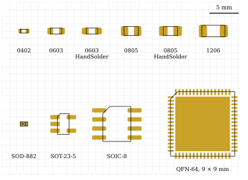

# Parts you can solder by hand

<!--
  Sources for this page (row 5 of the course path):
  - Horowitz and Hill, The Art of Electronics, 3rd ed., Appendix C, p. 1104 (printed):
    size codes in units of 0.010 in, "0603" = 0.06 x 0.03 in (1.5 x 0.75 mm), "We favor
    that size, or the larger 0805 package, for general prototyping", "a major pain".
  - KiCad footprint libraries in kicad/kicad:10.0.8 (/usr/share/kicad/footprints), read
    Nov 16, 2026: Resistor_SMD (R_0402, R_0603, R_0805, R_1206 and their _HandSolder
    variants, descriptions and pad sizes), Diode_SMD/D_SOD-882, Package_TO_SOT_SMD/SOT-23-5,
    Package_SO/SOIC-8_3.9x4.9mm_P1.27mm, Package_DFN_QFN/QFN-64-1EP_9x9mm_P0.5mm_EP7.65x7.65mm.
  - SKY130 breakout (breakout-pcb 91a2bf1): footprints of every passive; schematic note
    "popping off the relevant resistor (0805s for easier manip)".
  - DIP dock (breakout-pcb 91a2bf1) and demo board (tt-demo-pcb bbf3dd1) footprints.
  - Tiny Tapeout pcb-files (ca5fd72), ETR/breakout-skyqfn-v3p2/bom/: the breakout's
    production BOM for JLCPCB.
  - kicad-tinytapeout-pmod-lib (9ee6345): Pmod header footprint.
-->

This page answers: *which parts can you solder to a board yourself with an iron, and how do you choose footprints so that the board you order is one you can put together?*

You don't have to solder anything in IC103. But if your team orders the board you draw in [Lab 03](../labs/lab-03-a-pmod-for-one-projects-pins-overview.md), someone will assemble it, quite possibly you, and a footprint you choose in the lab decides how hard that job is. This page is about choosing the size of each part and the footprint that goes with it.

## Sizes and their codes

Resistors, capacitors and other two-terminal surface-mount parts come in standard sizes named by a four-digit code, which gives the length and width in units of 0.010 inch. Horowitz and Hill's example is the "0603" package, 0.06 × 0.03 inch, or 1.5 × 0.75 mm (*The Art of Electronics*, 3rd ed., p. 1104). KiCad's footprint names give both codes: `R_0603_1608Metric` is the same 0603 part, called 1608 in the metric code, which counts tenths of a millimetre (1.6 × 0.8 mm).

Horowitz and Hill favour 0603, "or the larger 0805 package, for general prototyping of surface-mount circuits". Of the smaller sizes, 0402 and below, they write that they "are a major pain – you basically have to work under a microscope (and don't sneeze)". That's the rule of thumb for this course: on a board you'll assemble yourself, use 0603 or 0805 for resistors and capacitors.

*Footprints from KiCad 10.0.8's own libraries, drawn to one scale on a 1 mm grid by [`scripts/figures/footprint_sizes.py`](https://github.com/uoftasic/ic103/blob/main/scripts/figures/footprint_sizes.py): copper pads in gold, and the part's body as the fabrication layer draws it. Top row, resistors: 0402, 0603, 0805 and 1206, and the hand-soldering versions of 0603 and 0805. Bottom row: SOD-882, a two-pin diode package; SOT-23-5; SOIC-8; and the 9 × 9 mm QFN-64 that Tiny Tapeout's SKY130 chip comes in.*

## KiCad's hand-soldering footprints

KiCad's libraries have a second footprint for most of these sizes, with `_HandSolder` at the end of its name. Its description reads "IPC-7351 nominal with elongated pad for handsoldering": the part is the same, and each pad is longer, reaching further out from the part's end, which leaves room for the iron's tip and for a fillet of solder you can see.

| Footprint | Pad (length × width) | Pad centres from the middle |
|---|---|---|
| `R_0603_1608Metric` | 0.8 × 0.95 mm | ±0.825 mm |
| `R_0603_1608Metric_Pad0.98x0.95mm_HandSolder` | 0.975 × 0.95 mm | ±0.9125 mm |
| `R_0805_2012Metric` | 1.025 × 1.4 mm | ±0.9125 mm |
| `R_0805_2012Metric_Pad1.20x1.40mm_HandSolder` | 1.2 × 1.4 mm | ±1.0 mm |

So the 0603 hand-soldering pad reaches 1.4 mm from the middle of the part instead of 1.225 mm, and the 0805 one 1.6 mm instead of 1.425 mm. The capacitor libraries have the same pairs (`C_0603_1608Metric_Pad1.08x0.95mm_HandSolder`, for example), and there are hand-soldering versions of some three- and five-pin packages too, such as `SOT-23-5_HandSoldering`.

## Part sizes on Tiny Tapeout's boards

Tiny Tapeout's boards use smaller parts than this page recommends. On the SKY130 breakout, every 100 nF capacitor is 0402, the 1 µF capacitors are 0603 and the 10 µF ones 0805. The DIP dock uses 0402 for 36 of its 37 resistors and for its 100 nF capacitors, 0603 for its 1 µF capacitors and LED, and SOT-353 (SC-70-5) for its two logic gates. That's fine for them, because their boards are assembled by machine: Tiny Tapeout's archive of production files has the breakout's bill of materials prepared for JLCPCB's assembly service.

There's one exception on the breakout. Its 0 Ω links R13, R14 and R15, which connect the chip's three supplies, are 0805, while the board's other fitted 0 Ω links, R2, R4, R5 and R8, are 0603 or 0402. The schematic explains why: each supply "may be monitored or fed through these headers by popping off the relevant resistor (0805s for easier manip)". Those three are the parts a person is expected to take off by hand, so they got the larger size. ([Measuring current](measuring-current.md) comes back to them.)

## Packages with pads you can't reach

Whether you can solder a part depends as much on whether the iron can reach the joint as on the part's size.

- **SOT-23-5**, the package of the breakout's AP2112K regulator, has its leads out beside the body, on 1.325 × 0.6 mm pads at 0.95 mm pitch. You can see and reach every joint.
- **SOIC-8** has leads on a 1.27 mm pitch, again beside the body.
- **SOD-882**, the package of 22 of the TVS diodes on the demo board, has a body of 1.0 × 0.6 mm and two pads of 0.4 × 0.7 mm, 0.7 mm apart between centres. That's about the size of an 0402, with the same problem.
- **QFN-64**, 9 × 9 mm with a 0.5 mm pitch, has pads 0.25 mm wide. Each one reaches only 0.375 mm beyond the edge of the body, and the 7.65 × 7.65 mm exposed pad in the middle is entirely underneath the part, where no iron can reach it. The Tiny Tapeout chip comes already mounted on its breakout, so a QFN is something you'll draw a footprint for, in [Lab 02](../labs/lab-02-a-footprint-from-a-datasheet-overview.md), and not something you'll solder.

When you add ESD protection to your Pmod in Lab 04, look for a part in a package like the first two in this list, with its leads beside the body, and not one like SOD-882.

## Through-hole parts

The Pmod connectors are the easy joints on your board. Tiny Tapeout's Pmod footprint, `PinHeader_2x06_P2.54mm_PMODPeriph2B`, is a through-hole angled header with 1.7 mm pads and 1.0 mm holes on a 2.54 mm pitch. Its joints are large and easy to see, and the pins hold the part in place while you solder them.

## Fabricator assembly and safety

If you'd rather not solder, fabricators also assemble boards, as JLCPCB does for Tiny Tapeout's. It costs more than bare boards and needs your board's parts list and placement files, which [Fabrication outputs](fabrication-outputs.md) covers; [Reviewing and ordering a board](reviewing-and-ordering-a-board.md) covers ordering. If you do solder, do it in a room set up for it and follow that room's rules. The course doesn't teach soldering or its safety.

## Check yourself

1. You need a 100 nF capacitor on a Pmod that you'll assemble yourself. Which KiCad footprint would you pick?

   

   
Answer

   An 0603 or 0805 capacitor, preferably the hand-soldering version, such as `C_0603_1608Metric_Pad1.08x0.95mm_HandSolder`. 0402 is the size Horowitz and Hill call "a major pain" to work with.

   

2. Why are R13, R14 and R15 on the SKY130 breakout 0805 when its other 0 Ω links are 0603?

   

   
Answer

   They're the links a person is expected to remove by hand, to measure or feed one of the chip's supplies, and the schematic says they're 0805 "for easier manip". The rest of the board is assembled by machine and never touched again.

   

3. Why can't you solder a QFN's exposed pad with an iron, and why does that matter less for the Tiny Tapeout chip than for a QFN on your own board?

   

   
Answer

   The exposed pad lies entirely under the body of the part, so an iron can't reach it. The Tiny Tapeout chip comes already mounted on its breakout, so you never solder it. A QFN on your own board would need a different way of soldering, or a fabricator to assemble it.

   

Next on the [course path](../index.md#course-path): [Lab 03: A Pmod for one project's pins](../labs/lab-03-a-pmod-for-one-projects-pins-overview.md).
