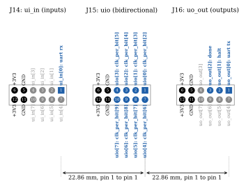

# Pins, Pmods and planning a pinout

<!--
  Sources for this page (row 5 of the course path):
  - Tiny Tapeout GPIO spec https://tinytapeout.com/specs/gpio/, pinouts
    https://tinytapeout.com/specs/pinouts/, and ETR demo board guide
    https://tinytapeout.com/guides/get-started-demoboard-etr/, all read Nov 16, 2026.
  - Demo board (tt-demo-pcb bbf3dd1): README (three I/O Pmods, "span at least two",
    RP2 pinout table) and board file (J14/J15/J16 positions and pad nets; DIP switch
    SW1 to +3V3 through 1 k; uo_out through JP2-JP9 and 510 ohm to the display).
  - kicad-tinytapeout-pmod-lib (9ee6345): README, PinHeader_2x06_P2.54mm_PMODPeriph2B,
    symbol PMOD_PERIPH_2x6.
  - SimProc (uoftasic/simproc 1d97772): info.yaml, src/tt_um_ieeeuoftasic_simproc.sv,
    docs/info.md.
-->

This page answers: *which of a Tiny Tapeout project's pins can a board of yours reach, through which connector pin, and what else on the demo board is already connected to each one?*

A Pmod is the simplest board you can make for a Tiny Tapeout chip. It plugs into headers on the demo board and never touches the chip's breakout. In [Lab 03](../labs/lab-03-a-pmod-for-one-projects-pins-overview.md) you'll draw one for a single project, which by default is the team's SimProc, and this page uses SimProc as its example. To draw it, you need to know which socket pin each of the project's pins comes out on, what the demo board already has connected to each of them, and how the project's choice of pins makes the board easier or harder to design. A team can still change its choice of pins until its chip is taped out, so this page ends with that.

## A project's pins

Tiny Tapeout's [GPIO page](https://tinytapeout.com/specs/gpio/) lists 26 pins for each project: the clock `clk`, the active-low reset `rst_n`, eight inputs `ui_in[7:0]`, eight outputs `uo_out[7:0]` and eight bidirectional pins `uio[7:0]`. The project sets the direction of each `uio` pin with its `uio_oe` output, 1 for output and 0 for input. The demo board's RP2350 microcontroller usually supplies the clock and drives the reset. The board's three Pmod sockets carry only the other 24 pins, so those are the ones a Pmod can reach. Their electrical limits are on [Protecting the chip's I/O](protecting-the-chips-io.md).

## The three I/O Pmods

The demo board's README says the three Pmod headers along its bottom edge "provide access to all the project I/O in a logical fashion, with inputs, bidirectional pins and outputs available on their own distinct headers", and that "extension boards will often need to span at least two, and sometimes three, distinct headers." Tiny Tapeout's [guide to the ETR demo board](https://tinytapeout.com/guides/get-started-demoboard-etr/) (ETR is the name printed on the board) adds that the headers "follow the digilent PMOD spec and spacing".

*The demo board's sockets J14, J15 and J16, seen from above, drawn from the board file (`TinyTapeout/tt-demo-pcb` at bbf3dd1) by [`scripts/figures/pmod_pinout.py`](https://github.com/uoftasic/pcb101/blob/main/scripts/figures/pmod_pinout.py). Each pad is labelled with the net that the board file gives it, and pin 1 is drawn square. SimProc's pins are in blue, labelled with what each one does, from its `info.yaml` and RTL. Each `uio` pin sets one bit of SimProc's `clk_per_bit`.*

Each socket has twelve pins in two rows of six. Pins 1 to 4 carry bits 0 to 3 of the socket's bus, pins 7 to 10 carry bits 4 to 7, pins 5 and 11 are ground, and pins 6 and 12 are the demo board's +3V3. A Pmod takes its power from pins 5, 6, 11 and 12, at the same 3.3 V that the chip's pads run from. Pin 1 of each socket is 22.86 mm from pin 1 of the next. That's the spacing Tiny Tapeout's Pmod library asks for, and the one [Placement and routing](placement-and-routing.md#connectors-first) uses for a Pmod's connectors.

On your own board, the matching part comes from that Pmod library. Its footprint, `PinHeader_2x06_P2.54mm_PMODPeriph2B`, is a through-hole angled header with "digilent numbering". Its symbol, `PMOD_PERIPH_2x6`, names the eight signal pins `IO1` to `IO8`, with `IO1` to `IO4` on pins 1 to 4 and `IO5` to `IO8` on pins 7 to 10, and it has `GND` on pins 5 and 11 and `VCC` on 6 and 12. The library's README asks for the input connector on the left, the bidirectional one in the middle and the output one on the right, looking at the board from the top, which is the order of the demo board's sockets in the figure.

## What else is on each pin

Every pin your Pmod reaches is connected to the chip, through the connector the breakout plugs into, and also to other parts on the demo board. Counting only the parts that are fitted, the board file connects them like this:

- **`ui_in[0..7]`** go to the RP2350 (GPIO17 to GPIO24) and to an 8-way DIP switch. Each switch connects its line to +3V3 through a 1 kΩ resistor, so a switch that's on pulls its input high.
- **`uo_out[0..7]`** go to the RP2350 (GPIO33 to GPIO40), and each one drives a segment of the 7-segment display through a bridged solder jumper (JP2 to JP9) and a 510 Ω resistor. `uo_out[0]` to `uo_out[6]` drive segments A to G, and `uo_out[7]` drives the decimal point.
- **`uio[0..7]`** go to the RP2350 (GPIO25 to GPIO32) and to nothing else that's fitted.

On an input, then, your Pmod is one of up to three drivers. The demo board's firmware has a mode, `ASIC_RP_CONTROL`, in which the RP2350 drives the `ui_in` pins, and its example configuration starts in that mode. A DIP switch that's on drives its pin as well. If the browser app in the ETR guide reports the shuttle as "unknown", the guide says the usual cause is "driving the ui_in pins through the INPUT Pmod port". On an output, your Pmod is a second load, because the display segment and its 510 Ω resistor are already there. [Protecting the chip's I/O](protecting-the-chips-io.md) and [Supplies, back-powering and ESD](supplies-back-powering-and-esd.md) deal with both in detail.

## The RP2350's UARTs and the recommended pinouts

Tiny Tapeout's [pinouts page](https://tinytapeout.com/specs/pinouts/) says "TT advocates to use common pinouts wherever possible", so that boards made for one project work for others. For a serial console it recommends one of two pairs, "ui_in[3] - RX" with "uo_out[4] - TX", or "ui_in[1] - RX" with "uo_out[0] - TX", and says you can reach either "via the builtin RP2040 on the demo board". The current demo board has an RP2350 instead, and its README's pin table shows which of the RP2350's pins have a hardware UART:

| Project pin | RP2350 pin | UART function in the README's table |
|---|---|---|
| `ui_in[0]` | GPIO17 | none |
| `ui_in[1]` | GPIO18 | none |
| `ui_in[3]` | GPIO20 | UART1.tx |
| `uo_out[0]` | GPIO33 | UART0.rx |
| `uo_out[4]` | GPIO37 | UART1.rx |

The pinouts page was written for the RP2040 board, and on the RP2350 board only its first pair has a hardware UART in both directions. With that pair, UART1 transmits into the project's RX on `ui_in[3]` and receives the project's TX on `uo_out[4]`. With the second pair, UART0 can receive the project's TX on `uo_out[0]`, but `ui_in[1]` has no UART function, so the RP2350 has no hardware UART to transmit to the project with.

## SimProc's pins

SimProc's `info.yaml` and its top-level RTL (`uoftasic/simproc` at 1d97772) give this pinout:

| Pin | Use |
|---|---|
| `ui[0]` | UART receive |
| `uo[0]` | UART transmit |
| `uo[1]` | halt flag |
| `uo[2]` | done flag |
| `uio[0..7]` | inputs (`uio_oe` is 0) that set the UART's bit period: `clk_per_bit = {uio_in[7:0], 2'b00}` |

The UART's bit period is `clk_per_bit` cycles of the project's clock. SimProc's `info.yaml` gives that clock as 0 Hz, which means "not applicable", so the bit period in seconds depends on the clock that the demo board supplies. Its documentation says to "Send commands using the UART RX pin (using a USB to UART conveter)" and to "Set UIO7-UIO0 to set the BAUD rate of the internal UART module."

On the demo board, SimProc's transmit pin, `uo_out[0]`, lands on GPIO33, which the README's table lists as a UART0 receiver. Its receive pin, `ui_in[0]`, lands on GPIO17, which has no UART function in the table. So to talk to SimProc from a computer without going through the RP2350, a Pmod needs a header for a 3.3 V USB-UART dongle on `ui[0]` and `uo[0]`, which is how SimProc's documentation says to send it commands, and eight switches with pull-down resistors on `uio[0..7]` to set the baud rate. Those pins are on all three sockets, so the Pmod spans all three, the "sometimes three" case in the demo board's README. It needs no LEDs for the halt and done flags on `uo_out[1]` and `uo_out[2]`, because those pins already light segments B and C of the display, and an LED would be a second load on each one.

## Planning a pinout before tapeout

While a design is still RTL, moving a signal to another pin costs nothing. Once the chip is made, its pins can't move, and they decide what board or firmware the chip needs. Had SimProc used the first recommended pair, `ui_in[3]` and `uo_out[4]`, for its UART, the RP2350's UART1 could talk to it in both directions. Four things are worth doing before a team submits a design:

- Check each pin against the demo board's current RP2 pin table, not only against the pinouts page, which still describes the RP2040 board.
- Use a recommended pinout when one fits, so that existing Pmods work with your project. The pinouts page gives them for UART, SPI, I2C, QSPI flash and PSRAM, VGA, audio and game controllers.
- Keep a peripheral's signals within one Pmod row when you can. The page's pinouts for SPI, for UART with optional hardware flow control, and for I2C each use one row, "preferably the upper row".
- Say in `info.yaml` what every used pin does, so that whoever draws the board doesn't have to read the RTL to find out.

## Check yourself

1. Which pins of a Pmod socket carry power, and at what voltage?

   

   
Answer

   Pins 5 and 11 are ground, and pins 6 and 12 are the demo board's +3V3, so a Pmod's parts run from 3.3 V.

   

2. On the SimProc Pmod, which socket and pin does the dongle's TX line connect to, and which one does its RX line connect to?

   

   
Answer

   The dongle's TX drives SimProc's receive pin, `ui_in[0]`, which is pin 1 of J14, the input socket. The dongle's RX listens to SimProc's transmit pin, `uo_out[0]`, which is pin 1 of J16, the output socket.

   

3. You want an LED on your Pmod that shows `uo_out[1]`. What else does that pin already drive?

   

   
Answer

   Segment B of the demo board's display, through the solder jumper JP3 and a 510 Ω resistor, and an input of the RP2350. The pad is rated for 4 mA, and your LED and the segment would share that 4 mA.

   

4. Why can the RP2350 receive what SimProc transmits with a hardware UART, but not transmit to it the same way?

   

   
Answer

   SimProc transmits on `uo_out[0]`, which is GPIO33, listed as UART0.rx. It receives on `ui_in[0]`, which is GPIO17, and the README's table lists no UART function for that pin.

   

Next: [Parts you can solder by hand](parts-you-can-solder-by-hand.md).
