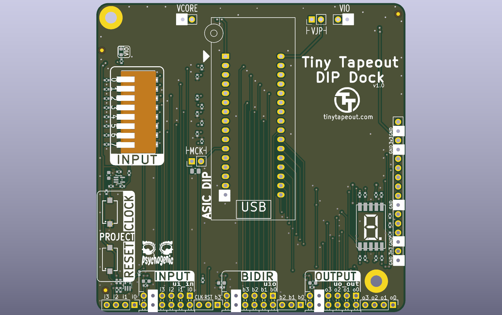
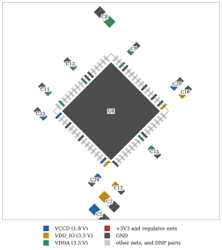
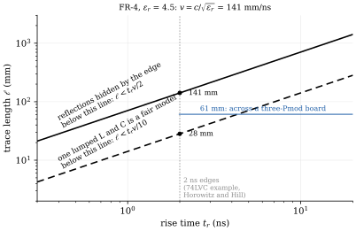

# Placement and routing

<!--
  Sources for this page (row 5 of the course path):
  - Tiny Tapeout's boards at the commits in labs/common/upstream.json, parsed on Nov 16, 2026:
    DIP dock (breakout-pcb 91a2bf1, dip-dock.kicad_pcb and .kicad_pro and .kicad_dru),
    demo board (tt-demo-pcb bbf3dd1), SKY130 breakout (breakout-sky-qfn.kicad_pcb).
    Capacitor distances: pcbnew in kicad/kicad:10.0.5, centre of each capacitor pad to
    the centre of the nearest U4 pad on the same net. C25 to U3's pin 8 (VDD_IO) measured
    the same way from the board file; the schematic draws C25 in the EEPROM ID block.
  - kicad-tinytapeout-pmod-lib README (9ee6345): 0.9 in / 22.86 mm, Shift+P, order.
  - JLCPCB capabilities, https://jlcpcb.com/capabilities/pcb-capabilities, read Nov 16, 2026.
  - Horowitz and Hill, The Art of Electronics, 3rd ed.: pp. 856 (ground plane, 0.1 uF per IC),
    857 (74LVC example, 5 nH/cm), 859 (series termination).
  - Hall and Heck, Advanced Signal Integrity for High-Speed Digital Designs: 3.2.3 and
    Example 3-1 (t_r/10, eps_r 4.5), 3.5.6 (t_r < 2 t_d), 8.1.3 (0.35/t_r), Example 9-9
    (via), 10.2 (return paths).
  - Tiny Tapeout GPIO spec, https://tinytapeout.com/specs/gpio/, read Nov 16, 2026.
-->

This page answers: *in what order do the parts go onto a board, and what decides how wide each trace is, where it runs, and which path its current takes back?*

You'll lay out your first board, a 2-layer Pmod for one Tiny Tapeout project, in [Lab 03](../labs/lab-03-a-pmod-for-one-projects-pins-overview.md). [Layers and fabricator rules](layers-and-fabricator-rules.md) covers the numbers a fabricator will hold you to and how they become KiCad's design rules, and this page is about the choices you make inside those rules. Its worked examples are two of Tiny Tapeout's own boards. The 2-layer DIP dock is the closest thing to the board you'll draw, and the 4-layer SKY130 breakout is the board that carries the chip.

## Connectors first

Place the parts whose positions someone else has already decided, and lock them, before you place anything else. On a Pmod that means the connectors, because they have to line up with the sockets on the demo board. Tiny Tapeout's Pmod library says that when a board uses more than one Pmod connector, the connectors sit 0.9 in (22.86 mm) apart, with the input connector on the left, the bidirectional one in the middle and the output one on the right, looking at the board from the top. Its README suggests KiCad's Position Relative To (Shift+P) with an X offset of 22.86 mm to get the spacing exactly.

A Pmod plugs into either the demo board or the DIP dock, and the two boards put their sockets in the same places. In the demo board's file, the three I/O sockets J14, J15 and J16 sit at x = 92.70, 115.56 and 138.42 mm, all at y = 93 mm, and in the DIP dock's file its sockets J5, J6 and J7 are at exactly the same coordinates, so a Pmod drawn for one board fits the other.

*Tiny Tapeout's DIP dock (`TinyTapeout/breakout-pcb` at 91a2bf1, Apache-2.0), rendered from above by `kicad-cli` 10.0.5, with the parts' 3D models. The board is 85 × 85 mm with two copper layers. The three Pmod sockets along the bottom edge are labelled INPUT, BIDIR and OUTPUT on the silkscreen and are 22.86 mm apart.*

After the connectors, place the parts their signals go to, in the order that keeps each signal's path short. Then place the small parts that serve those parts: decoupling capacitors next to the pins they decouple, and the series resistors and ESD parts that [Protecting the chip's I/O](protecting-the-chips-io.md) and [Supplies, back-powering and ESD](supplies-back-powering-and-esd.md) add. Take your time over this, because routing can't fix a placement that leaves a signal no short path.

## Decoupling next to the pin it serves

A CMOS chip draws its supply current in short pulses, one at every edge, and each pulse has to come through the inductance of the wiring between the chip and wherever the charge is stored. Horowitz and Hill work an example (*The Art of Electronics*, 3rd ed., p. 857) in which a 74LVC output at 3.3 V driving 25 pF with 2 ns edges draws 40 mA. A ground wire has roughly 5 nH/cm of inductance, so one inch of it turns that current step into about 0.2 V of noise on the chip's ground. Their remedy (p. 856) is a ground plane and plenty of bypass capacitors. They write that "it is best to use a 0.1 µF ceramic capacitor near each IC, although one capacitor for every two or three ICs may suffice", and they recommend a few larger capacitors scattered through the circuit as well. The capacitor supplies the pulse from close by, so the pulse's loop is the short one from the capacitor through the chip and back, and the rest of the supply only has to deliver the average current.

To see how this is done around a QFN, we measured the SKY130 breakout's board file, from the centre of each capacitor's pad to the centre of the nearest chip pad on the same rail. Nine of its twelve 100 nF capacitors are within 2.6 mm of the chip pin they serve, and two more, C21 and C22, are on the regulator outputs. The twelfth, C25, is on `VDD_IO` too, but the schematic draws it beside U3, the footprint for an EEPROM that isn't fitted, and on the board it's 1.9 mm from U3's supply pin and 18.5 mm from the chip. The 1 µF capacitors are further out. C2, C8 and C5 are 3.7 to 5.5 mm from the chip's pins, six more sit beside the 0 Ω links at the top of the board, and the last two, C18 and C19, are on the regulator outputs with C21 and C22. The two 10 µF capacitors sit at the regulator inputs.

*A 24 × 24 mm patch of Tiny Tapeout's SKY130 QFN breakout, rev 3.2 (`TinyTapeout/breakout-pcb` at 91a2bf1), drawn to scale from the board file by [`scripts/figures/sky_breakout_map.py`](https://github.com/uoftasic/ic103/blob/main/scripts/figures/sky_breakout_map.py). Pads are coloured by the supply they're on; tracks and copper pours are left out. The chip U4 is placed at 135°, so its rows of pads run diagonally, and the 0402 capacitors C9, C11, C13, C15, C16, C17, C20, C23 and C24 sit just off its edges, each by a pin of its own colour. C2, C5 and C8 are 1 µF.*

## Track widths, clearances and vias

A fabricator's capability page gives the smallest track and gap it can make, and you shouldn't design at that limit everywhere. JLCPCB's page, read on November 16, 2026, gives a minimum track width and spacing of 0.10 mm (4 mil) on 1- and 2-layer boards with 1 oz copper, and a minimum via of 0.15 mm hole and 0.25 mm diameter. Tiny Tapeout's 2-layer dock draws at roughly twice that. Here are the numbers we read from the two boards' project and board files:

| | DIP dock (2 layers) | SKY130 breakout (4 layers) |
|---|---|---|
| Default track width | 0.22 mm | 0.2 mm |
| Default clearance | 0.2 mm | 0.2 mm |
| Power tracks | 0.25 mm (`Power` class) | 0.25 mm (`PowerRail` class) |
| Default via (diameter / drill) | 0.65 / 0.3 mm | 0.6 / 0.3 mm |
| Track widths used | 0.22 to 0.45 mm | 0.16 to 0.55 mm; 693 of 1,139 tracks are 0.2 mm |
| Board-wide minimum, track and clearance | 0.16 mm | 0.16 mm |

The dock's defaults are the same as the demo board's, and so is its custom rules file. The rules in it that let copper sit closer together apply only in and around two fine-pitch parts on the demo board, the connector the breakout plugs into and the RP2350's QFN-80, and there they let the gap shrink from the net class's 0.2 mm to as little as 0.16 mm. (On the dock, which has neither part, those rules match nothing.) Outside those parts, DRC holds a track's width only to the board-wide 0.16 mm minimum, so the net class's 0.22 mm is the width you route with by default rather than a limit, and every track on the dock is 0.22 mm or wider. We suggest you do the same, drawing comfortably wide by default and going narrower only where the pads leave no room.

Wider tracks also have less resistance and less inductance, which matters for supply tracks. Hall and Heck model a via as the inductance of its barrel between the capacitances of its two pads, and in their worked example (*Advanced Signal Integrity for High-Speed Digital Designs*, Example 9-9) the barrel is about 0.7 nH and each pad about 0.3 pF. For a decoupling capacitor, the vias from its pads to the planes are part of the loop you're trying to keep small, so they belong right at the pads.

## Return paths and the ground plane

Every current returns to its source, and at high frequencies it takes the path of least impedance, which runs through the reference plane directly under the trace that carried it out. Hall and Heck (§10.2) call any other path a nonideal return path. Their examples include a gap in the plane or a crowd of via holes that makes the current detour, and a bond wire that it has to return through. A detour makes the current's loop bigger, and the most basic effect of that is extra series inductance in the signal's path, which grows with the length of the detour.

On a 2-layer board, the bottom layer is usually the plane. The DIP dock pours ground over both layers from one zone, `GNDPOUR`, which covers F.Cu and B.Cu with 0.35 mm clearance to pads. It joins the two pours with 107 stitching-via footprints and with the 21 of its 111 vias that are on GND. Its other 90 vias carry +3V3 and signals. When you route a signal on the bottom layer, you cut a slot in that pour, and every signal crossing the slot on top has its return current pushed around the end of it. Route on the top where you can, keep any run on the bottom short, so that the detour it causes is short too, and don't let a pour be cut into islands.

## When a trace stops being a wire

A trace behaves like a plain wire only while its delay is short compared with the edges it carries. Hall and Heck give two rules of thumb:

- A piece of line can be modelled as one lumped inductance and capacitance when its delay is at most $t_r/10$ (§3.2.3).
- Reflections from the line's ends are hidden inside the edge when $t_r > 2t_d$, where $t_d$ is the line's delay (§3.5.6).

A signal in FR-4 travels at $v = c/\sqrt{\varepsilon_r}$. With $\varepsilon_r = 4.5$, the value in Hall and Heck's Example 3-1, that's 141 mm/ns, or about 7 ps per millimetre. A trace on an outer layer runs partly in air and is a little faster, so lengths worked out this way are on the safe side.

*The two rules turned into lengths of trace. For 2 ns edges, as in the 74LVC example above, a trace up to 28 mm long is a lumped element by the $t_r/10$ rule, and its reflections stay hidden up to 141 mm. The blue line marks 61 mm, about the width of a board that spans all three Pmods.*

Tiny Tapeout's GPIO page rates the SKY130 pads at 33 MHz for outputs and 66 MHz for inputs, and says the pads have a slow slew rate, but it gives no rise time. An edge's rise time sets its bandwidth, about $0.35/t_r$ (Hall and Heck, eq. 8-8), so a 2 ns edge has content up to about 175 MHz even when the signal toggles at a few MHz. On a Pmod, whose traces are a few centimetres long, every trace counts as short by the reflection rule for edges of a nanosecond or two. A cable can be long compared with the edge, though, whether it's a wire to a USB-UART dongle or a ribbon to another board. The standard cure for a logic output driving a cable is a series resistor at the driver, of about the line's impedance, which Horowitz and Hill call "series termination" (p. 859). The series resistors you add for protection in Lab 04 slow the edges as well, which helps here too.

## Check yourself

1. Why do the Pmod connectors go down before anything else, and why lock them?

   

   
Answer

   The board they plug into fixes their positions. They have to be 22.86 mm apart, with inputs on the left, bidirectional in the middle and outputs on the right, so that they line up with the sockets on the demo board and the DIP dock. Every other part is placed around them, and locking them stops a later drag from moving one off that spacing.

   

2. On the SKY130 breakout, C25 is a 100 nF capacitor on `VDD_IO`, about 18.5 mm from the chip. Suppose the chip had to draw its current pulses from C25, and the path there and back added 3.6 cm of conductor. Using Horowitz and Hill's 5 nH/cm and their 40 mA in 2 ns, how much voltage would that path's inductance develop?

   

   
Answer

   3.6 cm × 5 nH/cm is 18 nH, and 40 mA in 2 ns is 20 mA/ns, so $V = L\,dI/dt$ = 18 nH × 20 mA/ns = 0.36 V. That's why the breakout puts nine of its 100 nF capacitors within 2.6 mm of the chip's pins. C25 sits beside U3, the EEPROM footprint, 1.9 mm from U3's supply pin.

   

3. With 1 ns edges in FR-4 ($\varepsilon_r$ = 4.5), up to what length can a trace be treated as one lumped element, and up to what length are its reflections hidden by the edge?

   

   
Answer

   At 141 mm/ns, $t_r/10$ is 0.1 ns, or about 14 mm, and $t_r/2$ is 0.5 ns, or about 71 mm.

   

4. On a 2-layer board whose bottom layer is a ground pour, you route one signal along the bottom for 20 mm. What does that do to the signals on the top layer that cross it?

   

   
Answer

   The bottom track cuts a 20 mm slot in the pour. A signal crossing the slot on top can't have its return current directly underneath, so the return goes around the end of the slot, the loop gets bigger, and the crossing adds series inductance that grows with the detour. Keeping bottom-layer runs short keeps the detours short.

   

Next: [Pins, Pmods and planning a pinout](pins-pmods-and-planning-a-pinout.md).
