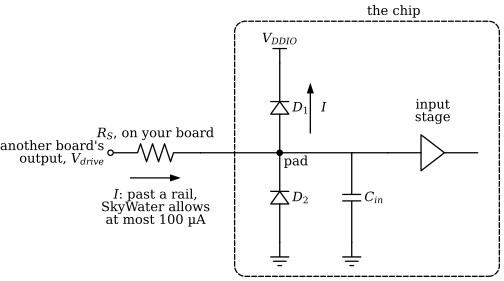

# Protecting the chip's I/O

<!--
  Sources for this page (row 7 of the course path):
  - Tiny Tapeout GPIO spec, https://tinytapeout.com/specs/gpio/, and analog spec,
    https://tinytapeout.com/specs/analog/, read Nov 16, 2026.
  - SkyWater sky130_fd_io user guide,
    https://skywater-pdk.readthedocs.io/en/main/contents/libraries/sky130_fd_io/docs/user_guide.html,
    read Nov 16, 2026: feature list (hot swap and over-voltage tolerance for sio and
    gpio_ovtv2 only), "use the main Vddio/Vssio connections for their ESD current steering
    diodes". General Integration Requirements: a pin may be taken above vddio or below
    vssd_io "provided that the current flowing into/out of the pin is externally limited
    to 100uA". That is the guide's only current limit for a pin; an earlier search for
    "clamp current", "injection" and "absolute" missed it. Read Nov 19, 2026: Table 103,
    "I/O Vil & Vih Specifications", with vtrip_sel = 0 (CMOS): VIL 0.3 * vddio, VIH
    0.7 * vddio, so 0.99 V and 2.31 V at 3.3 V.
  - tt-multiplexer at the commit TTSKY25b pins (7481146),
    https://github.com/TinyTapeout/tt-multiplexer/blob/7481146140da8cc28dbd7679ee284e894a8913f3/ol2/tt_top/openframe_project_wrapper.v,
    read Nov 19, 2026: TT_PAD_IN, the setting of the ui_in pads: input only (dm = 001),
    vtrip_sel = 0, ib_mode_sel = 0, so CMOS thresholds.
  - Horowitz and Hill, The Art of Electronics, 3rd ed. (printed pages): 718 (LVC accepts
    inputs to +5.5 V, including when unpowered), 759-760 (SCR
    latch-up, footnote 92: input clamp current e.g. 20 mA, series input resistor), 794
    (Fig. 12.3 caption: LVC outputs don't load lines when unpowered), 795 (input current,
    Fig. 12.4: 20-50 mA, 74HC clamps at +0.6 V, LVC/AUP tolerant when unpowered), 798-800
    (Fig. 12.9: 74LVC1T45, open drain, TXB0101), 802 (Fig. 12.13, 10k pull-up or
    pull-down), 806 (unused inputs).
  - Hall and Heck, eq. 8-8 (t_10-90 = 2.195 tau).
  - Texas Instruments, SN74LVC2G17 Dual Schmitt-Trigger Buffer, SCES381N (revised January
    2015), https://www.ti.com/lit/ds/symlink/sn74lvc2g17.pdf, read Nov 19, 2026: Description
    (the partial-power-down quote), Features (inputs accept 5.5 V, +-24 mA at 3.3 V), 7.5
    Electrical Characteristics (Ioff +-10 uA max at VCC = 0 V, VI or VO = 5.5 V; at VCC = 3 V,
    VT+ 1.3 to 2.0 V and VT- 0.8 to 1.3 V).
  - Texas Instruments, SN74LVC1T45, SCES515N, and SN74LVC2T45, SCES516N (both revised June
    2024), https://www.ti.com/lit/ds/symlink/sn74lvc1t45.pdf and
    https://www.ti.com/lit/ds/symlink/sn74lvc2t45.pdf, read Nov 22, 2026: Features (VCCA and
    VCCB 1.65 to 5.5 V; "VCC isolation feature"; "DIR input circuit referenced to VCCA";
    "Ioff supports partial-power-down mode operation"), Description (the Ioff quote),
    Electrical Characteristics (Ioff +-1 uA at 25 C, +-2 uA from -40 to 85 C, on the A port
    with VCCA = 0 V and on the B port with VCCB = 0 V), Recommended Operating Conditions
    (DIR's VIH 2 V and VIL 0.8 V at VCCA = 3 to 3.6 V; note 3, unused data inputs held at
    VCCI or GND), 7.3.6 Vcc Isolation, 7.4 function table (DIR L, B to A; H, A to B; one DIR
    for both channels of the 2T45).
  - Raspberry Pi, RP2350 datasheet, Release 8 (build date 01/10/2026),
    https://datasheets.raspberrypi.com/rp2350/rp2350-datasheet.pdf, read Nov 19, 2026:
    Table 1683 (pull-down 36 to 113 kohm at IOVDD = 3.3 V), 9.6 Pads (drive strength 2, 4,
    8 or 12 mA), Table 1680 (absolute maximum ratings: voltages only, no current per pin),
    Appendix D.5.1 (erratum RP2350-E9, A2 stepping only: typically around 120 uA of input
    leakage, a pad held near 2.2 V, overcome by a source of 8.2 kohm or less), Table 7 and
    the package marking (die stepping A2, A3 or A4).
  - tt-micropython-firmware, https://github.com/TinyTapeout/tt-micropython-firmware
    (15ba5ce, Nov 12, 2026; the same code in v3.1.1), read Nov 19, 2026:
    src/ttboard/pins/gpio_map_dbv3.py (UI_IN0 = 17; default_pull returns Pin.PULL_DOWN),
    pins/pins.py (SAFE and ASIC_MANUAL_INPUTS build every pin as an input with that pull;
    ASIC_RP_CONTROL makes the ui_in pins outputs), src/config.ini (mode = ASIC_RP_CONTROL).
  - WCH CH340 datasheet, Version 3C, mirror https://wiki.kamamilabs.com/images/2/29/CH340DS1.PDF,
    read Nov 19, 2026: 6.3, 3.3 V parameters (VIL 0.8 V max; IUP 3, 70 and 200 uA min, typ
    and max). It gives no pin voltage for IUP; 16.5 kohm takes 200 uA at 0 V.
  - The other four dongle-chip datasheets read on Nov 19, 2026, all from mirrors: FTDI FT232R
    v2.07, https://cdn-shop.adafruit.com/datasheets/DS_FT232R.pdf; FTDI FT231X v1.4,
    https://cdn.sparkfun.com/assets/f/2/a/5/0/COM-27909_DS_FT231X.pdf; Silicon Labs CP2102/9
    Rev. 1.6, https://hestore.hu/prod_getfile.php?id=8719; Silicon Labs CP2102N Rev. 1.1,
    https://www.farnell.com/datasheets/2245279.pdf. None of the five, the CH340 included,
    gives a limit for current injected into a pin.
  - Demo board (tt-demo-pcb bbf3dd1): 510 ohm and a segment on each uo_out line; ui_in0 on
    the RP2350's GPIO17; DIP switch 1 from ui_in0 to +3V3 through 1k.
  - SimProc (uoftasic/simproc 1d97772): info.yaml and top-level RTL.
  - Lab 04's reference board (labs/lab-04-protect-and-plan/solutions/simproc-pmod) and rule 5
    of labs/common/check_pmod.py, at 955719c: U1, R1, R2 and R4, and the resistor windows.
    At 4bdb8bb: U1's VCC, C1 and R4 on +3V3_PMOD, after R3; rule 5f, the translators.
    Its BRINGUP.md: DIP switch 1 against R1 leaves a low at 1.65 V; keep the dongle powered
    whenever it's plugged in.
-->

This page answers: *what can the board around a Tiny Tapeout chip do to the chip's digital pins, and what can you put between a pin and the outside world to protect it?*

The chip on a Tiny Tapeout breakout is the only one in the kit, so a mistake on your Pmod that damages a pin is expensive. This page gives the pins' ratings and says what happens when a pin is driven past them. SkyWater's guide for the pads allows 100 µA into a pin that is driven past its supply. The page works out the series resistor that this would take on the UART lines between SimProc and a USB-UART dongle. In the worst case that the datasheets allow, no value of resistor both holds the current to 100 µA and lets the UART work. Then it covers buffers and translators, among them the buffer that Lab 04's board uses on those lines. Last come pull resistors, which hold an input at a defined level when nothing drives it. [Supplies, back-powering and ESD](supplies-back-powering-and-esd.md) covers what happens when one board is powered and the other isn't, and what static discharge does to a pin. In [Lab 04](../labs/lab-04-protect-and-plan-overview.md) you'll put a buffer and a resistor on each UART line of your Lab 03 board.

## What the pins are rated for

Tiny Tapeout's [GPIO page](https://tinytapeout.com/specs/gpio/) says the chip uses the `sky130_ef_io_gpiov2_pad` macro for its I/O pads, and lists these limits for them:

| Parameter | Limit |
|---|---|
| I/O supply voltage | 1.71 V to 5.5 V; the demo board supplies 3.3 V |
| Drive strength, source or sink | 4 mA |
| Maximum output frequency | 33 MHz |
| Maximum input frequency | 66 MHz |

Below the table it says, "The input pins are not 5V tolerant." On the demo board the pads run from 3.3 V, so keep every input between 0 V and 3.3 V.

SkyWater's [user guide for its I/O cells](https://skywater-pdk.readthedocs.io/en/main/contents/libraries/sky130_fd_io/docs/user_guide.html) describes the circuit behind that limit. The guide says its GPIO cells "use the main Vddio/Vssio connections for their ESD current steering diodes", which means that each pad has a diode up to the I/O supply and another down to ground. Its feature list marks two cells, `sky130_fd_io__sio` and `sky130_fd_io__gpio_ovtv2`, as "Hot swap & over-voltage tolerant", and doesn't mark `sky130_fd_io__gpiov2`. The one current limit for a pin that we found in it is among its integration requirements: "It is permissible to externally connect the I/O pin to a voltage above vddio or below vssd_io, provided that the current flowing into/out of the pin is externally limited to 100uA." We found no other rating in it for the current through the diodes, and none for the current that damages a pin or starts latch-up.

This course designs to that 100 µA. Whenever a pin can be taken above the chip's I/O supply or below ground, the current into or out of the pin must stay at or below 100 µA. While the chip is unpowered, any high on a pin takes it above the supply. For larger currents, the next section uses Horowitz and Hill's typical figures.

## Beyond the rails

Between ground and its supply voltage, a CMOS input draws almost no current. Horowitz and Hill (*The Art of Electronics*, 3rd ed., p. 795) put the leakage at about $10^{-5}$ µA. Outside that range the protection diodes conduct. An input more than a diode drop above the supply pushes current through the upper diode into the supply rail, and an input more than a diode drop below ground pulls current out through the lower one. Horowitz and Hill warn that "Momentary currents greater than 20–50 mA through these diodes will damage or destroy the part, in some cases causing what's known as 'SCR latchup'". In latch-up, the current through the input diodes turns on a pair of parasitic transistors, which short the supply to ground, and the chip stays shorted and gets hot until you turn the power off (p. 759). In a footnote on the same page they add that manufacturers often guarantee no latch-up as long as the input current stays below a maximum "input clamp current", 20 mA for example, which means that "you can use a series input resistor to prevent latchup even with input-voltage overdrive" (p. 759).

*A chip input, as it looks electrically from outside the chip. $D_1$ and $D_2$ are the pad's protection diodes, and $C_{in}$ stands for the capacitance of the pin, its trace and the connectors together. When $V_{drive}$ rises more than a diode drop above $V_{DDIO}$, $D_1$ conducts, and $R_S$ sets the current $I$ into the pin.*

## Sizing a series resistor

Suppose a series resistor $R_S$ on your board is all that stands between another board's output, at $V_{drive}$, and the pad. With the pad past the rail, the current through the resistor and the upper diode is

$$I = \frac{V_{drive} - V_{DDIO} - V_D}{R_S},$$

where $V_D$ is the diode's forward drop. We take it as 0.6 V, the level at which Horowitz and Hill say an unpowered 74HC input clamps (p. 795). For a 3.3 V source such as a USB-UART dongle, the worst case is a chip that isn't powered, with $V_{DDIO}$ near 0 V, because the whole 3.3 V then appears across the resistor and the diode. In the table below, "kit off" means that the demo board, and the chip on it, have no power while the dongle, powered from the laptop, is still connected. The second column gives the current then.

The resistor also has to let the UART work while the kit is on. On the SimProc Pmod, the dongle's TX drives `ui_in[0]`, which SimProc's UART receives on, and SimProc transmits on `uo_out[0]` to the dongle's RX. The demo board's RP2350 is on `ui_in[0]` too, through its GPIO17. Of the three modes that the demo board firmware's example `config.ini` lists, two leave the `ui_in` pins as inputs, `SAFE` and `ASIC_MANUAL_INPUTS`, and SimProc's section of `config.ini` has to select the second ([Supplies, back-powering and ESD](supplies-back-powering-and-esd.md) explains the modes). In both of them the firmware turns on the RP2350's pull-down on every `ui_in` pin, GPIO17 included. The RP2350 datasheet gives that pull-down as 36 to 113 kΩ at 3.3 V. While the dongle's TX is high, $R_S$ and the pull-down form a divider, and with the strongest pull-down the high that reaches the pad is $3.3\ \text{V} \times 36\ \text{kΩ} / (36\ \text{kΩ} + R_S)$. Tiny Tapeout sets the `ui_in` pads as CMOS inputs, and SkyWater's guide says that a CMOS input needs 0.7 × $V_{DDIO}$ for a high, which is 2.31 V at 3.3 V. The third column gives the high.

| $R_S$ | Kit off: $I = (3.3\ \text{V} - 0.6\ \text{V})/R_S$ | Kit on: high at `ui_in[0]` against 36 kΩ |
|---|---|---|
| 100 Ω | 27 mA | 3.29 V |
| 330 Ω | 8.2 mA | 3.27 V |
| 1 kΩ | 2.7 mA | 3.21 V |
| 4.7 kΩ | 0.57 mA | 2.92 V |
| 15.4 kΩ | 0.18 mA | 2.31 V |
| 27 kΩ | 0.10 mA | 1.89 V |

Every row but the last is over SkyWater's 100 µA limit, and the first, 27 mA, is also past Horowitz and Hill's 20 mA example. Holding the current to 100 µA takes at least 2.7 V / 100 µA = 27 kΩ, and at 27 kΩ the high is 1.89 V, below the 2.31 V that the pad needs. A valid high needs $R_S$ of at most 15.4 kΩ, so against the strongest pull-down no value of $R_S$ meets both. The next page follows this current further while the kit is off, through the chip's I/O supply and onto the demo board's whole 3.3 V net.

On the other line, `uo_out[0]`, a series resistor can't meet both conditions either. There the current into the unpowered pad comes from the dongle's RX input, which has a pull-up of its own. The datasheet for the CH340, one of the chips that USB-UART dongles use, gives its pull-up current as up to 200 µA at 3.3 V. It doesn't say at what pin voltage that 200 µA flows, so assume 0 V, which makes the pull-up 3.3 V / 200 µA = 16.5 kΩ. Into an unpowered `uo_out[0]`, with nothing in series, that's (3.3 − 0.6) V / 16.5 kΩ = 164 µA. Holding it to 100 µA would take 10.5 kΩ in series. With the kit on and the chip's output low, though, the RX pin sits at 3.3 V × $R_S$ / ($R_S$ + 16.5 kΩ), and that stays at or below the CH340's 0.8 V input-low limit only for $R_S$ up to 5.28 kΩ, less than the 10.5 kΩ that the current needs. The board you finish in Lab 04 therefore has a buffer on each UART line, with a resistor after it, as [Buffers and translators](#buffers-and-translators) describes.

A series resistor also slows the signal's edges. That applies to the 1 kΩ after each buffer on Lab 04's board as well. Together with the capacitance at the pin it drives, the resistor forms an RC low-pass filter, whose 10–90 % rise time is $2.2RC$ (Hall and Heck, *Advanced Signal Integrity for High-Speed Digital Designs*, eq. 8-8, give $2.195\tau$). We have no figure for the pad's own capacitance, so suppose the pin, its trace and the connectors add up to 10 pF. Then 1 kΩ gives $\tau$ = 10 ns and an edge of 22 ns. For a UART at 115 200 baud, whose bits last 8.7 µs, an edge that long doesn't matter. For an input near the pads' 66 MHz rating, whose half period is 7.6 ns, the edge would last longer than the signal stays high, so a fast line can only have a small series resistor, of tens of ohms. A resistor of that size at the driving end is also the series termination that [Placement and routing](placement-and-routing.md#when-a-trace-stops-being-a-wire) describes for a logic output driving a cable.

## Outputs

Another board's driver or pull-up can push an output pin past its rails through the pin's own protection diodes, as a dongle's RX pull-up does to an unpowered `uo_out[0]`. A load on your board can also need more current than the pin's 4 mA. On the demo board, every `uo_out` line already drives one segment of the 7-segment display through a solder jumper and a 510 Ω resistor. An LED that your Pmod adds on the same line is a second load, and the LED and the segment then share the pin's 4 mA. A `uo_out` pin can also drive the input of something powered separately, such as the RX pin of a USB-UART dongle. When the chip is powered and the dongle isn't, a high output pushes current through the dongle's clamp diode, and that current loads the chip's output and feeds the dongle's supply. On Lab 04's board the chip's output drives the buffer's input instead of the dongle, and the buffer drives the dongle through a resistor that limits that current.

## Buffers and translators

A buffer drives its output from its own supply, so it gives the far side that supply's logic levels, which a series resistor can't do. A buffer that is specified for partial power down also passes almost no current while its supply is off. The course's reference board for Lab 04 has a buffer on each UART line for that second reason, although the dongle and the chip both run at 3.3 V. The part is U1, a Texas Instruments SN74LVC2G17, which has two Schmitt-trigger buffers, one for each line, in a SOT-23-6 package. The datasheet's row nearest the kit's 3.3 V is for a 3 V supply, where its inputs switch high somewhere between 1.3 and 2.0 V and low between 0.8 and 1.3 V, so a 3.3 V signal from the dongle or from the chip crosses both thresholds. A dual-supply translator does the same job on a line whose other side runs at a voltage other than 3.3 V ([Changing a signal's level](#changing-a-signals-level)).

### Partial power down

TI's [datasheet](https://www.ti.com/lit/ds/symlink/sn74lvc2g17.pdf) for the part says, "This device is fully specified for partial-power-down applications using Ioff. The Ioff circuitry disables the outputs, preventing damaging current backflow through the device when it is powered down." $I_{off}$ is the most current a pin passes while the part's supply is at 0 V. For the SN74LVC2G17 it's ±10 µA at most, with 5.5 V on an input or an output, and its inputs accept up to 5.5 V. Horowitz and Hill describe the same behaviour for the 74LVC family as a whole. Its inputs accept up to 5.5 V "regardless of its own supply voltage (including when it is unpowered)" (p. 718), and its output stages are built not to load a shared line when the part is unpowered (p. 794).

With the kit off and the dongle on, the dongle's TX drives U1's unpowered input, and U1's output passes at most 10 µA on to `ui_in[0]`, a tenth of SkyWater's limit. TI gives that figure with U1's supply at 0 V. U1 runs from `+3V3_PMOD`, which takes the kit's +3V3 through R3, the 10 Ω current-sense resistor that Lab 04 adds. Current from the dongle's TX flows through R4, the 100 kΩ pull-up on U1's input ([Inputs that nobody drives](#inputs-that-nobody-drives)), into `+3V3_PMOD` and on through R3 into the kit's rail, and lifts U1's supply above 0 V. Even so, the most the dongle's TX can push onto the board is about 43 µA, up to 10 µA into U1's input and up to 33 µA through R4, so less than 100 µA can reach the chip. On the `uo_out[0]` line, the dongle's RX pull-up pushes current into U1's unpowered output, again at most 10 µA, and none of it reaches `uo_out[0]`, which is on U1's input side.

### U1's supply

$I_{off}$ applies only while U1's own supply is at 0 V, so U1 has to lose its power whenever the chip does. The reference board runs it from `+3V3_PMOD`, which takes the kit's 3.3 V through R3, and the chip's I/O supply comes from the kit's 3.3 V too, so the two lose their power together. If U1 ran from the dongle's 3.3 V instead, it would stay on with the kit off and drive the unpowered pad through the resistor after it, with about (3.3 − 0.6) V / 1 kΩ = 2.7 mA, the same current that a 1 kΩ resistor with no buffer would pass. Powered from the kit, U1 also can't drive the chip's input above the chip's own I/O supply while the kit is on.

### The resistor after each buffer

With U1 holding the current into an unpowered chip to 10 µA, the resistor after each buffer limits two other currents. On the `ui_in[0]` line, it's the current when another driver on the same pin fights U1. Without the resistor, only the two drivers' output stages would limit that current, and each of U1's outputs can drive 24 mA at 3.3 V. On the `uo_out[0]` line, it's the current into an unpowered dongle. The Pmod check that you run in Lab 04 accepts a window of values for each resistor, and the reference board uses 1 kΩ for both.

R1 sits between U1's first output and the chip's `ui_in[0]` pin. The firmware's example `config.ini` starts in `ASIC_RP_CONTROL`, a mode in which the RP2350 drives the `ui_in` pins itself, so until SimProc's section of `config.ini` selects `ASIC_MANUAL_INPUTS`, the RP2350 can drive that pin against U1. The demo board's DIP switch 1 can too, because when it's on, it connects the line to +3V3 through 1 kΩ. With R1 at 1 kΩ, a fight with the RP2350 passes at most 3.3 V / 1 kΩ = 3.3 mA. A fight with the switch passes 3.3 V / 2 kΩ = 1.65 mA, through the switch's own 1 kΩ and R1 in series. The switch still has to stay off, because against R1 it holds a low on the line at 3.3 V × 1 kΩ / 2 kΩ = 1.65 V, and the pad reads a low only up to 0.3 × $V_{DDIO}$ = 0.99 V.

The check's window for R1 is 330 Ω to 8.2 kΩ. At 330 Ω a fight passes 3.3 V / 330 Ω = 10 mA. The RP2350's absolute maximum ratings give no current for a pin, and its pads' drive strength can be set to 2, 4, 8 or 12 mA, so that 10 mA is a limit we chose rather than a rating. The top of the window comes from an erratum. On the RP2350's A2 stepping, erratum E9 says that a GPIO input leaks about 120 µA and holds its pad near 2.2 V, and that only a source of 8.2 kΩ or less is sure to pull it low. The firmware leaves GPIO17's input on, so on an A2 kit R1 can't be bigger than that. The marking on the RP2350's package includes its stepping, A2, A3 or A4. On an A3 or A4, where E9 is fixed, R1 could go up to 15.4 kΩ against the 36 kΩ pull-down. With R1 at 1 kΩ, the high against that pull-down is 3.21 V.

R2 sits between U1's second output and the dongle's RX pin, on the `uo_out[0]` line. With the kit on and the dongle unpowered, U1 drives a high into the dongle's clamp diode, and R2 limits that current to (3.3 − 0.6) V / 1 kΩ = 2.7 mA. None of the datasheets we read for five dongle chips, the CH340 among them, gives a limit for the current into a pin, so the 1 kΩ at the low end of the check's window, and the 2.7 mA it allows, are a judgement of ours. The top end is 5.1 kΩ, the E24 value just below the 5.28 kΩ that the CH340's pull-up allows if its 200 µA flows at 0 V (worked out above), so that the window ends on a value you can buy.

### Changing a signal's level

When the other side runs from a supply other than the chip's 3.3 V, you need a part in between that changes the signal's level. Horowitz and Hill give a set of recommended connections between logic families (pp. 798–800), and these four are the ones you'd use between another board and the chip:

- **A buffer with 5 V-tolerant inputs**, such as U1, powered from your Pmod's 3.3 V. It turns a 5 V signal into a 3.3 V one for the chip's input, because its inputs accept up to 5.5 V.
- **A dual-supply translator**, such as the 74LVC1T45, runs each side from its own supply, which TI's datasheet allows anywhere from 1.65 V to 5.5 V, and has a direction pin that sets which way the signal goes. Use one when the other side is lower than 3.3 V, or when the line goes both ways.
- **An open-drain output with a pull-up to the receiving side's supply.** It's simple, and it can translate a signal up or down across a wide range of voltages. The pull-up resistor is a compromise, because a smaller one gives faster rising edges but draws more current while the line is low.
- **An auto-direction translator**, such as the TXB0101, senses transitions on either side, so it needs no direction pin, but the supply on its B side must be at least the supply on its A side.

Lab 04's check accepts two dual-supply translators in place of a buffer: TI's SN74LVC1T45, which carries one line, and the SN74LVC2T45, which carries two. Each has an A port, powered from its VCCA pin, and a B port, powered from its VCCB pin. TI's datasheets for them ([SN74LVC1T45](https://www.ti.com/lit/ds/symlink/sn74lvc1t45.pdf), [SN74LVC2T45](https://www.ti.com/lit/ds/symlink/sn74lvc2t45.pdf)) give the three features that the check relies on:

- **Partial power down.** As for U1, "The Ioff circuitry disables the outputs, preventing damaging current backflow through the device when it is powered down." For these two parts $I_{off}$ is at most ±2 µA from −40 to 85 °C, on the A port with VCCA at 0 V and on the B port with VCCB at 0 V.
- **VCC isolation.** In TI's words, "if either VCC input is at GND, both ports are in the high-impedance state". With the kit off, or with the other side off, neither port drives its line. TI gives this for a supply at GND, though, and a VCCB pin that floats while the other side is unplugged isn't at GND. The capstone's design holds VCCB at GND through 100 kΩ while nothing is plugged in.
- **A direction pin referenced to VCCA.** DIR low sends "B data to A bus", and DIR high sends "A data to B bus". TI lists a "DIR input circuit referenced to VCCA", so DIR's thresholds follow VCCA: at a VCCA of 3 to 3.6 V, DIR reads a high from 2 V and a low up to 0.8 V. The SN74LVC2T45 has one DIR for both of its channels, so its two lines have to run the same way.

Lab 04's check wants A to face the chip, with VCCA on your Pmod's 3.3 V, and B to face the other side, with VCCB on that side's own supply, brought in on a pin of its connector, so that B is unpowered whenever the other side is. Because DIR follows VCCA, it goes on GND for a line into the chip and on VCCA's 3.3 V for a line out, and never on VCCB's net. The translator's outputs can drive ±24 mA at 3.3 V, as U1's can, so a line into the chip still needs a resistor between A and the Pmod pin, for the same reasons as R1. The [capstone](../labs/capstone-a-board-for-a-team-chip-overview.md#a-line-to-a-part-at-another-voltage) lists everything the check asks of a translator, and gives a design for a 1.8 V part that passes.

The chip's analog pins carry an analog voltage rather than a logic level, so these parts don't apply to them. Tiny Tapeout's [analog page](https://tinytapeout.com/specs/analog/) gives the path from each analog pad to the project as under 500 Ω and under 5 pF, through an analog switch, with 4 mA at most. Brief A of the capstone, a source board for one analog pin, asks you to work with those numbers.

## Inputs that nobody drives

A CMOS input that nothing drives is left floating. Horowitz and Hill warn that an open input can float up to the logic threshold, which puts the gate's output at half the supply "with both MOS output transistors conducting", so the gate draws current and can oscillate (p. 806). So every input your board might leave undriven needs a resistor that holds it at a defined level. The usual case is a switch, which leaves its input undriven while it's open. Horowitz and Hill's circuit for a switch driving a logic input (p. 802) uses a 10 kΩ pull-up or pull-down, and with CMOS either one works. SimProc's `uio[0..7]` pins are all inputs (`uio_oe` is 0 in its RTL), and together they set its UART's bit period. On the Pmod you draw for it in Lab 03, each switch connects its `uio` line to +3V3, so each line needs a pull-down to ground. A closed switch then reads as 1, and an open one reads as 0 rather than as whatever the line picks up.

Lab 04's board has another input of this kind, U1's input on the `ui_in[0]` line, which nothing drives while no dongle is plugged in. A floating input on a powered buffer can switch back and forth, and U1 would pass that on to SimProc as garbage. R4, 100 kΩ, pulls that input up to `+3V3_PMOD`, the kit's 3.3 V after R3. It pulls up rather than down because a UART line idles high, and a receiver reads a line held low as a "break". With the kit off and the dongle on, R4 passes up to 3.3 V / 100 kΩ = 33 µA from the dongle's TX, through R3, into the kit's +3V3. That current goes into a supply rail rather than into a pin, and it's 1/80 of the 2.7 mA that a bare 1 kΩ would put into `ui_in[0]`. With the kit on, a dongle that's plugged in but unpowered may pull U1's input down to about 0.6 V through the clamp diode on its TX pin, and so hold `ui_in[0]` low, because R4, at 100 kΩ, is too weak to stop it. That's our inference, not a measurement, and Lab 04's reference bring-up plan says to keep the dongle powered whenever it's plugged in.

## Check yourself

1. A teammate wants to connect a 5 V Arduino output straight to `ui_in[2]`. What do you tell them, and what would you put in between?

   

   
Answer

   The pads aren't 5 V tolerant, and on the demo board they run at 3.3 V, so a 5 V high would push current through the pad's upper diode into the 3.3 V supply, with nothing to hold it to SkyWater's 100 µA. Put a 74LVC buffer that is specified for partial power down, such as the SN74LVC2G17, in between, powered from the kit's 3.3 V and with a resistor after it, as on Lab 04's UART lines. Its inputs take up to 5.5 V, and with the kit off its $I_{off}$ keeps the current into the chip to 10 µA or less. A series resistor alone runs into the same conflict as on `ui_in[0]`, because in the modes that leave the `ui_in` pins as inputs the firmware pulls every one of them down. Holding the current into an unpowered chip to 100 µA from 5 V takes (5 − 0.6) V / 100 µA = 44 kΩ, and against a 36 kΩ pull-down that leaves a high of 5 V × 36 kΩ / 80 kΩ = 2.25 V, below the pad's 2.31 V.

   

2. With the kit switched off, a dongle's TX at 3.3 V drives `ui_in[0]` through a 1 kΩ resistor and nothing else. Roughly how much current flows into the chip? How much reaches it on Lab 04's board, where the TX goes to U1's input and U1's output goes to `ui_in[0]` through R1?

   

   
Answer

   Through the resistor alone, with $V_{DDIO}$ near 0 V and about 0.6 V across the diode, $(3.3 - 0.6)\ \text{V} / 1\ \text{kΩ}$ = 2.7 mA, 27 times SkyWater's 100 µA. On Lab 04's board U1 is unpowered too, so its output passes at most its $I_{off}$, 10 µA. R4 also passes up to 33 µA from the TX into the kit's +3V3, but that goes into the supply rail, not into a pin.

   

3. Why can each UART line on Lab 04's board take a 1 kΩ resistor after its buffer when a 50 MHz clock line can't?

   

   
Answer

   The resistor and the capacitance at the pin it drives set the edge time, $2.2RC$. With the 10 pF supposed above, 1 kΩ gives edges of about 22 ns. That's a small fraction of a UART bit, 8.7 µs at 115 200 baud, but it's longer than the 10 ns that a 50 MHz clock stays high.

   

4. Why does U1 run from the kit's 3.3 V, which it takes from the Pmod sockets, and not from the dongle's supply?

   

   
Answer

   U1's $I_{off}$ applies only while its own supply is at 0 V, so U1 has to be off whenever the chip is off. Powered from the dongle, it would stay on with the kit off and drive the unpowered `ui_in[0]` through R1, with about 2.7 mA, as if the buffer weren't there.

   

5. Why does each of SimProc's eight baud-rate switches need a pull-down?

   

   
Answer

   An open switch leaves its `uio` input undriven, and a floating CMOS input can drift to the logic threshold, where it can read as either value and the input stage draws current. The pull-down makes an open switch read as 0.

   

Next: [Supplies, back-powering and ESD](supplies-back-powering-and-esd.md).
