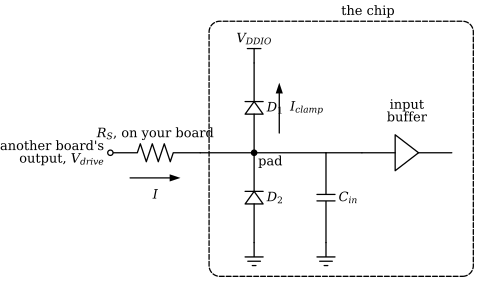

# Protecting the chip's I/O

<!--
  Sources for this page (row 7 of the course path):
  - Tiny Tapeout GPIO spec, https://tinytapeout.com/specs/gpio/, and analog spec,
    https://tinytapeout.com/specs/analog/, read Nov 16, 2026.
  - SkyWater sky130_fd_io user guide,
    https://skywater-pdk.readthedocs.io/en/main/contents/libraries/sky130_fd_io/docs/user_guide.html,
    read Nov 16, 2026: feature list (hot swap and over-voltage tolerance for sio and
    gpio_ovtv2 only), "use the main Vddio/Vssio connections for their ESD current steering
    diodes". No input clamp-current rating found in it (searched for "clamp current",
    "injection", "absolute").
  - Horowitz and Hill, The Art of Electronics, 3rd ed. (printed pages): 718 (LVC accepts
    inputs to +5.5 V, including when unpowered), 759-760 (SCR
    latch-up, footnote 92: input clamp current e.g. 20 mA, series input resistor), 794
    (Fig. 12.3 caption: LVC outputs don't load lines when unpowered), 795 (input current,
    Fig. 12.4: 20-50 mA, 74HC clamps at +0.6 V, LVC/AUP tolerant when unpowered), 798-800
    (Fig. 12.9: 74LVC1T45, open drain, TXB0101), 802 (Fig. 12.13, 10k pull-up or
    pull-down), 806 (unused inputs).
  - Hall and Heck, eq. 8-8 (t_10-90 = 2.195 tau).
  - Demo board (tt-demo-pcb bbf3dd1): 510 ohm and a segment on each uo_out line.
  - SimProc (uoftasic/simproc 1d97772): info.yaml and top-level RTL.
-->

This page answers: *what can the board around a Tiny Tapeout chip do to its digital pins, and what do you put between a pin and the outside world so that it can't?*

The chip on a Tiny Tapeout breakout is the only one in the kit, so a mistake on your Pmod that damages a pin is expensive. This page covers the pins' ratings, what happens when a pin is driven past them, and the parts that keep it inside: series resistors, buffers and translators, and pull resistors. [Supplies, back-powering and ESD](supplies-back-powering-and-esd.md) covers what happens when one board is powered and the other isn't, and static. In [Lab 04](../labs/lab-04-protect-and-plan-overview.md) you'll add this protection to your Lab 03 board.

## What the pins are rated for

Tiny Tapeout's [GPIO page](https://tinytapeout.com/specs/gpio/) says the chip's pads are SkyWater's `sky130_ef_io_gpiov2_pad` macro and lists their limits:

| Parameter | Limit |
|---|---|
| I/O supply voltage | 1.71 V to 5.5 V; the demo board supplies 3.3 V |
| Drive strength, source or sink | 4 mA |
| Maximum output frequency | 33 MHz |
| Maximum input frequency | 66 MHz |

Under the table it adds: "The input pins are not 5V tolerant." On the demo board the pads run from 3.3 V, so keep every input between 0 V and 3.3 V.

SkyWater's [user guide for its I/O cells](https://skywater-pdk.readthedocs.io/en/main/contents/libraries/sky130_fd_io/docs/user_guide.html) describes the circuit behind that limit. Its GPIO cells "use the main Vddio/Vssio connections for their ESD current steering diodes", that is, each pad has a diode up to the I/O supply and a diode down to ground. Its feature list gives "Hot swap & over-voltage tolerant" for two other cells, `sky130_fd_io__sio` and `sky130_fd_io__gpio_ovtv2`, and not for `sky130_fd_io__gpiov2`. We found no rating in that guide for how much current the diodes may carry, so the arithmetic below uses Horowitz and Hill's typical figures and a limit you'll set in Lab 04.

## Beyond the rails

Inside the supply range a CMOS input draws essentially no current. Horowitz and Hill (*The Art of Electronics*, 3rd ed., p. 795) put the leakage at about $10^{-5}$ µA. Outside the range the protection diodes conduct: an input more than a diode drop above the supply pushes current through the upper diode into the supply rail, and one below ground pulls current through the lower one. They warn that "Momentary currents greater than 20–50 mA through these diodes will damage or destroy the part, in some cases causing what's known as 'SCR latchup'". In latch-up, the current through the input diodes turns on a pair of parasitic transistors that short the supply to ground, and the chip stays shorted, getting hot, until you turn the power off (p. 759). Their footnote says how to prevent it: manufacturers guarantee no latch-up while the input current stays below an "input clamp current", for example 20 mA, so "you can use a series input resistor to prevent latchup even with input-voltage overdrive" (p. 759).

*A chip input as the outside sees it. $D_1$ and $D_2$ are the pad's protection diodes, and $C_{in}$ is the capacitance of the pin, its trace and the connectors. When $V_{drive}$ rises above $V_{DDIO}$ plus a diode drop, $D_1$ conducts, and $R_S$, on your board, is all that limits the current.*

## Sizing a series resistor

With the input past the rail, the current through the resistor and the upper diode is

$$I = \frac{V_{drive} - V_{DDIO} - V_D}{R_S},$$

where $V_D$ is the diode's forward drop. Horowitz and Hill use about 0.6 V for it (p. 795). The worst case for a 3.3 V source such as a USB-UART dongle is a chip that isn't powered, with $V_{DDIO}$ near 0 V, because the whole 3.3 V then appears across the resistor and the diode:

| $R_S$ | $I = (3.3\ \text{V} - 0.6\ \text{V})/R_S$ |
|---|---|
| 100 Ω | 27 mA |
| 330 Ω | 8.2 mA |
| 1 kΩ | 2.7 mA |
| 4.7 kΩ | 0.57 mA |

The first row is already past Horowitz and Hill's 20 mA example. Lab 04 sets the limit you design to and has you work out the resistor from it; the next page explains why the unpowered case is also the one where that current does the most mischief.

A series resistor costs speed. With the capacitance at the pin it forms an RC low-pass, and its 10–90 % rise time is $2.2RC$ (Hall and Heck, *Advanced Signal Integrity for High-Speed Digital Designs*, eq. 8-8, give $2.195\tau$). We have no figure for the pad's own capacitance, so suppose the pin, its trace and the connectors add up to 10 pF. Then 1 kΩ gives $\tau$ = 10 ns and an edge of 22 ns. For a UART at 115 200 baud, whose bits last 8.7 µs, that edge doesn't matter at all. For an input near the pads' 66 MHz rating, whose half period is 7.6 ns, the edge would last longer than the signal stays high, so a fast line can only have a small series resistor, of tens of ohms. That small resistor, placed at the driving end, is also the series termination that [Placement and routing](placement-and-routing.md#when-a-trace-stops-being-a-wire) mentions for long lines.

## Outputs

An output pin can be driven past its rails from outside in the same way, through its own protection diodes, and it can also be asked to drive more than its 4 mA. On the demo board, every `uo_out` line already drives one segment of the 7-segment display through a solder jumper and a 510 Ω resistor. If your Pmod adds an LED on the same line, that's a second load on a pin rated for 4 mA, and both share it. If a `uo_out` pin drives the input of something powered separately, such as the RX pin of a USB-UART dongle, then a powered chip and an unpowered dongle put the chip's output high into the dongle's clamp diode, which loads the output and feeds the dongle's supply. A series resistor on that line limits both.

## Buffers and translators

A series resistor limits current, but it doesn't change a signal's level. When the other side runs at a different voltage, you need a part in between. Horowitz and Hill's cookbook of connections between logic families (pp. 798–800) has the ones you'd use here:

- **A buffer with 5 V-tolerant inputs.** The 74LVC family accepts inputs up to 5.5 V "regardless of its own supply voltage (including when it is unpowered)" (p. 718), and its output stages are built not to load a shared line when the part is unpowered (p. 794). A single 74LVC buffer powered from your Pmod's 3.3 V turns a 5 V signal into a 3.3 V one for the chip's input.
- **A dual-supply translator**, such as the 74LVC1T45, which runs from 1.8 V to 5 V on each side and has a direction pin. Use one when the other side is lower than 3.3 V, or when the line goes both ways.
- **An open-drain output with a pull-up to the receiving side's supply.** It's simple and works across almost any pair of voltages. The pull-up resistor is a compromise, because a smaller one gives faster rising edges and draws more current while the line is low.
- **An auto-direction translator** such as the TXB0101, which needs no direction pin but requires the B side's supply to be at least the A side's.

The chip's analog pins are a different case, because there the signal itself is an analog voltage. Tiny Tapeout's [analog page](https://tinytapeout.com/specs/analog/) gives the path from each pad to the project as under 500 Ω and under 5 pF, through an analog switch, with 4 mA at most, and the analog capstone brief works with those numbers.

## Inputs that nobody drives

A CMOS input that isn't driven floats, and Horowitz and Hill warn that an open input can float up to the logic threshold, where the gate's output sits at half the supply "with both MOS output transistors conducting", drawing current and sometimes oscillating (p. 806). So every input your board might leave undriven needs a resistor that holds it at a defined level. A switch is the usual case. Their switch-to-logic circuit (p. 802) uses a 10 kΩ pull-up or pull-down, and for CMOS either works. SimProc is a good example: its `uio[0..7]` pins are all inputs (`uio_oe` is 0 in its RTL) and set its UART's bit period, so the Lab 03 Pmod puts a switch and a pull-down on each one, and a switch that's open reads as 0 rather than as whatever the line picks up.

## Check yourself

1. A teammate wants to connect a 5 V Arduino output straight to `ui_in[2]`. What do you tell them, and what would you put in between?

   

   
Answer

   The pads aren't 5 V tolerant, and on the demo board they run at 3.3 V, so a 5 V high would push current through the pad's upper diode into the 3.3 V supply. Put a 74LVC buffer powered from 3.3 V in between (its inputs take up to 5.5 V), or a dual-supply translator. A series resistor alone would limit the current, but the pin would still sit a diode drop above its supply.

   

2. A dongle's TX at 3.3 V drives `ui_in[0]` through 1 kΩ while the kit is switched off. Roughly how much current flows into the chip?

   

   
Answer

   With $V_{DDIO}$ near 0 V and about 0.6 V across the diode, $(3.3 - 0.6)\ \text{V} / 1\ \text{kΩ}$ = 2.7 mA.

   

3. Why can a UART line take a 1 kΩ series resistor when a 50 MHz clock line can't?

   

   
Answer

   The resistor and the capacitance at the pin set the edge time, $2.2RC$. With 10 pF, 1 kΩ gives about 22 ns edges, which is nothing against a UART bit of microseconds, but longer than a 50 MHz clock's whole 20 ns period.

   

4. Why does each of SimProc's eight baud-rate switches need a pull-down?

   

   
Answer

   An open switch leaves the `uio` input undriven, and a floating CMOS input can drift to the logic threshold, where it reads as either value and makes the input stage draw current. The pull-down makes an open switch read as 0.

   

Next: [Supplies, back-powering and ESD](supplies-back-powering-and-esd.md).
