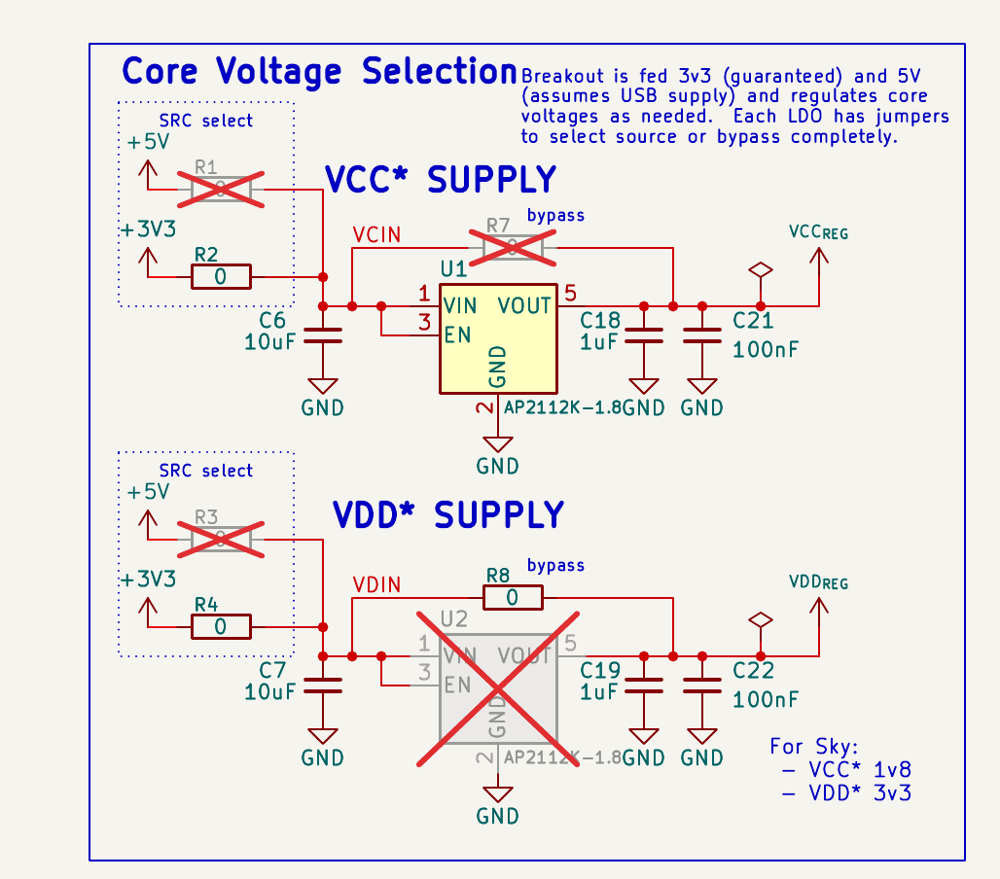

# Schematics other people can read

This page answers: *KiCad drew every wire where I put it, so what is ERC complaining about, and what makes a schematic that the next person can check?*

The person who reviews your board reads its schematic, so does whoever brings the board up, and so do you, six months later, with a probe in one hand. KiCad's electrical rules check, ERC, goes through the schematic before any of them, and it can only check what the schematic says about itself. If you leave a pin open on purpose, or a supply comes in from another board, ERC can't know that unless the schematic tells it, and a person reading the sheet has to guess. This page explains how KiCad decides what is connected and what ERC checks. Then it goes through the ten ERC errors on Tiny Tapeout's SKY130 breakout that you found in [Lab 01](../labs/lab-01-open-a-board-you-didnt-design-overview.md), and the habits that make a schematic readable.

Every ERC count and message on this page comes from `kicad-cli` 10.0.5 in the course's pinned image, run on the breakout at `TinyTapeout/breakout-pcb` 91a2bf1, which is the same setup as in Lab 01.

## Nets, labels and power symbols

A **net** is a set of pins that are connected to each other, and on the board each net becomes the copper that joins those pins. KiCad joins pins into nets in four ways:

- **Wires and junctions.** A wire connects wherever one of its ends lands on a pin or on another wire. A **junction**, the dot drawn where two wires cross, joins those two wires.
- **Labels.** A local label joins every wire and pin on the same sheet that carries a label with the same name. A global label does the same across every sheet of the design. A hierarchical label connects a net inside a sheet to the matching pin on that sheet's symbol in the parent sheet.
- **Power symbols.** A power symbol from KiCad's `power` library, such as `+3V3` or `GND`, makes a net that is global across the whole design and is named by the symbol's value.
- **Pins on top of each other.** Two pins at the same point are connected, and you don't need a wire between them.

The breakout's schematic is one sheet with 333 wires, 46 junctions and 128 local labels. It has no global or hierarchical labels, because there's no second sheet for them to reach. In the board file, a net made by a label and a net made by a power symbol are named differently. A local label's net has the sheet's path in front of its name, so the label `VCIN` makes the net `/VCIN`. A power symbol's net has no prefix, so the board's nets for `+3V3`, `GND` and `VCCD` are named just that.

Because a power symbol's value is its net's name, one library symbol can make any number of supply nets. The breakout uses KiCad's `power:+3V3` symbol, with its value changed, for `VCCD`, `VDDA`, `VDD_{IO}`, `VCC_{REG}` and `VDD_{REG}` as well as for `+3V3` itself. (`_{IO}` is KiCad's markup for a subscript, so `VDD_{IO}` is drawn as VDD with a small IO after it.) ERC treats these as six separate nets, and each of them has its own row in the table of errors below.

Two names on one net is a mistake, and KiCad warns about it. On the breakout, ERC gives one `multiple_net_names` warning, "Both GND and res_an7 are attached to the same items; GND will be used in the netlist". It also gives eleven `isolated_pin_label` warnings, "Label connected to only one pin", for labels such as `res_an16` and `res_an19`, each of which is on a net with only one pin. A pin that you mean to leave unconnected should carry a **no-connect flag** (the small cross KiCad places on a pin), which tells ERC that the pin is open on purpose. The breakout has eleven no-connect flags.

## Pin types and what ERC checks

Every pin of every symbol has an **electrical type**, which says what the pin does to a net. KiCad's symbol format has twelve, and the standard libraries in the course's image use all of them: input, output, bidirectional, tri-state, passive, free, unspecified, power input, power output, open collector, open emitter and not connected. Resistors and capacitors have passive pins, and so does every connector in KiCad's `Connector_Generic` library. A passive pin carries a signal without driving it.

ERC goes through every net and checks the types of the pins on it against a table of which combinations are fine, which deserve a warning and which are errors. Two outputs on one net are an error, for example, because two drivers would fight over the net's voltage.

ERC also requires a net that has a **power input** pin on it, such as a chip's supply pin or a ground symbol, to have a **power output** pin on it as well, such as a regulator's output. If the net has no power output, ERC reports "Input Power pin not driven by any Output Power pins". The rule catches a supply you forgot to connect, but it also fires whenever a supply reaches a net through passive parts, because ERC doesn't look through a passive pin for a source on the other side. So a supply that comes in on a connector, or through a 0 Ω link, looks to ERC like no supply at all.

To tell ERC that a net like that is driven from somewhere it can't see, you put a **power flag** on the net. It's `PWR_FLAG` in KiCad's `power` library, a symbol with a single power-output pin and no footprint, so it satisfies ERC's rule and puts nothing on the board.

## The breakout's ten errors

You found ten ERC errors on the breakout in Lab 01. Here are all ten, with the net each one is on:

| Where ERC reports it | Net | Type |
|---|---|---|
| `#PWR01` (a `VCCD` power symbol) | `VCCD` | `power_pin_not_driven` |
| `#PWR02` (a `GND` symbol) | `GND` | `power_pin_not_driven` |
| `#PWR03` (a `+5V` symbol) | `+5V` | `power_pin_not_driven` |
| `#PWR04` (a `+3V3` symbol) | `+3V3` | `power_pin_not_driven` |
| `#PWR09` (a `VDD_{IO}` symbol) | `VDD_{IO}` | `power_pin_not_driven` |
| `#PWR013` (a `VDDA` symbol) | `VDDA` | `power_pin_not_driven` |
| U1 pin 1, VIN | `/VCIN` | `power_pin_not_driven` |
| U2 pin 1, VIN | `/VDIN` | `power_pin_not_driven` |
| `#FLG01` and U1 pin 5, VOUT | `VCC_{REG}` | `pin_to_pin`: "Pins of type Power output and Power output are connected" |
| `#FLG02` and U2 pin 5, VOUT | `VDD_{REG}` | `pin_to_pin`, the same message |

ERC reports an undriven net only once, at one of its power pins, however many power pins the net has. The `VCCD` net has eleven power symbols in different parts of the sheet, and ERC names only `#PWR01`, so each of the first eight rows is a different net with no source.

{fig-alt="Part of a KiCad schematic titled Core Voltage Selection, with two near-identical blocks. In the upper block, VCC* SUPPLY, a dotted box labelled SRC select holds +5V and +3V3 power symbols, each feeding a 0 ohm resistor, R1 (crossed out) and R2, to a net labelled VCIN. VCIN goes to pins 1 and 3 of U1, an AP2112K-1.8, with a 10 uF capacitor C6 to ground. U1's pin 5, VOUT, connects to C18, 1 uF, C21, 100 nF, a small diamond-shaped power flag and a power symbol labelled VCC REG. A crossed-out 0 ohm resistor R7, labelled bypass, runs from VCIN to the output. The lower block, VDD* SUPPLY, has the same shape with R3 (crossed out) and R4 feeding VDIN, a crossed-out U2, and R8, labelled bypass, not crossed out, joining VDIN to VDD REG. A note at the top right reads: Breakout is fed 3v3 (guaranteed) and 5V (assumes USB supply) and regulates core voltages as needed. Each LDO has jumpers to select source or bypass completely. A note at the bottom right reads: For Sky: VCC* 1v8, VDD* 3v3."}

*The supply section of the breakout's schematic (rev 3.1, according to its title block), plotted by `kicad-cli` 10.0.5. The crossed-out symbols are the parts marked DNP, and the small diamonds by `VCC_{REG}` and `VDD_{REG}` are the two power flags. Made by [`scripts/figures/kicad_figures.sh`](https://github.com/uoftasic/ic103/blob/main/scripts/figures/kicad_figures.sh).*

Six of the ten errors are reported at symbols you can see in the figure. They are the `+5V` and `+3V3` symbols `#PWR03` and `#PWR04` in the upper "SRC select" box, the VIN pins of U1 and U2, and the two power flags. The other four are the `VCCD`, `GND`, `VDD_{IO}` and `VDDA` symbols `#PWR01`, `#PWR02`, `#PWR09` and `#PWR013`, which are in the "Bulk/Bypass C" block at the bottom left of the sheet.

`+3V3`, `+5V` and `GND` reach the breakout on the pins of its two DF12 connectors, and every pin of both connector symbols is passive, so ERC sees no source for any of them. `/VCIN` and `/VDIN`, the regulators' inputs, are fed from `+3V3` through the 0 Ω links R2 and R4, whose pins are passive too, so those nets have power-input pins (the regulators' VIN) and no power output. The chip's three supplies, `VCCD`, `VDD_{IO}` and `VDDA`, have no power output either. Each one is joined to a regulator's output net through another passive 0 Ω link in the "MUX and Supply Headers" block on the right of the sheet. R14 joins `VCC_{REG}` to `VCCD`, and R13 and R15 join `VDD_{REG}` to `VDD_{IO}` and `VDDA`.

The two power flags are on `VCC_{REG}` and `VDD_{REG}`, the regulators' output nets. Each of those nets already has a power output on it, the VOUT pin of its regulator, so the flag adds a second one, and two power outputs on one net is the "Power output and Power output" error.

We checked this by editing a copy of the schematic and running ERC on it again. With the two power flags deleted, ERC reported 8 errors, all `power_pin_not_driven`, on the same eight nets as before, plus 2 new `unconnected_wire_endpoint` warnings for the wires the flags had been on. With a power flag added on each of those eight nets as well, ERC reported no errors. None of the ten errors changes the copper, and the breakout was built and shipped with all ten in its schematic. They're mistakes in what the schematic tells ERC about where power comes from, not in the circuit. On a board of your own, fix them anyway, because if ERC always reports ten errors that you know are harmless, a real eleventh one is easy to miss among them.

So put a power flag on each net whose supply comes in through a connector or a link, and never on a regulator's output net, where the regulator's VOUT pin is already a power output.

## Warnings that come from the libraries

Besides the ten errors, ERC reports 97 warnings on the breakout in the course's setup. Apart from the 12 label warnings above, they are 63 `lib_symbol_mismatch` warnings, such as "Symbol 'GND' doesn't match copy in library 'power'", and 22 `lib_symbol_issues` warnings, such as "The current configuration does not include the symbol library 'psypassives'". Both of those kinds compare the copies of symbols saved in the schematic with the libraries KiCad has set up, so their counts change from one KiCad installation to another. [Symbols, footprints and libraries](symbols-footprints-and-libraries.md) explains where those copies come from.

## Habits that make a schematic readable

ERC checks connections and pin types, and whether a person can follow your schematic is up to you. These are the habits we ask for in this course, with an example of each from the breakout:

- **Group by function and say what each group is for.** The supply section above sits in a box titled "Core Voltage Selection", with sub-blocks titled "VCC\* SUPPLY" and "VDD\* SUPPLY" and dotted boxes marked "SRC select", so a reader can find the regulators without searching the sheet for them.
- **Write the intent on the sheet.** The note "Breakout is fed 3v3 (guaranteed) and 5V (assumes USB supply) and regulates core voltages as needed" tells a reviewer what to check the circuit against. Without a note like that, a reviewer can only check the circuit against itself.
- **Name the nets that matter.** A name such as `VCIN` or `VDD_{REG}` tells the reader what a net is for. When nobody names a net, KiCad makes up a name from a part and pad, which is how the demo board ends up with nets like `Net-(R1-Pad2)`. That's fine for a net between a switch and its resistor, which is what that one is, but a net you'd want to probe should have a name.
- **Draw supplies up and ground down.** In the supply section above, every supply symbol points up and every ground symbol points down, so a reader can find the supply rails at a glance. The rest of the breakout's sheet is less consistent. Many of the power symbols beside its connectors and its chip point sideways, and three `GND` symbols on the header J2 point up.
- **Mark parts that aren't fitted.** The crossed-out symbols tell the reader how this revision is built. The board file and the production BOM have to agree with them, and in Lab 01 you checked that the breakout's production BOM leaves them out.
- **Keep the title block current.** The breakout's schematic says rev 3.1, dated 2025-12-02, and its board file says rev 3.2, dated 2025-10-04. Someone comparing a printed schematic with a board in their hand would reasonably wonder whether they had the right files. In a repository of your own, the git history keeps the real record, and the title block should agree with it.

## Check yourself

1. Your Pmod board gets 3.3 V from a pin of a Pmod connector, and ERC reports "Input Power pin not driven by any Output Power pins" at your `+3V3` symbol. Why, and what's the fix?

   

   
Answer

   Nothing on the `+3V3` net is a power output. The power symbol and your parts' supply pins are power inputs. The connector's pin doesn't count as a source either, because a generic connector's pins are passive, and the power pins of the Tiny Tapeout Pmod symbol that you'll use in Lab 03 are power inputs. The 3.3 V comes from a board on the other side of the connector, which ERC can't see. Put a `PWR_FLAG` on the net, near the connector where the supply comes in.

   

2. Why did the two power flags on the breakout cause errors rather than fix them?

   

   
Answer

   They're on `VCC_{REG}` and `VDD_{REG}`, the regulators' output nets, which already have a power output pin each (VOUT). A power flag is another power output, and two power outputs on one net is an error in ERC's table, "Pins of type Power output and Power output are connected".

   

3. ERC lists one `power_pin_not_driven` error for `VCCD`, at `#PWR01`, but there are many `VCCD` power symbols on the sheet. How many power flags does it take to clear it?

   

   
Answer

   One, anywhere on the `VCCD` net. ERC reports each undriven net once, and a single power output anywhere on a net drives the whole net.

   

4. A wire on your schematic carries two labels, `SDA` and `I2C_SDA`. What does ERC report, and what should you do?

   

   
Answer

   A `multiple_net_names` warning, in the form "Both … and … are attached to the same items; … will be used in the netlist", which names the label KiCad picked. Decide which name you want and delete the other, so the net has one name everywhere: on the schematic, in the board and in the fabrication files.

   

Next: [Symbols, footprints and libraries](symbols-footprints-and-libraries.md).
