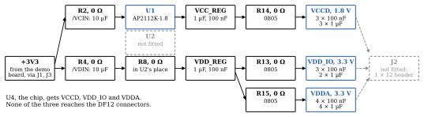

# Supplies, back-powering and ESD

<!--
  Sources for this page (row 7 of the course path):
  - SKY130 breakout (breakout-pcb 91a2bf1), parsed pad by pad on Nov 16, 2026: rails,
    fitted and DNP parts, capacitors per net, connector nets. Demo board (tt-demo-pcb
    bbf3dd1): parts on +3V3 (U1 TLV1117LV33, U6 RP2350, U7 W25Q32), TVS parts D1, D2
    (value "TVS", on usb_d-/usb_d+) and D6-D27 (value "5VTVS", SOD-882, nets /A to /X,
    to the unfitted header J13).
  - Diodes Inc., AP2112 datasheet, DS39724 Rev. 2-2, June 2017,
    https://www.diodes.com/assets/Datasheets/AP2112.pdf, read Nov 16, 2026.
  - SkyWater sky130_fd_io user guide (URL on protecting-the-chips-io), read Nov 16, 2026:
    "Grounded Power Supplies", hold mode, enable_h.
  - Tiny Tapeout ETR demo board guide, read Nov 16, 2026: back-powering a breakout with
    3v3; config.ini modes; uio_oe_pico. FAQ (one chip per kit).
  - Horowitz and Hill, The Art of Electronics, 3rd ed. (printed pages): 611 (TPS775xx
    output capacitor and ESR), 754 (mixed supplies), 759-760 (latch-up; a chip powered by its logic inputs),
    795 (Fig. 12.4: HIGH input partially powers the rail), 804-805 (HBM, Fig. 12.21 and
    12.22, 15 uJ at 2.5 kV).
  - The 5VTVS lines against the SKY breakout: we matched the demo board's J5 pad Ln to
    the breakout's J1 pad n (all 16 digital project nets on those pads agree); /A-/X are
    an0-an11, res_an16, res_an19 and eight GND.
-->

This page answers: *where does each of the chip's supplies come from, what happens to the chip when one board is powered and the board connected to it isn't, and where does static get in?*

[Protecting the chip's I/O](protecting-the-chips-io.md) dealt with each pin on its own. This page starts with the supplies behind the pins. It shows how the breakout makes them, and what SkyWater says about the order in which they come up. Then it follows the current that a powered board can push backwards into an unpowered one, and the current that flows when two boards drive the same line to different levels. Last, it covers static discharge. The demo board has TVS diodes on some of its lines but not on the pins your Pmod reaches, so you put the protection for those pins on your own board.

## The chip's three supplies

The SKY130 chip on Tiny Tapeout's breakout has three supply rails: `VCCD`, the 1.8 V core supply; `VDD_IO`, the supply of the I/O pads; and `VDDA`, the analog supply. The breakout has footprints for two regulators, and as it's built only one of them is fitted. [Tiny Tapeout's boards, part by part](tiny-tapeouts-boards-part-by-part.md) walks through the whole board, and the figure below shows where each of the three supplies comes from.

*The supplies on Tiny Tapeout's SKY130 QFN breakout, rev 3.2, as fitted, from the board file at 91a2bf1 (drawn by [`scripts/figures/sky_breakout_rails.py`](https://github.com/uoftasic/ic103/blob/main/scripts/figures/sky_breakout_rails.py)). U1, an AP2112K-1.8 regulator, makes `VCCD`. `VDD_IO` and `VDDA` come from the demo board's 3.3 V through four 0 Ω links, with no regulator in between. Both rails go through R4 and then R8, which bypasses the empty footprint of the second regulator, U2. After that, R13 goes to `VDD_IO` and R15 to `VDDA`. The dashed parts are marked DNP, for "do not populate", so they aren't fitted.*

So a board plugged into the demo board can't set the chip's supplies one at a time. The only supplies on the breakout's connectors are +3V3, +5V and ground, so changing +3V3 changes `VDD_IO` and `VDDA` together, while `VCCD` stays at 1.8 V as long as U1 has enough input. `VDD_IO` is also joined to the demo board's +3V3 by just three 0 Ω links (R4, R8 and R13), so anything that pushes current into the chip's I/O supply pushes it into the demo board's whole 3.3 V net as well.

## A regulator and its capacitors

A regulator's datasheet says which capacitors it needs on its input and output, so U1's capacitors are part of the regulator's design. Diodes Inc.'s [AP2112 datasheet](https://www.diodes.com/assets/Datasheets/AP2112.pdf) describes a 600 mA CMOS low-dropout regulator that is "Stable with 1.0µF Flexible Cap: Ceramic, Tantalum and Aluminum Electrolytic", and it specifies the regulator's electrical characteristics with 1.0 µF ceramic capacitors on the input and the output. The breakout gives U1 10 µF on its input (C6), and 1 µF and 100 nF on its output (C18 and C21). The six capacitors on `VCCD` itself come after those, on the far side of R14.

Other regulators are stricter. Horowitz and Hill's example (*The Art of Electronics*, 3rd ed., p. 611) is the TPS775xx, whose output capacitor "must be at least 10 µF (with an ESR no less than 50 mΩ and no greater than 1.5 Ω)", and whose datasheet plots the regions of stability and instability. So when you put a regulator on a board, take the value of its output capacitor from the datasheet, and take its type and series resistance from there too whenever the datasheet sets them, as the TPS775xx's does.

## The order the supplies come up in

We found no required power-up order between `VDD_IO`, `VCCD` and `VDDA` in SkyWater's [user guide for its I/O cells](https://skywater-pdk.readthedocs.io/en/main/contents/libraries/sky130_fd_io/docs/user_guide.html), and no power-sequencing statement from Tiny Tapeout for the chip itself. The guide's rules are about a supply that is off, and about what the pads do while the supplies come up:

- "no single power supply will be grounded while another supply is active. This will help alleviate the grounded NWELL issues that induce latch-up. It is OK to float a supply while another is active though."
- Before `vccd` is taken to 0 or left floating, the cell's hold mode must be asserted.
- During power-up a control signal, `enable_h`, is held low, and "the output driver is forced to a known state (Hi-Z)".

These rules are written for the people who design the chip's I/O ring, and the guide says that the chip team is responsible for the levels on those supplies. On the breakout as it's fitted, `VDD_IO` and `VDDA` rise with the demo board's +3V3, and `VCCD` follows once U1 has started, so the board fixes the order and nothing on a Pmod can change it.

## Back-powering

Tiny Tapeout's ETR guide uses "back-powered" for feeding the boards 3.3 V on purpose, through a header pin. None of the breakout boards so far needs the 5 V that comes in from USB, it says, so "the boards can be back-powered by feeding 3v3 on a header pin marked as such". On this page the word means an accident instead, in which a chip is powered through its own input pins.

*The kit is switched off, but the USB-UART dongle on the SimProc Pmod takes its power from the laptop, and the dongle's TX line sits high between characters. Current flows through $R_S$ and the pad's upper protection diode into `VDD_IO`, and from there through the breakout's 0 Ω links onto the demo board's +3V3 net. The figure draws the three links as one resistor, and everything else on that net as a second resistor. In the demo board's file, that net includes its RP2350, the RP2350's flash memory and the output of its TLV1117LV33 regulator.*

Horowitz and Hill say that a HIGH input on an unpowered chip without tolerant inputs will "partially power the supply rail" through the clamp (p. 795). The "craziest" case they give is a CMOS chip whose supply pin was never wired up, and which works anyway because it is "powered by one of its logic inputs (via the chip's internal input-protection diodes from input to VDD)", until the moment all of its inputs are low at once (p. 760). Current through those input diodes can also start latch-up (p. 759). Their advice for low-power CMOS boards includes the same warning: "be careful whenever mixing supply voltages. Otherwise you may have current flowing through input-protection diodes" (p. 754).

SkyWater's rules cover a supply that is grounded and a supply that is floating, and in this case the kit's +3V3 is neither, because the dongle's current holds it up at a voltage that depends on that current and on the rail's load. You can keep that current small, or stop it, in three ways:

- **A series resistor** on the line, sized as on the previous page, limits the current to a value that you choose.
- **A buffer whose inputs accept a voltage even while it's unpowered**, such as a 74LVC part, sits between the dongle and the chip, powered from the 3.3 V that your Pmod takes from the kit. When the kit is off, the buffer is off too, and its input takes the dongle's 3.3 V without passing current on to the chip.
- **A written order** for powering and unplugging the boards keeps the dongle from driving an unpowered chip at all. In Lab 04 you'll write it in `BRINGUP.md`, which says which board is powered first and which is unplugged first, and why.

It can also happen the other way round. If the kit is on and the dongle is unplugged from the laptop, SimProc's TX output on `uo_out[0]` drives the dongle's unpowered RX input, and the series resistor that you put on that line in Lab 04 limits the current that flows into the dongle.

## Contention

Contention means that two outputs are driving one line to different levels at the same time. Only the two drivers' output resistances limit the current, and it flows for as long as they disagree. A Pmod for a Tiny Tapeout project is never the only thing connected to its pins ([Pins, Pmods and planning a pinout](pins-pmods-and-planning-a-pinout.md#what-else-is-on-each-pin) has the list), so for each pin you need to know what the other drivers on it are doing:

- **The RP2350.** The demo board's firmware has three modes, which the ETR guide's example `config.ini` lists: `SAFE`, with "all RP2 I/O connected pins inputs"; `ASIC_RP_CONTROL`, in which the "TT inputs,nrst and clock" are driven by the RP2350; and `ASIC_MANUAL_INPUTS`, "basically same as safe, but intent is clear". The example sets `ASIC_RP_CONTROL` as the default, and `config.ini` can set a different mode for each project. A SimProc Pmod drives `ui_in[0]` from the dongle, so SimProc's section of `config.ini` has to select `ASIC_MANUAL_INPUTS`. On the `uio` pins, a separate option called `uio_oe_pico` decides which of the RP2350's pins are outputs, and for SimProc it has to leave all eight as inputs, because the switches on your Pmod drive those lines.
- **The DIP switches.** A switch that's on connects its `ui_in` line to +3V3 through 1 kΩ. With your board driving the same line low, 3.3 V / 1 kΩ = 3.3 mA flows into your driver, and the line's low level then depends on how stiff your driver is. For SimProc, switch 1, the one on `ui_in[0]`, has to be off.
- **The chip.** On a `uio` pin, the project's own `uio_oe` decides whether the chip drives it. SimProc sets `uio_oe` to 0, so its eight `uio` pins are inputs and your switches never fight it.

A series resistor helps here as well, because with $R_S$ between your driver and the line, the worst-case contention current is about 3.3 V / $R_S$.

## ESD

Static discharge is another way for current to get into a pin from outside. The human body model, which chip makers test with, treats a charged person as 100 pF in series with 1.5 kΩ, and Horowitz and Hill (p. 804) give its usual charging voltages as 1 to 2.5 kV, with some ICs rated up to 15 kV. At 2.5 kV that's a peak current of 1.67 A for a pulse with a time constant of 150 ns. Their estimate is that such a discharge delivers 15 µJ to an unprotected input, and that a pair of external clamp diodes, one to the supply and one to ground, with a series resistor on each side of them, cuts that to about 0.1 µJ (p. 805). Ordinary diodes like these have more junction area than the clamps on a chip, so they clamp better. The resistor before them limits the current through the diodes, and the resistor after them limits the current into the chip.

Static gets in wherever something from outside touches the board, such as a connector, a cable or a finger. The demo board's file has TVS diodes, which are parts made to clamp such pulses, in two places. D1 and D2, valued "TVS", sit on the USB data lines. Twenty-two more, valued "5VTVS" and in SOD-882 packages (D6 to D27), sit on the lines `/A` to `/X`, which run from the breakout's connector to an unfitted 2 × 16 header. We matched the demo board's connector to the SKY130 breakout's pad by pad, and the sixteen digital project lines on that connector all line up. On the breakout, those 22 lines are the analog pads `an0` to `an11`, two `res_an` lines and eight grounds. The digital project pins have no TVS diodes, so the `ui_in`, `uo_out` and `uio` lines that your Pmod reaches have only the chip's own protection, and a cable from a dongle gives static a direct path to them. In Lab 04 you'll put ESD protection on the connector that the dongle's cable plugs into, from each of its signal pins to ground, so that a discharge arriving on the cable reaches the ESD part before anything else on your board.

Static can also reach the chip while you're handling the breakout, and each kit has only one chip, so work on an ESD mat, wear a wrist strap, and hold the breakout by its edges.

## Check yourself

1. The kit is off, and the SimProc dongle is plugged into both the laptop and your Pmod. Where does current flow, and what limits it?

   

   
Answer

   It flows from the dongle's TX, which idles high, into `ui_in[0]`, through the pad's upper protection diode into `VDD_IO`, and through the breakout's 0 Ω links onto the demo board's +3V3, where it partly powers everything on that net. The series resistor you add to your Pmod in Lab 04 limits it, and so do the dongle's own output stage and the diode's drop. On the board as Lab 03 leaves it, with no series resistor, only the dongle's output stage and the diode's drop limit it.

   

2. Why does SimProc's section of `config.ini` need `ASIC_MANUAL_INPUTS` when the Pmod is plugged in?

   

   
Answer

   In `ASIC_RP_CONTROL`, the default in the example configuration, the RP2350 drives the `ui_in` pins. The dongle drives `ui_in[0]` too, so the two would fight. `ASIC_MANUAL_INPUTS` leaves the RP2350's pins as inputs.

   

3. Can a board plugged into the demo board run the chip's I/O at 1.8 V while `VDDA` stays at 3.3 V?

   

   
Answer

   No. The only supplies on the breakout's connectors are +3V3, +5V and ground, and on the fitted breakout `VDD_IO` and `VDDA` both come from +3V3 through 0 Ω links. To separate them you'd have to remove R13, the link that feeds `VDD_IO`, and feed `VDD_IO` from outside through the unfitted header J2.

   

4. Which lines on the demo board have TVS diodes, and what does that mean for your Pmod's dongle header?

   

   
Answer

   The USB data lines, and the lines `/A` to `/X`, which connect the breakout's analog pads, and some of its ground pins, to the unfitted analog header. The digital project pins have none, so the dongle header needs its own ESD part, from each of its two signal pins (the dongle's TXD and RXD) to ground.

   

Next: [Measuring current](measuring-current.md).
