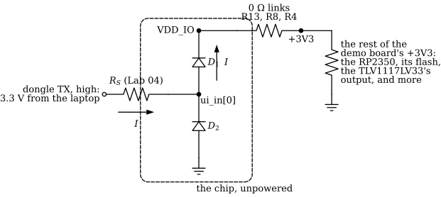

# Supplies, back-powering and ESD

<!--
  Sources for this page (row 7 of the course path):
  - SKY130 breakout (breakout-pcb 91a2bf1), parsed pad by pad on Nov 16, 2026: rails,
    fitted and DNP parts, capacitors per net, connector nets. Demo board (tt-demo-pcb
    bbf3dd1): parts on +3V3 (U1 TLV1117LV33, U6 RP2350, U7 W25Q32), TVS parts D1, D2
    (value "TVS", on usb_d-/usb_d+) and D6-D27 (value "5VTVS", SOD-882, nets /A to /X,
    to the unfitted header J13).
  - Diodes Inc., AP2112 datasheet, DS39724 Rev. 2-2, June 2017,
    https://www.diodes.com/assets/Datasheets/AP2112.pdf, read Nov 16, 2026.
  - SkyWater sky130_fd_io user guide (URL on protecting-the-chips-io), read Nov 16, 2026:
    "Grounded Power Supplies", hold mode, enable_h.
  - Tiny Tapeout ETR demo board guide, read Nov 16, 2026: back-powering a breakout with
    3v3; config.ini modes; uio_oe_pico. FAQ (one chip per kit), per the course plan T1.
  - Horowitz and Hill, The Art of Electronics, 3rd ed. (printed pages): 611 (TPS775xx
    output capacitor and ESR), 754 (mixed supplies), 759-760 (latch-up; a chip powered by its logic inputs),
    795 (Fig. 12.4: HIGH input partially powers the rail), 804-805 (HBM, Fig. 12.21 and
    12.22, 15 uJ at 2.5 kV).
  - The SKY breakout's 60-pin connector carrying an0-an11, res_an and ground where the
    demo board has its 5VTVS parts: the course plan's fact T15 (pad numbers matched
    between the two board files).
-->

This page answers: *where does each of the chip's supplies come from, what happens to the chip when one board is powered and the board connected to it isn't, and where does static get in?*

[Protecting the chip's I/O](protecting-the-chips-io.md) treated each pin on its own. This page is about the supplies behind the pins: how the breakout makes them, what SkyWater says about the order they come up in, how a powered board can run current backwards into an unpowered one, how two boards can fight over one line, and what the demo board does, and doesn't do, about static.

## The chip's three supplies

The SKY130 chip on Tiny Tapeout's breakout has three supply rails: `VCCD`, the 1.8 V core supply; `VDD_IO`, the supply of the I/O pads; and `VDDA`, the analog supply. The breakout has places for two regulators, and as built it fits one. [Tiny Tapeout's boards, part by part](tiny-tapeouts-boards-part-by-part.md) walks through the board; here is the result.

*The supplies on Tiny Tapeout's SKY130 QFN breakout, rev 3.2, as fitted, from the board file at 91a2bf1 (drawn by [`scripts/figures/sky_breakout_rails.py`](https://github.com/uoftasic/pb101/blob/main/scripts/figures/sky_breakout_rails.py)). U1, an AP2112K-1.8 regulator, makes `VCCD`. `VDD_IO` and `VDDA` come straight from the demo board's 3.3 V through four 0 Ω links, past the empty place of the second regulator U2. The dashed parts are marked DNP, do not populate.*

Two things follow. First, a board plugged into the demo board can't set the chip's supplies one at a time. The breakout's connectors carry only +3V3, +5V and ground, so changing +3V3 changes `VDD_IO` and `VDDA` together, and `VCCD` stays at 1.8 V as long as U1 has enough input. Second, `VDD_IO` is the demo board's +3V3, joined to it by three 0 Ω links. Anything that pushes current into the chip's I/O supply pushes it into the demo board's whole 3.3 V net.

## A regulator and its capacitors

U1's capacitors are part of its design, not decoupling added afterwards. Diodes Inc.'s [AP2112 datasheet](https://www.diodes.com/assets/Datasheets/AP2112.pdf) describes a 600 mA CMOS low-dropout regulator that is "Stable with 1.0µF Flexible Cap: Ceramic, Tantalum and Aluminum Electrolytic", and its electrical characteristics are specified with 1.0 µF ceramic capacitors on the input and the output. The breakout gives U1 10 µF on its input (C6) and 1 µF and 100 nF on its output (C18 and C21), before the six capacitors on `VCCD` itself.

Not every regulator is that relaxed. Horowitz and Hill's example (*The Art of Electronics*, 3rd ed., p. 611) is the TPS775xx, whose output capacitor "must be at least 10 µF (with an ESR no less than 50 mΩ and no greater than 1.5 Ω)", and whose datasheet plots the regions of stability and instability. So when you put a regulator on a board, its output capacitor comes from its datasheet: the value, and sometimes the type and its series resistance too.

## The order the supplies come up in

We found no required power-up order between `VDD_IO`, `VCCD` and `VDDA` in SkyWater's [user guide for its I/O cells](https://skywater-pdk.readthedocs.io/en/main/contents/libraries/sky130_fd_io/docs/user_guide.html), and no power-sequencing statement from Tiny Tapeout for the chip itself. What the guide does say is about supplies that are off:

- "no single power supply will be grounded while another supply is active. This will help alleviate the grounded NWELL issues that induce latch-up. It is OK to float a supply while another is active though."
- Before `vccd` is taken to 0 or left floating, the cell's hold mode must be asserted.
- During power-up a control signal, `enable_h`, is held low, and "the output driver is forced to a known state (Hi-Z)".

These are written for the designers of the chip's I/O ring, and the guide says the chip team is responsible for the levels on those supplies. On the fitted breakout the board fixes the order, and you can't change it from a Pmod: `VDD_IO` and `VDDA` rise with the demo board's +3V3, and `VCCD` follows once U1 has started.

## Back-powering

Tiny Tapeout's ETR guide uses "back-powered" for a deliberate thing: a breakout "can be back-powered by feeding 3v3 on a header pin marked as such", in place of the demo board's own supply. This page means something else by it, the accident in which a chip is powered through its own input pins.

*The SimProc case. The USB-UART dongle takes its power from the laptop, the kit is switched off, and the dongle's TX line sits high between characters. Current flows through $R_S$ and the pad's upper protection diode into `VDD_IO`, and through the breakout's 0 Ω links onto the demo board's +3V3 net, which the figure lumps into one resistor. The demo board's file has its RP2350, the RP2350's flash memory and the output of its TLV1117LV33 regulator on that net.*

Horowitz and Hill describe both halves of what happens next. A HIGH input on an unpowered chip without tolerant inputs will "partially power the supply rail" through the clamp (p. 795). Their "craziest" example is a CMOS chip whose supply pin was never wired up and which works anyway, "powered by one of its logic inputs (via the chip's internal input-protection diodes from input to VDD)", until the moment all its inputs are low at once (p. 760). Meanwhile, the current through the input diodes is exactly what triggers latch-up (p. 759). Their list of habits for CMOS boards puts it in one line: "be careful whenever mixing supply voltages. Otherwise you may have current flowing through input-protection diodes" (p. 754).

In SkyWater's terms the kit's +3V3 is neither grounded nor floating here: it's held up to whatever voltage the dongle's current and the rail's load make it. So the remedies are about keeping that current small, or zero:

- **A series resistor** on the line, sized as on the previous page, limits the current to a value you chose.
- **A buffer whose inputs tolerate an unpowered state**, such as a 74LVC part powered from the Pmod's own +3V3, sits between the dongle and the chip. When the kit is off, the buffer is off too, and its input takes the dongle's 3.3 V without passing current on.
- **A written order.** `BRINGUP.md`, which you'll write in Lab 04, says which board is powered first and which is unplugged first, and why.

The same thing can happen the other way round. If the kit is on and the dongle is unplugged from the laptop, SimProc's TX output on `uo_out[0]` drives the dongle's unpowered RX input, which is the case the series resistor on that line covers.

## Contention

Contention is two outputs driving one line to different levels at once. The current is limited only by the two drivers' output resistances, and it flows for as long as the disagreement lasts. A Pmod for a Tiny Tapeout project is never the only thing connected to its pins ([Pins, Pmods and planning a pinout](pins-pmods-and-planning-a-pinout.md#what-else-is-on-each-pin) has the list), so it has to say what the other drivers are doing:

- **The RP2350.** The demo board's firmware has three modes, which the ETR guide's example `config.ini` lists: `SAFE`, with "all RP2 I/O connected pins inputs"; `ASIC_RP_CONTROL`, in which the "TT inputs, nrst and clock" are driven by the RP2350; and `ASIC_MANUAL_INPUTS`, "basically same as safe, but intent is clear". The example sets `ASIC_RP_CONTROL` as the default, and `config.ini` can set a different mode for each project. On the `uio` pins, an option called `uio_oe_pico` decides which of the RP2350's pins are outputs. A SimProc Pmod drives `ui_in[0]` from the dongle, so it needs SimProc's section of `config.ini` to select `ASIC_MANUAL_INPUTS`.
- **The DIP switches.** A switch that's on connects its `ui_in` line to +3V3 through 1 kΩ. With your board driving the same line low, 3.3 V / 1 kΩ = 3.3 mA flows into your driver, and the line's low level now depends on how stiff your driver is. For SimProc, the switch on `ui_in[0]` has to be off.
- **The chip.** On a `uio` pin, the project's own `uio_oe` decides whether the chip drives it. SimProc sets `uio_oe` to 0, so its eight `uio` pins are inputs and your switches never fight it.

A series resistor helps here as well: with $R_S$ between your driver and the line, the worst-case contention current is about 3.3 V / $R_S$.

## ESD

Static is the other way current gets into a pin from outside. The human body model, which chip makers test with, treats a charged person as 100 pF in series with 1.5 kΩ, and Horowitz and Hill (p. 804) give its usual charging voltages as 1 to 2.5 kV, with some ICs rated up to 15 kV. At 2.5 kV that's a peak current of 1.67 A for a pulse with a time constant of 150 ns. Their estimate is that such a discharge delivers 15 µJ to an unprotected input, and that a series resistor with a pair of external clamp diodes, which have more junction area than the clamps on a chip, cuts that to about 0.1 µJ (p. 805).

Static gets in where something from outside touches the board: connectors, cables and fingers. The demo board's file has TVS diodes, parts made to clamp such pulses, in two places. D1 and D2, valued "TVS", sit on the USB data lines. Twenty-two more, valued "5VTVS" and in SOD-882 packages (D6 to D27), sit on the lines `/A` to `/X`, which run from the breakout's connector to an unfitted 2 × 16 header; on the SKY130 breakout, those connector pins carry the analog pads `an0` to `an11`, two `res_an` lines and ground. The digital project pins have none. So the `ui_in`, `uo_out` and `uio` lines your Pmod reaches have only the chip's own protection, and a cable from a dongle gives static a direct path to them. Lab 04 has you add an ESD part from every pin of the dongle header to ground, at the header, so that a discharge arriving on the cable is diverted before it reaches anything else.

The other half of ESD protection is handling. Each kit has one chip, so handle the breakout on an ESD mat, wearing a wrist strap, and hold it by its edges.

## Check yourself

1. The kit is off, and the SimProc dongle is plugged into both the laptop and your Pmod. Where does current flow, and what limits it?

   

   
Answer

   From the dongle's TX, which idles high, into `ui_in[0]`, through the pad's upper protection diode into `VDD_IO`, and through the breakout's 0 Ω links onto the demo board's +3V3, where it tries to power everything on that net. Only the series resistor on your Pmod and the diode's drop limit it.

   

2. Why does SimProc's section of `config.ini` need `ASIC_MANUAL_INPUTS` when the Pmod is plugged in?

   

   
Answer

   In `ASIC_RP_CONTROL`, the default in the example configuration, the RP2350 drives the `ui_in` pins. The dongle drives `ui_in[0]` too, so the two would fight. `ASIC_MANUAL_INPUTS` leaves the RP2350's pins as inputs.

   

3. Can a board plugged into the demo board run the chip's I/O at 1.8 V while `VDDA` stays at 3.3 V?

   

   
Answer

   No. The connectors carry only +3V3, +5V and ground, and on the fitted breakout `VDD_IO` and `VDDA` both come from +3V3 through 0 Ω links. Separating them means removing a link on the breakout and feeding the rail through the unfitted header J2.

   

4. Which lines on the demo board have TVS diodes, and what does that mean for your Pmod's dongle header?

   

   
Answer

   The USB data lines, and the analog lines from the breakout's connector. The digital project pins have none, so the dongle header needs its own ESD part on every pin.

   

Next: [Measuring current](measuring-current.md).
