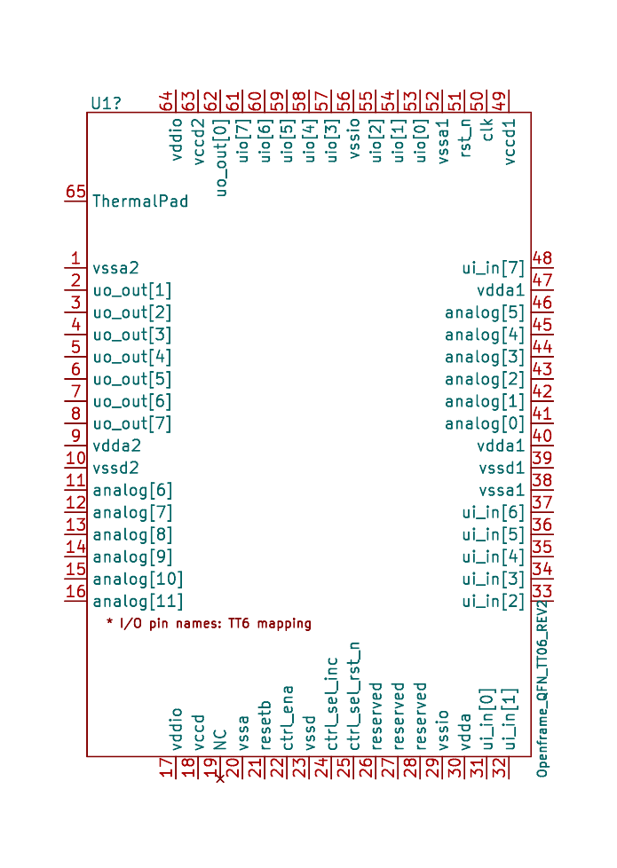
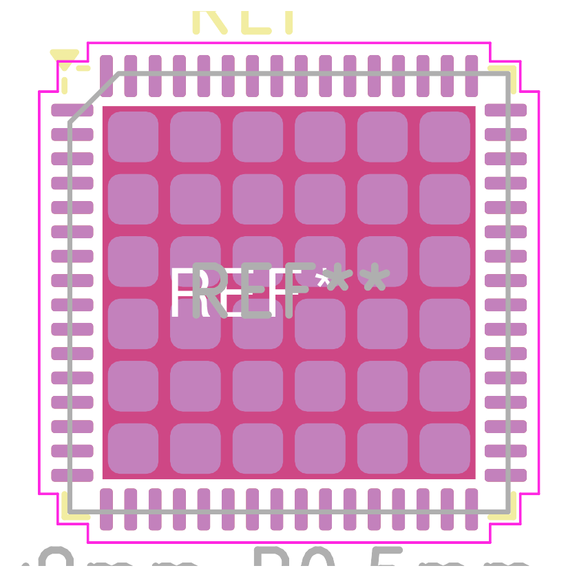
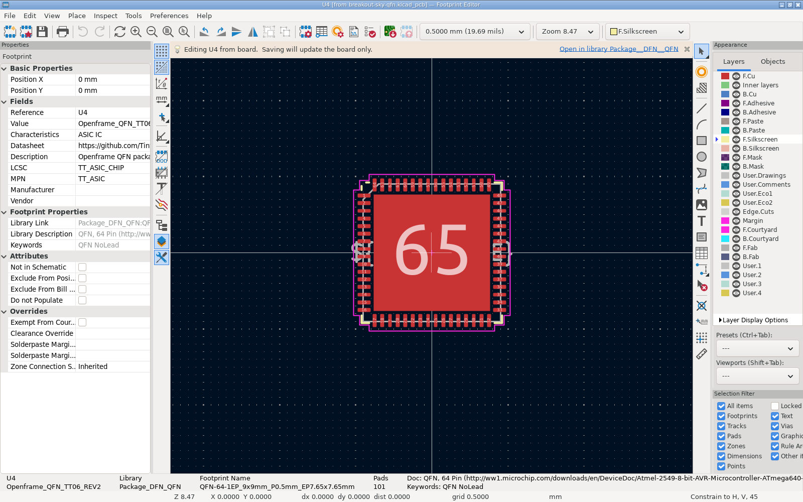

# Symbols, footprints and libraries

This page answers: *the schematic shows the chip as a box with 65 pins, and the board shows it as 64 pads around a square. What ties the two together, and where do they come from?*

Every part in a KiCad design has two drawings. Its **symbol** is what you place in the schematic, and it says what the part does: which pins it has, what they're called and what kind of pin each one is. Its **footprint** is what you place on the board, and it says where the copper, solder and markings go. The two are joined by a single field on the symbol, which names the footprint, and by pin numbers, which must match pad numbers. Both drawings come from **libraries**, which KiCad finds through **library tables**. This page takes each of those in turn, using the chip on Tiny Tapeout's SKY130 breakout as the example throughout, and in [Lab 02](../labs/lab-02-a-footprint-from-a-datasheet-overview.md) you make a symbol and a footprint of your own.

## A symbol says what a part does

A symbol is a drawing with **pins**. Each pin has a number, a name and an electrical type, which [Schematics other people can read](schematics-other-people-can-read.md) showed is what ERC checks. A symbol also has **fields**: a reference (`U4`), a value, a footprint, a datasheet link and a description. A part with several identical sections, such as a quad op-amp, can be split into **units**, each drawn separately.

{fig-alt="A tall rectangular schematic symbol with pins on all four sides. Pin names include uo_out, ui_in and uio lines, vccd, vddio, vdda, the ground pins and analog pins, each with its pin number."}

*The symbol `Openframe_QFN_TT06_REV2` from Tiny Tapeout's library (`tinytapeout-kicad-libs` at 0e99691), plotted by `kicad-cli` 10.0.8. Made by [`scripts/figures/kicad_figures.sh`](https://github.com/uoftasic/pb101/blob/main/scripts/figures/kicad_figures.sh).*

The breakout's chip uses `Openframe_QFN_TT06_REV2`, whose description is "Openframe QFN packaging, with TinyTapeout 6+ pin mapping". It's a single unit with 65 pins. Pins 1 to 64 are the package's pins, and pin 65, named `ThermalPad`, is the exposed pad underneath it. Of the 65, 19 are power inputs (the supply and ground pins, and the thermal pad), 12 inputs, 11 bidirectional, 10 outputs, 12 passive and 1 not connected. Its footprint field already names a footprint, `Package_DFN_QFN:QFN-64-1EP_9x9mm_P0.5mm_EP7.65x7.65mm`, which is the form every footprint reference takes: a library's nickname, a colon, and the footprint's name in that library.

A symbol's pin types are part of its correctness. If a supply pin were drawn as passive, ERC couldn't tell you when the supply was missing, and if two outputs were drawn as bidirectional, it couldn't tell you when they fought. When you make a symbol from a datasheet, the pin types deserve as much care as the pin numbers.

## A footprint says where the copper goes

A footprint is a set of numbered **pads** plus drawings on the board's technical layers. The pad numbers are what join it to the symbol: symbol pin 17 connects to whatever pad is numbered 17, so the symbol's pin 65, `ThermalPad`, lands on the footprint's pad 65, the exposed pad. KiCad doesn't check that the pin and pad mean the same thing, only that the numbers match, which is why a footprint and a symbol made from two different datasheets can disagree without any check noticing.

The layers a footprint draws on each have one job:

| Layer | What it holds | What it becomes |
|---|---|---|
| `F.Cu` | the pads' copper | copper on the board |
| `F.Mask` | openings in the solder mask, usually over each pad | the parts of the board that aren't covered by mask |
| `F.Paste` | openings in the solder paste stencil | where paste is printed before parts are placed |
| `F.SilkS` | outline and pin 1 marker (KiCad calls this layer F.Silkscreen in its menus) | printed ink on the board |
| `F.Fab` | the part's body outline and its reference | assembly drawings, not the board itself |
| `F.CrtYd` | the courtyard, the area the part and its pads need | nothing on the board; DRC checks that courtyards don't overlap |

A part on the back of the board uses the `B.` layers instead. The copper, mask and paste layers are what the fabricator and the assembler work from, so a mistake there gets made. The fab and courtyard layers are for people and for DRC.

{fig-alt="A square footprint drawn in several colours. Sixteen narrow pads line each side. The large square exposed pad fills most of the middle and is covered by a 6 by 6 grid of smaller rounded squares, the paste openings. A thin outline around everything is the courtyard, and short silkscreen corner marks sit just outside the pads, with a small filled triangle at the top-left corner."}

*`QFN-64-1EP_9x9mm_P0.5mm_EP7.65x7.65mm` from KiCad 10.0.8's `Package_DFN_QFN` library, with its copper, paste, mask, silkscreen, fab and courtyard layers. Made by [`scripts/figures/kicad_figures.sh`](https://github.com/uoftasic/pb101/blob/main/scripts/figures/kicad_figures.sh).*

That footprint shows each layer at work. Its 64 signal pads are 0.85 × 0.25 mm rounded rectangles on `F.Cu`, `F.Mask` and `F.Paste`. The exposed pad, pad 65, is a 7.65 mm square on `F.Cu` and `F.Mask` only, and its paste is printed through 36 separate 1.03 mm squares in a 6 × 6 grid, which together cover 36 × 1.03² / 7.65² = 65 % of it. KLC's rule F6.3 explains why an exposed pad gets separate openings: they're there "to reduce the amount of solderpaste that is applied during stencil application". [From die to package](from-die-to-package.md) shows where the exposed pad comes from. The silkscreen lines are 0.12 mm wide, the courtyard is drawn in 0.05 mm lines and reaches 5.13 mm from the centre on each side, and the fab outline is 0.1 mm.

## KiCad's library conventions

KiCad's own libraries follow the **KiCad Library Convention** (KLC), a set of rules that the numbers above come from. They're a good default for footprints of your own, and these are the ones you'll use most, from the KLC's source at commit 6e8cbad:

| Rule | What it says |
|---|---|
| F4.2 | Pin 1 at the top left ("IPC-7351"); for a QFN with pin 1 in the middle of a side, that side at the top. |
| F5.1 | Silkscreen lines between 0.10 and 0.15 mm, nominally 0.12 mm; no silkscreen over pads, with a recommended 0.2 mm clearance from exposed copper. |
| F5.2 | Fab outline in lines of 0.10 to 0.15 mm (0.10 mm recommended), with a bevel at pin 1 on IC packages. |
| F5.3 | Courtyard in 0.05 mm lines, 0.25 mm clear of the part and its pads by default (0.15 mm for parts smaller than 1.5 mm), 0.5 mm for connectors, crystals and canned capacitors, 1.0 mm for BGAs. |
| F6.3 | SMD pads as rounded rectangles; at least 0.2 mm between an exposed pad and the other pads; paste over 50 % to 80 % of an exposed pad's area, 65 % recommended. |
| F7.5 | Annular ring of a through-hole pad at least 0.15 mm ("IPC-2221"). |
| F7.6 | Finished hole at least the lead's maximum diameter plus 0.2 mm ("derived from IPC-2222 class 2"). |

KLC is a convention for a library that has to work for everyone, so its numbers are a floor that suits most fabricators. A fabricator's own minimums can be stricter, and [Layers and fabricator rules](layers-and-fabricator-rules.md) shows what happens when you check a board against them.

## One package, many footprints

The image the course's checks run in has 155 footprint libraries, and `Package_DFN_QFN` alone holds 779 footprints. Thirty of them have names that start `QFN-64-1EP_9x9mm_P0.5mm`: the same 9 × 9 mm body and 0.5 mm pitch, with exposed pads from 3.4 mm to 7.65 mm square, some with thermal vias and some without. The name spells out what you need to match: the package, the pin count, `1EP` for one exposed pad, the body size, the pitch and the exposed pad's size.

So picking a footprint by its body size and pin count isn't enough. A QFN-64 package with a 4.7 mm exposed pad would sit on the 7.65 mm footprint's pad with solder spread far past its own, and one with a 7.65 mm pad would overhang a 4.7 mm footprint's. Tiny Tapeout's IHP breakout, for example, uses a footprint of Tiny Tapeout's own, `QFN-64-1EP_9x9mm_P0.5mm_EP4.7x4.7mm_IHP_C`. The package drawing in the part's datasheet is what decides, and working from one is what Lab 02 is about.

## Libraries and library tables

A footprint library is a folder whose name ends in `.pretty`, with one `.kicad_mod` file per footprint. A symbol library is a single `.kicad_sym` file. KiCad finds them through **library tables**, which map a nickname such as `Package_DFN_QFN` to a path. There are two kinds. The global tables (`fp-lib-table` and `sym-lib-table` in your KiCad settings) list the libraries every project can use, and KiCad sets them up with its own libraries the first time it runs. A project's own tables, files with the same names beside its `.kicad_pro`, add libraries for that project only.

The breakout has project tables, and each one adds Tiny Tapeout's library:

```
(lib (name "TinyTapeout")(type "KiCad")(uri "${KIPRJMOD}/../tinytapeout-kicad-libs/footprints/TinyTapeout.pretty")(options "")(descr ""))
```

`${KIPRJMOD}` is the folder the project is in, so this path means "the folder `tinytapeout-kicad-libs` beside this project's folder". In Tiny Tapeout's repository that folder is a git submodule, and the course's fetch script puts the same library there, which is why the breakout finds its library when you open it. Paths that start from `${KIPRJMOD}` are the reason a project works the same on every computer: nothing depends on where the computer keeps its libraries.

## The copies inside a design

A KiCad design doesn't depend on its libraries once a part is placed, because it keeps a copy. The schematic stores each symbol it uses in a section of its own, and the board stores every footprint in full. That's why the breakout opens even without Tiny Tapeout's library, and why the Footprint Editor, opened on U4 from the board, says it's editing the board's copy:

{fig-alt="KiCad's Footprint Editor. A banner across the top of the canvas reads: Editing U4 from board. Saving will update the board only. Open in library Package_DFN_QFN. The canvas shows the QFN-64 footprint with its large exposed pad numbered 65. The Properties panel on the left lists U4's fields, including Characteristics ASIC IC, LCSC TT_ASIC_CHIP and MPN TT_ASIC, and the library link Package_DFN_QFN. The status bar at the bottom shows Pads 101."}

*U4 opened from the board in the Footprint Editor of KiCad 10.0.8. The status bar counts 101 pads: 64 signal pads, the exposed pad and its 36 paste openings, which KiCad stores as pads with no copper. Screenshot from [`scripts/screenshots/kicad/shot.sh`](https://github.com/uoftasic/pb101/blob/main/scripts/screenshots/kicad/README.md).*

The copies are also where two kinds of warning come from. When KiCad can find the library a part came from, it compares the copy with the library's version, and when they differ it warns. When it can't find the library at all, it warns about that instead. In the course's setup, DRC on the breakout reports:

- 47 `lib_footprint_mismatch` warnings, such as "Footprint 'C_0402_1005Metric' does not match copy in library 'Capacitor_SMD'". They cover every footprint the board took from KiCad's own libraries: 25 capacitors, 15 resistors, 3 fiducials, the two regulators, the header J2 and the chip. The warning says that the copies differ, not how. For U4, we compared the two: the pads are identical, and the library's version has gained a filled triangle on the silkscreen at the pin 1 corner, which the board's copy doesn't have, and different fields.
- 76 `lib_footprint_issues` warnings, all "The current configuration does not include the footprint library …": 74 for `flyingcarsfootprints`, the library of the board's stitching vias, and 2 for `Logos`. `flyingcarsfootprints` isn't in either of Tiny Tapeout's library repositories, so these 74 stay whatever you install.

ERC reports the same two kinds for symbols: 69 `lib_symbol_mismatch` and 22 `lib_symbol_issues`. None of these warnings is about the board's copper. They're about whether the design still matches its libraries, and when a design is meant to be a record of what was built, the copy in the design is the one that counts. When you start a board of your own, though, it's worth resolving them: either update the part from the library, or know why you've kept the old copy.

## Check yourself

1. In a symbol you've made, pin 17 is `vddio`. What connects it to a particular pad on the board?

   <details>
   <summary>Answer</summary>

   Two things: the symbol's footprint field, which picks the footprint, and the pad number. Pin 17 connects to the pad numbered 17 in that footprint, whatever that pad is. KiCad doesn't check that pad 17 is really the package's `vddio` lead, so the numbers have to come from the same package drawing.

   </details>

2. A friend opens the breakout without Tiny Tapeout's library beside it. Does the chip's footprint still appear on the board, and what changes?

   <details>
   <summary>Answer</summary>

   It appears, because the board stores a full copy of every footprint. What changes is the warnings: KiCad can no longer find the `TinyTapeout` library to compare against, so DRC and ERC report it as missing.

   </details>

3. Your package's drawing gives a 9 × 9 mm body, 64 pins at 0.5 mm pitch and a 4.7 mm exposed pad. Why is `QFN-64-1EP_9x9mm_P0.5mm_EP7.65x7.65mm` the wrong footprint?

   <details>
   <summary>Answer</summary>

   Its exposed pad is 7.65 mm square, so the copper and the paste for the package's 4.7 mm pad would be far too large: solder would spread across copper the package doesn't cover. The footprint's name has to match the drawing in every part, the exposed pad included.

   </details>

4. The paste openings on that footprint's exposed pad cover 65 % of it. What range does KLC allow?

   <details>
   <summary>Answer</summary>

   50 % to 80 % of the exposed pad's area, with 65 % recommended (rule F6.3).

   </details>

Next: [From die to package](from-die-to-package.md).
