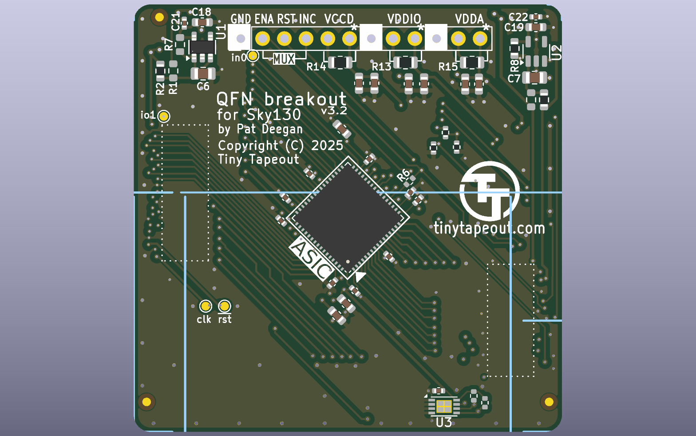
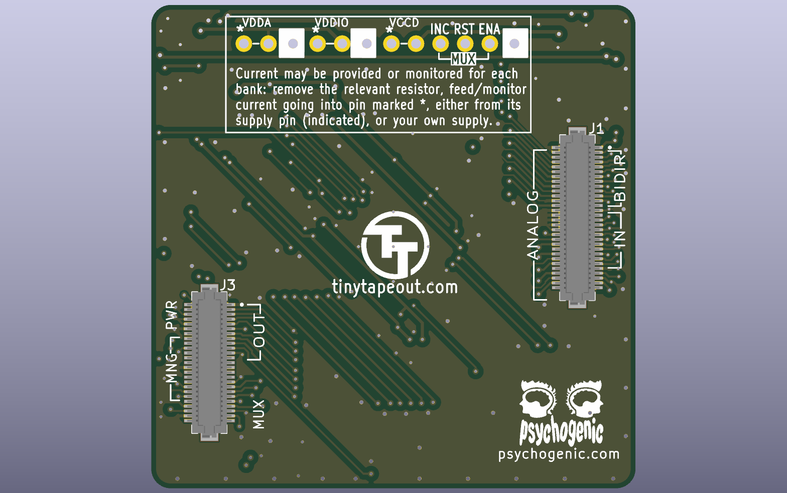
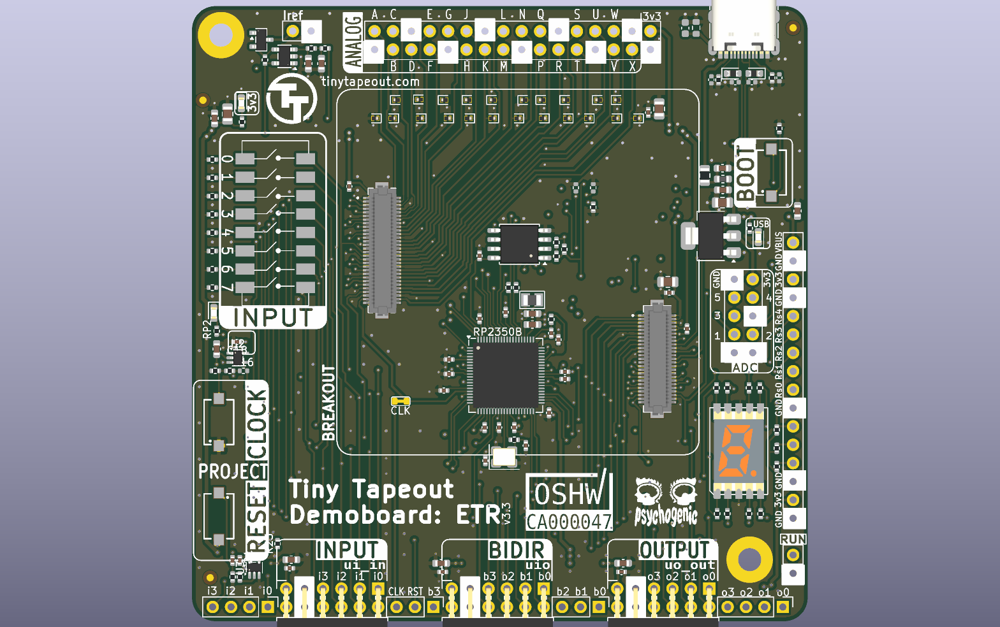
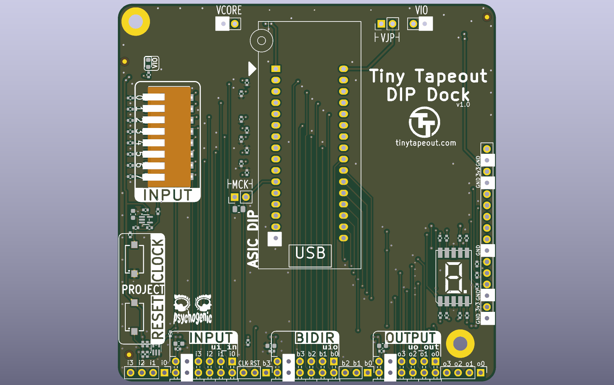

# Tiny Tapeout's boards, part by part

This page answers: *what is actually on the boards a Tiny Tapeout chip arrives on, and how do you read a board that someone else designed?*

Tiny Tapeout publishes its boards as open KiCad projects under the Apache 2.0 licence, so you can open the very files the boards were made from. That makes them the best first boards to read: they're real, they were built and shipped, and they hold the decisions a board designer makes for a chip, written down in KiCad's own format. The course fetches them from Tiny Tapeout's repositories at fixed commits (Lab 01 has you run the script), so every board on this page is the version you'll open:

| Board | Repository and folder | Title block | Size | Copper layers | Saved by |
|---|---|---|---|---|---|
| SKY130 QFN breakout | `breakout-pcb/breakout-sky-qfn` | rev 3.2, 2025-10-04 | 50 × 50 mm | 4 | KiCad 9 |
| IHP QFN breakout | `breakout-pcb/breakout-ihp-qfn` | rev 1.2, 2026-08-18 | 50 × 50 mm | 4 | KiCad 10 |
| Demo board | `tt-demo-pcb` | "Tiny Tapeout Demoboard v3", rev 3.3, 2026-06-23 | 85 × 85 mm | 4 | KiCad 9 |
| DIP dock | `breakout-pcb/dip-dock` | rev 1.0, 2026-10-19 | 85 × 85 mm | 2 | KiCad 10 |

The sizes are the extent of each board's outline, the copper layers are the ones each board file defines, and "saved by" is the `generator_version` in the board file. `breakout-pcb` is at commit 91a2bf1 and `tt-demo-pcb` at bbf3dd1.

## The SKY130 QFN breakout

This is the board that carries a SKY130 chip, so it's the one most of the team's chips will arrive on, and it's the board you take apart in [Lab 01](../labs/lab-01-open-a-board-you-didnt-design-overview.md).

{fig-alt="Top view of a square green board. A QFN chip, rotated 45 degrees, sits in the middle as a dark square package with leads along its four sides. A row of twelve plated holes along the top edge is labelled GND, ENA, RST, INC, VCCD, VDDIO and VDDA, with R14, R13 and R15 below the last three. Small resistors and capacitors are grouped near the top corners, with the regulator U1, a small black package, on the left, and only the empty pads of U2 on the right. Text reads QFN breakout for Sky130 v3.2. The empty pads of U3 are near the bottom edge, and four round test points are labelled in0, io1, clk and rst."}

*The top of the SKY130 QFN breakout, rendered by `kicad-cli` 10.0.5 from the board file, with KiCad's 3D models of the parts. Under them are the pads, holes, silkscreen and copper under the solder mask. `kicad-cli pcb render` leaves out the models of parts marked DNP, so U2 and U3 show only their pads. Made by [`scripts/figures/kicad_figures.sh`](https://github.com/uoftasic/ic103/blob/main/scripts/figures/kicad_figures.sh), as are the other renders on this page.*

The chip, U4, sits in the middle in KiCad's own footprint `QFN-64-1EP_9x9mm_P0.5mm_EP7.65x7.65mm`: a 9 × 9 mm QFN with 64 pins at 0.5 mm pitch and a 7.65 mm square exposed pad underneath. Its schematic symbol, `Openframe_QFN_TT06_REV2`, comes from Tiny Tapeout's own library. The chip is placed at 45° to the board's edges, which the board file records as a rotation of 135°.

Around it are footprints for the parts that power it. There are two SOT-23-5 footprints for an AP2112K-1.8 regulator, U1 and U2; a footprint for a 24LC02 EEPROM, U3; a 1 × 12 header, J2, along the top edge, whose silkscreen names its pins GND, ENA, RST, INC, VCCD, VDDIO and VDDA; four test points; a set of resistors, several of them 0 Ω; and capacitors in three sizes, 0402, 0603 and 0805, close to the chip. (Those are imperial size codes, and KiCad's footprint names give the metric size too: `C_0402_1005Metric` is 1.0 × 0.5 mm.) The schematic explains what they're for in notes on the sheet. One reads "For Sky: VCC\* 1v8 / VDD\* 3v3", which names the chip's core supply (`VCCD`, 1.8 V) and its I/O and analog supplies (`VDD_IO` and `VDDA`, 3.3 V). Another says the "Breakout is fed 3v3 (guaranteed) and 5V (assumes USB supply) and regulates core voltages as needed. Each LDO has jumpers to select source or bypass completely." A third says that "each supply pin is jumpered and may be monitored or fed through these headers by popping off the relevant resistor (0805s for easier manip)".

So the board has room for more than one way of powering the chip, and a breakout as built uses one of them. In Lab 01 you work out which parts are fitted, and so which way this revision is built, by following each supply from the connector to the chip's pins.

{fig-alt="Bottom view of the same square board. Two long, narrow grey connectors with fine-pitch pins, one near the left edge and one near the right edge, are the two connectors that plug into the demo board. The rest of the bottom is copper under solder mask, with vias and a few small pads."}

*The bottom of the breakout, with its two Hirose DF12 connectors: J1 with 60 pins and J3 with 50. They plug into the demo board and carry every signal and supply between the two boards.*

## Unfitted footprints and DNP

A footprint on a board means the copper will be there, but it doesn't mean a part will be fitted to it. When a designer leaves room for a part that a particular build doesn't use, KiCad marks it **DNP**, for "do not populate". In the board file a DNP footprint carries `dnp` in its attributes, and in the schematic its symbol carries `(dnp yes)` and is drawn crossed out. Several of the breakout's footprints are marked that way.

DNP affects assembly and not fabrication. The fabricator still makes the pads of a DNP footprint (you can see U2's and U3's pads in the render above), and the assembler leaves them empty. `kicad-cli`, the program the course's checks use, writes a DNP column into a bill of materials by default and can leave DNP parts out of a bill of materials or a placement file (`--exclude-dnp`). Lab 05 has you make both files.

The board file says what the designer intended, and Tiny Tapeout keeps a separate record of what was actually built: its `pcb-files` repository preserves "the PCB/PCBA production files as they were used when creating the relevant run", including the bill of materials sent to the assembler. In Lab 01 you compare the breakout's DNP marks with that record for the same revision.

## Links and jumpers

The breakout's supplies run through **0 Ω resistors**: resistor footprints fitted with a part whose resistance is (very nearly) zero. A 0 Ω resistor behaves as a wire, but it's placed by the same machine as every other resistor, and it can be taken off with a soldering iron, which opens the connection. That makes it a jumper you can change after the board is built. The breakout's note says why three of its links are bigger than the others: they're 0805 parts "for easier manip", because you'd take one off by hand to measure a supply or feed it from outside.

The demo board shows a second kind of jumper. Every `uo_out` pin of every project goes through one, so the path from a `uo_out` pin makes a good first net to follow. Following the net names in its board file:

- `uo_out0` goes to one side of JP2, a two-pad solder jumper whose footprint is bridged with copper (KiCad calls the part `SolderJumper_2_Bridged`).
- The other side of JP2 goes to R19, a 510 Ω resistor in an 0402 package.
- The other side of R19 goes to segment A of the 7-segment display, U4.

`uo_out1` takes the same path through JP3 and R20 to segment B, and so on up to `uo_out7`, which reaches the decimal point through JP9 and R32. A bridged solder jumper is closed as made, and you open it by cutting the thin copper between its pads. So every project's outputs drive a display segment through 510 Ω unless someone cuts the jumper, which is worth knowing when you put another load on the same pin.

The inputs work the other way round. Each of the eight switches in SW1, the input DIP switch, connects one `ui_in` line to the 3.3 V supply through its own 1 kΩ resistor (R1, and R4 to R10).

## The demo board

{fig-alt="Top view of a larger square board. An 8-way DIP switch labelled INPUT is at the upper left. A two-row header labelled ANALOG with pins A to X runs along the top. The middle is a rectangle labelled BREAKOUT with two long connectors, and the RP2350B microcontroller below it. On the right are a header labelled ADC, a 7-segment display and a column of pins. Along the bottom edge are three 2 by 6 Pmod sockets labelled INPUT, BIDIR and OUTPUT, and at the lower left are buttons labelled CLOCK and PROJECT RESET. The text reads Tiny Tapeout Demoboard: ETR v3.3 and OSHW CA000047."}

*The demo board, rev 3.3, from `TinyTapeout/tt-demo-pcb` at bbf3dd1. The rectangle marked BREAKOUT is where the breakout plugs in.*

The demo board has the RP2350 microcontroller (U6, in a QFN-80 with 0.4 mm pitch) and its flash memory (U7, an 8-pin SOIC); a TLV1117LV33 regulator (U1) that makes 3.3 V from the USB supply; the USB-C connector (J1); the input switches and the display; the analog header along the top, whose lines are labelled A to X; and the three I/O Pmod sockets along the bottom edge, J14, J15 and J16. The Pmod sockets' centres are at x = 92.70, 115.56 and 138.42 mm in the board file, 22.86 mm (0.9 in) apart, and a board that plugs into all three has to match that spacing exactly.

The demo board also has 24 TVS diodes, which clamp fast voltage spikes such as an electrostatic discharge. Two of them (value "TVS", D1 and D2) sit on the USB data lines, and the other 22 (value "5VTVS", in SOD-882 packages) sit on the lines `/A` to `/X` of the analog header. None of them is on a digital project pin. [Supplies, back-powering and ESD](supplies-back-powering-and-esd.md) explains why that matters for a board that plugs into the Pmods.

## The DIP dock

{fig-alt="Top view of a square board the same size as the demo board, with fewer parts. It has an 8-way DIP switch at the upper left, a socket outline for a DIP chip carrier in the middle, a 7-segment display on the right, buttons at the left edge and three 2 by 6 Pmod sockets along the bottom edge in the same places as on the demo board."}

*The DIP dock, rev 1.0, from `TinyTapeout/breakout-pcb` at 91a2bf1.*

Not every Tiny Tapeout chip comes in a QFN on a breakout. For chips delivered on a DIP carrier, Tiny Tapeout made the DIP dock, a "Docking station for Tiny Tapeout DIP breakouts" in its README's words, which "provides the same footprint, and same interfaces" as the demo board: the input DIP switch, the 7-segment display, Pmods for I/O, and manual clock and reset. The README also says "The board is very simple, and designed using only two layers."

The board file bears that out, and shows how closely the dock follows the demo board. Its outline is the same 85 × 85 mm, its three Pmod sockets (J5, J6 and J7) sit at the same x = 92.70, 115.56 and 138.42 mm, and its three fiducials (the bare copper dots an assembly machine aligns to) are at the same coordinates. Its custom design rules file, `dip-dock.kicad_dru`, is byte for byte the demo board's, including rules for a QFN-80 and a USB-C connector that the dock doesn't have. Copying a rules file from an older board is common, and harmless here, because a rule with no matching parts checks nothing. It's still worth reading the rules you inherit, which you'll do on [Layers and fabricator rules](layers-and-fabricator-rules.md).

The DIP dock is the closest thing among Tiny Tapeout's boards to the board you draw in Lab 03: two layers, the same Pmod spacing, and simple parts. The difference is that its Pmod sockets are the host side, the side a Pmod plugs into, and your Lab 03 board will be the Pmod.

## Two layers and four

Three of these four boards have four copper layers and one has two. The extra layers in a 4-layer board are inside it. On the SKY130 breakout, a ground zone fills all four layers around the tracks, and the first inner layer is almost solid ground, which gives the signals on the top layer a return path close underneath them. A 2-layer board has to route on both of its layers and fit its ground in around the signals. [Layers and fabricator rules](layers-and-fabricator-rules.md) shows both stackups from the board files.

## Tiny Tapeout's errata

The `breakout-pcb` README is candid about past mistakes, and they're worth knowing before you design anything. The TT07 breakout "has the ASIC project MUX `reset_n` and `increment` wires crossed and is thus mislabelled", and the production run of the TT06 demo boards "had very low valued resistances which, if you wish to interact with analog projects, had to be removed or replaced."

Neither mistake is the kind that KiCad's checks find. ERC checks the schematic against rules about pins, DRC checks the board against geometric rules and against the schematic, and neither reports two wires that connect cleanly to the wrong pins, or a resistor of the wrong value. Mistakes like these are found by reading the board against what it's meant to do, which is what the review in [Lab 06](../labs/lab-06-review-a-seeded-board-overview.md) is for.

## Check yourself

1. U2 on the breakout carries the `dnp` attribute. Does the bare board you'd get from the fabricator have pads for U2?

   

   
Answer

   Yes. DNP tells the assembler not to fit the part. The footprint's copper is still part of the board, which is why U2's pads show in the render.

   

2. Why would a designer put a 0 Ω resistor in a supply line instead of a plain track?

   

   
Answer

   So that the connection can be opened after the board is built, by taking the resistor off. With the link removed you can put a meter in its place to measure the supply's current, or feed that pin from somewhere else, as the breakout's notes describe. A track would have to be cut, which is much harder to undo.

   

3. You design a board to plug into the demo board's three I/O Pmods. Will it also plug into the DIP dock?

   

   
Answer

   Mechanically, yes: the dock's three Pmod sockets are at the same positions, 22.86 mm apart, and its README says it provides the same interfaces as the demo board, Pmods for I/O among them.

   

4. The TT07 breakout had its `reset_n` and `increment` wires crossed. Would ERC or DRC have reported it?

   

   
Answer

   No. The wires connected cleanly, just to each other's pins. ERC and DRC report broken rules, such as unconnected pins, conflicting outputs or copper too close together, and a design can follow every rule and still be wrong about what it connects. A review against the design's intent catches this kind of mistake.

   

Next: [Lab 01: Open a board you didn't design](../labs/lab-01-open-a-board-you-didnt-design-overview.md).
