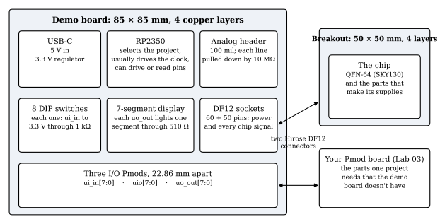

# What a board does for a chip

This page answers: *the team's chips arrive already sitting on a board. What is left for us to design?*

A chip on its own can't do much. It needs its supplies at the right voltages, a clock, some way for you to set its inputs and read its outputs, and some protection from whatever you connect to its pins. Boards provide all of that, and for a Tiny Tapeout chip the first boards are Tiny Tapeout's own. The [next page](tiny-tapeouts-boards-part-by-part.md) goes through the same boards part by part, and in [Lab 01](../labs/lab-01-open-a-board-you-didnt-design-overview.md) you open one in KiCad.

On November 16, 2026, we read the Tiny Tapeout web pages that this page quotes. The board files and READMEs are the ones at the commits the course fetches, which are listed in [`labs/common/upstream.json`](https://github.com/uoftasic/ic103/blob/main/labs/common/upstream.json).

## The devkit

Tiny Tapeout doesn't sell bare chips. Its [FAQ](https://tinytapeout.com/faq/) says "We don't ship bare dies either", and describes what you get instead: "The devkit consists of two PCBs (printed circuit boards) - a 'demo board' and a 'breakout board'. The breakout board contains the shuttle's ASIC, and connects to the demo board via a set of pins." The same FAQ says "You only get 1 chip", and that if you want more you have to order more devkits, so be careful with the one on your bench.

{fig-alt="Block diagram. A large box, the demo board, 85 by 85 mm with 4 copper layers, holds six blocks: USB-C (5 V in, 3.3 V regulator); RP2350 (selects the project, usually drives the clock, can drive or read pins); analog header (100 mil, each line pulled down by 10 megohms); 8 DIP switches (each one connects a ui_in line to 3.3 V through 1 kilohm); 7-segment display (each uo_out lights one segment through 510 ohms); DF12 sockets (60 and 50 pins, power and every chip signal). A wide block along the bottom is the three I/O Pmods, 22.86 mm apart, for ui_in, uio and uo_out. A double arrow labelled two Hirose DF12 connectors joins the sockets to a second box, the breakout, 50 by 50 mm with 4 layers, which holds the chip, a QFN-64 for SKY130, and the parts that make its supplies. A second double arrow joins the Pmods to a box labelled your Pmod board, Lab 03: the parts one project needs that the demo board doesn't have."}

*A Tiny Tapeout devkit for a SKY130 shuttle. The labels come from the demo board's README and board file (`TinyTapeout/tt-demo-pcb` at bbf3dd1), the breakout's board file (`TinyTapeout/breakout-pcb` at 91a2bf1) and Tiny Tapeout's guide to the demo board. Drawn by [`scripts/figures/devkit_blocks.py`](https://github.com/uoftasic/ic103/blob/main/scripts/figures/devkit_blocks.py).*

The **breakout** is a small board that carries the chip and the few parts the chip needs right beside it. On a SKY130 shuttle it's 50 × 50 mm with four copper layers, and the chip is in a QFN-64 package, which [From die to package](from-die-to-package.md) takes apart. A regulator on the breakout makes the chip's 1.8 V core supply from the demo board's 3.3 V, and the chip's I/O and analog supplies take the 3.3 V through 0 Ω links with no regulator in between, which you trace for yourself in Lab 01. It plugs into the demo board through two Hirose DF12 connectors on its underside, one with 60 pins and one with 50, which the FAQ describes as "2 connectors where you get all of the signals of the chip."

The **demo board** is everything else. Its [README](https://github.com/TinyTapeout/tt-demo-pcb) lists three ways to reach a project: "directly, using the input DIP switches and 7-segment display", "via breadboard or extension boards through PMODs" (a Pmod is a small add-on board on a 2 × 6 pin header; Digilent defined the format, and the README links its specification), or "by interacting through the on-board RP2". The RP2 is an RP2350 microcontroller, and the README says it "is responsible for selecting projects, by controlling the project MUX that's on the ASIC and, under most circumstances, providing the clock for the projects." That multiplexer is there because a shuttle's chip carries many projects at once (TT08's carries 135, according to Tiny Tapeout's [news post](https://tinytapeout.com/news/tt08-arrives/) about it), and the RP2350 connects one of them to the pins. The demo board takes its power from a USB-C connector, and Tiny Tapeout's [demo board guide](https://tinytapeout.com/guides/get-started-demoboard-etr/) says that, running the factory test project, the kit draws "around 180-200 milliAmps, on the 5V supply". Before you power a board of your own for the first time, [Bringing up a chip](bringing-up-a-chip.md) has you power the kit without it and compare the kit's current with that figure.

## The chip's pin limits

Every board you design for these chips starts from the limits of the chip's pins, so it's worth having them in one place. Tiny Tapeout's [GPIO page](https://tinytapeout.com/specs/gpio/) gives each project 26 digital pins:

| Pins | Count | Direction |
|---|---|---|
| `clk` | 1 | input, the clock |
| `rst_n` | 1 | input, active-low reset |
| `ui_in[7:0]` | 8 | input |
| `uo_out[7:0]` | 8 | output |
| `uio[7:0]` | 8 | bidirectional |

For SKY130 chips the same page lists the limits of the I/O pads from the documentation of the pad cell the chip uses, and it calls the two frequencies SkyWater's official ratings:

| Parameter | Limit |
|---|---|
| Maximum output frequency | 33 MHz |
| Maximum input frequency | 66 MHz |
| Drive strength (source or sink) | 4 mA |
| I/O supply voltage | 1.71 V to 5.5 V |

Under the table, the page adds "The demo board provides 3.3V IO supply voltage. The input pins are not 5V tolerant." Signals also pass through the multiplexer on their way to and from a project, and the page reports a worst-case round trip of 20 ns, measured on Tiny Tapeout 3.5 silicon.

Almost every board in this course has to allow for two of those limits: the 4 mA drive strength, and inputs that aren't 5 V tolerant. A 4 mA output is a logic-level output, enough to drive another chip's input or a small LED through a resistor (the demo board's display segments are driven through 510 Ω), and anything that needs more current needs a transistor or a buffer on your board. And a 5 V logic output can't drive the inputs directly, nor can anything else that can rise above the chip's 3.3 V I/O supply. [Protecting the chip's I/O](protecting-the-chips-io.md) covers what happens then and what to put in the way.

Analog pins have limits of their own. The [analog spec](https://tinytapeout.com/specs/analog/) says that for SKY130 the path between a pad and a project's analog pin has a resistance under 500 Ω and a capacitance under 5 pF, with a maximum current of 4 mA, and that an analog switch (`tt_asw_3v3`) sits in that path. The demo board guide says SKY130 chips "have 12 pins dedicated to analog, while projects may use up to 6 of these", that the demo board brings them to a 100 mil header, and that "Each of these lines is pulled down with a large 10 MegaOhm resistance". So a source on a board of yours that drives an analog pin also drives the 10 MΩ pull-down, and it charges up to 5 pF through up to 500 Ω of path, the switch included.

## Hardware for one project

The demo board is general on purpose. It gives every project the same switches, the same display, the same three Pmods and the same microcontroller, and that covers a lot of projects, but it can't give one particular project hardware that only that project needs.

SimProc, the team's processor on the TTSKY25b shuttle, is a good example. Its `info.yaml` puts its UART receive line on `ui[0]` and its transmit line on `uo[0]`, its source sets all eight `uio` pins as inputs and uses them to set the UART's baud rate, and its documentation says "Send commands using the UART RX pin (using a USB to UART conveter), receive data through the UART TX pin" and "Set UIO7-UIO0 to set the BAUD rate of the internal UART module." Now look at the demo board's README, which has a table of the RP2350 pin behind each project pin. `uo_out[0]` goes to GPIO33, which the table lists as a hardware UART receiver (`UART0.rx`), so the RP2350 could listen to SimProc. `ui_in[0]` goes to GPIO17, and the table lists no UART function for it. Getting a UART onto that pin, and setting the eight baud-rate inputs, would be a job for the demo board's firmware. A small board with a header for a USB-to-UART adapter on `ui[0]` and `uo[0]`, and eight switches on `uio[7:0]`, does the same job with no firmware at all, and that's the board you draw in [Lab 03](../labs/lab-03-a-pmod-for-one-projects-pins-overview.md).

The same README warns that the three I/O Pmods give "access to all the pins, but extension boards will often need to span at least two, and sometimes three, distinct headers." The SimProc board spans all three, because it uses an input, an output and the eight bidirectional pins.

## Four kinds of board

The boards a chip team builds around Tiny Tapeout chips fall into four kinds. The order below is the order we expect the team to need them in, which is a plan for this course rather than a rule.

1. **A Pmod for one project's pins.** It plugs into the demo board's I/O Pmods and adds what one project needs: connectors for an adapter, switches, test points and protection. It's a small 2-layer board, and it's what you draw in Labs 03 and 04 and, for a digital project, in the capstone.
2. **A board for an analog pin.** It drives one of the chip's analog pins from a known, filtered source, or measures what comes out of one, through the demo board's analog header. The capstone's analog brief, Brief A, is a small board of this kind. A full characterization board for an analog block needs a precision reference and a way to capture codes, which makes it a bigger design than anything in this course.
3. **A motherboard for the breakout.** This replaces the demo board, and it's the route Tiny Tapeout suggests to anyone designing their own board: "we recommend that you design your PCB to interface with our breakout board", says the FAQ. A motherboard has to supply everything the demo board did. The demo board guide says that "All the I/O expects 3.3V logic levels", that the 5 V from USB is also passed to the breakout, and that no breakout so far actually needs it. Mating with two fine-pitch DF12 connectors is harder than plugging into a Pmod, and Tiny Tapeout's own breakouts and demo board use four copper layers.
4. **A board for a chip from another kind of shuttle.** Not every chip comes in a QFN. The FAQ says that some shuttles, "such as our GF180-based ones", don't come with a packaged chip: "they instead have the die bonded to a PCB directly (called chip-on-board, or COB)". On those shuttles the PCB is a small board shaped like a DIP chip, and it plugs into Tiny Tapeout's DIP dock, a 2-layer board that the next page shows. [From die to package](from-die-to-package.md) covers what bare dies, wire bonds and packages mean for a board. [Boards for chips](boards-for-chips.md), the last reading row on the course path, comes back to the analog board, the motherboard and this kind.

## Check yourself

1. A project wants to light an LED at 10 mA straight from `uo_out[3]`. Can the pin do it?

   

   
Answer

   No. The GPIO page rates the SKY130 pads at 4 mA, source or sink. Your board needs a transistor or a buffer between the pin and the LED, or an LED that's bright enough at the current the pin can give.

   

2. A sensor module has 5 V logic outputs. Can you wire one straight to `ui_in[2]` through the demo board's input Pmod?

   

   
Answer

   No. The demo board runs the chip's I/O at 3.3 V, and the GPIO page says "The input pins are not 5V tolerant." The signal needs translating down to 3.3 V on your board first.

   

3. The team wants a spare chip for bring-up, in case the first one is damaged. What does it have to buy?

   

   
Answer

   A second devkit. Tiny Tapeout ships each chip on a breakout, one chip per devkit, and doesn't sell bare dies.

   

4. A source with 10 kΩ of output resistance drives a SKY130 analog pin through the demo board's analog header. Using the limits on this page, and counting only the chip's own capacitance, what is the longest the time constant can be, and how far does the 10 MΩ pull-down pull the pin's voltage below the source's?

   

   
Answer

   The resistance is at most 10 kΩ + 500 Ω = 10.5 kΩ and the chip's capacitance at most 5 pF, so the time constant is at most 10.5 kΩ × 5 pF ≈ 53 ns. The header and any wiring add capacitance of their own, so the real figure is larger. For the steady-state error, the pull-down and the source's 10 kΩ form a divider (the chip's 500 Ω carries no current once the pin has settled, so it drops nothing), and the header sits at 10 MΩ / (10 MΩ + 10 kΩ) of the source's voltage. That's about 0.1 % low, or about 1 mV for a 1 V signal.

   

Next: [Tiny Tapeout's boards, part by part](tiny-tapeouts-boards-part-by-part.md).
