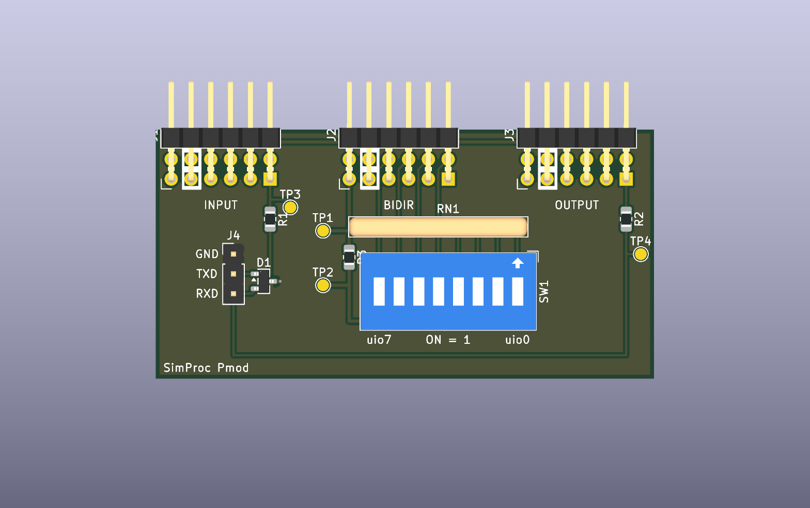
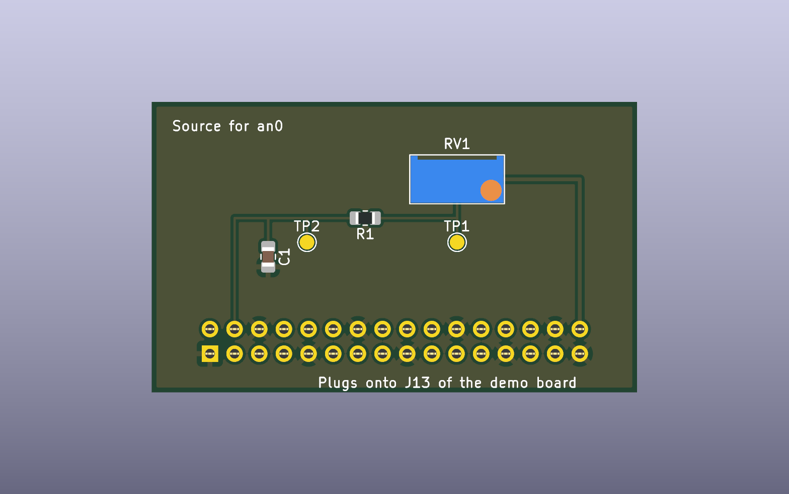

# Capstone: A board for a team chip

In the capstone you take one board for a team chip to the point where it could be ordered: drawn, checked, reviewed, built by CI, with a design note that says why every part is there and a bring-up plan that says what to expect at every step. You choose one of two briefs. Brief D is a bring-up Pmod for a digital project, and if you built the SimProc Pmod in Labs 03 and 04, you can carry that board through. Brief A is a small source board that drives one analog pin of a chip from a known, filtered voltage. Everything goes in a repository of your own.

The capstone's files are in [`labs/capstone-a-board-for-a-team-chip/`](https://github.com/uoftasic/pb101/tree/main/labs/capstone-a-board-for-a-team-chip) in the course repo.

## Before you start

- Finish [Lab 06](lab-06-review-a-seeded-board-overview.md). The capstone uses everything from Labs 03 to 06: the board template, the protection rules, the CI workflow and the checklist.
- Read [Boards for chips: carriers, motherboards and characterization boards](../guide/boards-for-chips.md), row 13 of the [course path](../index.md#course-path). Its section on a board for an analog pin has the arithmetic Brief A asks for.
- Decide on your brief, from the two below.

The capstone takes about 4 hours for Brief D on the SimProc board you already have: roughly 30 minutes for the requirements, 1 hour for the board's changes, 1 hour 30 minutes for the decisions and the bring-up plan, and 1 hour to review, commit and push. Those are our estimates, but we timed the check itself: it took 43 s on our Brief D reference with one CPU. Brief A starts a new board, so expect it to take longer; we haven't timed it.

## The two briefs

### Brief D: a bring-up Pmod for a digital project

Brief D is for SimProc, Sentry, or a Tiny Tapeout project of your own. The board plugs into the demo board's I/O sockets and gives the project what the demo board doesn't. It must have:

- every pin the project uses brought to the right socket, as its pin list says;
- a series resistor, or a translator, on every line that crosses from another supply, since the chip's inputs aren't 5 V tolerant;
- an ESD part on every pin of a connector that leaves the board;
- a test point on every signal pin of that connector, on either side of its series resistor;
- in `DESIGN.md`, what happens on each line when either side is unpowered, which firmware mode and switch settings the board assumes, and a check that the project's clock and edges are within the pin ratings (outputs to 33 MHz and inputs to 66 MHz, by Tiny Tapeout's GPIO spec);
- if the project's pinout is awkward for the demo board, a line in `DESIGN.md` on what it cost the board.

For a project other than SimProc, write its pin list in the form of [`labs/common/pins/simproc.json`](https://github.com/uoftasic/pb101/blob/main/labs/common/pins/simproc.json), as Lab 03's Going further describes, and pass it to the check with `--pins`.

### Brief A: a source board for one analog pin

Brief A is for CrossWalk or an ASIC Zoo cell. The board plugs onto the demo board's analog header, J13, a 2 × 16 header with a 2.54 mm pitch, and drives one analog pin from a known, filtered source: a trimmer, or a DAC, with a buffer if you want one, and an RC filter at the pin. It must have:

- a 2 × 16 connector that mates J13, with GND on J13's ground pins (1, 6, 9, 14, 17, 22, 25, 30 and 31) and, if the board needs power, 3.3 V from pin 32;
- exactly one of J13's analog lines driven, and nothing on the lines that are ground on the SKY130 breakout;
- a series resistor into that line and a capacitor from it to GND;
- a test point on the source and one on the pin;
- in `DESIGN.md`, how the source settles into the pin's path (under 500 Ω and under 5 pF, through an analog switch, 4 mA at most) and what error the demo board's 10 MΩ pull-down adds.

These are J13's lines that carry an analog pad of the chip on the SKY130 QFN breakout. We worked them out by following each line from J13 to the breakout connector in Tiny Tapeout's board files (`tt-demo-pcb` at bbf3dd1, `breakout-pcb` at 91a2bf1):

| J13 pin | 4 | 5 | 7 | 10 | 12 | 13 | 29 | 28 | 26 | 23 | 21 | 20 |
|---|---|---|---|---|---|---|---|---|---|---|---|---|
| Line | /C | /D | /F | /G | /J | /K | /X | /W | /U | /T | /R | /Q |
| Pad | an0 | an1 | an2 | an3 | an4 | an5 | an6 | an7 | an8 | an9 | an10 | an11 |

Pins 2, 3, 8, 11, 15, 16, 18 and 19 are ground on that breakout. J13 is marked DNP in the demo board's files at that commit, so before you order anything, someone with a kit should check whether J13 is fitted on it.

## Part 1: Requirements first

What does your board have to do, in numbers?

1. Start in your repository. For Brief D, that's your Lab 03 to 06 repository. For Brief A, make a new one the way Lab 03, Part 1 does, from the same template, and copy your finished `.github/`, `ci/` and `.gitignore` into it from your Lab 05 repository.

2. Copy the design note's template in:

   ```bash
   cp ~/pb101/labs/capstone-a-board-for-a-team-chip/DESIGN.md .
   ```

3. Fill in the line at the top and write the Requirements: a numbered list of what the board has to do, from the brief and from your project, each with its number where it has one (a pin, a voltage, a current, a rate). Leave the Decisions for Part 3.

4. Commit `DESIGN.md`, because the check runs Lab 05's check first, and that fails on any file git doesn't track. Then write down which rows you expect to fail, and run the check with your brief:

   ```bash
   ~/pb101/labs/capstone-a-board-for-a-team-chip/check.sh --brief D
   ```

   On Lab 04's reference board with Lab 05's CI and the template copied in, in a repository with one commit, the rows were:

   ```text
     ok    ci           Lab 05's check passes: the board check, every output, and .gitignore
     FAIL  design       7 lines still say TODO; 1 numbered requirement; at least 3 needed; 1 numbered decision; at least 3 needed; decision 1 has no 'Meets:' line naming requirements; decision 1 gives no value with its unit; requirement 1 isn't met by any decision
     FAIL  history      1 commit changes the schematic or the board; at least 2 needed
     ok    pmod         PASS  pmod.kicad_pro: 17 of 17 Pmod checks ok; bring-up plan PASS
     FAIL  test points  no test point on J4 pin 2 (/DONGLE_TXD) or J4 pin 3 (/DONGLE_RXD), or on the other side of their series resistors
   ```

   You should see the design row name what's still missing from your requirements and decisions. Your history row will differ from ours, because a repository carried through Labs 03 to 05 already has several commits that change the board. When we worked through the labs the way you have, it read `ok    history      5 commits change the schematic or the board`.

## Part 2: The board

Does your board do what your requirements say?

1. Draw or change the board. For Brief D on the SimProc board, that's a test point on each dongle line; ours puts TP3 on `ui[0]` between J1 and R1, and TP4 on `uo[0]` between R2 and J4. For Brief A it's a new schematic and board.

2. For Brief A, place the connector before anything else, the way Lab 03 placed the Pmods. Your board sits on top of the demo board, so a socket goes on its underside: select it and flip it to the bottom (F), then rotate it (R) until its pin 1 lies over J13's pin 1 and its pins follow J13's. Write down which way you expect pin 2 to point from pin 1 before you look. For KiCad's `PinSocket_2x16_P2.54mm_Vertical`, flipped and turned 270° was the one placement of the eight whose pads lie over J13's pad for pad; our generator checked it against J13 in the demo board's file. Lock it.

   <details>
   <summary>Answer</summary>

   Seen from above, J13's pin 2 is 2.54 mm in −Y from pin 1 (up, on the screen) and pin 3 is 2.54 mm in +X (to the right), with the odd pins in one row and the even pins in the other. Flipping a footprint to the underside mirrors it, so a placement that looks right can be the mirror image of the one that mates. The PCB Editor draws each pad's number on it: check that your pin 2 is above pin 1 and pin 3 to its right, as on J13, and that pin 32 ends up at the far end of the row from pin 1.

   </details>

3. Route the board, refill the zones, and run DRC with the parity test ticked until it's clean. Commit as you go: the check wants at least two commits that change the schematic or the board, because the history is what shows the work.

4. Run the check again. You should see the ci row pass and your brief's own rows pass. Ours, for Brief D:

   ```text
     ok    pmod         PASS  pmod.kicad_pro: 17 of 17 Pmod checks ok; bring-up plan PASS
     ok    test points  J4 pin 2: TP3, J4 pin 3: TP4
   ```

   and for Brief A:

   ```text
     ok    connector    J1 mates J13: GND on its 9 GND pins, pin 32 on +3V3
     ok    pin          J1 pin 4 (J13 line /C, an0 on the SKY130 breakout), net /AN0
     ok    filter       R1 (1k) from /SET, C1 (10n) to GND
     ok    test points  TP1 on /SET, TP2 on /AN0
   ```

   

   *Our Brief D board, rendered by `kicad-cli` 10.0.8 without 3D models: Lab 04's SimProc Pmod with TP3 to the right of R1 and TP4 to the right of the track from R2 down to J4.*

   

   *Our Brief A board, 50 × 30 mm, from the top. J1, along the bottom edge, is on the underside, so only its pads show; RV1 is a 1 kΩ trimmer, R1 and C1 are the filter at the pin, and the track down the left goes to J1's pin 4.*

## Part 3: Decisions and the bring-up plan

Why is each part there, and what will you read at each step?

1. Write the Decisions in `DESIGN.md`: one numbered item per part or choice, with the value that justifies it and its unit, and a line `Meets:` naming the requirements it meets. Every requirement needs at least one decision. Work every number out in the note itself, as our references do: for example, "(3.3 V − 0.6 V) / 1 kΩ = 2.7 mA into an unpowered pin" for a series resistor, or, for Brief A with a 1.25 kΩ source, "1.25 kΩ / 10 MΩ = 0.0125 %" for the pull-down.

2. For Brief A, take care over the current that the pin's sampling capacitor draws on average, which is roughly $C \cdot V \cdot f_s$ and drops across your source's resistance. Before you work it out, write down whether you think it matters for an 8-bit converter. Our reference assumes 400 kS/s, which CrossWalk's documentation doesn't yet confirm. At that rate, 5 pF × 3.3 V × 400 kHz = 6.6 µA, and across 1.25 kΩ that's 8.3 mV, 0.64 of one step of 12.9 mV. That's why our trimmer is 1 kΩ and not 10 kΩ.

   <details>
   <summary>Answer</summary>

   It does. With a 10 kΩ trimmer the source can be 2.5 kΩ + 1 kΩ = 3.5 kΩ, and the same 6.6 µA drops 23 mV, nearly two steps. The charge each single sample takes from a 10 nF capacitor is small (5 pF / 10 nF = 0.05 %), but at a high sample rate the capacitor never fully recovers between samples, so the average current decides the error. A buffer amplifier between the trimmer and the filter would make the source resistance small; that's a good Going further.

   </details>

3. Fill in Checks (what you checked and how) and Open questions (what you couldn't settle, and who could). Our Brief A reference lists four, including the DNP mark on J13.

4. Write `BRINGUP.md`. For Brief D, start from your Lab 04 plan and read the steps at your new test points. For Brief A, copy Lab 04's template and fill it in for your board: the lines that leave it are the analog pin, 3.3 V and GND. Every step still needs an `Expect:` with a value and its unit.

5. Commit, and run the check. You should see `ok    design       ...` with your own counts, for example `9 requirements, 9 decisions, every requirement met`, and for Brief A `ok    bringup      PASS  BRINGUP.md: 6 of 6 parts ok`.

## Part 4: Review it and push

Would your board pass the review you gave the seeded one?

1. Review your own board against the checklist from Lab 06, line by line, and write what you checked under Checks in `DESIGN.md`. Fix what you find. For a line that doesn't apply, say why, as "there are no ICs, so nothing needs decoupling" does in ours.

2. Commit, push, and wait for your workflow's run. You should see it green, with the `board-outputs` artifact.

3. Run the check one last time on the commit you pushed. You should see every row `ok` and the last line `PASS  pmod, Brief D: 5 of 5 capstone checks ok`, or for Brief A `PASS  source, Brief A: 8 of 8 capstone checks ok`, with your own project's name.

The check can't tell whether your requirements are the right ones, whether a decision's reasoning holds, or whether the values in `BRINGUP.md` are what you'll read. A person reads `DESIGN.md` and `BRINGUP.md` for that, and nobody should power a kit from your board until someone other than you has read the plan.

## Finishing

You're done when `~/pb101/labs/capstone-a-board-for-a-team-chip/check.sh --brief D` (or `--brief A`), run in your own repository on the commit you pushed, ends with `PASS`, and that commit's run on GitHub is green.

Questions:

1. Brief D asks for test points on the dongle lines, and not on the project's clock. Why can't a Pmod give you a test point on the clock?

   <details>
   <summary>Answer</summary>

   The clock doesn't come out on the Pmod sockets. On the demo board (`tt-demo-pcb` at bbf3dd1), each I/O socket carries eight project pins, GND on pins 5 and 11 and +3V3 on pins 6 and 12, and nothing else, so the clock, which the RP2350 usually provides, reaches the chip without passing through them. Probe it on the breakout instead, which has a test point on its clock line.

   </details>

2. For Brief A, why put a 10 nF capacitor right at the pin, when its RC corner, 12.7 kHz with the source's largest resistance of 1.25 kΩ, is far above anything a hand-turned trimmer does?

   <details>
   <summary>Answer</summary>

   It's there mostly as a reservoir. When the pin's analog switch closes, its capacitance, up to 5 pF, takes its charge from whatever is closest, and 10 nF at the pin gives it that charge with a 0.05 % change in voltage. The filtering is a bonus: it also keeps noise picked up on the board, and the trimmer's wiper noise, out of the pin.

   </details>

Submit: the URL of your repository and the hash of the commit the check passed on.

## Going further (optional)

- Order your board with your cohort after a second person has read `BRINGUP.md`, and bring it up when there's a chip to bring up; [Reviewing and ordering a board](../guide/reviewing-and-ordering-a-board.md) has the costs, and SimProc, on TTSKY25b, is the only team chip that could be on a bench before the TTSKY26d chips, which are expected in May 2027.
- For Brief A, add a buffer between the trimmer and the filter, and work out how much of the sampling droop it removes. KiCad's `MCP6001R` is a 1 MHz op-amp in SOT-23-5; its pins 2 and 5, V+ and V−, are the reverse of those on `MCP6001-OT`, the plain MCP6001 in the same package. A swap like that is the kind of package-variant fault you looked for in Lab 06.
- Do both briefs.

Next on the [Course path](../index.md#course-path): this is the last row. A second course, PB201, would take up what PB101 left out: 4-layer boards and decoupling for a QFN, characterization boards with a reference of their own, and high-speed signals.
