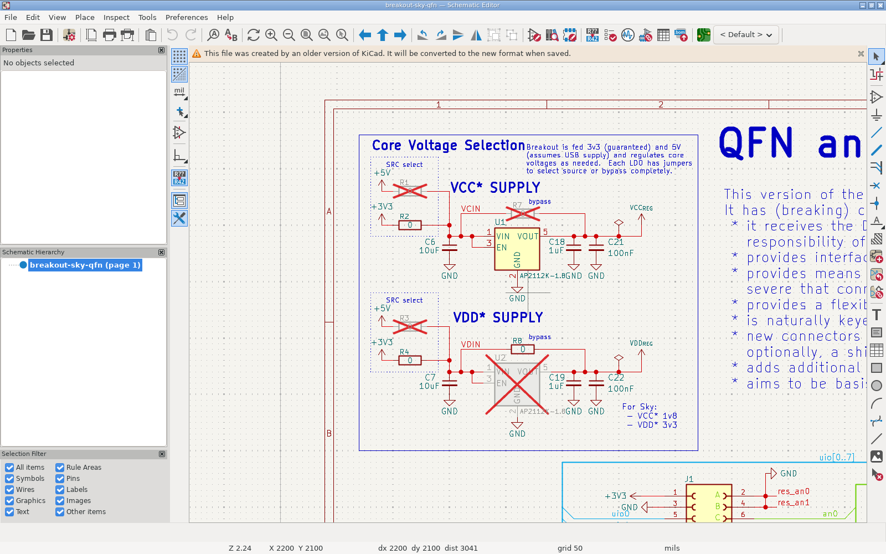

# Lab 01: Open a board you didn't design

In this lab you install KiCad and open Tiny Tapeout's SKY130 QFN breakout, which is the board that the team's SKY130 chips arrive on. You work out which of its parts are fitted, and follow each of the chip's three supplies from the connectors to the chip's pins. Then you run ERC and DRC on the breakout and explain each kind of error they report. You write all of that into one file of notes, and a check compares your notes with the board.

This lab takes about 1 h 30 min, not counting the time that KiCad and the course's Docker image take to download.

Package: [`labs/lab-01-open-a-board-you-didnt-design/`](https://github.com/uoftasic/ic103/tree/main/labs/lab-01-open-a-board-you-didnt-design)

## Before you start

- Read [Getting started](../guide/getting-started.md), [What a board does for a chip](../guide/what-a-board-does-for-a-chip.md) and [Tiny Tapeout's boards, part by part](../guide/tiny-tapeouts-boards-part-by-part.md).
- You need Docker, git and Python 3 from [IC101](https://uoftasic.com/ic101/). You also need 2.6 GB of disk for the course's KiCad image once it's unpacked, and 84 MB for the boards you fetch.

## Part 1: Install KiCad and get the boards

1. Install KiCad 10.0.5 on your own computer, as [Getting started](../guide/getting-started.md) describes for Windows, macOS and Linux. If you can only get a later 10.0 release, or you already have one, use that. Any 10.0 release opens the course's files, and Getting started says what differs between releases. The course's checks run 10.0.5 in Docker whichever release you have installed. Start KiCad and open Help → About KiCad, where you should see a version that starts with `10.0`.

2. Clone the course and go into it:

   ```bash
   git clone https://github.com/uoftasic/ic103.git
   cd ic103
   ```

   Run every command in this lab from that folder.

3. Fetch Tiny Tapeout's boards, two of its KiCad libraries and the breakout's production BOM. The course doesn't keep copies of them, so this script checks each one out of Tiny Tapeout's repositories at a fixed commit:

   ```bash
   python3 labs/common/fetch_boards.py
   ```

   It took about 8 s for us, and you should see:

   ```text
   fetched    breakout-pcb                 91a2bf1    21.0 MB  labs/common/upstream/breakout-pcb
   fetched    tt-demo-pcb                  bbf3dd1    12.8 MB  labs/common/upstream/tt-demo-pcb
   fetched    kicad-tinytapeout-pmod-lib   9ee6345     0.4 MB  labs/common/upstream/kicad-tinytapeout-pmod-lib
   fetched    pcb-files                    ca5fd72     0.3 MB  labs/common/upstream/pcb-files
   fetched    tinytapeout-kicad-libs       0e99691    28.5 MB  labs/common/upstream/breakout-pcb/tinytapeout-kicad-libs
   ```

4. Check that the course's pinned KiCad runs:

   ```bash
   labs/common/kicad.sh kicad-cli version
   ```

   The first time, it pulls `kicad/kicad:10.0.5`, an 808 MB download. After that you should see:

   ```text
   ic103: KiCad image kicad/kicad@sha256:182c8005cb775a2c448a4c18681d489f1ff472a761885eba3e08b07e3c0564de
   10.0.5
   ```

   The first line is the digest that Docker resolved, which records exactly which build of KiCad ran. `kicad.sh` is a bash script, so it runs on Linux, macOS and WSL. If you don't have bash, [`labs/common/README.md`](https://github.com/uoftasic/ic103/tree/main/labs/common) has a plain `docker run` command that runs Part 4's board check without `kicad.sh`; we have run it on Linux but not on Windows.

Check: KiCad's About box says 10.0, `kicad-cli version` prints `10.0.5`, and `labs/common/upstream/breakout-pcb/breakout-sky-qfn/` exists.

## Part 2: Fitted and unfitted parts

Which of the parts drawn on this board does the factory actually solder on?

1. In KiCad, open `labs/common/upstream/breakout-pcb/breakout-sky-qfn/breakout-sky-qfn.kicad_pro`, then open its schematic. Tiny Tapeout saved these files in KiCad 9, so a bar across the top says the file was created by an older version of KiCad and will be converted when saved. Don't save it. If you do, the fetch script will name the file you changed and refuse to update the board, and you'll have to rerun it with `--force` to put the original back.

2. Open `breakout-notes.md` in the lab folder in a text editor. It's the file you'll fill in during this lab, and the check reads its headings and table columns, so keep those as they are.

3. Find the block labelled "Core Voltage Selection" at the top left of the sheet and zoom in on it (the mouse wheel zooms around the cursor):

   

   KiCad draws a part marked DNP (do not populate) with a red cross. Its footprint is still on the board, so the copper is there, but nothing is soldered to it. In this block, R1, R7, R3 and the second regulator, U2, are marked DNP.

4. Look over the rest of the sheet for crossed-out parts, and list every one under "## Not fitted" in your notes. The "Presence Detection", "EEPROM ID" and "MUX and Supply Headers" blocks have some, and so does the corner beside the title block:

   

   With the whole sheet in view, as in the screenshot, the red crosses are small, so zoom in on each block to read the references of the parts under them. You can confirm any one by opening its properties (double-click it) and looking for the "Do not populate" box.

5. Open the Symbol Fields Table with the grid-shaped button near the right-hand end of the top toolbar:

   

   It opens on a view that Tiny Tapeout saved in the project, called "populatedlcsc". The view leaves out the DNP parts and puts identical parts on one row, the way a factory's parts list does, so C1–C5, C8 and five more 1 µF capacitors share a row, and U1 has a row of its own. None of the parts you listed in step 4 is in it.

6. Compare that table with what the factory was actually given. Tiny Tapeout's production BOM for this revision is `labs/common/upstream/pcb-files/ETR/breakout-skyqfn-v3p2/bom/breakout-sky-qfn_bom_jlc.csv`; open it in a text editor or a spreadsheet. You should see 12 lines after the header. Between them they list 25 capacitors, J1 and J3, 9 resistors, and U1 and U4, and there's no U2, U3 or J2.

   The `v3p2` in the BOM's path means rev 3.2. That's the revision in the board file's title block, dated 2025-10-04. The schematic's title block says rev 3.1, dated 2025-12-02. Both files come from the same commit, though. When the board check in Part 4 compares the board with the schematic, the only differences it reports are in the Datasheet field, which is empty in the schematic. Part 4 explains them.

7. FID1, FID2 and FID3 are marked DNP too, and TP1 to TP4 are in neither the BOM nor your list. Why?

   <details>
   <summary>Answer</summary>

   A fiducial is a bare copper dot that the assembly machine's camera uses to line the board up, so there's nothing to place on it. Tiny Tapeout marked all three fiducials DNP and also excluded them from the BOM, so they stay out of the parts list. The test points here use `TestPoint_Pad_D1.0mm`, a 1 mm pad on the board itself, so they're excluded from the BOM too, but they aren't DNP, because there was never a part to leave off. The check accepts your list with or without the fiducials.

   </details>

Check: your "Not fitted" list has 9 parts, plus the fiducials if you included them.

## Part 3: The supply rails

How does each of the chip's three supplies get from the connectors to the chip, and at what voltage?

1. Make a prediction first. A note on the schematic says "For Sky: VCC\* 1v8, VDD\* 3v3", and both regulators, U1 and U2, are AP2112K-1.8s, which put out 1.8 V. The chip, U4, has three supply nets: VCCD, VDD_IO and VDDA. Write down which you expect at 1.8 V and which at 3.3 V, and which regulator you expect to feed each.

2. Find U4's pins on each rail. U4 is the large symbol in the middle of the sheet; zoom in on it and read the numbers beside its supply pins, which are named `vccd`, `vccd1`, `vccd2`, `vddio`, `vdda`, `vdda1` and `vdda2`. (Edit → Find with "Search pin names and numbers" ticked finds them too, but in our run its first match for `vdda` was the value of a VDDA power symbol, so it's slower than reading the symbol.) Write the pin numbers into the "Chip pins" column.

3. Follow VCCD back towards the connectors. Between U1 and the chip, VCCD's supply passes through the "MUX and Supply Headers" block at the top right of the sheet:

   

   R14 is a 0 Ω resistor from VCC_REG to VCCD. Then go back to the Core Voltage Selection block. VCC_REG is U1's output, U1's input is the net VCIN, and VCIN comes from +3V3 through R2. Both of the other links on VCIN are DNP: R1, which would bring in +5V, and the "bypass" link R7, which would connect VCIN straight to VCC_REG. So in VCCD's row, "Comes from" is +3V3, and "Through" is R2, U1, R14.

4. Do the same for VDD_IO and VDDA. VDD_IO comes from VDD_REG through R13, and VDDA comes from VDD_REG through R15. VDD_REG is U2's output net, but U2 isn't fitted. What feeds VDD_REG, and what voltage does it carry?

   <details>
   <summary>Answer</summary>

   R8, the link labelled "bypass", is fitted, and it connects U2's input net, VDIN, straight to its output net, VDD_REG. VDIN comes from +3V3 through R4 (R3, from +5V, is DNP). So VDD_IO and VDDA both get the demo board's 3.3 V through R4 and R8, and then through R13 for VDD_IO or R15 for VDDA, with no regulator in between. A note on the schematic says that for Sky the VDD rails run at 3.3 V, so U2's 1.8 V output isn't wanted on them. Another note says that each LDO "has jumpers to select source or bypass completely", and R8 is the jumper that bypasses U2.

   </details>

5. Find each rail's capacitors. Most of them are in the "Bulk/Bypass C" block at the bottom left of the sheet. Count only the fitted capacitors between the rail itself and GND. C18 and C21 sit on VCC_REG, and C19 and C22 on VDD_REG. Those are the regulators' output nets rather than the chip's rails, so leave them out. Leave out C6 and C7 too, because they're on the regulators' inputs.

6. Fill in the "Supply rails" table: "Chip pins", "Comes from" (the net that the supply arrives on at the connectors), "Through" (the fitted parts, in order from the connector), "Volts" and "Capacitors". Compare the volts with your prediction from step 1.

7. J3 brings +5V onto the board on pins 2 and 4. Where does it go?

   <details>
   <summary>Answer</summary>

   On this build it goes nowhere. The only parts that +5V reaches are R1 and R3, which would take it to the regulators' inputs, and both are DNP. The schematic's note says the breakout "is fed 3v3 (guaranteed) and 5V (assumes USB supply)", and R1 and R3 are the source-select links that would let either regulator run from 5 V instead.

   </details>

Check: you have a row for each of VCCD, VDD_IO and VDDA, with every column filled in. Part 4 runs the check on them.

## Part 4: ERC and DRC

What do KiCad's checks find on a board that Tiny Tapeout has built and sold, and which of the findings matter?

1. Predict, before you run anything: how many ERC errors and how many DRC errors do you expect on this board? Write the two numbers down.

2. Run ERC in your own KiCad: Inspect → Electrical Rules Checker, or its toolbar button, then Run ERC. Tick "Errors" to list them:

   

   We took this screenshot in the course's KiCad image, with its default library tables, so it shows the same setup that the course's check uses. Your KiCad should also report 10 errors, but it may count a different number of warnings from 97. Many warnings come from comparing the design with whichever libraries your KiCad has set up ([Getting started](../guide/getting-started.md#your-kicad-and-the-courses-checks) explains this), and later 10.0 releases count some of them differently.

3. Run the course's board check on the breakout. In the pinned image, it runs ERC on the schematic and DRC on the board, compares the board with the schematic (KiCad calls this schematic parity), and counts the results:

   ```bash
   labs/common/kicad.sh python3 labs/common/check_board.py labs/common/upstream/breakout-pcb/breakout-sky-qfn
   ```

   In our runs it took 23 to 44 s with the container limited to one CPU, and 19 s with two. Below the header lines you should see:

   ```text
                   errors  warnings  excluded
     ERC               10        97         0
     DRC                0       120         1
     unconnected        0         0         0
     parity             0        37         0

     ERC errors (10):
       power_pin_not_driven     Input Power pin not driven by any Output Power pins  [Symbol #PWR01 Pin 1 [Power input, Line]]
       power_pin_not_driven     Input Power pin not driven by any Output Power pins  [Symbol #PWR02 Hidden pin 1 [GND, Power input, Line]]
       power_pin_not_driven     Input Power pin not driven by any Output Power pins  [Symbol #PWR03 Pin 1 [Power input, Line]]
       power_pin_not_driven     Input Power pin not driven by any Output Power pins  [Symbol #PWR04 Pin 1 [Power input, Line]]
       power_pin_not_driven     Input Power pin not driven by any Output Power pins  [Symbol #PWR09 Pin 1 [Power input, Line]]
       power_pin_not_driven     Input Power pin not driven by any Output Power pins  [Symbol #PWR013 Pin 1 [Power input, Line]]
       power_pin_not_driven     Input Power pin not driven by any Output Power pins  [Symbol U1 Pin 1 [VIN, Power input, Line]]
       power_pin_not_driven     Input Power pin not driven by any Output Power pins  [Symbol U2 Pin 1 [VIN, Power input, Line]]
       pin_to_pin               Pins of type Power output and Power output are connected  [Symbol #FLG01 Pin 1 [pwr, Power output, Line]; Symbol U1 Pin 5 [VOUT, Power output, Line]]
       pin_to_pin               Pins of type Power output and Power output are connected  [Symbol #FLG02 Pin 1 [pwr, Power output, Line]; Symbol U2 Pin 5 [VOUT, Power output, Line]]

     parity items (37):
       footprint_symbol_field_mismatch Field 'Datasheet' differs (PCB: '~', Schematic: '')  [Footprint C1]
       footprint_symbol_field_mismatch Field 'Datasheet' differs (PCB: '~', Schematic: '')  [Footprint C2]
   ...
       ... and 17 more (--show 37 lists them all)

     ERC warnings by type: lib_symbol_mismatch 63, lib_symbol_issues 22, isolated_pin_label 11, multiple_net_names 1
     DRC warnings by type: lib_footprint_issues 76, lib_footprint_mismatch 44
     DRC excluded by type: courtyards_overlap 1

   FAIL  erc.error: 10 (want 0)
   FAIL  parity.warning: 37 (want 0)
   ```

   We've left out 18 of the parity lines, which are the same apart from the footprint they name (C3 to C20). Both FAILs are what should happen here. By default the check allows no ERC errors, and this board has ten. It allows no parity items either, and in KiCad 10.0.5 this board has 37. Every one is a `footprint_symbol_field_mismatch` on the Datasheet field, where the board's copy of the footprint has `~` and the schematic has nothing. KiCad 10.0.8 doesn't report these 37 on the same two files ([Getting started](../guide/getting-started.md#which-version-to-install) lists what else differs between the two releases), so they come from the way 10.0.5 compares the files rather than from a part that is missing or wired differently.

4. Eight of the errors are `power_pin_not_driven`. The first six name `#PWR` symbols, which are the power symbols for VCCD, GND, +5V, +3V3, VDD_IO and VDDA, and the last two name the regulators' VIN pins. Why does ERC think nothing drives them?

   <details>
   <summary>Answer</summary>

   ERC treats a net with a power-input pin as driven only if a power-output pin is on the same net. +3V3, +5V and GND arrive through the DF12 connectors, whose pins are passive, and VCCD, VDD_IO, VDDA and the two regulator inputs are each fed through a 0 Ω resistor, which is passive too. ERC can't see the demo board on the far side of the connector, and it doesn't follow a supply through a resistor, so as far as ERC can tell, none of these nets has a driver. The usual fix is a PWR_FLAG symbol on each such net, which tells ERC that power comes from somewhere it can't see. None of this means the board itself is faulty.

   </details>

5. The other two errors are `pin_to_pin`, one between `#FLG01` and U1's VOUT pin, and the other between `#FLG02` and U2's VOUT pin. What has the designer done here?

   <details>
   <summary>Answer</summary>

   PWR_FLAG is a symbol with one power-output pin. The designer put the two flags on VCC_REG and VDD_REG. Those are the regulators' output nets, which the regulators' VOUT pins already drive, so each of them ends up with two power outputs. On the nets in the previous question, which have no driver, the flags would have done their job. Like those eight errors, these two come from how the schematic tells ERC where power comes from, and not from a fault on the board.

   </details>

6. DRC reports no errors, but it counts one item as excluded. Run DRC in KiCad's PCB Editor (Inspect → Design Rules Checker, then Run DRC) and look at its exclusions, or add `--reports labs/lab-01-open-a-board-you-didnt-design/results` to the command in step 3 and search the `drc.json` it writes there for `"excluded": true`. Then open the board's design rules in a text editor. They're in `breakout-sky-qfn.kicad_dru`, in the board's folder. What is the excluded item, and why doesn't it count?

   <details>
   <summary>Answer</summary>

   It's a `courtyards_overlap` error between J2, the unfitted 12-pin header, and the test point TP4. The last rule in `breakout-sky-qfn.kicad_dru`, called "testpoints under connectors", sets the severity of any courtyard clash between a test point (`TP*`) and a connector (`J*`) to `exclusion`, and when we deleted that rule, DRC reported the same overlap as an error. J2 is DNP, so on this build no header is soldered there to collide with TP4. `check_board.py` counts excluded items separately and never fails on them, and `kicad-cli pcb drc` leaves them out of its report unless you ask for them with `--severity-exclusions` or `--severity-all`.

   </details>

7. Now look at the kinds of warning, which the check listed by type above. Most of them come from comparing the design with the libraries. `lib_footprint_mismatch` and `lib_symbol_mismatch` mean that the copy of a part saved in the design differs from the one in today's library. `lib_footprint_issues` and `lib_symbol_issues` mean that the design names a library this setup doesn't have, or a part that isn't in its library. 74 of the 76 `lib_footprint_issues` name `flyingcarsfootprints`, which supplies the board's 73 stitching vias and one logo. Will installing Tiny Tapeout's libraries make those 74 go away?

   <details>
   <summary>Answer</summary>

   No. `flyingcarsfootprints` isn't in the board's own library table, and it isn't in `tinytapeout-kicad-libs`, the library that the fetch script put beside the board, so there's no copy of it for you to install. That's harmless, because KiCad saves a copy of every footprint inside the board file, and the board opens and plots without the library. The other two `lib_footprint_issues` name `Logos`, for the two Tiny Tapeout logos.

   </details>

8. Fill in the "Checks" table in your notes: the three "all" rows, then one row for each type of error and each type of excluded item, with its count and what it means in your own words. Add warning rows too if you like; the check doesn't read them, because their counts depend on your setup. Compare the error counts with your prediction from step 1.

9. Run the lab's check on your notes:

   ```bash
   labs/common/kicad.sh python3 labs/lab-01-open-a-board-you-didnt-design/src/check_notes.py
   ```

   It works out its own answers from the board file and runs `check_board.py` for the counts, so it takes about as long as the board check, 35 s with one CPU in our run and 12 s with two. On the notes as shipped, where every row is TODO, its output ends:

   ```text
     MISMATCH  Checks        ERC error all: the count is TODO
     MISMATCH                DRC error all: the count is TODO
     MISMATCH                DRC excluded all: the count is TODO
     MISMATCH                ERC error: the check finds 2 types, and your table has 0 of them
     MISMATCH                DRC excluded: the check finds 1 type, and your table has 0 of them

   FAIL  5 of 5 rows disagree with the board
   ```

   Each MISMATCH line says what disagrees without giving the answer away. If you list U2 on VDD_IO's path, for example, it says `Through: U2 is marked DNP, so no current flows through it`. Fix the rows it names and run it again until it passes.

Check: `check_notes.py` prints an `ok` row for Not fitted, VCCD, VDD_IO, VDDA and Checks.

## Expected results

| Check | Expected | |
|---|---|---|
| `kicad-cli version` in the image | `10.0.5` | exact |
| Parts marked DNP | 9, plus 3 fiducials | exact |
| Rails at the chip | VCCD 1.8 V; VDD_IO and VDDA 3.3 V | exact |
| ERC errors | 10: 8 `power_pin_not_driven`, 2 `pin_to_pin` | exact |
| DRC errors, excluded | 0, and 1 excluded `courtyards_overlap` | exact |
| ERC and DRC warnings | 97 and 120 in the pinned image; yours may differ | setup-dependent |
| Parity items | 37 warnings, all `footprint_symbol_field_mismatch` on the Datasheet field, in the pinned image; none in KiCad 10.0.8 | release-dependent |
| `check_notes.py` run time | 35 s with one CPU, 12 s with two | ballpark |

## Finishing

You're done when `check_notes.py` prints `PASS  labs/lab-01-open-a-board-you-didnt-design/breakout-notes.md` on your own notes.

Questions:

1. Suppose you wanted to measure VDDA's current alone, with a meter in series. Which part would you take off, and where would you connect the meter?

   <details>
   <summary>Answer</summary>

   Take off R15, the 0805 link from VDD_REG to VDDA, and connect the meter between pins 11 and 12 of J2, which carry VDD_REG and VDDA. J2 is the header that the schematic's note means when it says each supply pin "may be monitored or fed through these headers by popping off the relevant resistor (0805s for easier manip)". It isn't fitted on this build, so you'd solder a header into its holes first. Taking off R15 and fitting J2 is rework on the board that carries the kit's only chip, so practise it on a spare board first.

   </details>

2. Your notes say +3V3 feeds all three rails. What does that mean for a board that the breakout plugs into, if that board needs to change VDD_IO without changing VDDA?

   <details>
   <summary>Answer</summary>

   As the breakout is built, that board can't change one without the other. VDD_IO and VDDA both come from the connectors' +3V3 through R4 and R8, so changing +3V3 changes both, and the chip's own rails don't reach the connectors at all. To separate them you'd take off R13 or R15 and fit J2, as in question 1.

   </details>

Submit: nothing for this lab.

## Going further (optional)

- Run `check_board.py` on Tiny Tapeout's demo board, `labs/common/upstream/tt-demo-pcb`, and compare its counts with the table in [`labs/common/README.md`](https://github.com/uoftasic/ic103/tree/main/labs/common). Its parity items include a `missing_footprint`, which KiCad reports as a warning. The course's check fails on parity warnings as well as parity errors so that it catches a missing footprint like this one.
- Open the breakout in the PCB Editor and follow VDDA's copper from R15 to the chip's pins. Which of the board's four copper layers does it use?

Next on the [Course path](../index.md#course-path): read [Schematics other people can read](../guide/schematics-other-people-can-read.md), [Symbols, footprints and libraries](../guide/symbols-footprints-and-libraries.md) and [From die to package](../guide/from-die-to-package.md), then do [Lab 02: A footprint from a datasheet](lab-02-a-footprint-from-a-datasheet-overview.md).
