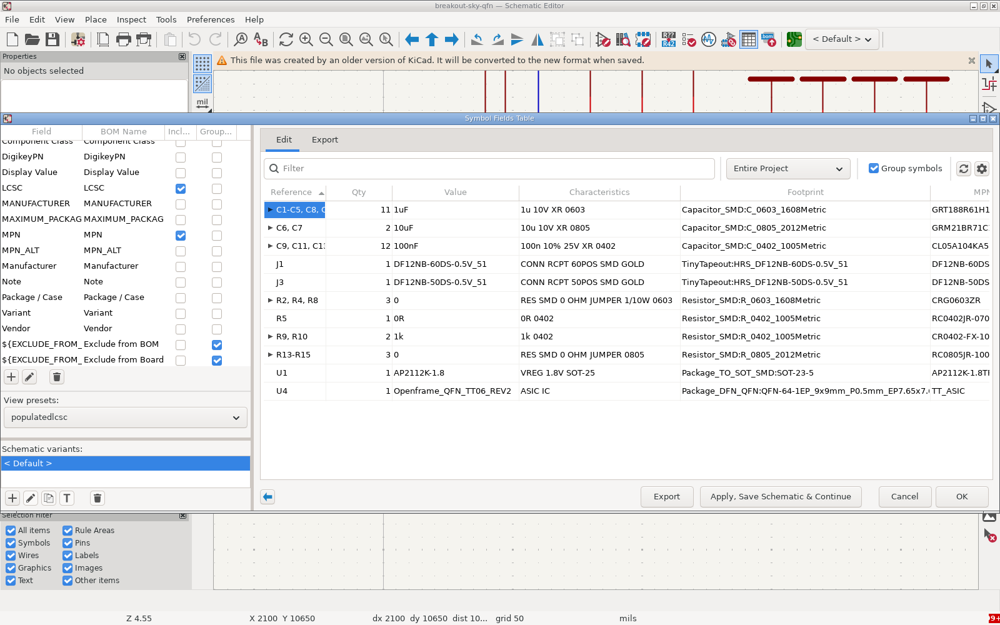
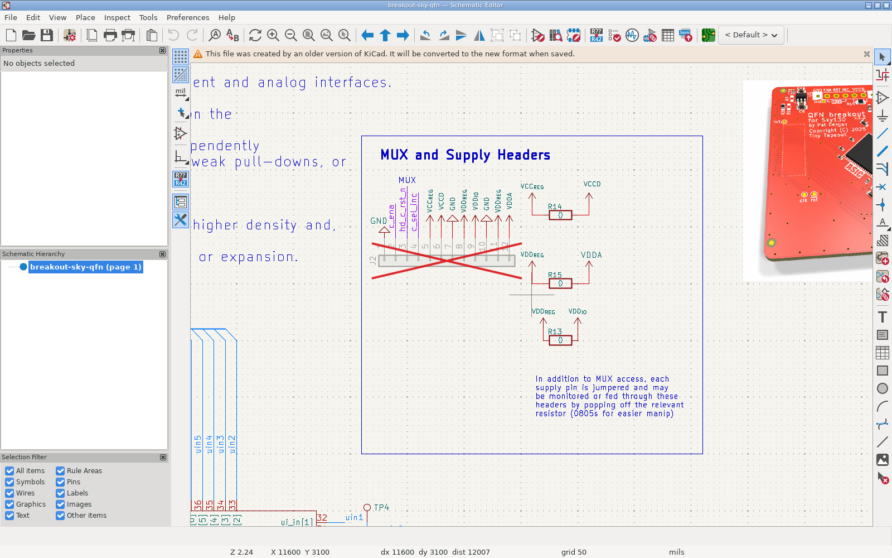
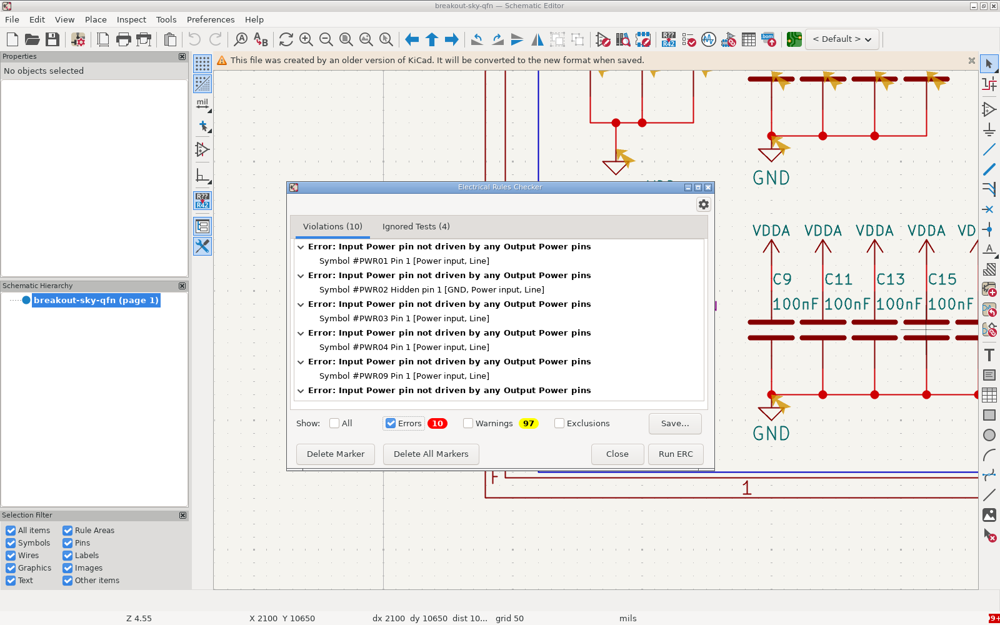

# Lab 01: Open a board you didn't design

In this lab you install KiCad and open the board the team's SKY130 chips arrive on: Tiny Tapeout's SKY130 QFN breakout. You'll work out which of its parts are fitted, follow each of the chip's three supplies from the connectors to the chip's pins, and find out what ERC and DRC report about a board that was built and sold. You write all of that into one file of notes, and a check compares your notes with the board.

This lab takes about 1 h 30 min, not counting the time KiCad and the course's Docker image take to download.

Package: [`labs/lab-01-open-a-board-you-didnt-design/`](https://github.com/uoftasic/pb101/tree/main/labs/lab-01-open-a-board-you-didnt-design)

## Before you start

- Read [Getting started](../guide/getting-started.md), [What a board does for a chip](../guide/what-a-board-does-for-a-chip.md) and [Tiny Tapeout's boards, part by part](../guide/tiny-tapeouts-boards-part-by-part.md).
- You need Docker, git and Python 3 from [IC101](https://uoftasic.com/ic101/), and room on disk for the course's KiCad image, which takes 2.6 GB once it's unpacked, and the fetched boards, which take 84 MB.

## Part 1: Install KiCad and get the boards

1. Install KiCad 10.0 on your own computer, as [Getting started](../guide/getting-started.md) describes for Windows, macOS and Linux. Start KiCad and open Help → About KiCad. You should see a version that starts with `10.0`. Any 10.0 release can open the course's files, but the course's checks always run 10.0.8.

2. Clone the course and go into it:

   ```bash
   git clone https://github.com/uoftasic/pb101.git
   cd pb101
   ```

   Run every command in this lab from that folder.

3. Fetch Tiny Tapeout's boards. The course doesn't keep its own copies of them, so this script checks each one out of Tiny Tapeout's own repositories at a fixed commit:

   ```bash
   python3 labs/common/fetch_boards.py
   ```

   It took about 8 s for us, and you should see:

   ```text
   fetched    breakout-pcb                 91a2bf1    21.0 MB  labs/common/upstream/breakout-pcb
   fetched    tt-demo-pcb                  bbf3dd1    12.8 MB  labs/common/upstream/tt-demo-pcb
   fetched    kicad-tinytapeout-pmod-lib   9ee6345     0.4 MB  labs/common/upstream/kicad-tinytapeout-pmod-lib
   fetched    pcb-files                    ca5fd72     0.3 MB  labs/common/upstream/pcb-files
   fetched    tinytapeout-kicad-libs       0e99691    28.5 MB  labs/common/upstream/breakout-pcb/tinytapeout-kicad-libs
   ```

4. Check that the course's pinned KiCad runs:

   ```bash
   labs/common/kicad.sh kicad-cli version
   ```

   The first time, it pulls `kicad/kicad:10.0.8`, an 812 MB download. After that you should see:

   ```text
   pb101: KiCad image kicad/kicad@sha256:3f4a01786dfbe803a65f345c3342b765db9add913f5e9448f8356793714ddc34
   10.0.8
   ```

   The first line is the digest that Docker resolved, which records exactly which build of KiCad ran. `kicad.sh` is a bash script, so it runs on Linux, macOS and WSL. If you don't have bash, [`labs/common/README.md`](https://github.com/uoftasic/pb101/tree/main/labs/common) has a plain `docker run` command that runs Part 4's board check without `kicad.sh`; we have run it on Linux but not on Windows.

Check: KiCad's About box says 10.0, `kicad-cli version` prints `10.0.8`, and `labs/common/upstream/breakout-pcb/breakout-sky-qfn/` exists.

## Part 2: Fitted and unfitted parts

Which of the parts drawn on this board does the factory actually solder on?

1. In KiCad, open `labs/common/upstream/breakout-pcb/breakout-sky-qfn/breakout-sky-qfn.kicad_pro`, then open its schematic. A bar across the top says the file was created by an older version of KiCad and will be converted when saved. Don't save it: if you do, the fetch script will refuse to update the board until you put the original back with `--force`.

2. Open `breakout-notes.md` in the lab folder in a text editor. It's the file you'll fill in during this lab, and the check reads its headings and table columns, so keep those as they are.

3. Find the block labelled "Core Voltage Selection" at the top left of the sheet and zoom in on it (the mouse wheel zooms around the cursor):

   

   KiCad draws a part marked DNP (do not populate) with a red cross. Its footprint is still on the board, so the copper is there, but nothing is soldered to it. This block has four of them: R1, R7, R3 and the second regulator, U2.

4. Look over the rest of the sheet for crossed-out parts, and list every one under "## Not fitted" in your notes. The "Presence Detection", "EEPROM ID" and "MUX and Supply Headers" blocks have some, and so does the corner beside the title block. You can confirm any one by opening its properties (double-click it) and looking for the "Do not populate" box.

5. Open the Symbol Fields Table with the grid-shaped button near the right-hand end of the top toolbar:

   

   It opens on a view Tiny Tapeout saved in the project, "populatedlcsc", which leaves out the DNP parts and groups the rest the way a factory's parts list does: C1–C5, C8 and five more 1 µF capacitors on one row, U1 on its own row, and so on. None of the parts you listed in step 4 is in it.

6. Compare that table with what the factory was actually given. Tiny Tapeout's production BOM for this revision is `labs/common/upstream/pcb-files/ETR/breakout-skyqfn-v3p2/bom/breakout-sky-qfn_bom_jlc.csv`; open it in a text editor or a spreadsheet. You should see 12 lines after the header, listing 25 capacitors, J1 and J3, 9 resistors, U1 and U4, and no U2, U3 or J2.

7. FID1, FID2 and FID3 are marked DNP too, and TP1 to TP4 are in neither the BOM nor your list. Why?

   <details>
   <summary>Answer</summary>

   A fiducial is a bare copper dot that the assembly machine's camera uses to line the board up, so there's nothing to place on it, and marking it DNP keeps it out of the parts list. The test points here use `TestPoint_Pad_D1.0mm`, a 1 mm pad on the board itself, so they're also left out of the BOM, but they aren't DNP because there was never a part to leave off. The check accepts your list with or without the fiducials.

   </details>

Check: your "Not fitted" list has 9 parts, plus the fiducials if you included them.

## Part 3: The supply rails

How does each of the chip's three supplies get from the connectors to the chip, and at what voltage?

1. Make a prediction first. The schematic's notes say "For Sky: VCC\* 1v8, VDD\* 3v3", and both regulators, U1 and U2, are AP2112K-1.8s, which make 1.8 V. The chip, U4, has three supply nets: VCCD, VDD_IO and VDDA. Write down which you expect at 1.8 V, which at 3.3 V, and which regulator you expect to feed each.

2. Find U4's pins on each rail. U4 is the large symbol in the middle of the sheet; zoom in on it and read the numbers beside its supply pins, which are named `vccd`, `vccd1`, `vccd2`, `vddio`, `vdda`, `vdda1` and `vdda2`. (Edit → Find with "Search pin names and numbers" ticked finds them too, but in our run its first match for `vdda` was the value of a VDDA power symbol, so it's slower than reading the symbol.) Write the pin numbers into the "Chip pins" column.

3. Follow VCCD back towards the connectors. VCCD doesn't connect to U1 directly: it comes from the "MUX and Supply Headers" block, on the right of the sheet below its title:

   

   R14 is a 0 Ω resistor from VCC_REG to VCCD. Then go back to the Core Voltage Selection block: VCC_REG is U1's output, U1's input is the net VCIN, and VCIN comes from +3V3 through R2. The other two ways into that corner, R1 from +5V and the "bypass" link R7, are both DNP. So VCCD's row reads: from +3V3, through R2, U1, R14.

4. Do the same for VDD_IO and VDDA. Both start at R13 and R15 on VDD_REG, the output net of U2. U2 isn't fitted, though. What feeds VDD_REG, and what voltage does it carry?

   <details>
   <summary>Answer</summary>

   R8, the link labelled "bypass", is fitted, and it connects U2's input net, VDIN, straight to its output net, VDD_REG. VDIN comes from +3V3 through R4 (R3, from +5V, is DNP). So VDD_IO and VDDA both get the demo board's 3.3 V through R4, R8 and then R13 or R15, with no regulator in between. The schematic's notes say that for Sky the VDD rails run at 3.3 V, so U2's 1.8 V output isn't wanted on them, and that each LDO "has jumpers to select source or bypass completely". R8 is that bypass.

   </details>

5. Find each rail's capacitors. Most of them are in the "Bulk/Bypass C" block at the bottom left of the sheet. Count only the fitted capacitors between the rail itself and GND: C18 and C21 sit on VCC_REG and C19 and C22 on VDD_REG, which are the regulator outputs rather than the chip's rails, and C6 and C7 are on the regulator inputs.

6. Fill in the "Supply rails" table: chip pins, "Comes from" (the net the supply arrives on at the connectors), "Through" (the fitted parts, in order from the connector), volts and capacitors. Compare the volts with your prediction from step 1.

7. J3 brings +5V onto the board on pins 2 and 4. Where does it go?

   <details>
   <summary>Answer</summary>

   On this build it goes nowhere. The only parts that +5V reaches are R1 and R3, which would take it to the regulators' inputs, and both are DNP. The schematic's note says the breakout "is fed 3v3 (guaranteed) and 5V (assumes USB supply)", and R1 and R3 are the source-select links that would let either regulator run from 5 V instead.

   </details>

Check: you have a row for each of VCCD, VDD_IO and VDDA, with every column filled in. Part 4 runs the check on them.

## Part 4: ERC and DRC

What do KiCad's checks find on a board that Tiny Tapeout has built and sold, and which of the findings matter?

1. Predict, before you run anything: how many ERC errors and how many DRC errors do you expect on this board? Write the two numbers down.

2. Run ERC in your own KiCad: Inspect → Electrical Rules Checker, or its toolbar button, then Run ERC. Tick "Errors" to list them:

   

   This screenshot was taken with the image's default library tables, the same setup as the course's check. Your KiCad should also report 10 errors, but its warning count can differ from 103, because many warnings compare the design with whichever libraries your KiCad has set up ([Getting started](../guide/getting-started.md#your-kicad-and-the-courses-checks) explains this).

3. Run the course's board check on the breakout. It runs ERC and DRC, with schematic parity, in the pinned image and counts the results:

   ```bash
   labs/common/kicad.sh python3 labs/common/check_board.py labs/common/upstream/breakout-pcb/breakout-sky-qfn
   ```

   It takes 20 to 30 s. Below the header lines you should see:

   ```text
                   errors  warnings  excluded
     ERC               10       103         0
     DRC                0       123         1
     unconnected        0         0         0
     parity             0         0         0

     ERC errors (10):
       power_pin_not_driven     Input Power pin not driven by any Output Power pins  [Symbol #PWR01 Pin 1 [Power input, Line]]
       power_pin_not_driven     Input Power pin not driven by any Output Power pins  [Symbol #PWR02 Hidden pin 1 [GND, Power input, Line]]
       power_pin_not_driven     Input Power pin not driven by any Output Power pins  [Symbol #PWR03 Pin 1 [Power input, Line]]
       power_pin_not_driven     Input Power pin not driven by any Output Power pins  [Symbol #PWR04 Pin 1 [Power input, Line]]
       power_pin_not_driven     Input Power pin not driven by any Output Power pins  [Symbol #PWR09 Pin 1 [Power input, Line]]
       power_pin_not_driven     Input Power pin not driven by any Output Power pins  [Symbol #PWR013 Pin 1 [Power input, Line]]
       power_pin_not_driven     Input Power pin not driven by any Output Power pins  [Symbol U1 Pin 1 [VIN, Power input, Line]]
       power_pin_not_driven     Input Power pin not driven by any Output Power pins  [Symbol U2 Pin 1 [VIN, Power input, Line]]
       pin_to_pin               Pins of type Power output and Power output are connected  [Symbol #FLG01 Pin 1 [pwr, Power output, Line]; Symbol U1 Pin 5 [VOUT, Power output, Line]]
       pin_to_pin               Pins of type Power output and Power output are connected  [Symbol #FLG02 Pin 1 [pwr, Power output, Line]; Symbol U2 Pin 5 [VOUT, Power output, Line]]

     ERC warnings by type: lib_symbol_mismatch 69, lib_symbol_issues 22, isolated_pin_label 11, multiple_net_names 1
     DRC warnings by type: lib_footprint_issues 76, lib_footprint_mismatch 47
     DRC excluded by type: courtyards_overlap 1

   FAIL  erc.error: 10 (want 0)
   ```

   That FAIL is what should happen here: by default the check allows no ERC errors, and this board has ten.

4. Eight of the errors are `power_pin_not_driven`. The six `#PWR` symbols are the power symbols for VCCD, GND, +5V, +3V3, VDD_IO and VDDA, and the last two are the regulators' VIN pins. Why does ERC think nothing drives them?

   <details>
   <summary>Answer</summary>

   ERC treats a net with a power-input pin as driven only if a power-output pin is on the same net. +3V3, +5V and GND arrive through the DF12 connectors, whose pins are passive, and VCCD, VDD_IO, VDDA and the two regulator inputs are each fed through a 0 Ω resistor, which is passive too. ERC can't see the demo board on the far side of the connector, and it doesn't follow a supply through a resistor, so as far as ERC can tell, none of these nets has a driver. The usual fix is a PWR_FLAG symbol on each such net, which tells ERC that power comes from somewhere it can't see. None of this means the board itself is faulty.

   </details>

5. The other two errors are `pin_to_pin`, between `#FLG01` or `#FLG02` and a regulator's VOUT pin. What has the designer done here?

   <details>
   <summary>Answer</summary>

   PWR_FLAG is a symbol with one power-output pin. The designer put the two flags on VCC_REG and VDD_REG, the regulators' output nets, which the regulators' VOUT pins already drive, so each of those nets has two power outputs on it. On the nets in the previous question the flags would have done their job. Here too the board itself is fine, and the errors are about how the schematic tells ERC where power comes from.

   </details>

6. DRC reports no errors, but one item is counted as excluded. Run DRC in KiCad's PCB Editor (Inspect → Design Rules Checker, then Run DRC) and look at its exclusions, or add `--reports labs/lab-01-open-a-board-you-didnt-design/results` to the command in step 3 and search `drc.json` for `"excluded": true`. Then open the board's design rules, `breakout-sky-qfn.kicad_dru` in the board's folder, in a text editor. What is the excluded item, and why doesn't it count?

   <details>
   <summary>Answer</summary>

   It's a `courtyards_overlap` error between J2, the unfitted 12-pin header, and the test point TP4, and a design rule excludes it: the last rule in `breakout-sky-qfn.kicad_dru`, called "testpoints under connectors", sets the severity of any courtyard clash between a test point (`TP*`) and a connector (`J*`) to `exclusion`. When we deleted that rule, DRC reported the same overlap as an error. J2 is DNP, so no header is ever soldered there to collide with TP4. `check_board.py` counts excluded items separately and never fails on them; `kicad-cli pcb drc` leaves them out unless you ask for `--severity-all`.

   </details>

7. Now look at the kinds of warning, which the check listed by type above. Most of them compare the design with the libraries: `lib_footprint_mismatch` and `lib_symbol_mismatch` mean the copy of a part saved in the design differs from today's library version, and `lib_footprint_issues` and `lib_symbol_issues` mean the design names a library this setup doesn't have. 74 of the 76 `lib_footprint_issues` name `flyingcarsfootprints`, which supplies the board's 73 stitching vias and one logo. Will installing Tiny Tapeout's libraries make those 74 go away?

   <details>
   <summary>Answer</summary>

   No. `flyingcarsfootprints` isn't in the board's own library table or in `tinytapeout-kicad-libs`, which the fetch script put beside the board, so neither of them gives you a copy to install. That's harmless, because KiCad saves a copy of every footprint inside the board file, and the board opens and plots without the library. The other two `lib_footprint_issues` name `Logos`, for the two Tiny Tapeout logos.

   </details>

8. Fill in the "Checks" table in your notes: the three "all" rows, then one row for each type of error and each type of excluded item, with its count and what it means in your own words. Add warning rows too if you like; the check doesn't read them, because their counts depend on your setup. Compare the error counts with your prediction from step 1.

9. Run the lab's check on your notes:

   ```bash
   labs/common/kicad.sh python3 labs/lab-01-open-a-board-you-didnt-design/src/check_notes.py
   ```

   It works out its own answers from the board file, and runs `check_board.py` for the counts, so it takes 20 to 30 s. On the notes as shipped, every row is TODO, and it ends:

   ```text
     MISMATCH  Checks        ERC error all: the count is TODO
     MISMATCH                DRC error all: the count is TODO
     MISMATCH                DRC excluded all: the count is TODO
     MISMATCH                ERC error: the check finds 2 types, and your table has 0 of them
     MISMATCH                DRC excluded: the check finds 1 type, and your table has 0 of them

   FAIL  5 of 5 rows disagree with the board
   ```

   Each MISMATCH line says what disagrees without giving the answer away. If you list U2 on VDD_IO's path, for example, it says `Through: U2 is marked DNP, so no current flows through it`. Fix the rows it names and run it again until it passes.

Check: `check_notes.py` prints an `ok` row for Not fitted, VCCD, VDD_IO, VDDA and Checks.

## Expected results

| Check | Expected | |
|---|---|---|
| `kicad-cli version` in the image | `10.0.8` | exact |
| Parts marked DNP | 9, plus 3 fiducials | exact |
| Rails at the chip | VCCD 1.8 V; VDD_IO and VDDA 3.3 V | exact |
| ERC errors | 10: 8 `power_pin_not_driven`, 2 `pin_to_pin` | exact |
| DRC errors, excluded | 0, and 1 excluded `courtyards_overlap` | exact |
| ERC and DRC warnings | 103 and 123 in the pinned image; yours may differ | setup-dependent |
| `check_notes.py` run time | 20 to 30 s | ballpark |

## Finishing

You're done when `check_notes.py` prints `PASS  labs/lab-01-open-a-board-you-didnt-design/breakout-notes.md` on your own notes.

Questions:

1. Suppose you wanted to measure VDDA's current alone, with a meter in series. Which part would you take off, and where would you connect the meter?

   <details>
   <summary>Answer</summary>

   R15, the 0805 link from VDD_REG to VDDA. The schematic's note says each supply pin "may be monitored or fed through these headers by popping off the relevant resistor (0805s for easier manip)", and the header is J2, whose pins 11 and 12 carry VDD_REG and VDDA. J2 isn't fitted on this build, so you'd solder a header into its holes first. That's rework on the board that carries the kit's only chip, so it's something to practise on a spare board before trying it on a real one.

   </details>

2. Your notes say +3V3 feeds all three rails. What does that mean for a board that plugs into the breakout's connectors and wants to change VDD_IO without changing VDDA?

   <details>
   <summary>Answer</summary>

   It can't, as the breakout is built. VDD_IO and VDDA both come from the connectors' +3V3 through R4 and R8, so changing +3V3 changes both, and the chip's own rails don't reach the connectors at all. Separating them takes the rework from question 1: R13 or R15 off, and J2 fitted.

   </details>

Submit: nothing for this lab.

## Going further (optional)

- Run `check_board.py` on Tiny Tapeout's demo board, `labs/common/upstream/tt-demo-pcb`, and compare its counts with the table in [`labs/common/README.md`](https://github.com/uoftasic/pb101/tree/main/labs/common). Its parity items include a `missing_footprint`, which is why the course's check fails on parity warnings as well as parity errors.
- Open the breakout in the PCB Editor and follow VDDA from R15 to the chip's pins on the copper, through the board's four layers.

Next on the [Course path](../index.md#course-path): read [Schematics other people can read](../guide/schematics-other-people-can-read.md), [Symbols, footprints and libraries](../guide/symbols-footprints-and-libraries.md) and [From die to package](../guide/from-die-to-package.md), then do [Lab 02: A footprint from a datasheet](lab-02-a-footprint-from-a-datasheet-overview.md).
