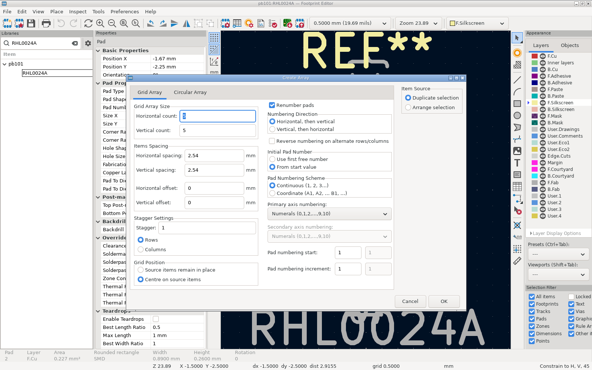
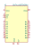

# Lab 02: A footprint from a datasheet

In this lab you make a KiCad footprint for TI's RHL0024A package, which KiCad's library doesn't have. The package is a 24-pin VQFN with a 3.5 × 5.5 mm body and an exposed pad underneath. You work out the size and position of each pad by hand from TI's package drawing, and then draw the footprint in KiCad. You also draw a symbol for the SN74LVC8T245, a level translator that TI sells in this package. The lab's check compares your numbers with the course's, your footprint with your numbers and your symbol with the datasheet's pin table. It then builds a small board with your part on it and runs KiCad's own checks on that board.

This lab takes about 2 h.

Package: [`labs/lab-02-a-footprint-from-a-datasheet/`](https://github.com/uoftasic/pcb101/tree/main/labs/lab-02-a-footprint-from-a-datasheet)

## Before you start

- Finish [Lab 01](lab-01-open-a-board-you-didnt-design-overview.md), which installs KiCad and checks that `labs/common/kicad.sh` runs.
- Read [Schematics other people can read](../guide/schematics-other-people-can-read.md), [Symbols, footprints and libraries](../guide/symbols-footprints-and-libraries.md) and [From die to package](../guide/from-die-to-package.md).
- Download TI's [SN74LVC8T245 datasheet](https://www.ti.com/lit/ds/symlink/sn74lvc8t245.pdf). We used revision SCES584D (June 2005, revised May 2026), and the page numbers below are that revision's PDF pages. If TI has revised it since, find the package outline headed "RHL0024A" near the end; the drawing we used is numbered 4225250/C.

The SN74LVC8T245 passes eight signals between its A side and its B side, and each side has its own supply, anywhere from 1.65 V to 5.5 V. You could use one between a Tiny Tapeout chip's 3.3 V pins and a part that runs at another voltage. KiCad 10.0.5's `Package_DFN_QFN` library has 776 footprints. Only two have RHL in their names, `Texas_VQFN-RHL-20` and its thermal-via version, and both are for a 20-pin package, with 21 pads counting the exposed pad.

## Part 1: Read the drawing

What does the drawing say about the package, and which of its numbers come with a tolerance?

1. Open the datasheet at page 36, "PACKAGE OUTLINE, RHL0024A". The view at the top of the drawing is the package seen from above. Under it is a side view, and under that is the package seen from below, which shows the 24 terminals and the exposed pad. The drawing numbers the exposed pad 25.

2. Write down these dimensions from the drawing, which are the only ones the lab uses. A dimension given as two numbers, such as 3.6 over 3.4, is a range, and a real part can measure anything between them. A number in a box is a basic dimension, which is exact by definition, and a number in parentheses is for reference only.

   | Dimension | From the drawing |
   |---|---|
   | Body, the short side | 3.4 to 3.6 |
   | Body, the long side | 5.4 to 5.6 |
   | Terminal length | 0.3 to 0.5 (24X) |
   | Terminal width | 0.18 to 0.30 (24X) |
   | Pitch | 0.5, boxed |
   | Span of the 10 terminals on each long side | 4.5, boxed |
   | Spacing of the 2 terminals on each short side | 1.5, boxed |
   | Exposed pad | 2.05 ± 0.1 by 4.05 ± 0.1 |

3. In the view from below, pin 1 is at the bottom left. Where will pin 1 be in your footprint, which KiCad draws from above?

   <details>
   <summary>Answer</summary>

   Pin 1 goes at the top left. The view from below is the view from above turned over, and on this drawing it's turned top to bottom, so pin 1 moves from the bottom left to the top left. Seen from above, the numbering then runs counterclockwise. Pin 1 is on the top short side, 2 to 11 run down the left side, 12 and 13 are on the bottom, 14 to 23 run up the right side, and 24 is on the top next to pin 1. TI's example board layout on page 37 is drawn from above and numbers its pads the same way, and KiCad's library convention also puts pin 1 at the top left.

   </details>

Check: you have the eight dimensions above written down, and you know where pin 1 goes.

## Part 2: Work out the pads

How big should each pad be, and where does it go?

1. Make a prediction first. TI's example land pattern on page 37 uses pads 0.6 mm long and 0.24 mm wide. Will pads worked out from the IPC method below come out longer or shorter than that?

2. For each pair of opposite sides, work out Z, G and X from the formulas below. The terminals on the long sides (pins 2 to 11 and 14 to 23) point along the short body dimension, so for them L is 3.4 to 3.6. The terminals on the short sides (1, 12, 13 and 24) point along the long one, so for them L is 5.4 to 5.6. T is the terminal length, W the terminal width, and each C is the difference between the maximum and the minimum of the quantity in its subscript:

   $$S_{max} = L_{max} - 2T_{min}, \qquad S_{min} = L_{min} - 2T_{max}$$

   $$Z = L_{min} + 2J_T + \sqrt{C_L^2 + F^2 + P^2}$$

   $$G = S_{max} - 2J_H - \sqrt{C_S^2 + F^2 + P^2}$$

   $$X = W_{min} + 2J_S + \sqrt{C_W^2 + F^2 + P^2}$$

   S is the distance between the inner ends of two opposite terminals. Z is the distance between the outer ends of two opposite pads, G the distance between their inner ends, and X the pad width. $J_T = 0.30$, $J_H = 0$ and $J_S = -0.04$ mm are IPC-7351B's solder-fillet goals at the toe, heel and side of a no-lead terminal, at nominal density, as KiCad's footprint generator records them. F and P allow for the board maker's and the assembler's tolerances, and this course uses F = 0.10 mm and P = 0.05 mm. Taking $C_S$ as $S_{max} - S_{min}$ in the formula for G assumes that the tolerances that make up S are all at their worst at once, and the course's check does the same. KiCad's footprint generator instead combines those tolerances as a root-sum-square. Write each result to two decimal places in the Z, G and X rows of `pads.md`, in the lab folder.

3. KiCad's library convention asks for at least 0.2 mm between the exposed pad and every other pad. Make the exposed pad's land the drawing's nominal size, 2.05 × 4.05, and work out the gap between it and the inner ends of your pads at G. Where the gap is less than 0.2 mm, move the pads' inner ends out until it's 0.2 mm, which makes the pads shorter. Then work out each pad's length, and the distance from the footprint's centre to the pad's centre, and write them in the "Pad length" and "Pad centre" rows. Write the exposed pad's size on the "Exposed pad:" line at the bottom.

4. Check your numbers:

   ```bash
   labs/common/kicad.sh python3 labs/lab-02-a-footprint-from-a-datasheet/src/check_footprint.py
   ```

   You should see an `ok` row for `pads.md` and MISMATCH rows for the other three parts, because you haven't drawn the footprint or the symbol yet:

   ```text
     ok        pads.md    Z, G, X, pad lengths and centres within 0.02 mm of the course's
     MISMATCH  Footprint  no labs/lab-02-a-footprint-from-a-datasheet/pcb101.pretty/RHL0024A.kicad_mod yet
     MISMATCH  Symbol     no symbol called SN74LVC8T245RHL in labs/lab-02-a-footprint-from-a-datasheet/pcb101.kicad_sym
     MISMATCH  Fit        needs both the footprint and the symbol

   FAIL  3 of 4 parts have a MISMATCH: Footprint, Symbol and Fit
   ```

   If a row says a number is more than 0.02 mm from the course's value, recheck that one. Compare your pad length with your prediction.

   <details>
   <summary>Answer</summary>

   On the long sides, Z = 4.23, G = 2.39 and X = 0.26. On the short sides, Z = 6.23, G = 4.39 and X is 0.26 again. At G, the gap to the exposed pad is 0.17 mm on both pairs of sides, which is less than 0.2 mm, so the inner ends move out to 1.225 mm (long sides) and 2.225 mm (short sides) from the centre. Every pad ends up 0.89 × 0.26 mm, and its centre is 1.67 mm (long sides) or 2.67 mm (short sides) from the middle of the footprint. That's longer than TI's 0.6 mm. The formula for Z, with its 0.30 mm toe goal, puts the outer end of each pad about 0.37 mm beyond the nominal edge of the body, so that a solder fillet can form there. TI's pads end 0.2 mm beyond it. The course's check holds you to the IPC method so that everyone's numbers can be checked against the same answer.

   </details>

Check: the `pads.md` row says `ok`.

## Part 3: Draw the footprint

Can you turn your numbers into a KiCad footprint that matches them?

1. Open `labs/lab-02-a-footprint-from-a-datasheet/lab02.kicad_pro` in KiCad, then the Footprint Editor. The project's library tables add the lab folder's `pcb101.pretty` as a library called `pcb101`. Make a new footprint in `pcb101` called `RHL0024A`.

2. Place one pad with the pad tool on the right-hand toolbar, then press E on it to open its properties:

   

   The dialog above shows pad 1 of the reference footprint. Make yours pad 2: SMD, rounded rectangle, 0.89 mm in X by 0.26 mm in Y, at X = −1.67 and Y = −2.25, with your own numbers in place of these if they differ. Leave F.Paste and F.Mask ticked. KiCad's Y axis points down, so negative Y is the top of the footprint.

3. Make the rest of the left column with an array. Select pad 2 and press Ctrl+T:

   

   Set a horizontal count of 1, a vertical count of 10 and a vertical spacing of 0.5 mm, choose "Source items remain in place", keep "Renumber pads" ticked and start the numbering at 2. The pad you selected becomes the first of the ten, so you get pads 2 to 11 down the left side.

4. Make pads 14 to 23 the same way, from a pad 14 at X = 1.67, Y = 2.25. The right column is numbered upward, so give this array a vertical spacing of −0.5 mm, and start its numbering at 14. Then place the four pads on the short sides, each 0.26 mm in X by 0.89 mm in Y. Pads 1 and 24 go at Y = −2.67, and 12 and 13 at Y = 2.67. Pads 1 and 12 are at X = −0.75, and 24 and 13 at X = 0.75.

5. Add the exposed pad: pad 25, a rectangle 2.05 × 4.05 mm at the origin, with F.Paste unticked. Its paste goes on separately, through smaller openings, as it does in KiCad's own QFN footprints (`QFN-64-1EP_9x9mm_P0.5mm_EP7.65x7.65mm`, for example, has 36 of them). You can make the openings in either of two ways. One is to add pads of type "SMD Aperture" with no number, on F.Paste only. The other is to set a negative "Solder paste relative clearance" on pad 25 and tick F.Paste again. On each side, KiCad then pulls the edge of the opening in by that percentage of the pad's size along the same axis. We plotted a 2.05 × 4.05 mm pad with −10 % and got a 1.64 × 3.24 mm opening, which is 64 % of the pad's area. Whichever way you choose, the paste should cover between 50 % and 80 % of the pad's area, which is what KiCad's library convention asks for. TI's own stencil on page 38 prints 80 %. The reference uses eight 0.83 × 0.82 mm openings, two across and four down, for 66 %.

6. Draw the rest:
   - on F.Fab, the body outline, 3.5 × 5.5 mm, centred, ideally with the pin 1 corner cut off;
   - on F.Silkscreen, a mark at pin 1 and short lines at the body's corners, all at least 0.2 mm clear of every pad;
   - on F.Courtyard, a rectangle 0.25 mm outside the pads and the body, which for the reference is ±2.37 × ±3.37 mm.

   

7. Save, and run the check from Part 2 again. You should see `ok  Footprint  25 pads where your numbers put them, paste 66 %, and matches none of KiCad's 776 QFN footprints`, with your own paste percentage in place of the reference's 66. The check compares every pad with your `pads.md` to within 0.01 mm, and if a pad is off, it names the pad and says where your numbers put it.

Check: the Footprint row says `ok`.

## Part 4: Draw the symbol

Which pins does the schematic need, and what kind is each one?

1. KiCad's own library has a symbol called `SN74LVC8T245`. Open it in the Symbol Editor (it's in `Logic_LevelTranslator`) and look at its pins and its footprint filters. Why can't you use it with your footprint as it stands?

   <details>
   <summary>Answer</summary>

   It has 24 pins and no pin for the exposed pad, so pad 25 would get no net. Its footprint filters include `Texas*VQFN*RHL*`, which in KiCad 10.0.5's library matches only `Texas_VQFN-RHL-20` and `Texas_VQFN-RHL-20_ThermalVias`. Both are footprints for a 20-pin package, and the description of each cites the datasheet of a different part. In a filtered list, a footprint for the wrong pin count can look plausible, and that's one reason to read the drawing yourself.

   </details>

2. In the Symbol Editor, make a new symbol in the project library `pcb101` called `SN74LVC8T245RHL`. Give it the pins in Table 4-1 on page 5: VCCA on 1, DIR on 2, A1 to A8 on 3 to 10, GND on 11, 12 and 13, B8 to B1 on 14 to 21, OE on 22 and VCCB on 23 and 24. Add pin 25 for the thermal pad, called `EP`. The Pin Table lets you type the pins into a grid rather than placing each one.

3. Set each pin's electrical type, because ERC decides what to report from the pin types. Make the supplies power input, DIR and OE input, and the A and B pins bidirectional. GND has three pins and VCCB has two, and a schematic should have to connect each supply only once, so stack each supply's pins. In KiCad 10 a stack can be a single pin with a list of numbers. Number one GND pin `[11,12,13]` and one VCCB pin `[23,24]`, and KiCad gives that pin's net to every pad in the list. KiCad's library convention (KLC S4.3) asks for these pin stacks from KiCad 10 on, in place of the older way, in which several pins are drawn on top of each other and all but one are hidden. The check accepts either, and the reference was drawn the older way. If you draw it that way, make the hidden pins passive, because KiCad joins a hidden power-input pin to a global net named after it, and then in Part 5 the pads' nets wouldn't match the schematic. If you leave one as a power input, the check's Symbol row names the pin to change. Table 4-1 gives the thermal pad no type. The reference makes it passive, and the check accepts passive, power input, input, bidirectional or unspecified for it.

4. Set the symbol's Footprint field to `pcb101:RHL0024A`, and save.

5. Table 4-1 lists the thermal pad with no pin number, type or description, and note 3 on page 36 says only that it must be soldered to the board. Neither says what to connect it to. Where would you find out?

   <details>
   <summary>Answer</summary>

   Note 4 on page 37 points to TI's application note SLUA271 on soldering a thermal pad, and you can ask about this part on TI's support forum. Giving the pad its own pin, EP, puts whatever you decide in the schematic, where a reviewer can see it.

   </details>

   {width=45%}

Check: the check's Symbol row says `ok  Symbol  25 pins with Table 4-1's names and types, footprint pcb101:RHL0024A`.

## Part 5: Put it on a board

Do your symbol and footprint work together the way KiCad expects?

1. Run the check once more. With both files in place, it now builds a KiCad project with one part in `results/fit/`. The project's schematic has your symbol, a label on every pin, and a PWR_FLAG on each net that has a power-input or input pin, so that ERC sees each of those nets driven. Its board has your footprint, with every pad given the net of its pin. The check then runs `labs/common/check_board.py` on that project. In our three runs, with the container limited to one CPU, the whole check took 18 to 43 s. On the reference solution it ends like this:

   ```text
     ok        pads.md    Z, G, X, pad lengths and centres within 0.02 mm of the course's
     ok        Footprint  25 pads where your numbers put them, paste 66 %, and matches none of KiCad's 776 QFN footprints
     ok        Symbol     25 pins with Table 4-1's names and types, footprint pcb101:RHL0024A
     ok        Fit        ERC, DRC and parity clean on a board with your part (17 ERC and 0 DRC warnings)

   PASS  labs/lab-02-a-footprint-from-a-datasheet/solutions
   ```

   The 17 ERC warnings are for the labels on A1 to A8, B1 to B8 and EP. Each of those labels is connected to only one pin, because the schematic has no other part for it to reach. `results/fit/check_board.txt` has the board check's full output.

2. To see what the board check adds, we made every signal pad 0.32 mm wide instead of 0.26, in `pads.md` and in the footprint. The `pads.md` row failed, because 0.32 is more than 0.02 mm from the course's X. The Footprint row still passed, because the pads matched the numbers in `pads.md`, but the board check in the Fit row failed:

   ```text
     MISMATCH  pads.md    X, long sides: 0.32 is more than 0.02 mm from the course's value
     MISMATCH             X, short sides: 0.32 is more than 0.02 mm from the course's value
     ok        Footprint  25 pads where your numbers put them, paste 66 %, and matches none of KiCad's 776 QFN footprints
     ok        Symbol     25 pins with Table 4-1's names and types, footprint pcb101:RHL0024A
     MISMATCH  Fit        drc.error 18 (clearance 18)
   ```

   Each of the 18 is `Clearance violation ( clearance 0.2000 mm; actual 0.1800 mm)` between neighbouring pads. Why 18, and why 0.18 mm?

   <details>
   <summary>Answer</summary>

   Pads 0.32 mm wide at a 0.5 mm pitch leave 0.5 − 0.32 = 0.18 mm of copper-free space between neighbours, and the board's default clearance is 0.2 mm. Each long side has 10 pads and so 9 gaps, and there are two long sides. The two pads on each short side are 1.5 mm apart, centre to centre, which leaves far more than the clearance between them.

   </details>

3. We also deleted pin 25 from the reference symbol. The board check still passed, because pad 25 just had no net and KiCad's schematic parity check reported nothing. Only the Symbol row failed, with `no pin 25`. That's why the lab's check reads your symbol's pins itself rather than leaving it all to KiCad.

Check: the check prints `PASS`.

## Expected results

| Check | Expected | |
|---|---|---|
| Z, G, X, long sides | 4.23, 2.39, 0.26 mm | within 0.02 mm |
| Z, G, X, short sides | 6.23, 4.39, 0.26 mm | within 0.02 mm |
| Gap to the exposed pad at G | 0.17 mm, so the pads are trimmed | exact |
| Pads | 0.89 × 0.26 mm, centres at ±1.67 and ±2.67 mm | within 0.02 mm |
| Paste on the exposed pad | 50 to 80 % | rule |
| Fit project | 0 ERC errors, 0 DRC errors, 0 parity items | exact |
| `check_footprint.py` run time | 18 to 43 s in our runs, with both files in place and one CPU | ballpark |

## Finishing

You're done when `check_footprint.py` prints `PASS  labs/lab-02-a-footprint-from-a-datasheet` on your own `pads.md`, footprint and symbol.

Questions:

1. Your pads stick out about 0.37 mm past the body; TI's stop at 0.2 mm. Which would you rather solder by hand, and which leaves more room for parts packed around the chip?

   <details>
   <summary>Answer</summary>

   The longer IPC pads are easier to solder by hand, because there's more copper outside the body for the iron to heat and for you to see the fillet on. TI's shorter pads make the courtyard smaller, which matters when other parts are packed close around the chip. Neither is wrong, and the drawing doesn't tell you which to use, so it's a decision you make for each board.

   </details>

2. In the fit project, pads 11, 12 and 13 are all on the net GND, and 23 and 24 are on VCCB, but no track connects them, and the check doesn't count that against you. Why is that fine here, and not on your Lab 03 board?

   <details>
   <summary>Answer</summary>

   The fit project is a board with one part and no tracks, made only to test the part, so pads that share a net are bound to be unconnected. On the reference, `check_board.py` reported 3 unconnected items, and the project's `check-expect.json` leaves unconnected items out of the PASS or FAIL. On a real board every net has to be routed, and unless a `check-expect.json` says otherwise, the board check counts unconnected items as failures.

   </details>

Submit: nothing for this lab.

## Going further (optional)

- Compare your pads with the QFN-64 on Tiny Tapeout's SKY130 breakout from Lab 01. That board uses KiCad's `QFN-64-1EP_9x9mm_P0.5mm_EP7.65x7.65mm`, which has 0.85 × 0.25 mm pads centred at ±4.45 mm. The footprint's description cites page 415 of the ATmega2560 datasheet, so the footprint under the Tiny Tapeout chip was drawn from another chip's package drawing.
- Run `labs/common/kicad.sh python3 labs/lab-02-a-footprint-from-a-datasheet/src/selftest.py`. It runs the check on seven folders whose verdicts are known in advance. One of them holds KiCad's `QFN-24-1EP_4x4mm_P0.5mm_EP2.6x2.6mm` renamed to `RHL0024A`, and the check fails it with `these pads are the same as KiCad's ...`.

{width=40%}

Next on the [Course path](../index.md#course-path): read [Layers and fabricator rules](../guide/layers-and-fabricator-rules.md), [Placement and routing](../guide/placement-and-routing.md), [Pins, Pmods and planning a pinout](../guide/pins-pmods-and-planning-a-pinout.md) and [Parts you can solder by hand](../guide/parts-you-can-solder-by-hand.md), then do [Lab 03: A Pmod for one project's pins](lab-03-a-pmod-for-one-projects-pins-overview.md).
