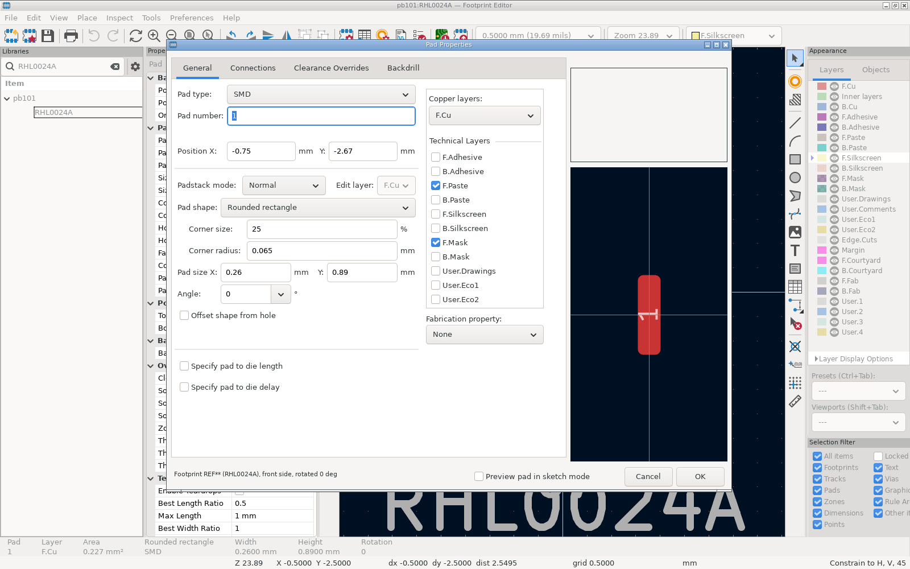
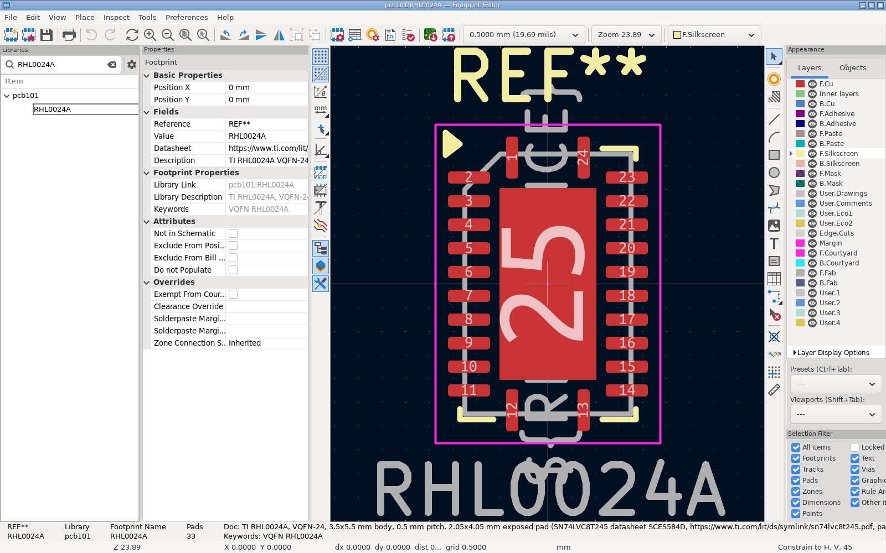

# Lab 02: A footprint from a datasheet

In this lab you make a footprint that KiCad's library doesn't have, for TI's RHL0024A package: a 24-pin VQFN, 3.5 × 5.5 mm, with an exposed pad underneath. You'll work out its pads by hand from the package drawing, draw the footprint and the symbol of the chip that comes in it, the SN74LVC8T245 level translator, and then check both against your own numbers and against KiCad's checks on a small board.

This lab takes about 2 h.

Package: [`labs/lab-02-a-footprint-from-a-datasheet/`](https://github.com/uoftasic/pb101/tree/main/labs/lab-02-a-footprint-from-a-datasheet)

## Before you start

- Finish [Lab 01](lab-01-open-a-board-you-didnt-design-overview.md), which installs KiCad and checks that `labs/common/kicad.sh` runs.
- Read [Schematics other people can read](../guide/schematics-other-people-can-read.md), [Symbols, footprints and libraries](../guide/symbols-footprints-and-libraries.md) and [From die to package](../guide/from-die-to-package.md).
- Download TI's [SN74LVC8T245 datasheet](https://www.ti.com/lit/ds/symlink/sn74lvc8t245.pdf). We used revision SCES584D (June 2005, revised May 2026), and the page numbers below are that revision's PDF pages. If TI has revised it since, find the package outline headed "RHL0024A" near the end; the drawing we used is numbered 4225250/C.

The SN74LVC8T245 moves eight signals between two supplies, each anywhere from 1.65 V to 5.5 V, which is the kind of part that sits between a Tiny Tapeout chip's 3.3 V pins and something running at another voltage. KiCad 10.0.8's `Package_DFN_QFN` library has 779 footprints and none of them is this package: the only RHL footprints in it, `Texas_VQFN-RHL-20` and its thermal-via version, are for a 20-pin package, with 21 pads counting the exposed pad.

## Part 1: Read the drawing

What does the drawing say about the package, and which of its numbers come with a tolerance?

1. Open the datasheet at page 36, "PACKAGE OUTLINE, RHL0024A". The upper view is the package seen from above, and the lower one the package seen from below, with its 24 terminals and the exposed pad, numbered 25.

2. Write down these numbers, which are all you need. A dimension given as two numbers, such as 3.6 over 3.4, is a range: the part can be anywhere between them. A number in a box is a basic dimension, exact by definition, and a number in parentheses is for reference only.

   | Dimension | From the drawing |
   |---|---|
   | Body, the short side | 3.4 to 3.6 |
   | Body, the long side | 5.4 to 5.6 |
   | Terminal length | 0.3 to 0.5 (24X) |
   | Terminal width | 0.18 to 0.30 (24X) |
   | Pitch | 0.5, boxed |
   | Span of the 10 terminals on each long side | 4.5, boxed |
   | Spacing of the 2 terminals on each short side | 1.5, boxed |
   | Exposed pad | 2.05 ± 0.1 by 4.05 ± 0.1 |

3. In the view from below, pin 1 is at the bottom left. Where will pin 1 be in your footprint, which KiCad draws from above?

   <details>
   <summary>Answer</summary>

   At the top left. The view from below is the top view flipped over, here top to bottom, so pin 1 moves from the bottom left to the top left, and the numbering runs counterclockwise from above: pin 1 on the top short side, 2 to 11 down the left side, 12 and 13 on the bottom, 14 to 23 up the right side, and 24 back on the top. TI's example board layout on page 37 is drawn from above and numbers its pads that way, and KiCad's library convention puts pin 1 at the top left too.

   </details>

Check: you have the eight numbers above written down, and you know where pin 1 goes.

## Part 2: Work out the pads

How big should each pad be, and where does it go?

1. Make a prediction first. TI's example land pattern on page 37 uses pads 0.6 mm long and 0.24 mm wide. Will pads worked out from the IPC method below come out longer or shorter than that?

2. Work out three numbers for each pair of opposite sides. The long sides' terminals (pins 2 to 11 and 14 to 23) point along the short body dimension, 3.4 to 3.6, and the short sides' terminals (1, 12, 13 and 24) point along the long one, 5.4 to 5.6. With L the body dimension, T the terminal length and W its width, and each C the difference between a maximum and a minimum:

   $$S_{max} = L_{max} - 2T_{min}, \qquad S_{min} = L_{min} - 2T_{max}$$

   $$Z = L_{min} + 2J_T + \sqrt{C_L^2 + F^2 + P^2}$$

   $$G = S_{max} - 2J_H - \sqrt{C_S^2 + F^2 + P^2}$$

   $$X = W_{min} + 2J_S + \sqrt{C_W^2 + F^2 + P^2}$$

   Z is the distance between the outer ends of two opposite pads, G the distance between their inner ends, and X the pad width. $J_T = 0.30$, $J_H = 0$ and $J_S = -0.04$ mm are IPC-7351B's solder-fillet goals at the toe, heel and side of a no-lead terminal, at nominal density, as KiCad's footprint generator records them. F and P allow for the board maker's and the assembler's tolerances; this course uses F = 0.10 mm and P = 0.05 mm. The formula for G takes the worst case for S. KiCad's footprint generator combines the tolerances that make up S as a root-sum-square instead, which gives a larger G for this package; the course's check uses the worst case. Write each result to two decimal places in the Z, G and X rows of `pads.md`, in the lab folder.

3. KiCad's library convention asks for at least 0.2 mm between the exposed pad and every other pad. Make the exposed pad's land the drawing's nominal size, 2.05 × 4.05, and work out the gap between it and the inner ends of your pads at G. Where the gap is less than 0.2 mm, move the pads' inner ends out until it's 0.2 mm, which makes the pads shorter. Then work out each pad's length, and the distance from the footprint's centre to the pad's centre, and write them in the "Pad length" and "Pad centre" rows. Write the exposed pad's size on the last line.

4. Check your numbers:

   ```bash
   labs/common/kicad.sh python3 labs/lab-02-a-footprint-from-a-datasheet/src/check_footprint.py
   ```

   You should see an `ok` row for `pads.md`, with MISMATCH rows for the footprint and the symbol, which you haven't drawn yet:

   ```text
     ok        pads.md    Z, G, X, pad lengths and centres within 0.02 mm of the course's
     MISMATCH  Footprint  no labs/lab-02-a-footprint-from-a-datasheet/pb101.pretty/RHL0024A.kicad_mod yet
     MISMATCH  Symbol     no symbol called SN74LVC8T245RHL in labs/lab-02-a-footprint-from-a-datasheet/pb101.kicad_sym
     MISMATCH  Fit        needs both the footprint and the symbol

   FAIL  3 of 4 parts of the check disagree
   ```

   If a row says a number is more than 0.02 mm from the course's value, recheck that one. Compare your pad length with your prediction.

   <details>
   <summary>Answer</summary>

   On the long sides, Z = 4.23, G = 2.39 and X = 0.26, and on the short sides Z = 6.23 and G = 4.39. At G the gap to the exposed pad is only 0.17 mm on both, so the inner ends move out to 1.225 and 2.225 mm from the centre, and every pad ends up 0.89 × 0.26 mm, centred 1.67 mm (long sides) or 2.67 mm (short sides) from the middle. That's longer than TI's 0.6 mm. IPC's toe goal puts the outer end of each pad about 0.37 mm beyond the nominal edge of the body, so that a solder fillet can form there, whereas TI's pads stop 0.2 mm beyond it. Both are reasonable; they're different choices, and the course's check holds you to the IPC one so that everyone's numbers can be compared.

   </details>

Check: the `pads.md` row says `ok`.

## Part 3: Draw the footprint

Can you turn your numbers into a footprint that KiCad will check?

1. Open `labs/lab-02-a-footprint-from-a-datasheet/lab02.kicad_pro` in KiCad, then the Footprint Editor. Its library tables add this folder's `pb101.pretty` as a library called `pb101`. Make a new footprint in `pb101` called `RHL0024A`.

2. Place one pad with the pad tool on the right-hand toolbar, then press E on it to open its properties:

   

   Make it pad 2: SMD, rounded rectangle, 0.89 mm in X by 0.26 mm in Y, at X = −1.67 and Y = −2.25 with your own numbers in place of these if they differ. Leave F.Paste and F.Mask ticked. KiCad's Y axis points down, so negative Y is the top of the footprint.

3. Make the rest of the left column with an array. Select pad 2 and press Ctrl+T:

   

   Set a horizontal count of 1, a vertical count of 10 and a vertical spacing of 0.5 mm, choose "Source items remain in place", keep "Renumber pads" ticked and start the numbering at 2. The pad you selected becomes the first of the ten, so you get pads 2 to 11 down the left side.

4. Make pads 14 to 23 the same way, from a pad 14 at X = 1.67, Y = 2.25. The right column is numbered upward, so give this array a vertical spacing of −0.5 mm, and start its numbering at 14. Then place pads 1 and 24 at Y = −2.67 and 12 and 13 at Y = 2.67, each at X = ±0.75, as 0.26 mm in X by 0.89 mm in Y.

5. Add the exposed pad: pad 25, a rectangle 2.05 × 4.05 mm at the origin, with F.Paste unticked. Its paste goes on separately, through smaller openings, the way KiCad's own QFN footprints do it (its `QFN-64-1EP_9x9mm_P0.5mm_EP7.65x7.65mm` has 36 of them). Either add pads of type "SMD Aperture" with no number, on F.Paste only, or set a negative "Solder paste relative clearance" on pad 25 and tick F.Paste again. KiCad applies that ratio to each side along its own axis: −10 % on a 2.05 × 4.05 mm pad plotted as a 1.64 × 3.24 mm opening, 64 % of the pad. Whichever you choose, the paste should cover between 50 % and 80 % of the pad's area, as the library convention asks (TI's own stencil on page 38 prints 80 %). The reference uses eight 0.83 × 0.82 mm openings, two across and four down, for 66 %.

6. Draw the rest:
   - on F.Fab, the body outline, 3.5 × 5.5 mm, centred, ideally with the pin 1 corner cut off;
   - on F.Silkscreen, a mark at pin 1 and short lines at the body's corners, all at least 0.2 mm clear of every pad;
   - on F.Courtyard, a rectangle 0.25 mm outside the pads and the body, which for the reference is ±2.37 × ±3.37 mm.

   

7. Save, and run the check from Part 2 again. You should see `ok  Footprint  25 pads where your numbers put them, paste 66 %, and matches none of KiCad's 779 QFN footprints`, with your own paste percentage in place of the reference's 66. It compares every pad with your `pads.md` to within 0.01 mm, so if a pad is off it names the pad and where your numbers put it.

Check: the Footprint row says `ok`.

## Part 4: Draw the symbol

Which pins does the schematic need, and what kind is each one?

1. KiCad's own library has a symbol called `SN74LVC8T245`. Open it in the Symbol Editor (it's in `Logic_LevelTranslator`) and look at its pins and its footprint filters. Why can't you use it with your footprint as it stands?

   <details>
   <summary>Answer</summary>

   It has 24 pins and no pin for the exposed pad, so pad 25 would get no net. Its footprint filters include `Texas*VQFN*RHL*`, which in KiCad 10.0.8's library matches only `Texas_VQFN-RHL-20` and `Texas_VQFN-RHL-20_ThermalVias`, footprints for a 20-pin package whose description cites a different part's datasheet. A footprint for the wrong pin count can look plausible in a filtered list, which is one reason to read the drawing yourself.

   </details>

2. In the Symbol Editor, make a new symbol in the project library `pb101` called `SN74LVC8T245RHL`. Give it the pins in Table 4-1 on page 5: VCCA on 1, DIR on 2, A1 to A8 on 3 to 10, GND on 11, 12 and 13, B8 to B1 on 14 to 21, OE on 22 and VCCB on 23 and 24. Add pin 25 for the thermal pad, called `EP`. The Pin Table lets you type the pins into a grid rather than placing each one.

3. Set each pin's electrical type, because ERC reasons from them: the supplies power input, DIR and OE input, and the A and B pins bidirectional. GND has three pins and VCCB two, and a schematic should only have to connect each of them once, so stack them. KiCad 10 can put a stack in a single pin: number one GND pin `[11,12,13]` and one VCCB pin `[23,24]`, and KiCad gives that pin's net to every pad in the list. KiCad's library convention (KLC S4.3) asks for these pin stacks from KiCad 10 on, in place of the older way of drawing several pins on top of each other, hidden behind one visible pin. The check accepts either, and the reference was drawn the older way. If you draw it that way, make the hidden pins passive. KiCad joins a hidden power-input pin to a global net named after it, so in Part 5 the pads' nets wouldn't match the schematic, and the check's Symbol row names the pin to change. The datasheet gives the thermal pad no type; the reference makes it passive, and the check accepts passive, power input, input, bidirectional or unspecified for it.

4. Set the symbol's Footprint field to `pb101:RHL0024A`, and save.

5. Table 4-1 doesn't say what to connect the thermal pad to, only that it must be soldered to the board (note 3 on page 36). Where would you find out?

   <details>
   <summary>Answer</summary>

   Note 4 on page 37 points to TI's application note SLUA271 for how to solder a thermal pad, and TI's support forum is the place to ask about this part. Giving the pad its own pin, EP, puts that decision in the schematic, where a reviewer can see it.

   </details>

   {width=45%}

Check: the check's Symbol row says `ok  Symbol  25 pins with Table 4-1's names and types, footprint pb101:RHL0024A`.

## Part 5: Put it on a board

Do your symbol and footprint work together the way KiCad expects?

1. Run the check once more. With both files in place, it now builds a one-part KiCad project in `results/fit/`: a schematic with your symbol, a label on every pin and a PWR_FLAG on each net that needs a driver, and a board with your footprint placed and every pad given its pin's net. Then it runs `labs/common/check_board.py` on that project, which takes about 20 s. On the reference solution it ends:

   ```text
     ok        pads.md    Z, G, X, pad lengths and centres within 0.02 mm of the course's
     ok        Footprint  25 pads where your numbers put them, paste 66 %, and matches none of KiCad's 779 QFN footprints
     ok        Symbol     25 pins with Table 4-1's names and types, footprint pb101:RHL0024A
     ok        Fit        ERC, DRC and parity clean on a board with your part (17 ERC and 0 DRC warnings)

   PASS  labs/lab-02-a-footprint-from-a-datasheet/solutions
   ```

   The 17 ERC warnings are labels connected to only one pin, which is all a one-part schematic can have. `results/fit/check_board.txt` has the board check's full output.

2. To see what the board check adds, we made every signal pad 0.32 mm wide instead of 0.26, in `pads.md` and in the footprint. The footprint check still passed, because the pads matched the numbers, but the board didn't:

   ```text
     MISMATCH  pads.md    X, long sides: 0.32 is more than 0.02 mm from the course's value
     MISMATCH             X, short sides: 0.32 is more than 0.02 mm from the course's value
     ok        Footprint  25 pads where your numbers put them, paste 66 %, and matches none of KiCad's 779 QFN footprints
     ok        Symbol     25 pins with Table 4-1's names and types, footprint pb101:RHL0024A
     MISMATCH  Fit        drc.error 18 (clearance 18)
   ```

   Each of the 18 is `Clearance violation ( clearance 0.2000 mm; actual 0.1800 mm)` between neighbouring pads. Why 18, and why 0.18 mm?

   <details>
   <summary>Answer</summary>

   Pads 0.32 mm wide at a 0.5 mm pitch leave 0.5 − 0.32 = 0.18 mm of copper-free space between neighbours, and the board's default clearance is 0.2 mm. Each long side has 10 pads and so 9 gaps, and there are two long sides. The short sides' two pads are 1.5 mm apart, far more than the clearance.

   </details>

3. We also deleted pin 25 from the reference symbol. The board check passed: KiCad's schematic parity reported nothing, and pad 25 simply had no net. Only the Symbol row failed, with `no pin 25`. That's why the lab's check reads your symbol's pins itself rather than leaving it all to KiCad.

Check: the check prints `PASS`.

## Expected results

| Check | Expected | |
|---|---|---|
| Z, G, X, long sides | 4.23, 2.39, 0.26 mm | within 0.02 mm |
| Z, G, X, short sides | 6.23, 4.39, 0.26 mm | within 0.02 mm |
| Gap to the exposed pad at G | 0.17 mm, so the pads are trimmed | exact |
| Pads | 0.89 × 0.26 mm, centres at ±1.67 and ±2.67 mm | within 0.02 mm |
| Paste on the exposed pad | 50 to 80 % | rule |
| Fit project | 0 ERC errors, 0 DRC errors, 0 parity items | exact |
| `check_footprint.py` run time | about 20 s with both files in place | ballpark |

## Finishing

You're done when `check_footprint.py` prints `PASS  labs/lab-02-a-footprint-from-a-datasheet` on your own `pads.md`, footprint and symbol.

Questions:

1. Your pads stick out about 0.37 mm past the body; TI's stop at 0.2 mm. Which would you rather solder by hand, and which leaves more room for parts packed around the chip?

   <details>
   <summary>Answer</summary>

   The longer IPC pads are easier by hand, because there's more copper outside the body for the iron to heat and for you to see the fillet on. TI's shorter pads leave the courtyard smaller, which matters when other parts crowd round the chip. Neither is wrong, and the drawing alone doesn't tell you which to use; that's a decision for the board, and the course makes it for you here so that the check can compare numbers.

   </details>

2. In the fit project, pads 11, 12 and 13 share the net GND, and 23 and 24 share VCCB, but nothing connects them, and the check doesn't count that against you. Why is that fine here, and not on your Lab 03 board?

   <details>
   <summary>Answer</summary>

   The fit project is a board with one part and no tracks, made only to test the part, so pads that share a net are bound to be unconnected; `check_board.py` reported 3 unconnected items on the reference, and the project's `check-expect.json` leaves them out of the PASS or FAIL. On a real board every net has to be routed, and the board check counts unconnected items as failures.

   </details>

Submit: nothing for this lab.

## Going further (optional)

- Compare your pads with the QFN-64 on Tiny Tapeout's SKY130 breakout from Lab 01: KiCad's `QFN-64-1EP_9x9mm_P0.5mm_EP7.65x7.65mm` uses 0.85 × 0.25 mm pads centred at ±4.45 mm. Its description cites the ATmega2560 datasheet, page 415, so the footprint under the Tiny Tapeout chip was drawn from another chip's package drawing.
- Run `labs/common/kicad.sh python3 labs/lab-02-a-footprint-from-a-datasheet/src/selftest.py`, which runs the check on seven folders with known verdicts, including a KiCad footprint renamed to `RHL0024A`, which fails with `these pads are the same as KiCad's ...`.

{width=40%}

Next on the [Course path](../index.md#course-path): read [Layers and fabricator rules](../guide/layers-and-fabricator-rules.md), [Placement and routing](../guide/placement-and-routing.md), [Pins, Pmods and planning a pinout](../guide/pins-pmods-and-planning-a-pinout.md) and [Parts you can solder by hand](../guide/parts-you-can-solder-by-hand.md), then do [Lab 03: A Pmod for one project's pins](lab-03-a-pmod-for-one-projects-pins-overview.md).
