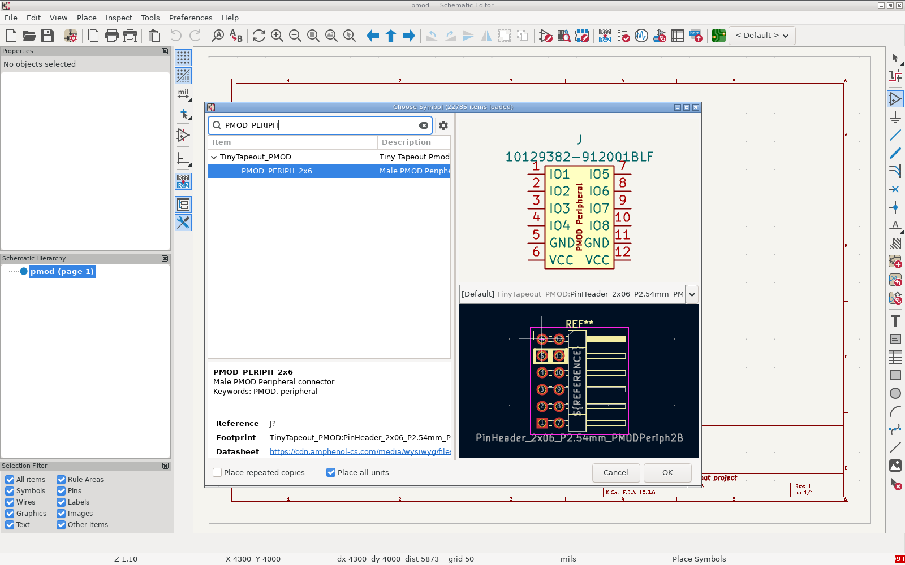
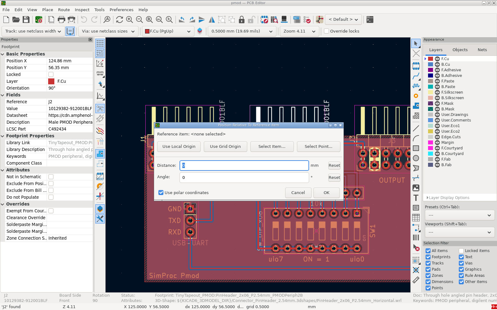
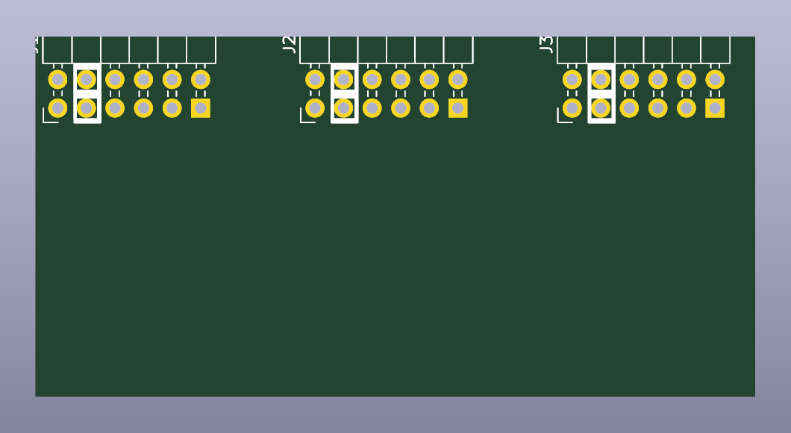
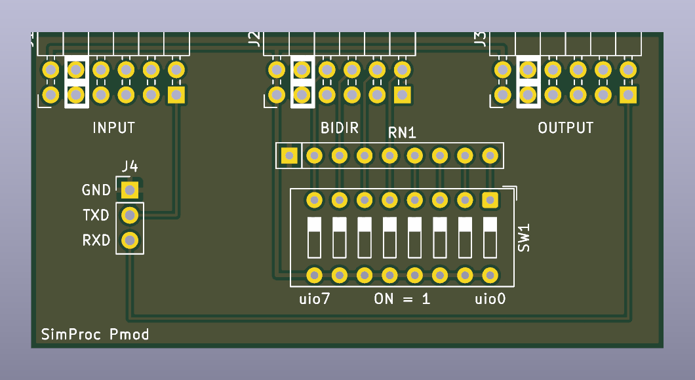

# Lab 03: A Pmod for one project's pins

In this lab you start a board repository of your own and draw your first board in it. The board is a 2-layer Pmod that plugs into the three I/O sockets on Tiny Tapeout's demo board and connects one project's pins to the parts that project needs. This page uses the team's SimProc, which is also the project the check uses by default. SimProc needs a header for a 3.3 V USB-UART dongle on `ui[0]` and `uo[0]`, and eight switches on `uio[0..7]` that set its baud rate. You'll draw the schematic, place the three connectors at the spacing of Tiny Tapeout's sockets, place and route the rest of the board, and then check its connections against SimProc's pin list. Labs 04 to 06 continue with this board, in the same repository. The capstone does too if you choose its Brief D; Brief A starts a new board.

The lab's files are in [`labs/lab-03-a-pmod-for-one-projects-pins/`](https://github.com/uoftasic/ic103/tree/main/labs/lab-03-a-pmod-for-one-projects-pins) in the course repo.

## Before you start

- Finish [Lab 01](lab-01-open-a-board-you-didnt-design-overview.md), Part 1, so that KiCad 10.0 is installed, the course repo is cloned (the commands below assume `~/ic103`; use your own path if it's elsewhere) and Docker can run the checks.
- Read the pages on row 5 of the [course path](../index.md#course-path): [Layers and fabricator rules](../guide/layers-and-fabricator-rules.md), [Placement and routing](../guide/placement-and-routing.md), [Pins, Pmods and planning a pinout](../guide/pins-pmods-and-planning-a-pinout.md) and [Parts you can solder by hand](../guide/parts-you-can-solder-by-hand.md).
- Have git and a GitHub account working, as you did in IC102.

The check scripts are bash scripts, so on Windows you run them in WSL. If you don't have bash, the lab's [README](https://github.com/uoftasic/ic103/tree/main/labs/lab-03-a-pmod-for-one-projects-pins) has a plain `docker run` command that does the same; we have run it on Linux but not on Windows.

The lab takes about 4 hours: roughly 15 minutes for Part 1, an hour for the schematic, half an hour to place the connectors, an hour and 45 minutes to place and route the rest, and half an hour for Part 5. Those times are our estimates for a first board. We did time the check itself, which took 20 seconds in our run once Docker had the image.

## Part 1: Start your board repository

From this lab on, your board lives in a repository of your own, and the check you run on it stays in the course repo.

1. Copy the board template out of the course repo and make it a git repository:

   ```bash
   cp -r ~/ic103/labs/lab-03-a-pmod-for-one-projects-pins/template ~/simproc-pmod
   cd ~/simproc-pmod
   git init -b main
   git add .
   git commit -m "Start from the IC103 board template"
   ```

   The template is a KiCad 10 project named `pmod`. Its Board Setup already holds JLCPCB's published limits for a 2-layer board (0.10 mm tracks and gaps, 0.15 mm holes, 0.25 mm vias, and silkscreen text at least 1.0 mm high and 0.15 mm thick), and a custom rule in `pmod.kicad_dru` adds their 0.18 mm minimum annular ring. By default the tracks you draw are 0.25 mm wide, with 0.2 mm clearance. `lib/` holds Tiny Tapeout's Pmod symbol and footprint (Apache 2.0), and the project's library tables point at it, so the project opens the same way on any computer.

2. Make a public repository called `simproc-pmod` in your own GitHub account and push to it, the way you did in IC102. With the GitHub CLI, that's `gh repo create simproc-pmod --public --source . --push`.

3. Before you run the check on the empty project, write down which of its parts you expect to fail. Then run it from your repository:

   ```bash
   ~/ic103/labs/lab-03-a-pmod-for-one-projects-pins/check.sh
   ```

   You should see the board check, then the Pmod check, both failing:

   ```text
                   errors  warnings  excluded
     ERC                0         0         0
     DRC                1         0         0
     unconnected        0         0         0
     parity             0         0         0

     DRC errors (1):
       invalid_outline          Board has malformed outline (no edges found on Edge.Cuts layer)  [PCB]

   FAIL  drc.error: 1 (want 0)
   ...
     FAIL  connectors   the schematic has 0 PMOD_PERIPH_2x6 connectors; this project needs 3, one per socket (input, bidir, output)
     FAIL  pins         not checked until the connectors pass

   FAIL  pmod.kicad_pro: board check FAIL; 0 of 2 Pmod checks ok
   ```

   ERC finds nothing to object to in an empty schematic, so a clean ERC row on its own doesn't tell you that a board does anything. The Pmod check reads SimProc's pin list, [`labs/common/pins/simproc.json`](https://github.com/uoftasic/ic103/blob/main/labs/common/pins/simproc.json), and it keeps failing until your board connects each pin in that list the way the list says.

KiCad and `kicad-cli` write a few files of their own next to the project. `kicad-cli` writes a `.kicad_prl` of local settings every time it runs on the project, which it does in every run of the check, and saving in KiCad adds a `.history` folder of automatic snapshots. `git status` lists them as untracked. Leave them out of your commits for now by committing with `git commit -am`, which commits changes to the files git already tracks and adds no new ones. Lab 05 adds the `.gitignore` that keeps them out of git.

## Part 2: Draw the schematic

What does SimProc need from a board, pin by pin?

1. Open `pmod.kicad_pro` in KiCad, then the Schematic Editor. Place three Pmod connectors with Place > Place Symbols (A): type `PMOD_PERIPH` in the filter, choose `PMOD_PERIPH_2x6` from `TinyTapeout_PMOD`, and place it three times, as J1, J2 and J3.

   

   *The Choose Symbol dialog in KiCad 10.0.5, opened with A in the template's schematic and filtered to `PMOD_PERIPH`. The symbol already names its footprint, `TinyTapeout_PMOD:PinHeader_2x06_P2.54mm_PMODPeriph2B`.*

   J1 will go in the demo board's input socket, J2 in the bidirectional one and J3 in the output one. The symbol's pins are numbered the same way as the sockets' pins. `IO1` to `IO4`, on pins 1 to 4, carry bits 0 to 3 of the socket's bus, and `IO5` to `IO8`, on pins 7 to 10, carry bits 4 to 7. Pins 5 and 11 are GND, and pins 6 and 12 are the demo board's 3.3 V.

2. Connect the pins SimProc uses with net labels (Place > Place Net Labels, L). Label J1 pin 1 (`ui[0]`) as `UART_RX`, J3 pin 1 (`uo[0]`) as `UART_TX`, and J2's eight IO pins as `UIO0` to `UIO7`. Put a `+3V3` power symbol on pins 6 and 12 and a `GND` symbol on pins 5 and 11 of all three connectors. Give each of the 14 IO pins left over a no-connect flag (Place > Place No Connect Flags, Q), which tells ERC that you left it open on purpose.

3. Add the header for the dongle, `Connector_Generic:Conn_01x03`, with the footprint `Connector_PinHeader_2.54mm:PinHeader_1x03_P2.54mm_Vertical`. (Double-click a symbol to set its Footprint field.) The check expects the header's pin 1 on GND, pin 2 wired to the dongle's TXD and pin 3 to the dongle's RXD, so pin 2 goes on `UART_RX` and pin 3 on `UART_TX`. Leave the dongle's VCC wire unconnected, because the board gets its power from the demo board.

   Why does SimProc's receive line go to the dongle's *transmit* pin?

   <details>
   <summary>Answer</summary>

   Each end names TX and RX from its own point of view. The dongle transmits on its TXD pin and SimProc receives on `ui[0]`, so the dongle's TXD drives `ui[0]`. In the other direction, SimProc transmits on `uo[0]`, which drives the dongle's RXD. Swapping the two is the classic UART mistake, and Part 5 shows which check catches it.

   </details>

4. Add the switches and their pull-downs. Use `Switch:SW_DIP_x08`, with the footprint `Button_Switch_THT:SW_DIP_SPSTx08_Slide_9.78x22.5mm_W7.62mm_P2.54mm`. Switch *k* sits between pin *k* and pin 17 − *k*, so connect pins 1 to 8 to `UIO0` to `UIO7` and pins 9 to 16 to `+3V3`. Then give every `UIO` line a 10 kΩ resistor to GND. You can use eight `Device:R` with the hand-soldering footprint `Resistor_SMD:R_0805_2012Metric_Pad1.20x1.40mm_HandSolder`, or one `Device:R_Network08` (footprint `Resistor_THT:R_Array_SIP9`), a bussed network in which all eight resistors share pin 1. That shared pin goes to GND. The check accepts either.

5. Before you add anything else, predict what ERC will say about the power pins. Then run it (Inspect > Electrical Rules Checker, or the check).

   You should see two errors of the same kind. The check prints them like this for our schematic, and the `#PWR` numbers in yours may differ:

   ```text
     ERC errors (2):
       power_pin_not_driven     Input Power pin not driven by any Output Power pins  [Symbol #PWR001 Pin 1 [Power input, Line]]
       power_pin_not_driven     Input Power pin not driven by any Output Power pins  [Symbol #PWR003 Pin 1 [Power input, Line]]
   ```

   Why does ERC think nothing powers the board?

   <details>
   <summary>Answer</summary>

   The Pmod symbol's power pins and the power symbols are all power inputs. Nothing on the schematic is a power output, because the 3.3 V comes in through the connectors from the demo board's regulator, which isn't on your schematic. ERC reports one error per net, here `+3V3` and `GND`. A `PWR_FLAG` on a net tells ERC that power reaches it from outside.

   </details>

6. Add one `power:PWR_FLAG` on `+3V3` and one on `GND`, and run ERC again. Commit with `git commit -am "Schematic"`.

In the check's output you should see 0 in all three columns of the ERC row. DRC still reports the `invalid_outline` error from Part 1, because you draw the outline in Part 3. Parity reports a warning for every footprint that isn't on the board yet, six in our version (`missing_footprint J1` to `missing_footprint SW1`). The Pmod check now finds the connectors and asks for them on the board: `FAIL  connectors   J1, J2, J3 not on the board yet (Update PCB from Schematic, F8)`.

## Part 3: Place the connectors

Where exactly do the three connectors have to be?

1. In the PCB Editor, run Tools > Update PCB from Schematic (F8) and click Update PCB. The footprints arrive together, attached to the cursor; click to drop them beside where the board will go.

2. Select J1 and set its Orientation to 90° in the Properties panel, so that its pins point up, off the top of the board. Put it wherever you like; ours is at X 102, Y 56.35.

3. Select J2 and press Shift+P, which opens Position Relative To with Use polar coordinates ticked, so it asks for a Distance and an Angle. Click Select Item… and then J1, and enter 22.86 mm and 0°. That puts J2 22.86 mm to the right of J1, along +X. Give J2 the same 90° orientation. Then do the same for J3, relative to J2.

   

   *Position Relative To in KiCad 10.0.5, opened with Shift+P on J2 of our finished board. The Properties panel on the left shows J2's position, its 90° orientation and the Locked box you'll tick in step 5.*

   You should see J2's Position X in the Properties panel exactly 22.86 mm more than J1's, and its Position Y the same. Why 22.86 mm?

   <details>
   <summary>Answer</summary>

   22.86 mm is 0.9 in, which is the spacing of the demo board's three I/O sockets. The README of Tiny Tapeout's Pmod library gives that spacing for a board with more than one Pmod connector, with the input connector on the left, the bidirectional one in the middle and the output one on the right, looking at the board from the top. The check allows 0.02 mm either way, and a part you drag by hand won't reliably land that close.

   </details>

4. Draw the board outline on the Edge.Cuts layer with the rectangle tool. Its top edge has to cross the connectors' plastic bodies, so that the pins stick out past the edge and into the sockets. Ours is 64 × 32 mm, from (100, 50) to (164, 82), which puts the top edge 6.35 mm above the lower row of each connector's pads.

5. Lock the three connectors by ticking Locked in the Properties panel for each one, so that a stray drag can't move them off the spacing.

6. Run the check.

   

   *Three connectors 22.86 mm apart on our outline, rendered by `kicad-cli` 10.0.5 with the parts' 3D models. They're angled pin headers, so their pins stick out past the board's top edge.*

   You should see the connectors pass, with your own positions in place of ours:

   ```text
     ok    connectors   J1 (102.00, 56.35), J2 (124.86, 56.35), J3 (147.72, 56.35): 22.86 mm apart, in a row, pins past the edge, locked
     ok    sockets      J1 input (ui), J2 bidir (uio), J3 output (uo), left to right with the pins pointing away from you
   ```

   The board check still fails on unconnected items, and it will until you route the board in Part 4. Ours had 38 unconnected items with every footprint placed and nothing routed.

## Part 4: Place the rest and route

Can every connection be made on two layers, with the bottom layer kept as a ground plane?

1. Place the switches, the pull-downs and the header. Put the switches under J2, because all eight `uio` lines come from it, and put the header where a dongle's wires can reach it.

2. Look at J2's pads and at the row of eight switches before you route. Can the eight `uio` lines reach switches 1 to 8 in order without crossing, on one layer?

   <details>
   <summary>Answer</summary>

   They can't, unless they detour around the end of the connector. J2's signal pins are in two rows of four, with bits 0 to 3 in one row and bits 4 to 7 in the other, so bit 4 sits opposite bit 0, bit 5 opposite bit 1, and so on along the connector. Tracks that leave the connector side by side on one layer can't change their order without crossing. To bring the lines out to a single row in order, put one row's four tracks on the top layer and the other row's on the bottom, where they can cross the top-layer tracks. Keep the bottom-layer tracks short, because each one cuts a slot in the ground plane there.

   </details>

3. Route every connection. Use the default 0.25 mm for signals, and 0.4 mm, which is in the track-width list, for `+3V3`.

4. Add a GND zone on B.Cu over the whole board (Place > Draw Filled Zones, net GND), and another on F.Cu if you like, then press B to fill them.

5. Run DRC (Inspect > Design Rules Checker) with Test for parity between PCB and schematic ticked, and fix everything it reports as an error, including every unconnected item. Commit, and push.

6. Run the check. You should see the board check pass:

   ```text
                   errors  warnings  excluded
     ERC                0         0         0
     DRC                0        30         0
     unconnected        0         0         0
     parity             0         0         0

     DRC warnings by type: silk_edge_clearance 24, silk_over_copper 6
   ```

   Where do those 30 warnings come from?

   <details>
   <summary>Answer</summary>

   On our board, all of them come from Tiny Tapeout's Pmod footprint. The footprint's silkscreen draws the six pins that stick out of each connector, so when the board's edge crosses the connector, seven silkscreen segments and the connector's reference text lie past the edge. That's 24 `silk_edge_clearance` warnings for the three connectors. The silkscreen also outlines pads 5 and 11, the GND pads, and touches their copper, which gives the 6 `silk_over_copper` warnings. KiCad reports both kinds as warnings, and the check lists warnings without failing on them. Your own count can differ if your edge crosses the connectors somewhere else.

   </details>

Look at your board in KiCad's 3D viewer (View > 3D Viewer, Alt+3). If your KiCad has its 3D models (the Linux Lite AppImage doesn't), you'll see the parts, as in our render below.



*Our Lab 03 board, rendered by `kicad-cli` 10.0.5 with the parts' 3D models; it's one of many layouts that would work. The `uio` lines go from J2 to the pull-down network RN1 and the switches SW1. Those from J2's upper row run straight down on the top layer, and those from its lower row cross to the right on the bottom layer.*

## Part 5: Check the connections against SimProc's pin list

Does your board connect SimProc's pins the way its pin list says?

1. Open [`simproc.json`](https://github.com/uoftasic/ic103/blob/main/labs/common/pins/simproc.json) and compare it with your schematic, pin by pin.

2. Suppose you'd put `UART_TX` on the header's pin 2 and `UART_RX` on pin 3, and routed the board to match. Write down which parts of the check would catch that: ERC, DRC, parity, or the Pmod check.

   <details>
   <summary>Answer</summary>

   Only the Pmod check catches it. We made that board, and its board check passed with 0 errors and 0 unconnected items. ERC looks only at the schematic, DRC only at the board, and parity checks that the board matches the schematic, so the swap passes all three. The Pmod check compares the schematic with SimProc's pin list and prints:

   ```text
     FAIL  ui[0]        J1 pin 1 reaches J4 pin 3 (the dongle's RXD), not pin 2 (the dongle's TXD): are TX and RX swapped?
     FAIL  uo[0]        J3 pin 1 reaches J4 pin 2 (the dongle's TXD), not pin 3 (the dongle's RXD): are TX and RX swapped?
   ```

   </details>

3. Run the check on your board. You should see every Pmod row `ok`, with your own parts named, and the last line `PASS  pmod.kicad_pro: board check PASS; 14 of 14 Pmod checks ok`.

## Finishing

You're done when `~/ic103/labs/lab-03-a-pmod-for-one-projects-pins/check.sh`, run in your own repository, ends with `PASS  pmod.kicad_pro: board check PASS; 14 of 14 Pmod checks ok`, and the commit it checked is pushed to GitHub.

Questions:

1. The demo board already shows `uo[1]` (halt) and `uo[2]` (done) on its 7-segment display. Why doesn't your Pmod have LEDs for them?

   <details>
   <summary>Answer</summary>

   Each `uo_out` line already drives a segment of the display through a 510 Ω resistor. An LED on your board would be a second load on the same pin, so the LED and the segment would share the pad's rating of 4 mA, and the LED would only repeat what the segment shows. [Pins, Pmods and planning a pinout](../guide/pins-pmods-and-planning-a-pinout.md) has the details.

   </details>

Submit: nothing for this lab. Lab 04 continues in the same repository.

## Going further (optional)

- Draw a Pmod for another team project. Copy `simproc.json`, write that project's pins into it, and run the check with `--pins your-file.json` after the folder argument.
- Put the "Designed for Tiny Tapeout" logo on your board. The logo is in Tiny Tapeout's full [Pmod library](https://github.com/TinyTapeout/kicad-tinytapeout-pmod-lib); the template copies only the Pmod symbol and footprint from it.

Next on the [Course path](../index.md#course-path): read [Protecting the chip's I/O](../guide/protecting-the-chips-io.md), [Supplies, back-powering and ESD](../guide/supplies-back-powering-and-esd.md), [Measuring current](../guide/measuring-current.md) and [Bringing up a chip](../guide/bringing-up-a-chip.md), then do [Lab 04: Protect and plan](lab-04-protect-and-plan-overview.md).
