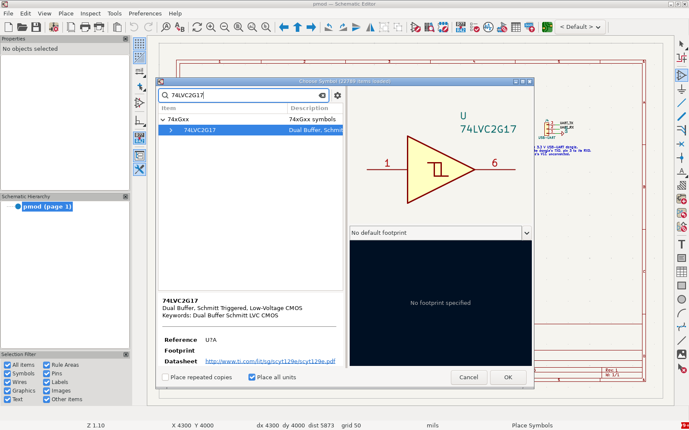

# Lab 04: Protect and plan

In this lab you make your Lab 03 board safe to plug into a Tiny Tapeout kit, and you write a plan for bringing it up with the kit. A kit has only one chip, so a mistake on your board that damages one of the chip's pins is expensive. On the board, you'll put a buffer and a resistor on each UART line, an ESD array on the dongle header and a current-sense point in the supply to your switches. The plan is a file in your repository, `BRINGUP.md`. It says what drives each line that leaves the board and what happens when one side is powered and the other isn't, it lists the checks you make before anything is powered, and it gives the reading you expect at every step.

The lab's files are in [`labs/lab-04-protect-and-plan/`](https://github.com/uoftasic/pcb101/tree/main/labs/lab-04-protect-and-plan) in the course repo.

## Before you start

- Finish [Lab 03](lab-03-a-pmod-for-one-projects-pins-overview.md), so that its check passes on your own repository.
- Read the pages on row 7 of the [course path](../index.md#course-path): [Protecting the chip's I/O](../guide/protecting-the-chips-io.md), [Supplies, back-powering and ESD](../guide/supplies-back-powering-and-esd.md), [Measuring current](../guide/measuring-current.md) and [Bringing up a chip](../guide/bringing-up-a-chip.md). The numbers that this lab asks you to work out come from those pages.

The lab takes about 2 hours, roughly 20 minutes for Part 1, 40 for Part 2, 15 for each of Parts 3 and 4, and 30 for the bring-up plan. Those times are our estimates. We did time the check itself, which took 18 seconds in our run with the container limited to one CPU.

Copy the bring-up plan's template into your repository and run the Lab 04 check on the board as Lab 03 left it:

```bash
cd ~/simproc-pmod
cp ~/pcb101/labs/lab-04-protect-and-plan/BRINGUP.md .
git add BRINGUP.md
~/pcb101/labs/lab-04-protect-and-plan/check.sh
```

The check runs everything that Lab 03's check runs, then the rows that Lab 04 adds, then the check of the bring-up plan. On our Lab 03 board the board check still passes, and five Pmod rows fail:

```text
  FAIL  ui[0]        J1 pin 1 reaches J4 pin 2 (the dongle's TXD) directly, with no buffer
                     a resistor big enough for SkyWater's 100 µA (27 kΩ) is more than the 15.4 kΩ that still gives a valid high against the RP2350's 36 kΩ pull-down
  FAIL  uo[0]        J3 pin 1 reaches J4 pin 3 (the dongle's RXD) directly, with no buffer
                     a resistor big enough for SkyWater's 100 µA from a CH340's 16.5 kΩ RX pull-up (10.5 kΩ) is more than the 5.28 kΩ that still gives a valid low at that RX
...
  FAIL  ESD J4.2     /UART_RX (the dongle's TXD) has no ESD part to GND on it
  FAIL  ESD J4.3     /UART_TX (the dongle's RXD) has no ESD part to GND on it
  FAIL  sense        no current-sense resistor between +3V3 and a net of the board's own
...
FAIL  pmod.kicad_pro: board check PASS; 12 of 17 Pmod checks ok; bring-up plan FAIL
```

The six rows that check the bring-up plan fail as well, although the excerpt above leaves them out. The template still says TODO in every section, and its Before power and Steps sections have one item each, where the check wants at least two and at least four. In Parts 2 to 4 you fix the five Pmod rows, and in Parts 1 and 5 you fill in the plan.

## Part 1: Every line that leaves the board

For each line between your board and something else, what drives it, what does it drive, and what happens when one side is powered and the other isn't?

1. Fill in the table under "Lines that leave the board" in `BRINGUP.md`. It has a row each for `ui[0]`, `uo[0]`, `uio[0..7]` and the 3.3 V that your board takes from the sockets. [Pins, Pmods and planning a pinout](../guide/pins-pmods-and-planning-a-pinout.md) lists what else the demo board connects to each pin. Part 2 changes what's on the two UART lines, and its last step has you rewrite their rows.

2. Start with the worst case, which is the `ui[0]` row with the kit switched off. The dongle is plugged into a laptop, and its TXD idles high at 3.3 V into `ui[0]`. On the board as Lab 03 left it, what limits the current that flows into the chip?

   <details>
   <summary>Answer</summary>

   Nothing on your board does. The current flows from the dongle's TXD through the pad's upper protection diode into `VDD_IO`, and from there onto the demo board's +3V3, and it's limited only by the dongle's own output stage and the diode's drop. Horowitz and Hill warn that momentary currents of more than 20 to 50 mA through those diodes can damage the part, and in some cases latch it up. [Supplies, back-powering and ESD](../guide/supplies-back-powering-and-esd.md#back-powering) draws this path in a figure.

   </details>

3. Your board drives `ui[0]`, and two things on the demo board can drive it too. Under Settings, write which firmware mode and which DIP-switch positions your board needs, and why.

   <details>
   <summary>Answer</summary>

   In the firmware's `ASIC_RP_CONTROL` mode, which the example configuration sets as the default, the RP2350 drives the `ui_in` pins, so SimProc's section of `config.ini` has to select `ASIC_MANUAL_INPUTS`. The demo board's DIP switch 1 connects `ui_in[0]` to +3V3 through 1 kΩ, so it has to be off. After Part 2 your board drives the line through R1, also 1 kΩ, so with the switch on a low would sit at 1.65 V, and the chip reads a low only at 0.99 V or less ([Contention](../guide/supplies-back-powering-and-esd.md#contention)).

   </details>

You should see the check's `Lines that leave the board` row go to `ok` once no cell is empty or says TODO.

## Part 2: A buffer on each UART line

What keeps the current into an unpowered chip under SkyWater's 100 µA, and still lets the UART work?

1. SkyWater's I/O guide allows a pin to be driven above its supply only if the current into it is limited to 100 µA ([Protecting the chip's I/O](../guide/protecting-the-chips-io.md#what-the-pins-are-rated-for) quotes it). Work out the smallest series resistor that keeps the current from a 3.3 V dongle under 100 µA when the chip's `VDD_IO` is near 0 V, $R \ge (3.3\ \text{V} - 0.6\ \text{V}) / 100\ \text{µA}$, and write it down.

2. The same resistor has to pass the UART's high. In `ASIC_MANUAL_INPUTS`, the demo board's firmware turns on the RP2350's pull-down on GPIO17, which is `ui_in[0]`, and the RP2350's datasheet gives that pull-down as 36 to 113 kΩ at 3.3 V. The chip's `ui_in` pads are CMOS inputs, and SkyWater guarantees a high only at 0.7 × 3.3 V = 2.31 V or more. Write down the high you expect at `ui_in[0]` through your resistor from step 1 against the strongest pull-down, 36 kΩ. Then work out the largest resistor that still gives 2.31 V.

   <details>
   <summary>Answer</summary>

   $3.3\ \text{V} \times 36\ \text{kΩ} / (36\ \text{kΩ} + 27\ \text{kΩ})$ = 1.89 V, below 2.31 V. The high reaches 2.31 V only while $R \le 15.4$ kΩ, less than the 27 kΩ that the current needs, so on this kit no series resistor does both. The `ui[0]` row of your first run of the check gives the same two numbers.

   </details>

3. The `uo[0]` row of that run gives a different pair, 10.5 kΩ and 5.28 kΩ. Where do they come from?

   <details>
   <summary>Answer</summary>

   From the dongle's RX pull-up. Of the five dongle chips we looked at (FT232R, FT231X, CP2102, CP2102N and CH340), the CH340's is the strongest. Its datasheet gives up to 200 µA at 3.3 V, which is 16.5 kΩ if that current flows at 0 V. Into an unpowered `uo_out[0]`, it takes 10.5 kΩ in series, for 27 kΩ in all, to keep that pull-up's current under 100 µA. With the chip powered, SimProc's low reaches the RX through the resistor and stays under the CH340's input-low limit of 0.8 V only while $R \le 5.28$ kΩ. [Sizing a series resistor](../guide/protecting-the-chips-io.md#sizing-a-series-resistor) works through both lines.

   </details>

4. Each line needs a buffer that passes almost no current while the kit is off and drives the line while it's on. Ours is TI's SN74LVC2G17 (U1), a dual Schmitt-trigger buffer, powered from the Pmod's +3V3 so that it's off whenever the kit is ([U1's supply](../guide/protecting-the-chips-io.md#u1s-supply)). TI specifies it for [partial power down](../guide/protecting-the-chips-io.md#partial-power-down), and with its supply at 0 V a pin passes at most 10 µA, which TI calls Ioff. To add it, press A and filter for `74LVC2G17`. KiCad's symbol is `74xGxx:74LVC2G17`, described as "Dual Buffer, Schmitt Triggered, Low-Voltage CMOS". It doesn't name a footprint, so give it `Package_TO_SOT_SMD:SOT-23-6`, which is TI's DBV package.

   

   *Choose Symbol in KiCad 10.0.5, filtered to `74LVC2G17`. The preview shows unit A, the buffer from pin 1 to pin 6, and the box under it says No default footprint. Unit B is the buffer from pin 3 to pin 4, and unit C holds GND (pin 2) and VCC (pin 5).*

   Leave Place all units ticked, and place all three. The pins have numbers but no names, so the wiring below goes by number, with the names from TI's pin table in brackets.

5. On your Lab 03 board, J4 pin 2 and J1 pin 1 are both on `UART_RX`, and J4 pin 3 and J3 pin 1 are both on `UART_TX`. Split each net, keep its name on the Pmod side (J1 or J3), give the J4 side a net of its own (ours are `DONGLE_TXD` and `DONGLE_RXD`), and wire each line through the buffer, U1, in the direction its signal runs:

   - `ui[0]`, into the chip: J4 pin 2 to U1 pin 1 (1A), and U1 pin 6 (1Y, our net `RX_BUF`) through R1 (1 kΩ) to J1 pin 1.
   - `uo[0]`, out of the chip: J3 pin 1 to U1 pin 3 (2A), and U1 pin 4 (2Y, our net `TX_BUF`) through R2 (1 kΩ) to J4 pin 3.
   - U1 pin 5 (VCC) to +3V3 and pin 2 (GND) to GND, with C1 (100 nF) from +3V3 to GND.
   - R4 (100 kΩ) from `DONGLE_TXD` to +3V3.

   R1, R2 and R4 (our references; R3 is the sense resistor in Part 4) are `Device:R` with the footprint `Resistor_SMD:R_0805_2012Metric_Pad1.20x1.40mm_HandSolder`, and C1 is `Device:C` with `Capacitor_SMD:C_0805_2012Metric_Pad1.18x1.45mm_HandSolder`. Why does U1's first input need R4, and why does R4 pull up rather than down?

   <details>
   <summary>Answer</summary>

   With no dongle on J4, nothing drives U1's pin 1, and a floating input on a powered buffer can toggle and send SimProc garbage. R4 pulls up because a UART line idles high, and a receiver reads a line held low as a break ([Inputs that nobody drives](../guide/protecting-the-chips-io.md#inputs-that-nobody-drives)).

   </details>

   With U1 driving both lines, what are R1 and R2 for?

   <details>
   <summary>Answer</summary>

   R1 limits the current to 3.3 mA if the RP2350 fights U1 on `ui_in[0]`, and to 1.65 mA if DIP switch 1 does, through the switch's own 1 kΩ and R1 in series (Part 1, step 3). With the kit on and the dongle unpowered, U1's high pushes current through the clamp diode on the dongle's RX, and R2 limits it to 2.7 mA. Each also slows the edges at the pin it drives, to $2.2RC$ = 22 ns with 1 kΩ and an assumed 10 pF. That's short next to the 8.7 µs of a bit at 115,200 baud.

   The check accepts R1 from 330 Ω to 8.2 kΩ. At 330 Ω a fight passes 10 mA. The top of the window is below step 2's 15.4 kΩ because of erratum E9 on the RP2350's A2 stepping ([RP2350 datasheet](https://datasheets.raspberrypi.com/rp2350/rp2350-datasheet.pdf)). It accepts R2 from 1 kΩ to 5.1 kΩ, the E24 value just under step 3's 5.28 kΩ. Neither the RP2350's absolute maximum ratings nor any of the dongle datasheets we read gives a current limit for a pin, so the 10 mA and the 2.7 mA are limits we chose. [The resistor after each buffer](../guide/protecting-the-chips-io.md#the-resistor-after-each-buffer) explains both windows.

   </details>

6. Update the board (F8), place the new parts near J4, and route. Put one of C1's pads within 3 mm of U1's pin 5, measured centre to centre, or both UART rows fail; ours is 2.24 mm away. On our board one line had to cross another near U1, so `DONGLE_RXD` goes from R2 through a via and along the bottom layer to J4 pin 3. If DRC reports `starved_thermal` on a GND pad, look for a piece of ground fill that your new tracks have cut off, and join it to the plane on the bottom layer with a GND via. Ours had two. Write down the high you expect at `ui[0]` through U1 and R1 against the 36 kΩ pull-down, then run the check. You should see both UART rows pass. Ours read:

   ```text
     ok    ui[0]        J4 pin 2 (the dongle's TXD) drives J1 pin 1 through U1 (74LVC2G17, 1A pin 1 to 1Y pin 6) and R1 (1k)
                        U1: Ioff-rated, VCC (pin 5) on +3V3, GND (pin 2) on GND
                        R1 = 1 kΩ (330 Ω to 8.2 kΩ): 3.3 V / 1 kΩ = 3.3 mA against a pin driving the other way; 3.3 V × 36 kΩ / (36 kΩ + 1 kΩ) = 3.21 V high against a 36 kΩ pull-down
                        decoupling: C1 (100n) from +3V3 to GND, a pad 2.24 mm from U1 pin 5
                        pull: R4 (100k) from U1's input (/DONGLE_TXD) up to +3V3
     ok    uo[0]        J3 pin 1 drives J4 pin 3 (the dongle's RXD) through U1 (74LVC2G17, 2A pin 3 to 2Y pin 4) and R2 (1k)
                        U1: Ioff-rated, VCC (pin 5) on +3V3, GND (pin 2) on GND
                        R2 = 1 kΩ (1 kΩ to 5.1 kΩ): (3.3 V - 0.6 V) / 1 kΩ = 2.7 mA into an unpowered dongle; 3.3 V × 1 kΩ / (1 kΩ + 16.5 kΩ) = 0.19 V low against a 16.5 kΩ pull-up
                        decoupling: C1 (100n) from +3V3 to GND, a pad 2.24 mm from U1 pin 5
   ```

7. Rewrite the `ui[0]` and `uo[0]` rows of your plan's table for the new circuit. With the kit off and the dongle powered, how much current can reach the chip now?

   <details>
   <summary>Answer</summary>

   At most 10 µA into `ui_in[0]`, U1's Ioff, because U1 is off with the kit. On `uo[0]` the dongle's RX pull-up pushes into U1's output (2Y), and `uo_out[0]` is on U1's input (2A), so none of that current reaches the chip. R4 adds up to 3.3 V / 100 kΩ = 33 µA from the dongle's TXD into the kit's +3V3, a supply rail rather than a pin.

   The "Kit on, dongle unpowered" column changes too. An unpowered dongle may pull `DONGLE_TXD` down to about 0.6 V through the clamp diode on its TXD. R4 is too weak to stop it, so U1 holds `ui[0]` low. That's our inference, not a measurement, and it's why your plan should say to keep the dongle powered whenever it's plugged into J4.

   </details>

## Part 3: ESD on the dongle header

Where does static get onto your board, and where does the protection have to sit?

1. Add a two-line ESD array to the schematic. Ours is `Power_Protection:SP0502BAHT`, which KiCad's library describes as "TVS Diode Array, 5.5V Standoff, 2 Channels, SOT-23 package". The symbol already names its footprint, `Package_TO_SOT_SMD:SOT-23`, whose leads come out beside the body, where you can reach them with an iron.

   

   *Choose Symbol in KiCad 10.0.5, filtered to `SP0502`. Pins 1 and 2 are the two protected lines and pin 3 goes to GND.*

2. Connect its pins 1 and 2 to the header's pins 2 and 3 (`DONGLE_TXD` and `DONGLE_RXD`, on the header side of U1 and R2), and pin 3 to GND. Why there, rather than at the Pmod connectors?

   <details>
   <summary>Answer</summary>

   Static arrives on the dongle's cable, so the clamp should be the first thing it meets, close to the header and with a short path to ground. U1 sits between the clamp and the chip on both lines, so whatever gets past the clamp reaches U1 first. The demo board's TVS diodes are on the USB data lines and the analog lines, none of which your board uses, so the array on J4 is the only TVS protection your board's lines get, and it covers just the two UART lines. [ESD](../guide/supplies-back-powering-and-esd.md#esd) gives Horowitz and Hill's estimate of the energy that a discharge delivers to an input with and without external clamp diodes and series resistors.

   </details>

3. Place the array next to the header with a via from pin 3 to the ground plane, route it, and run the check. You should see:

   ```text
     ok    ESD J4.2     /DONGLE_TXD: D1 (SP0502BAHT, pin 1) to GND
     ok    ESD J4.3     /DONGLE_RXD: D1 (SP0502BAHT, pin 2) to GND
   ```

The check counts a part as ESD protection if it has one pin on the line and another on GND, and either its reference starts with D or it comes from KiCad's `Power_Protection` library.

## Part 4: A current-sense point

What should your board draw from the demo board's 3.3 V, and how will you read it?

1. Give your switches a supply net of their own. Put a 10 Ω resistor, with the same symbol and footprint as R1, from the sockets' `+3V3` to a new net (ours is `+3V3_PMOD`), and move the common side of the switches onto that net. Leave U1 and C1 on `+3V3`, the net of the sockets' pins 6 and 12. The check looks for U1's VCC there, and the 10 Ω then carries only the switches' current. Put a test point on each side of the resistor, using the symbol `Connector:TestPoint` with the footprint `TestPoint:TestPoint_Pad_D1.5mm`.

2. Each switch that's on draws 3.3 V / 10 kΩ through its pull-down. Work out what your switches draw, set the way you'll use them, and the voltage that this current puts across the 10 Ω, and write both numbers in your plan.

   <details>
   <summary>Answer</summary>

   Each switch that's on draws 0.33 mA. With three on, the switches draw 0.99 mA, which drops 9.9 mV across 10 Ω, and with all eight on they draw 2.64 mA and drop 26.4 mV. A multimeter on its millivolt range can read either.

   </details>

3. Can this resistor tell you what the chip draws?

   <details>
   <summary>Answer</summary>

   No. The chip's supplies stay on the breakout, so the current through this resistor is only what your switches and their pull-downs draw. With your board on the demo board and no rework on the breakout, you can read the chip's current only as part of the whole kit's, at the USB input, and Tiny Tapeout's ETR guide puts the kit's current at 180 to 200 mA with the factory test project running. [Measuring current](../guide/measuring-current.md#what-you-can-measure-on-a-tiny-tapeout-kit) explains why, and describes a board in the demo board's place that can measure the breakout's total current on +3V3.

   </details>

4. Update the board, place the resistor and the test points, route, and run the check. You should see:

   ```text
     ok    sense        R3 (10) from +3V3 to /+3V3_PMOD, test points TP1 and TP2
   ```

## Part 5: The bring-up plan

What do you check before power, and what should you read at each step?

1. Under "Before power", list the checks you'd make with a multimeter on your board on its own, with nothing powered:

   - the resistance from +3V3 to GND, with every switch off and again with every switch on;
   - the resistance across R1 and across R2;
   - the resistance of R4, from J4 pin 2 to the test point on +3V3 (our TP1);
   - the resistance from each of the header's two signal pins to GND.

   Give each check an `Expect:` with its value. With every switch on, ours is 10 Ω + 10 kΩ / 8 = 1.26 kΩ. With every switch off, the reading climbs for a moment while the meter charges C1, and then settles above 1 MΩ. Why do you measure R1 and R2 at their own pads, rather than from one header to another?

   <details>
   <summary>Answer</summary>

   From header to header, both lines go through U1, so the reading tells you nothing about the resistor. Measure from J1 pin 1 to R1's other pad and from J4 pin 3 to R2's other pad, and expect 1.00 kΩ each.

   </details>

2. Fill in the rest of Settings: the current limit for your supplies (with its unit), your board's switches and the clock. The firmware mode and the DIP switches are there already from Part 1. SimProc's bit period is `clk_per_bit` = `uio` × 4 clocks, so with a 10 MHz clock and the switches set to 22, the UART runs at 10 MHz / 88 = 113,636 baud.

3. Under "Steps", write the bring-up in order: your board alone on a bench supply, then the kit's power, the clock, reset and project select, and the first functional test. Give each step an `Expect:` with a value and its unit, or with a byte in hex. On the bench nothing drives U1's second input, and TI's datasheet says that "All unused inputs of the device must be held at VCC or GND", so put 10 kΩ from J3 pin 1 to J3 pin 5 (GND) for the bench steps, and take it off before the board goes into the kit. With that resistor in place you can test both buffers on the bench: expect 3.3 V at J1 pin 1, because R4 holds U1's first input high, and 0 V at J4 pin 3. With the kit on, J1 pin 1 should read 3.21 V to 3.3 V, where 3.21 V is the high you worked out in Part 2 against the strongest pull-down.

   You can take two more values from DD104's [SimProc in one page](https://uoftasic.com/dd104/guide/simproc-in-one-page.html). After reset `uo_out` reads 0x03, because TX idles high and `halt` is high, so the demo board lights segments A and B. When you send SimProc `PING`, the three bytes F0 00 00, it replies 0xAA.

4. Under "When a reading is wrong", say what you do first and what each wrong reading points to. Also write down the order for unplugging, in which the dongle comes off J4 before the kit is switched off.

5. Run the check. You should see the bring-up plan pass:

   ```text
     ok    TODO                        none left
     ok    Lines that leave the board  4 rows, every cell filled in
     ok    Settings                    5 items; a current limit with its unit
     ok    Before power                5 items, each with an expected value and its unit
     ok    Steps                       8 items, each with an expected value and its unit
     ok    When a reading is wrong     7 lines
   ```

   Your counts may differ from ours. The check can't tell whether your expected values are right, so someone else should read your plan before any kit is powered with your board plugged in.

## Finishing

You're done when `~/pcb101/labs/lab-04-protect-and-plan/check.sh`, run in your own repository, ends with `PASS  pmod.kicad_pro: board check PASS; 17 of 17 Pmod checks ok; bring-up plan PASS`, and the files it checked are committed and pushed to GitHub.

Questions:

1. You power your board alone from a bench supply, with three switches on and the 10 kΩ on J3. What current does the supply show, and what voltage do you read between your two test points?

   <details>
   <summary>Answer</summary>

   The supply shows 0.99 mA, plus at most 10 µA of supply current for U1 (TI's ICC), and the meter across the test points reads 9.9 mV, as you worked out in Part 4, step 2. U1 takes its supply from +3V3 ahead of R3, so its current doesn't flow through R3.

   </details>

2. Why does the dongle come off J4 before the kit is switched off?

   <details>
   <summary>Answer</summary>

   So that the dongle never feeds the unpowered kit. If the kit goes off first, the dongle's TXD keeps driving U1's unpowered input and R4 (Part 2, step 7), and R4's 33 µA lifts the kit's +3V3 by an amount set by that rail's load. U1 keeps the current into the chip's pins under SkyWater's 100 µA in either order.

   </details>

Submit: nothing for this lab. Keep `BRINGUP.md` in your repository, because the capstone asks for a bring-up plan, and for Brief D you start from this one.

## Going further (optional)

- Give U1's second input a pull-down of its own, from `UART_TX` to GND, so that the bench steps no longer need the 10 kΩ on J3. The check doesn't ask for a pull on a `uo` line. Work out what a 100 kΩ pull-down takes from SimProc's TX while the line is high.
- Change R1 to 100 Ω, or R2 to 10 kΩ, run the check, and read the reason it gives. Then put the 1 kΩ back.

Next on the [Course path](../index.md#course-path): read [Fabrication outputs](../guide/fabrication-outputs.md), [Outputs in CI](../guide/outputs-in-ci.md) and [KiCad files in git](../guide/kicad-files-in-git.md), then do [Lab 05: Fab outputs in CI](lab-05-fab-outputs-in-ci-overview.md).
