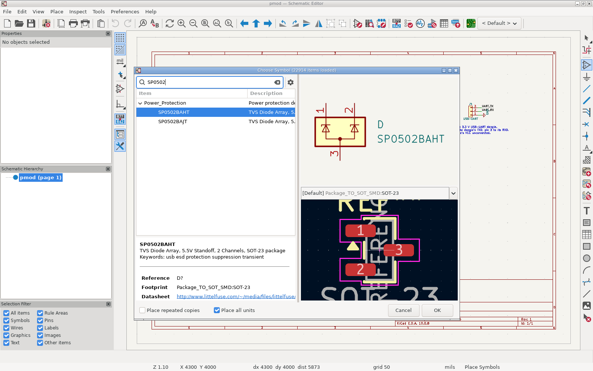

# Lab 04: Protect and plan

In this lab you make your Lab 03 board safe to plug into a kit that holds the team's only chip, and you write down how it will be brought up. You'll put a series resistor on each UART line, an ESD array on the dongle header and a current-sense point in the board's own supply, and you'll write `BRINGUP.md`: what drives each line when one side is unpowered, the checks before anything is powered, and the reading you expect at every step.

The lab's files are in [`labs/lab-04-protect-and-plan/`](https://github.com/uoftasic/pb101/tree/main/labs/lab-04-protect-and-plan) in the course repo.

## Before you start

- Finish [Lab 03](lab-03-a-pmod-for-one-projects-pins-overview.md): its check passes on your own repository.
- Read the pages on row 7 of the [course path](../index.md#course-path): [Protecting the chip's I/O](../guide/protecting-the-chips-io.md), [Supplies, back-powering and ESD](../guide/supplies-back-powering-and-esd.md), [Measuring current](../guide/measuring-current.md) and [Bringing up a chip](../guide/bringing-up-a-chip.md). The numbers this lab asks you to work out come from them.

The lab takes about 1 hour 30 minutes: roughly 20 minutes for Part 1, 15 each for Parts 2 to 4, and 25 for the bring-up plan. Those are our estimates. The check took 17 to 23 seconds in our runs.

Copy the bring-up plan's template into your repository and run the Lab 04 check on the board as Lab 03 left it:

```bash
cd ~/simproc-pmod
cp ~/pb101/labs/lab-04-protect-and-plan/BRINGUP.md .
git add BRINGUP.md
~/pb101/labs/lab-04-protect-and-plan/check.sh
```

It runs everything Lab 03's check runs, then the Lab 04 rows and the bring-up plan. On our Lab 03 board the board check still passes and five Pmod rows fail:

```text
  FAIL  ui[0]        J1 pin 1 reaches J4 pin 2 (the dongle's TXD) directly, with no series resistor; this line crosses from another supply
  FAIL  uo[0]        J3 pin 1 reaches J4 pin 3 (the dongle's RXD) directly, with no series resistor; this line crosses from another supply
...
  FAIL  ESD J4.2     /UART_RX (the dongle's TXD) has no ESD part to GND on it
  FAIL  ESD J4.3     /UART_TX (the dongle's RXD) has no ESD part to GND on it
  FAIL  sense        no current-sense resistor between +3V3 and a net of the board's own
...
FAIL  pmod.kicad_pro: board check PASS; 12 of 17 Pmod checks ok; bring-up plan FAIL
```

The bring-up plan fails on all six of its parts, because the template is full of TODOs. Parts 2 to 4 fix the five Pmod rows, and Parts 1 and 5 fill in the plan.

## Part 1: Every line that leaves the board

For each line between your board and something else, what drives it, what does it drive, and what happens when one side is powered and the other isn't?

1. Fill in the table under "Lines that leave the board" in `BRINGUP.md`, one row for `ui[0]`, `uo[0]`, `uio[0..7]` and the 3.3 V your board takes from the sockets. [Pins, Pmods and planning a pinout](../guide/pins-pmods-and-planning-a-pinout.md) lists what else the demo board hangs on each pin.

2. Take the worst row first. The kit is switched off, the dongle is plugged into a laptop, and its TXD idles high at 3.3 V into `ui[0]`. On the board as Lab 03 left it, what limits the current that flows into the chip?

   <details>
   <summary>Answer</summary>

   Nothing on your board. The current flows from the dongle's TXD through the pad's upper protection diode into `VDD_IO`, and from there onto the demo board's +3V3, and only the dongle's own output stage and the diode's drop limit it. Horowitz and Hill warn that 20 to 50 mA through those diodes can damage the part or latch it up. [Supplies, back-powering and ESD](../guide/supplies-back-powering-and-esd.md) follows the path.

   </details>

3. Your board drives `ui[0]`, and so can two things on the demo board. Write in Settings which firmware mode and which DIP-switch positions your board needs, and why.

   <details>
   <summary>Answer</summary>

   The RP2350 drives the `ui_in` pins in the firmware's `ASIC_RP_CONTROL` mode, which the example configuration starts in, so SimProc's section of `config.ini` needs `ASIC_MANUAL_INPUTS`. The demo board's DIP switch 1 connects `ui_in[0]` to +3V3 through 1 kΩ, so it has to be off: with the dongle driving the line low, it would push 3.3 V / 1 kΩ = 3.3 mA into the dongle's TXD.

   </details>

You should see the check's `Lines that leave the board` row go to `ok` once no cell is empty or says TODO.

## Part 2: Series resistors

How big a resistor keeps the current into an unpowered chip small, and still lets the UART's edges through?

1. Choose a limit for the current into a pin of an unpowered chip, and write it in your plan with its reason. SkyWater's I/O guide gives no rating for the protection diodes, so the limit is your choice. Horowitz and Hill's 20 to 50 mA is where damage starts, which makes it a ceiling rather than a target.

2. Work out the smallest resistor that meets your limit when the chip's `VDD_IO` is near 0 V, $R \ge (3.3\ \text{V} - 0.6\ \text{V}) / I_{max}$, and write it down before you choose a standard value.

3. Work out what your resistor does to an edge, $2.2RC$ with 10 pF at the pin, and compare it with one bit of the UART. At 115,200 baud a bit lasts 8.7 µs.

4. In the schematic, put the resistor between J1 pin 1 and the header's pin 2, and another between J3 pin 1 and the header's pin 3. Give the header side of each its own net name; ours are `DONGLE_TXD` and `DONGLE_RXD`. Update the board (F8), place each resistor on its line and route.

5. Run the check. You should see both UART rows pass, with the numbers worked out for your value. With 1 kΩ:

   ```text
     ok    ui[0]        J1 pin 1 reaches J4 pin 2 (the dongle's TXD) through R1 (1k)
                        into an unpowered chip: (3.3 V - 0.6 V) / 1 kΩ = 2.7 mA; edge with 10 pF: 2.2RC = 22 ns
     ok    uo[0]        J3 pin 1 reaches J4 pin 3 (the dongle's RXD) through R2 (1k)
                        into an unpowered chip: (3.3 V - 0.6 V) / 1 kΩ = 2.7 mA; edge with 10 pF: 2.2RC = 22 ns
   ```

   The check fails a resistor below 135 Ω, which would let more than 20 mA through. The resistor on `uo[0]` protects something else as well. What, and when?

   <details>
   <summary>Answer</summary>

   The dongle. With the kit on and the dongle unplugged from the laptop, SimProc's TX idles high into the dongle's unpowered RXD, and the current flows through the dongle's own clamp diode into its supply. R2 limits it the same way R1 limits the current into the chip.

   </details>

## Part 3: ESD on the dongle header

Where does static get onto your board, and where does the protection have to sit?

1. Add a two-line ESD array. Ours is `Power_Protection:SP0502BAHT`, which KiCad's library describes as "TVS Diode Array, 5.5V Standoff, 2 Channels, SOT-23 package", with the footprint `Package_TO_SOT_SMD:SOT-23`, a package whose leads you can reach with an iron.

   

   *Choose Symbol in KiCad 10.0.8, filtered to `SP0502`. Pins 1 and 2 are the two protected lines and pin 3 goes to GND.*

2. Connect its pins 1 and 2 to the header's pins 2 and 3, on the header side of the series resistors, and pin 3 to GND. Why there, rather than at the Pmod connectors?

   <details>
   <summary>Answer</summary>

   Static arrives on the dongle's cable, so the clamp should be the first thing it meets, close to the header with a short path to ground. The series resistor then sits between the clamp and the chip and limits whatever gets past. Horowitz and Hill's estimate is that a series resistor and external clamps cut the energy a 2.5 kV discharge delivers to an input from 15 µJ to about 0.1 µJ. The demo board has TVS diodes only on USB and the analog lines, so these are the only ones your digital pins get.

   </details>

3. Place the array next to the header with a via from pin 3 to the ground plane, route it, and run the check. You should see:

   ```text
     ok    ESD J4.2     /DONGLE_TXD: D1 (SP0502BAHT, pin 1) to GND
     ok    ESD J4.3     /DONGLE_RXD: D1 (SP0502BAHT, pin 2) to GND
   ```

The check counts a part as ESD protection if its reference starts with D, or it comes from KiCad's `Power_Protection` library, and it has a pin on the line and another on GND.

## Part 4: A current-sense point

What should your board draw from the demo board's 3.3 V, and how will you read it?

1. Give the board's own parts a supply net of their own. Put a 10 Ω resistor from the sockets' `+3V3` to a new net (ours is `+3V3_PMOD`), and move the switches' common side onto that net. Put a test point on each side, `Connector:TestPoint` with the footprint `TestPoint:TestPoint_Pad_D1.5mm`.

2. Work out what your board draws for the switch setting you'll use, and the voltage that puts across the 10 Ω. Each switch that's on draws 3.3 V / 10 kΩ through its pull-down. Write both numbers in your plan.

   <details>
   <summary>Answer</summary>

   0.33 mA per switch that's on. With three on, 0.99 mA, which drops 9.9 mV across 10 Ω; with all eight, 2.64 mA and 26.4 mV. A multimeter on its millivolt range reads either.

   </details>

3. Can this resistor tell you what the chip draws?

   <details>
   <summary>Answer</summary>

   No. The chip's supplies stay on the breakout, so the Pmod's 3.3 V feeds only your board's parts. The most a kit offers without rework is its whole current at the USB input, which Tiny Tapeout's ETR guide puts at 180 to 200 mA on the factory test project. [Measuring current](../guide/measuring-current.md) explains why.

   </details>

4. Update the board, place the resistor and the test points, route, and run the check. You should see:

   ```text
     ok    sense        R3 (10) from +3V3 to /+3V3_PMOD, test points TP1 and TP2
   ```

## Part 5: The bring-up plan

What do you check before power, and what should you read at each step?

1. Under "Before power", list the checks you'd make with a multimeter on the bare board: the resistance from +3V3 to GND with every switch off and with every switch on, across each series resistor, and from each header pin to GND. Give each an `Expect:` with its value; with every switch on ours is 10 Ω + 10 kΩ / 8 = 1.26 kΩ.

2. Fill in Settings: the current limit (with its unit), the firmware mode, the DIP switches, your board's switches, and the clock. SimProc's bit period is `clk_per_bit` = `uio` × 4 clocks, so with a 10 MHz clock and the switches set to 22, the UART runs at 10 MHz / 88 = 113,636 baud.

3. Under "Steps", write the bring-up in order: your board alone on a bench supply, then the kit's power, the clock, reset and project select, and the first functional test. Each step gives an `Expect:` with a value and its unit, or a byte in hex. Two values you can take from SimProc itself, from DD104's [SimProc in one page](https://uoftasic.com/dd104/guide/simproc-in-one-page.html): after reset `uo_out` reads 0x03 (TX idles high and `halt` is high, so the demo board lights segments A and B), and the three bytes F0 00 00, `PING`, get the reply 0xAA.

4. Under "When a reading is wrong", say what you do first and what each wrong reading points to. Write in the order of unplugging, too: the dongle comes off J4 before the kit is switched off.

5. Run the check. You should see the bring-up plan pass:

   ```text
     ok    TODO                        none left
     ok    Lines that leave the board  4 rows, every cell filled in
     ok    Settings                    5 items; a current limit with its unit
     ok    Before power                4 items, each with an expected value and its unit
     ok    Steps                       7 items, each with an expected value and its unit
     ok    When a reading is wrong     6 line(s)
   ```

   Your counts will differ. The check wants at least two checks before power and four steps, an `Expect:` with a value on each, a current limit with a unit, and no TODO left anywhere. It can't tell whether your expected values are right, so someone else should read your plan before any kit is powered from your board.

## Finishing

You're done when `~/pb101/labs/lab-04-protect-and-plan/check.sh`, run in your own repository, ends with `PASS  pmod.kicad_pro: board check PASS; 17 of 17 Pmod checks ok; bring-up plan PASS`, and the commit it checked is pushed to GitHub.

Questions:

1. You power your board alone from a bench supply, with three switches on. What do the supply and the voltage between your two test points read?

   <details>
   <summary>Answer</summary>

   Part 4, step 2: 0.99 mA, and 9.9 mV across the 10 Ω resistor.

   </details>

2. Why does the dongle come off J4 before the kit is switched off, and not after?

   <details>
   <summary>Answer</summary>

   With the kit off and the dongle still connected and powered, the dongle's TXD drives `ui[0]` of an unpowered chip. Your series resistor limits that current, but the order avoids it altogether.

   </details>

Submit: nothing for this lab. Keep `BRINGUP.md` in your repository; the capstone asks for one.

## Going further (optional)

- Hold `ui[0]` high when no dongle is plugged in. With J4 empty and the RP2350 in `ASIC_MANUAL_INPUTS`, nothing on your board drives the line. A pull-up from the header side of R1 to `+3V3_PMOD` would make it idle high, as a UART line should; work out a value that the dongle can still pull low.
- Replace the series resistor on `ui[0]` with a 74LVC buffer powered from your board's 3.3 V, as [Protecting the chip's I/O](../guide/protecting-the-chips-io.md) describes. The check's series-resistor row won't recognise a buffer, so keep that change on a branch of its own.

Next on the [Course path](../index.md#course-path): read [Fabrication outputs](../guide/fabrication-outputs.md), [Outputs in CI](../guide/outputs-in-ci.md) and [KiCad files in git](../guide/kicad-files-in-git.md), then do [Lab 05: Fab outputs in CI](lab-05-fab-outputs-in-ci-overview.md).
