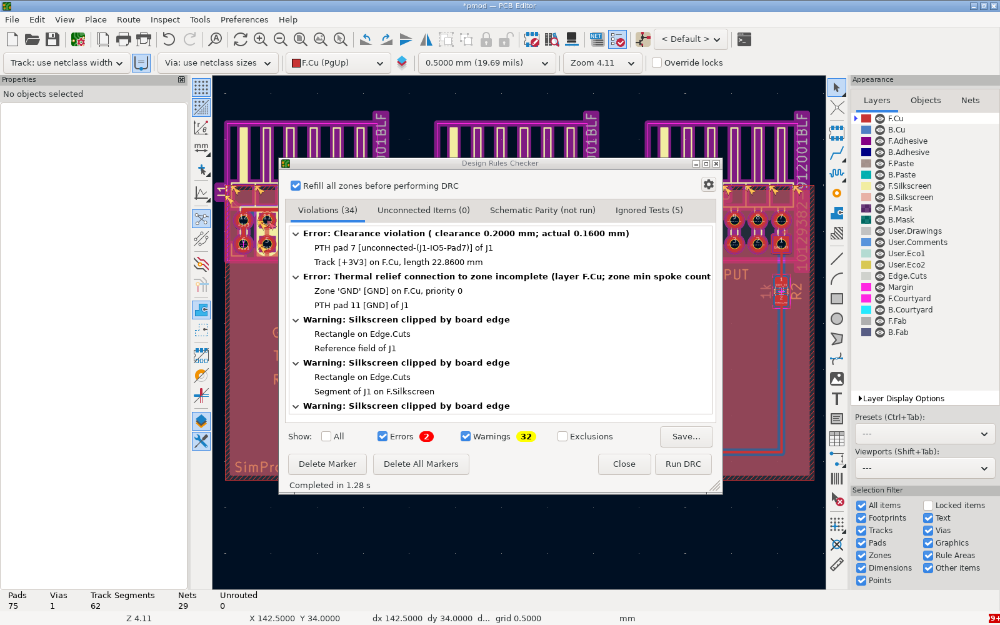

# Lab 05: Fab outputs in CI

In this lab you give your board repository a GitHub Actions workflow. On every push it checks the board, builds the files a fabricator needs (Gerbers, a drill file, a BOM and a position file) and the images a reviewer looks at, and uploads them as one artifact. You'll finish the build script that does the work, write the `.gitignore` that keeps KiCad's own files out of git, look at the Gerbers the way the fab will, and then break the board on purpose to watch the run go red.

The lab's files are in [`labs/lab-05-fab-outputs-in-ci/`](https://github.com/uoftasic/pb101/tree/main/labs/lab-05-fab-outputs-in-ci) in the course repo.

## Before you start

- Finish [Lab 04](lab-04-protect-and-plan-overview.md): its check passes on your repository, and the commit it checked is pushed to GitHub.
- Read the pages on row 9 of the [course path](../index.md#course-path): [Fabrication outputs](../guide/fabrication-outputs.md), [Outputs in CI](../guide/outputs-in-ci.md) and [KiCad files in git](../guide/kicad-files-in-git.md).

The check is bash, as in Labs 03 and 04, so on Windows run it in WSL. It runs git inside the course image as well as KiCad, and we have run it only on Linux.

The lab takes about 1 hour 15 minutes: roughly 10 minutes for Part 1, 10 for Part 2, 25 for Part 3, 10 for Part 4 and 20 for Part 5. Those are our estimates. What we measured is the check: with one CPU it took 55 s on our reference repository, and 91 s with `--planted`, because that builds a second commit.

## Part 1: Add the workflow

1. Copy the starter into your board repository and see what arrived:

   ```bash
   cd ~/simproc-pmod
   cp -r ~/pb101/labs/lab-05-fab-outputs-in-ci/starter/. .
   git status
   ```

   You should see two new folders, `.github/` and `ci/`. `.github/workflows/board.yml` is the workflow. `ci/build.sh` is the script it runs, `ci/check_board.py` is a copy of the course's board check, and `ci/kicad-image.txt` names the pinned KiCad image by its digest.

2. Read `board.yml`. After checking out your commit, it pulls the image named in `ci/kicad-image.txt`, then runs `bash ci/build.sh check`, `fab` and `images` as three steps, each in a fresh container, and uploads the folder `out/` as an artifact called `board-outputs`. Then read `ci/build.sh`, which holds everything those three steps do.

   Why does the workflow start the containers with `docker run` as the runner's own uid, rather than running the whole job in the image with GitHub's `container:` setting?

   <details>
   <summary>Answer</summary>

   So that the checks run the way the course's own checks do: as an ordinary uid, with KiCad's default library tables copied into an empty home folder (the first thing `build.sh` does). A job `container:` runs as the image's own user unless you override it, and wafer.space's workflow overrides it with `--user root`; [Outputs in CI](../guide/outputs-in-ci.md) shows that root in this image has no library tables and gets different warning counts. The course's own `labs.yml` workflow runs its checks the same way, and for the same reason.

   </details>

3. `build.sh` has five TODOs, which you'll do in Part 3, and there's no `.gitignore` yet. Before you run anything, write down which rows of the Lab 05 check you expect to fail. Then run it:

   ```bash
   ~/pb101/labs/lab-05-fab-outputs-in-ci/check.sh
   ```

   It first runs `bash ci/build.sh all` in the pinned image and prints what that prints, then one row per check. On Lab 04's reference board with the starter copied in, the rows were:

   ```text
     ok    workflow   .github/workflows/board.yml runs check, fab and images in kicad/kicad:10.0.8 by digest, and uploads out/
     ok    check      the board check passes
     ok    gerbers    9 Gerbers and pmod-job.gbrjob in out/fab/
     FAIL  drill      no drill file (.drl) in out/fab/
     FAIL  bom        no BOM in out/assembly/ (a .csv with 'bom' in its name)
     FAIL  position   no position file in out/assembly/ (a .csv with 'pos' in its name)
     FAIL  images     out/review/ is missing top render, bottom render, F.Cu plot, B.Cu plot
     FAIL  gitignore  no .gitignore; after the build git sees 15 untracked file(s): out/fab/pmod-B_Cu.gbr, out/fab/pmod-B_Mask.gbr, out/fab/pmod-B_Paste.gbr, out/fab/pmod-B_Silkscreen.gbr ...

   FAIL  pmod: 3 of 8 Lab 05 checks ok; add --planted REV once you've done Part 5
   ```

4. Commit the starter, but don't push it yet. If you pushed it now, would the run on GitHub be green or red?

   <details>
   <summary>Answer</summary>

   Green. A step fails only when its command exits with a status other than 0, and the TODOs are comments, so every stage of `build.sh` succeeds and the artifact has no drill file, BOM, position file, renders or copper plots in it. That's why the lab's check looks at the files the build made as well as at its exit status.

   </details>

## Part 2: Keep KiCad's own files out of git

Which files in your repository's folder belong in git, and which should git never see?

1. Run `git status` again. Besides `.github/` and `ci/`, it lists `out/`, which the build just wrote, and `pmod.kicad_prl`, which `kicad-cli` writes next to any project it reads. If you've opened the board in KiCad since Lab 04, there may also be a `pmod-backups/` folder, a `.history/` folder or lock files ending in `.lck`. [KiCad files in git](../guide/kicad-files-in-git.md) says what each one is.

2. Make a `.gitignore` in the repository's root folder. Start from Tiny Tapeout's, which [KiCad files in git](../guide/kicad-files-in-git.md) prints in full, and add the two lines it doesn't have: `.history/` for KiCad 10's local history, and `out/` for everything `build.sh` writes. CI makes `out/` again on every run, so it never needs to be in git.

3. Run `git status`. You should see only `.gitignore` as new, apart from anything you haven't committed yet. If a file you meant to ignore still shows as modified, git is already tracking it, and `git rm --cached` followed by a commit stops that.

4. Tiny Tapeout's demo board repository lists `fp-info-cache` in its `.gitignore`, and git still tracks the file. How?

   <details>
   <summary>Answer</summary>

   The cache was committed four minutes before the `.gitignore` that lists it, and a `.gitignore` only stops git from adding files; it doesn't affect a file git already tracks. Removing it from the index with `git rm --cached fp-info-cache` and committing would let the ignore rule apply.

   </details>

5. Commit the `.gitignore` and run the check. You should see `ok    gitignore  nothing untracked after the build, and none of KiCad's local files tracked`.

## Part 3: Finish the fabrication files and review images

What do a fab, an assembler and a reviewer each need from your CI?

1. Write the five commands the TODOs in `ci/build.sh` ask for. `kicad-cli` documents itself: run, for example,

   ```bash
   ~/pb101/labs/common/kicad.sh kicad-cli pcb export drill --help
   ```

   and the same for `sch export bom`, `pcb export pos`, `pcb render` and `pcb export svg`. Keep the file names the comments give, because the check looks for them. Things to decide as you go:

   - The drill file has to use the same origin as the Gerbers. Look at File > Plot in the PCB Editor: if "Use drill/place file origin" isn't ticked, the Gerbers use the absolute origin, and so should the drill file (`--drill-origin`).
   - An assembler wants the position file as CSV, in millimetres (`--format`, `--units`); the defaults are a text table in inches.
   - A render takes `--side top` or `--side bottom`.
   - For the copper plots, `--layers F.Cu,B.Cu` with `--mode-multi` writes one SVG per layer, `--common-layers Edge.Cuts` adds the outline to each, and `--page-size-mode 2` with `--exclude-drawing-sheet` crops them to the board.

2. Before you run it, count the holes your drill file should have: every pad with a hole, and every via. Write the number down. On our board it's 65: 36 pins in the three Pmod connectors, 3 in the dongle header, 16 in the switch, 9 in the resistor network and 1 via.

3. Run the check. You should see every row `ok` except the last line's reminder about Part 5. Ours:

   ```text
     ok    workflow   .github/workflows/board.yml runs check, fab and images in kicad/kicad:10.0.8 by digest, and uploads out/
     ok    check      the board check passes
     ok    gerbers    9 Gerbers and pmod-job.gbrjob in out/fab/
     ok    drill      pmod.drl: 65 holes, all inside the outline
     ok    bom        pmod-bom.csv: 12 rows, every footprint listed
     ok    position   pmod-pos.csv: 10 parts, in mm, where the board has them
     ok    images     5 files in out/review/: renders, copper plots and the schematic
     ok    gitignore  nothing untracked after the build, and none of KiCad's local files tracked

   PASS  pmod: 8 of 8 Lab 05 checks ok; add --planted REV once you've done Part 5
   ```

   The drill row compares every hole with the outline in the Edge.Cuts Gerber, so a drill file made in a different origin from the Gerbers fails it, the mistake [Fabrication outputs](../guide/fabrication-outputs.md) shows on the DIP dock.

4. Our BOM has 12 rows and our position file only 10 parts. Open `out/assembly/` and find the two that are missing from the position file. Why would KiCad leave them out?

   <details>
   <summary>Answer</summary>

   They're the test points, TP1 and TP2. Their footprint, `TestPoint_Pad_D1.5mm`, is a bare pad with nothing to place on it, and it carries the attribute "Exclude from position files" (`exclude_from_pos_files` in the board file), so the pick-and-place file skips it. The BOM comes from the schematic and lists them anyway.

   </details>

5. Commit and push. On your repository's page on GitHub, the Actions tab shows a run of the workflow, named Board, for your commit, and the run's page lists the job's steps and, once it has finished, the `board-outputs` artifact, which downloads as a zip of `out/`. You should see a green run. We couldn't push from the machine we wrote the course on, so we ran the workflow's steps locally with [`src/run_workflow.py`](https://github.com/uoftasic/pb101/blob/main/labs/lab-05-fab-outputs-in-ci/src/run_workflow.py): all six succeeded in 11 s, and the artifact held 21 files. On GitHub, pulling the image (812 MB) adds to that, and we haven't timed it there.

## Part 4: Look at what the fab will get

Do the files CI built describe your board?

1. Unzip the artifact, open GerbView (the Gerber Viewer, from KiCad's project manager), and use File > Open Gerber Plot File(s)... for every `.gbr` in `fab/`, then File > Open Excellon Drill File(s)... for the `.drl`. The `out/fab/` folder the check wrote on your own machine has the same files.

   

   *GerbView's File menu in KiCad 10.0.8, over the ten files `ci/build.sh fab` wrote for our Lab 04 board. We opened these from the command line (`gerbview out/fab/*.gbr out/fab/*.drl`), which also works if KiCad's programs are on your path.*

2. Before you look closely, write down how many layers the Layers Manager should list and what function GerbView should give each.

3. Compare the view with your board in the PCB Editor. You should see every drill hit (the small dots of the drill layer) in the middle of its pad, and the Layers Manager listing every file with the function GerbView read from it, such as "Copper, L1" for the top copper and "Profile, NP" for the outline:

   

   *Our board's nine Gerbers and its drill file in GerbView. The red is the bottom copper, mostly its ground pour, and the lighter tracks are on the top copper; untick a layer in the Layers Manager to see the others more clearly.*

   If every hole sat the same distance away from its pad, what would you change?

   <details>
   <summary>Answer</summary>

   The drill file's origin. The Gerbers and the drill file share nothing but their coordinates, so if the board's plot settings use the drill/place origin, the drill file needs `--drill-origin plot`, and if they don't, `absolute`. [Fabrication outputs](../guide/fabrication-outputs.md) shows the DIP dock with exactly this offset.

   </details>

## Part 5: Break it on purpose

Does your workflow stop a broken board before it makes a set of Gerbers?

1. You're about to move a track so that it passes too close to a pad of another net. Write down which step of the workflow will fail, which steps will run after it, and what the artifact will hold.

2. In the PCB Editor, select a track and drag it (press D) until it passes within 0.2 mm of a pad or track on another net, without touching it. Save. On our board we dragged the 0.4 mm +3V3 track that runs along the top edge from J1 to J2 down by 1 mm, which takes its lower edge to 0.16 mm from the upper row of J1's pads.

3. Run DRC in the editor (Inspect > Design Rules Checker, then Run DRC). You should see at least one error. Ours had two:

   

   *The Design Rules Checker in KiCad 10.0.8 on our board with the track dragged down: a clearance violation between the track and J1's pad 7 (0.1600 mm against 0.2000 mm), and an incomplete thermal relief on pad 11, whose connection to the GND zone the track now blocks. The other 32 items are the warnings the board had before.*

   The dialog's Schematic Parity tab says "(not run)". Does that mean your CI doesn't check parity either?

   <details>
   <summary>Answer</summary>

   No. The editor runs the parity test only when its "Test for parity between PCB and schematic" box is ticked, as you did in Lab 03, Part 4. `ci/build.sh check` runs `check_board.py`, which always passes `--schematic-parity` to `kicad-cli pcb drc` and fails on any parity item, warnings included.

   </details>

4. Run the Lab 05 check. You should see the board check fail inside the build, with the error your drag made:

   ```text
     DRC errors (2):
       clearance                Clearance violation ( clearance 0.2000 mm; actual 0.1600 mm)  [PTH pad 7 [unconnected-(J1-IO5-Pad7)] of J1; Track [+3V3] on F.Cu, length 22.8600 mm]
       starved_thermal          Thermal relief connection to zone incomplete (layer F.Cu; zone min spoke count 2; actual 1)  [Zone 'GND' [GND] on F.Cu, priority 0; PTH pad 11 [GND] of J1]
   ```

   and then six rows fail: `check` (`the board check fails: drc.error 2 (want 0); the fab and images stages didn't run`), and `gerbers`, `drill`, `bom`, `position` and `images`, because `build.sh` stops at the first stage that fails and the later stages never made their files.

5. Commit the broken board with a message that says what you did, and push. On GitHub you should see a red run: the step "ERC, DRC and schematic parity" fails with the same board check output as above, "Fabrication files" and "Review images" are skipped, and the upload step still runs, so the artifact holds `reports/` and nothing else. That's what our local run of the workflow did: the check step exited 1, the next two were skipped, and the artifact had three files, `drc.json`, `erc.json` and `summary.json`.

6. Fix the board: move the track back (or undo with Ctrl+Z before you close the editor), save, run the check until it passes, commit, and push. You should see a green run on GitHub, with the full artifact again.

7. Find the hash of the commit with the planted error (`git log --oneline` lists it) and run the check with it:

   ```bash
   ~/pb101/labs/lab-05-fab-outputs-in-ci/check.sh --planted <hash>
   ```

   It builds that commit again in a temporary folder and checks that its board check fails. You should see a tenth row, `ok    planted    16fecee fails the board check (drc.error 2), and the commits after it fix it` with your own hash and counts, and the last line `PASS  pmod: 9 of 9 Lab 05 checks ok`.

## Finishing

You're done when `~/pb101/labs/lab-05-fab-outputs-in-ci/check.sh --planted <your planted commit>`, run in your own repository, ends with `PASS  pmod: 9 of 9 Lab 05 checks ok`, and your repository's Actions tab shows a red run on that commit and a green run, with its `board-outputs` artifact, on a later one.

Questions:

1. A teammate's pull request moves a part. Which files in the run's artifact would you look at first, and why not the `.kicad_pcb` diff?

   <details>
   <summary>Answer</summary>

   The renders and the copper plots in `review/`, compared with the ones from the commit before. A board file diff is text, but moving one part changes its position, the tracks you reroute and the zone fills around it, and the lines that record those are hard to read as a change. [KiCad files in git](../guide/kicad-files-in-git.md) shows a "minor" commit to Tiny Tapeout's demo board that changed 5,770 lines.

   </details>

2. CI builds Gerbers from the same commit on two days, and their checksums differ. Did the board change?

   <details>
   <summary>Answer</summary>

   Not necessarily. Every Gerber, the job file and the drill file carry the date and time of the export ([Fabrication outputs](../guide/fabrication-outputs.md)), so compare them with those lines removed before you conclude anything.

   </details>

Submit: nothing for this lab. Keep the workflow; the capstone asks for a green run.

## Going further (optional)

- Add an interactive HTML BOM with [KiBot](https://github.com/INTI-CMNB/KiBot). We haven't run KiBot in this course: its newest KiCad 10 image carries 10.0.5, not the 10.0.8 the checks use, and its GitHub Action builds from a `:latest` tag. If you try it, name a fixed image tag, as [Outputs in CI](../guide/outputs-in-ci.md) explains, and keep the checks on the pinned `kicad/kicad` image.
- Save the list of outputs in the project as a jobset and run it with `kicad-cli jobset run`, so that the outputs live next to the board instead of in `build.sh`. We haven't tried a jobset yet either.

Next on the [Course path](../index.md#course-path): read [Reviewing and ordering a board](../guide/reviewing-and-ordering-a-board.md), then do [Lab 06: Review a seeded board](lab-06-review-a-seeded-board-overview.md).
