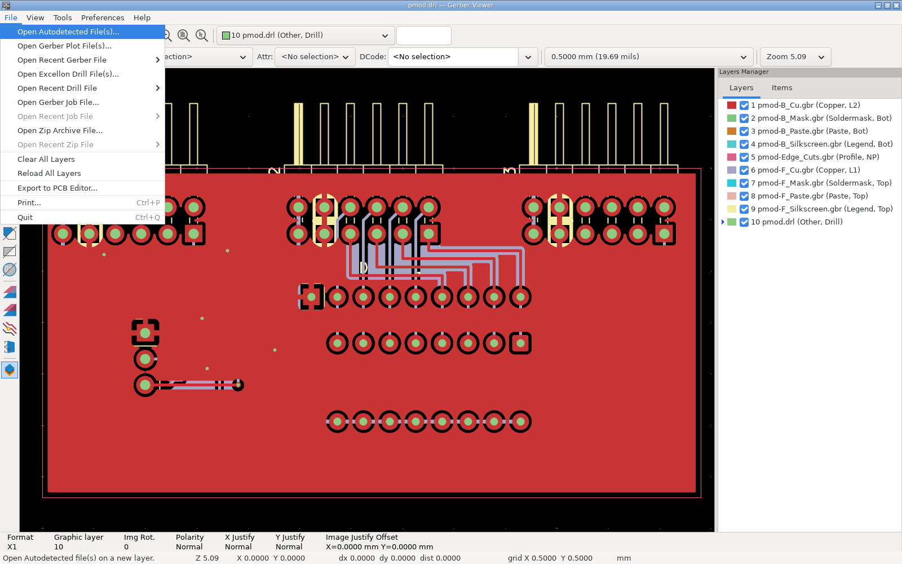
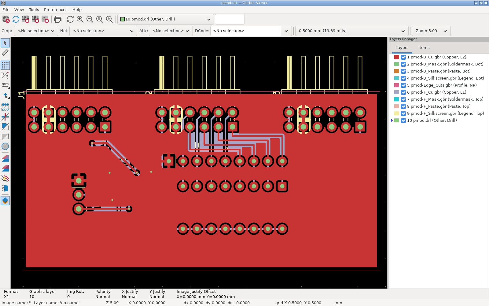
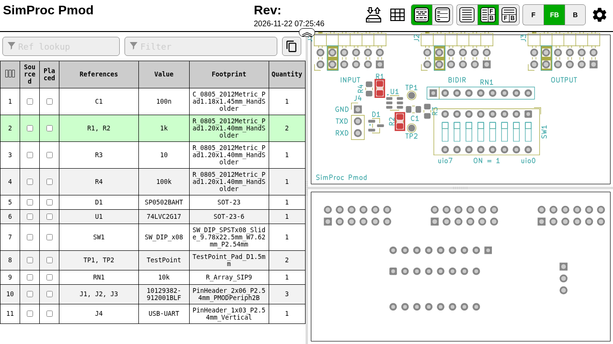

# Lab 05: Fab outputs in CI

In this lab you give your board repository a GitHub Actions workflow. On every push it checks the board, builds the files a fabricator needs (Gerbers, a drill file, a BOM and a position file) and the images a reviewer looks at, has KiBot make an interactive BOM and a design report, and uploads all of it as one artifact. You'll finish the build script that does the work, write the `.gitignore` that keeps KiCad's own files out of git, look at the Gerbers the way the fab will, write KiBot's configuration, and then break the board on purpose to watch the run go red.

The lab's files are in [`labs/lab-05-fab-outputs-in-ci/`](https://github.com/uoftasic/ic103/tree/main/labs/lab-05-fab-outputs-in-ci) in the course repo.

## Before you start

- Finish [Lab 04](lab-04-protect-and-plan-overview.md): its check passes on your repository, and the commit it checked is pushed to GitHub.
- Read the pages on row 9 of the [course path](../index.md#course-path): [Fabrication outputs](../guide/fabrication-outputs.md), [Outputs in CI](../guide/outputs-in-ci.md) and [KiCad files in git](../guide/kicad-files-in-git.md).

The check is bash, as in Labs 03 and 04, so on Windows run it in WSL. It runs git inside the course image as well as KiCad, and we have run it only on Linux. It also runs KiBot, in KiBot's own image, which is a 1,347 MB download the first time.

The lab takes about 1 hour 40 minutes: roughly 10 minutes for Part 1, 10 for Part 2, 25 for Part 3, 10 for Part 4, 25 for Part 5 and 20 for Part 6. Those are our estimates, but we timed the check itself: with one CPU for each container it took 26 s on our reference repository, and 42 s with `--planted`, because that builds a second commit.

## Part 1: Add the workflow

1. Copy the starter into your board repository and see what arrived:

   ```bash
   cd ~/simproc-pmod
   cp -r ~/ic103/labs/lab-05-fab-outputs-in-ci/starter/. .
   git status
   ```

   You should see two new folders, `.github/` and `ci/`, and `pmod.kicad_prl`, which is still untracked because Lab 03 had you leave it out of your commits. `.github/workflows/board.yml` is the workflow. `ci/build.sh` is the script it runs, `ci/check_board.py` is a copy of the course's board check, and `ci/kicad-image.txt` names the pinned KiCad image by its digest. `ci/kibot-image.txt` does the same for KiBot's image, and `ci/board.kibot.yaml` is KiBot's configuration, which you'll finish in Part 5.

2. Read `board.yml`. After checking out your commit, it pulls the image named in `ci/kicad-image.txt`, then runs `bash ci/build.sh check`, `fab` and `images` as three steps, each in a fresh container. A fourth step pulls the KiBot image named in `ci/kibot-image.txt` and runs `bash ci/build.sh kibot` in it, and the last uploads the folder `out/` as an artifact called `board-outputs`. Then read `ci/build.sh`, which holds everything those four steps do.

   Why does the workflow start the containers with `docker run` as the runner's own uid, rather than running the whole job in the image with GitHub's `container:` setting?

   <details>
   <summary>Answer</summary>

   So that the checks run the way the course's own checks do: as an ordinary uid, with KiCad's default library tables copied into an empty home folder (the first thing `build.sh` does). A job `container:` runs as the image's own user unless you override it, and wafer.space's workflow overrides it with `--user root`; [Outputs in CI](../guide/outputs-in-ci.md) shows that root in this image has no library tables and gets different warning counts. The course's own `labs.yml` workflow runs its checks the same way, and for the same reason.

   </details>

3. Commit the starter, but don't push it yet. Name its two folders in `git add`, so that `pmod.kicad_prl` stays out of the commit:

   ```bash
   git add .github ci
   git commit -m "Lab 05 starter"
   ```

   If you pushed it now, would the run on GitHub be green or red?

   <details>
   <summary>Answer</summary>

   It would be green. A step fails only when its command exits with a status other than 0, and the TODOs are comments, so every stage of `build.sh` succeeds. KiBot finds no outputs listed in `ci/board.kibot.yaml` and exits 0 as well. The artifact has no drill file, BOM, position file, renders, copper plots or KiBot outputs in it, which is why the lab's check looks at the files the build made as well as at its exit status.

   </details>

4. `build.sh` has five TODOs, which you'll do in Part 3, `ci/board.kibot.yaml` has three, for Part 5, and there's no `.gitignore` yet. Before you run anything, write down which rows of the Lab 05 check you expect to fail. Then run it:

   ```bash
   ~/ic103/labs/lab-05-fab-outputs-in-ci/check.sh
   ```

   It first runs `bash ci/build.sh all` in the pinned KiCad image and prints what that prints. If that passed, it runs `bash ci/build.sh kibot` in the KiBot image, as your workflow would, and then prints one row per check. On Lab 04's reference board with the starter copied in and committed, the rows were:

   ```text
     ok    workflow   .github/workflows/board.yml runs check, fab and images in kicad/kicad:10.0.5 and kibot in kicad10_auto_full:1.9.1-2_k10.0.5_d13.2_b4.2.4LTS, both by digest, and uploads out/
     ok    check      the board check passes
     ok    gerbers    9 Gerbers and pmod-job.gbrjob in out/fab/
     FAIL  drill      no drill file (.drl) in out/fab/
     FAIL  bom        no BOM in out/assembly/ (a .csv with 'bom' in its name)
     FAIL  position   no position file in out/assembly/ (a .csv with 'pos' in its name)
     FAIL  images     out/review/ is missing top render, bottom render, F.Cu plot, B.Cu plot
     FAIL  ibom       no interactive HTML BOM in out/kibot/ (the .html that an ibom output writes)
     FAIL  report     no design report in out/kibot/ (a .txt from a report output, with a 'Board size:' line)
     FAIL  gitignore  no .gitignore; after the build git sees 15 untracked files: out/fab/pmod-B_Cu.gbr, out/fab/pmod-B_Mask.gbr, out/fab/pmod-B_Paste.gbr, out/fab/pmod-B_Silkscreen.gbr ...

   FAIL  pmod: 3 of 10 Lab 05 checks ok; add --planted REV once you've done Part 6
   ```

## Part 2: Keep KiCad's own files out of git

Which files in your repository's folder belong in git, and which should git never see?

1. Run `git status` again. It lists `out/`, which the build just wrote, and `pmod.kicad_prl`, which `kicad-cli` writes next to any project it reads. If you've opened the board in KiCad since Lab 04, there may also be a `pmod-backups/` folder, a `.history/` folder or lock files ending in `.lck`. [KiCad files in git](../guide/kicad-files-in-git.md) says what each one is.

2. Make a `.gitignore` in the repository's root folder. Start from Tiny Tapeout's, which [KiCad files in git](../guide/kicad-files-in-git.md) prints in full, and add the two lines it doesn't have: `.history/` for KiCad 10's local history, and `out/` for everything `build.sh` writes. CI makes `out/` again on every run, so it never needs to be in git.

3. Run `git status`. You should see only `.gitignore` as new, apart from anything you haven't committed yet. If a file you meant to ignore still shows as modified, git is already tracking it, and `git rm --cached` followed by a commit stops that.

4. Tiny Tapeout's demo board repository lists `fp-info-cache` in its `.gitignore`, and git still tracks the file. How?

   <details>
   <summary>Answer</summary>

   The cache was committed four minutes before the `.gitignore` that lists it, and a `.gitignore` only stops git from adding files; it doesn't affect a file git already tracks. Removing it from the index with `git rm --cached fp-info-cache` and committing would let the ignore rule apply.

   </details>

5. Commit the `.gitignore` and run the check. You should see `ok    gitignore  nothing untracked after the build, and none of KiCad's local files tracked`.

## Part 3: Finish the fabrication files and review images

What do a fab, an assembler and a reviewer each need from your CI?

1. Write the five commands the TODOs in `ci/build.sh` ask for. Each `kicad-cli` command prints its own options with `--help`; for example, run

   ```bash
   ~/ic103/labs/common/kicad.sh kicad-cli pcb export drill --help
   ```

   and the same for `sch export bom`, `pcb export pos`, `pcb render` and `pcb export svg`. Keep the file names the comments give, because the check looks for them. Things to decide as you go:

   - The drill file has to use the same origin as the Gerbers. Look at File > Plot in the PCB Editor: if "Use drill/place file origin" isn't ticked, the Gerbers use the absolute origin, and so should the drill file (`--drill-origin`). On our board the drill/place origin was never moved from (0, 0), so `absolute` and `plot` wrote the same file. On a board where someone has placed that origin, such as the DIP dock, the two put the holes in different places.
   - An assembler wants the position file as CSV, in millimetres (`--format`, `--units`); the defaults are a text table in inches.
   - A render takes `--side top` or `--side bottom`.
   - For the copper plots, `--layers F.Cu,B.Cu` with `--mode-multi` writes one SVG per layer, `--common-layers Edge.Cuts` adds the outline to each, and `--page-size-mode 2` with `--exclude-drawing-sheet` crops them to the board.

2. Before you run it, count the holes your drill file should have: every pad with a hole, and every via. Write the number down. On our board it's 65: 36 pins in the three Pmod connectors, 3 in the dongle header, 16 in the switch, 9 in the resistor network and 1 via.

3. Run the check. You should see every row `ok` except `ibom` and `report`, which wait for Part 5. Ours:

   ```text
     ok    workflow   .github/workflows/board.yml runs check, fab and images in kicad/kicad:10.0.5 and kibot in kicad10_auto_full:1.9.1-2_k10.0.5_d13.2_b4.2.4LTS, both by digest, and uploads out/
     ok    check      the board check passes
     ok    gerbers    9 Gerbers and pmod-job.gbrjob in out/fab/
     ok    drill      pmod.drl: 65 holes, all inside the outline
     ok    bom        pmod-bom.csv: 12 rows, every footprint listed
     ok    position   pmod-pos.csv: 10 parts, in mm, where the board has them
     ok    images     5 files in out/review/: renders, copper plots and the schematic
     FAIL  ibom       no interactive HTML BOM in out/kibot/ (the .html that an ibom output writes)
     FAIL  report     no design report in out/kibot/ (a .txt from a report output, with a 'Board size:' line)
     ok    gitignore  nothing untracked after the build, and none of KiCad's local files tracked

   FAIL  pmod: 8 of 10 Lab 05 checks ok; add --planted REV once you've done Part 6
   ```

   The drill row compares every hole with the outline in the Edge.Cuts Gerber, so a drill file made in a different origin from the Gerbers fails it. That's the mistake [Fabrication outputs](../guide/fabrication-outputs.md) shows on the DIP dock.

4. Our BOM has 12 rows and our position file only 10 parts. Open `out/assembly/` and find the two that are missing from the position file. Why would KiCad leave them out?

   <details>
   <summary>Answer</summary>

   They're the test points, TP1 and TP2. Their footprint, `TestPoint_Pad_D1.5mm`, is a bare pad with nothing to place on it, and it carries the attribute "Exclude from position files" (`exclude_from_pos_files` in the board file), so the pick-and-place file skips it. The BOM comes from the schematic and lists them anyway.

   </details>

5. Commit and push. On your repository's page on GitHub, the Actions tab shows a run of the workflow, named Board, for your commit, and the run's page lists the job's steps and, once it has finished, the `board-outputs` artifact, which downloads as a zip of `out/`. You should see a green run, even though KiBot has nothing to make yet. We couldn't push from the machine we wrote the course on, so we ran the workflow's steps locally with [`src/run_workflow.py`](https://github.com/uoftasic/ic103/blob/main/labs/lab-05-fab-outputs-in-ci/src/run_workflow.py), with each container limited to one CPU: all seven succeeded in 35 s, and the artifact held 21 files. On GitHub, pulling the two images (808 MB and 1,347 MB) adds to that, and we haven't timed it there.

## Part 4: Look at what the fab will get

Do the files CI built describe your board?

1. Unzip the artifact, open GerbView (the Gerber Viewer, from KiCad's project manager), and use File > Open Gerber Plot File(s)... for every `.gbr` in `fab/`, then File > Open Excellon Drill File(s)... for the `.drl`. The `out/fab/` folder the check wrote on your own machine has the same files.

   

   *GerbView's File menu in KiCad 10.0.5, over the nine Gerbers and the drill file that `ci/build.sh fab` wrote for our Lab 04 board. We opened these from the command line (`gerbview out/fab/*.gbr out/fab/*.drl`), which also works if KiCad's programs are on your path.*

2. Before you look closely, write down how many layers the Layers Manager should list and what function GerbView should give each.

3. Compare the view with your board in the PCB Editor. You should see every drill hit (the small dots of the drill layer) in the middle of its pad, and the Layers Manager listing every file with the function GerbView read from it, such as "Copper, L1" for the top copper and "Profile, NP" for the outline:

   

   *Our board's nine Gerbers and its drill file in GerbView. The red is the bottom copper, mostly its ground pour, and the lighter tracks are on the top copper; untick a layer in the Layers Manager to see the others more clearly.*

   If every hole sat the same distance away from its pad, what would you change?

   <details>
   <summary>Answer</summary>

   You'd change the drill file's origin. The Gerbers and the drill file share nothing but their coordinates, so if the board's plot settings use the drill/place origin, the drill file needs `--drill-origin plot`, and if they don't, `absolute`. [Fabrication outputs](../guide/fabrication-outputs.md) shows the DIP dock with exactly this offset.

   </details>

## Part 5: Add KiBot's outputs

How do you add outputs that `kicad-cli` can't make, such as an interactive BOM, and keep the whole run on one version of KiCad?

1. Look at what the starter put in place for KiBot. [KiBot](https://github.com/INTI-CMNB/KiBot) is a program, free software under the AGPL-3.0, that drives KiCad from a YAML file and makes outputs `kicad-cli` doesn't. It needs a good deal of software besides KiCad, so it runs in an image of its own, `ghcr.io/inti-cmnb/kicad10_auto_full`, which `ci/kibot-image.txt` names by its digest. That image carries KiBot 1.9.1 and KiCad 10.0.5, the same version as the course's checks. The workflow's "KiBot outputs" step pulls it and runs `bash ci/build.sh kibot` in it, the same way the steps before it run theirs, rather than through KiBot's own GitHub Action, which builds its image from a tag that moves with every KiBot release ([Outputs in CI](../guide/outputs-in-ci.md#kibot) has the details). The `kibot` stage at the end of `build.sh` runs KiBot on `ci/board.kibot.yaml` and has it write what it makes into `out/kibot/`. That configuration file is the part you write.

   KiBot can also run ERC and DRC itself, as what it calls preflights. Why does the workflow keep its checks in `check_board.py`, in KiCad's own image, and use KiBot only for outputs?

   <details>
   <summary>Answer</summary>

   Because KiBot's DRC, as it comes, doesn't fail on what `check_board.py` fails on, and because its KiCad is a different build. We tried KiBot's checks on Lab 04's reference board through `kibot.sh`. With `erc: true` and `drc: true` under `preflight:`, KiBot fails only on errors, and KiCad reports a missing footprint as a parity warning: with R3 deleted from the board, KiBot printed `WARNING:(W145) (missing_footprint) Missing footprint R3 (10)` and exited 0, which is the green run that [Outputs in CI](../guide/outputs-in-ci.md#checks-that-fail-the-run) warns about. With its `warnings_as_errors: true` option it fails on every warning instead, and the unchanged board failed on its 32 silkscreen warnings (`DRC warnings: 32, promoted as errors`, exit status 5). `check_board.py` failed the board without R3 (`FAIL  parity.warning: 1 (want 0)`) and passed the unchanged one. KiBot's `filters` option can turn chosen kinds of warning into errors, one kind at a time, so you could bring it close, but then the course would have two definitions of a passing board to keep in step.

   The other reason is the KiCad inside. KiBot's image carries KiCad's Ubuntu build of 10.0.5, with the 10.0.4 symbol and footprint libraries, and warning counts depend on the libraries. Every count on the course's pages comes from `kicad/kicad:10.0.5`, so the gate stays there, and KiBot's step runs only after it has passed.

   </details>

2. See what KiBot can make. Its own help runs in its image, through the course's `kibot.sh`:

   ```bash
   ~/ic103/labs/common/kibot.sh kibot --help-list-outputs
   ~/ic103/labs/common/kibot.sh kibot --help-output ibom
   ```

   The first lists 56 types of output. Many of them are files `kicad-cli` makes too, such as Gerbers, drill files and position files. Two that it doesn't make are `ibom`, an interactive HTML BOM, and `report`, a design report written for whoever orders the board. `kicad-cli pcb export stats` writes a board statistics report that overlaps with the second, but it gives each hole at its finished size and leaves out what KiBot adds for the fab, such as the drill sizes, a Eurocircuits board class and an estimate of the solder paste. The second command prints every option of the `ibom` output, and `kibot --help-output report` and `kibot --help-filters` do the same for the report and for KiBot's filters.

3. Before you write anything, write down which of your board's parts the interactive BOM should list, and how many rows it will have if parts with the same value and footprint share a row. Then decide what it should do with a part marked DNP ([Tiny Tapeout's boards, part by part](../guide/tiny-tapeouts-boards-part-by-part.md#unfitted-footprints-and-dnp) explains the mark): should a part you won't fit be on the list you solder from?

4. Finish the three TODOs in `ci/board.kibot.yaml`. Things to decide as you go:

   - A filter goes in a `filters:` list, with a `name` of your choosing and a `type`. The `generic` type has an option that picks out the parts KiCad marks "Do not populate"; `kibot --help-filters` lists it.
   - The `ibom` output names that filter in its `dnf_filter` option (DNF is "do not fit"), and every part the filter picks out is then left off the BOM. Without a filter, the ibom lists a DNP part along with all the others.
   - The `report` output needs only its `name` and `type`. Keep its default template, because the check reads the board size and the drill tools from it.
   - Leave the file names as KiBot makes them, which for our board were `pmod-ibom.html` and `pmod-report.txt`.

5. Run the KiBot stage in the pinned KiBot image:

   ```bash
   ~/ic103/labs/common/kibot.sh bash ci/build.sh kibot
   ```

   You should see a line for each output, and the two files in `out/kibot/`. Ours took 2.3 s with one CPU:

   ```text
   ic103: KiBot image ghcr.io/inti-cmnb/kicad10_auto_full@sha256:96e75f885b15617c6b38aef11db7856a93f4367cab7a0b6c2b30465557619330
   == KiBot outputs
   CI/CD environment detected
   WARNING:(W182) No instance for `/00000000-0000-0000-0000-000000000000` using the first (kibot - v6_sch.py:1458)
   - 'Interactive HTML BOM' (ibom) [ibom]
   - 'Design report' (report) [report]
   Found 1 unique warning/s (36 total, 3 filtered)
   ```

   The text in quotes on each output's line is that output's `comment`. Our configuration gives each output one (`Interactive HTML BOM` and `Design report`). An output without a comment makes the same file, and its line reads `- '' (ibom) [ibom]`.

   The warning, W182, comes from the way KiBot reads a schematic. It looks for each symbol's instance under a sheet path of zeros, while our schematic records each one under the schematic's own UUID, so KiBot falls back to the symbol's first instance, as the message says. Our schematic is one sheet and each of its 33 symbols has only one instance, so that's the right one. KiBot prints the warning once and counts it for each symbol.

6. Open `out/kibot/pmod-ibom.html` in a browser and click a row of the BOM: its parts light up on the drawing of the board. You should see the parts and rows you wrote down in step 3. Ours has 12 parts in 8 rows:

   

   *KiBot's interactive BOM for our Lab 04 board, with the row of the two 1k resistors selected, so R1 and R2 are drawn in red on the front of the board (top right); the bottom is below it. The Sourced and Placed columns are checkboxes to tick as you buy and solder each row, and the page keeps the ticks in your browser's storage. Made by [`scripts/screenshots/browser/ibom.cjs`](https://github.com/uoftasic/ic103/blob/main/scripts/screenshots/browser/ibom.cjs).*

   Our board has no DNP part, so the filter changes nothing on it. What would the BOM have shown for a DNP part without the filter?

   <details>
   <summary>Answer</summary>

   It would have listed the part like any other. The course's self-test marks J4 DNP on our board, in the schematic and on the board, and runs the check twice. With `dnf_filter` naming the filter, the ibom listed 11 parts in 7 rows and left J4 out. With that line taken out, it listed J4 again, and the check's `ibom` row failed with `pmod-ibom.html lists J4, which the board marks Do not populate; give the ibom output a filter for DNP parts (dnf_filter)`. The BOM that `kicad-cli` made from the schematic listed all 12 parts both times.

   </details>

7. Open `out/kibot/pmod-report.txt`. It's a plain-text report for whoever orders the board: its size and layers, the sizes a fab's rules are about (clearance, track width, drills, vias and annular ring), the holes, and an estimate of the solder paste. Compare its holes with the count you wrote down in Part 3, step 2. Ours lists three drill tools:

   ```text
   Drill tools (including vias and computing adjusts and rounding):

   - 0.4 mm (16 mils) (1)
   - 0.9 mm (35 mils) (25)
   - 1.1 mm (43 mils) (39)
   ```

   That's 65 holes, as in the drill file, but the via and the pads on our board have holes of 0.3, 0.8 and 1.0 mm. Why is each tool 0.1 mm larger?

   <details>
   <summary>Answer</summary>

   They're the sizes of the drills rather than of the finished holes. Copper is plated onto the wall of a plated hole after it's drilled, which makes the hole smaller, so the drill has to be larger than the hole in the footprint. KiBot allows 0.1 mm for that on every plated hole, and the report says so under "Important sizes": "The above values are real drill sizes, they add 0.1 mm (4 mils) to plated holes (PTH)". Every hole on our board is plated, so all three sizes moved.

   </details>

   Some lines of the report aren't about your board at all. Our board file records no stack-up, so the finish (HAL), the material (FR4) and the colours of the solder mask and silkscreen are KiBot's defaults, and so is the "yes" after micro vias and buried/blind vias, which says what KiBot assumes the rules allow; the "Total" line under them counts the vias the board really has. Check those lines against what you'll order before you hand the report to anyone.

8. Run the Lab 05 check. You should see the two new rows `ok`:

   ```text
     ok    ibom       pmod-ibom.html: 12 parts in 8 rows, none of them marked DNP
     ok    report     pmod-report.txt: 64 x 32 mm and 65 holes, as in the Gerbers and pmod.drl
   ```

   and the last line `PASS  pmod: 10 of 10 Lab 05 checks ok; add --planted REV once you've done Part 6`. The `ibom` row reads the board data inside the page and compares its BOM with the footprints on your board: every part that belongs in a BOM is listed, no part marked DNP, and nothing that isn't on the board. The `report` row compares the report's board size with the outline in the Gerbers, and its drill tools with the holes in the drill file. Then commit `ci/board.kibot.yaml` and push. The run's "KiBot outputs" step now makes the two files, and the artifact has a `kibot/` folder. Our local run of the workflow, with one CPU for each container, succeeded in all seven steps in 30 s, and the artifact held 23 files.

## Part 6: Break it on purpose

Does your workflow stop a broken board before it makes a set of Gerbers?

1. You're about to move a track so that it passes too close to a pad of another net. Write down which step of the workflow will fail, which steps will run after it, and what the artifact will hold.

2. In the PCB Editor, select a track and drag it (press D) until it passes within 0.2 mm of a pad or track on another net, without touching it. Save. On our board we dragged the 0.4 mm +3V3 track that runs along the top edge from J1 to J2 down by 1 mm, which takes its lower edge to 0.16 mm from the upper row of J1's pads.

3. Run DRC in the editor (Inspect > Design Rules Checker, then Run DRC). You should see at least one error. Ours had two:

   

   *The Design Rules Checker in KiCad 10.0.5 on our board with the track dragged down: a clearance violation between the track and J1's pad 7 (0.1600 mm against 0.2000 mm), and an incomplete thermal relief on pad 11, whose connection to the GND zone the track now blocks. The other 32 items are the warnings the board had before.*

   The dialog's Schematic Parity tab says "(not run)". Does that mean your CI doesn't check parity either?

   <details>
   <summary>Answer</summary>

   No. The editor runs the parity test only when its "Test for parity between PCB and schematic" box is ticked, as you did in Lab 03, Part 4. `ci/build.sh check` runs `check_board.py`, which always passes `--schematic-parity` to `kicad-cli pcb drc` and fails on any parity item, warnings included.

   </details>

4. Run the Lab 05 check. You should see the board check fail inside the build, with the error your drag made:

   ```text
     DRC errors (2):
       clearance                Clearance violation ( clearance 0.2000 mm; actual 0.1600 mm)  [PTH pad 7 [unconnected-(J1-IO5-Pad7)] of J1; Track [+3V3] on F.Cu, length 22.8600 mm]
       starved_thermal          Thermal relief connection to zone incomplete (layer F.Cu; zone min spoke count 2; actual 1)  [Zone 'GND' [GND] on F.Cu, priority 0; PTH pad 11 [GND] of J1]
   ```

   and then eight rows fail: `check` (`the board check fails: drc.error 2 (want 0); the fab and images stages didn't run`), then `gerbers`, `drill`, `bom`, `position` and `images`, because `build.sh` stops at the first stage that fails and the later stages never made their files, and then `ibom` and `report` (`` `ci/build.sh kibot` didn't run, because an earlier stage failed, as in your workflow ``), because the check, like the workflow, runs KiBot only after the build has passed.

5. Commit the broken board with a message that says what you did, and push. On GitHub you should see a red run: the step "ERC, DRC and schematic parity" fails with the same board check output as above, "Fabrication files", "Review images" and "KiBot outputs" are skipped, and the upload step still runs, so the artifact holds `reports/` and nothing else. Our local run of the workflow did the same: the check step exited 1, the next three were skipped, and the artifact had three files, `drc.json`, `erc.json` and `summary.json`.

6. Fix the board: move the track back (or undo with Ctrl+Z before you close the editor), save, run the check until it passes, commit, and push. You should see a green run on GitHub, with the full artifact again.

7. Find the hash of the commit with the planted error (`git log --oneline` lists it) and run the check with it:

   ```bash
   ~/ic103/labs/lab-05-fab-outputs-in-ci/check.sh --planted <hash>
   ```

   It builds that commit again in a temporary folder and checks that its board check fails. You should see an eleventh row, `ok    planted    367a4f1, an earlier commit on this branch, fails the board check (drc.error 2)`, with your own hash and counts, and the last line `PASS  pmod: 11 of 11 Lab 05 checks ok`.

## Finishing

You're done when `~/ic103/labs/lab-05-fab-outputs-in-ci/check.sh --planted <your planted commit>`, run in your own repository, ends with `PASS  pmod: 11 of 11 Lab 05 checks ok`, and your repository's Actions tab shows a red run on that commit and a green run, with its `board-outputs` artifact, on a later one.

Questions:

1. A teammate's pull request moves a part. Which files in the run's artifact would you look at first, and why not the `.kicad_pcb` diff?

   <details>
   <summary>Answer</summary>

   Look first at the renders and the copper plots in `review/`, and compare them with the ones from the commit before. A board file diff is text, but moving one part changes its position, the tracks you reroute and the zone fills around it, and the lines that record those are hard to read as a change. [KiCad files in git](../guide/kicad-files-in-git.md) shows a "minor" commit to Tiny Tapeout's demo board that changed 5,770 lines.

   </details>

2. CI builds Gerbers from the same commit on two days, and their checksums differ. Did the board change?

   <details>
   <summary>Answer</summary>

   Not necessarily. Every Gerber, the job file and the drill file carry the date and time of the export ([Fabrication outputs](../guide/fabrication-outputs.md)), so compare them with those lines removed before you conclude anything.

   </details>

Submit: nothing for this lab. Keep the workflow; the capstone asks for a green run.

## Going further (optional)

- Save the list of outputs in the project as a jobset and run it with `kicad-cli jobset run`, so that the outputs live next to the board instead of in `build.sh`. We haven't tried a jobset in this course yet.

Next on the [Course path](../index.md#course-path): read [Reviewing and ordering a board](../guide/reviewing-and-ordering-a-board.md), then do [Lab 06: Review a seeded board](lab-06-review-a-seeded-board-overview.md).
