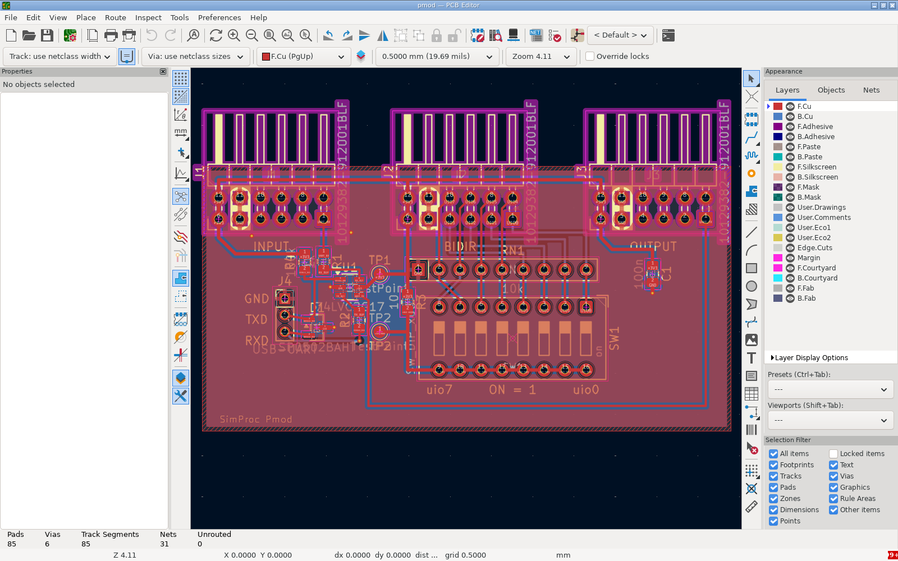
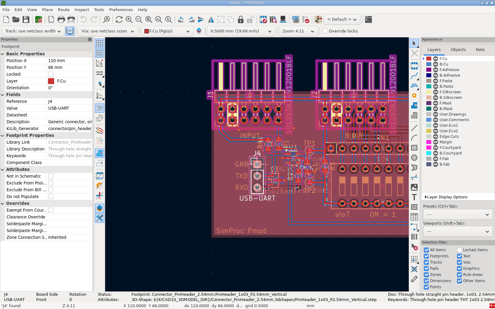
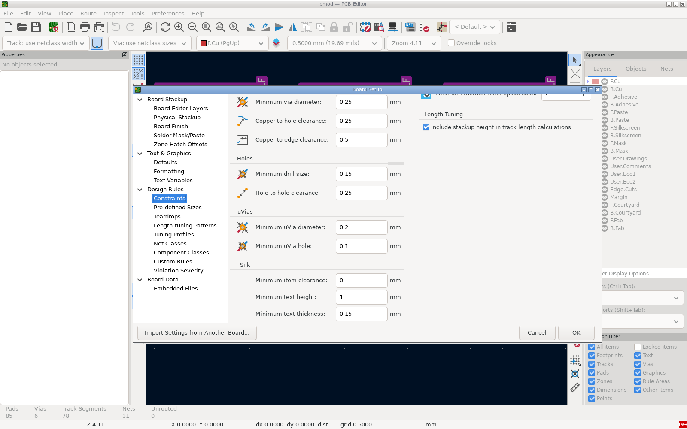

# Lab 06: Review a seeded board

In this lab you review a board you didn't draw. It's a SimProc Pmod like yours, with its bring-up plan, and we planted eight faults in it. The checks you already have look for fewer than half of them. You'll run those checks first, then go through the course checklist one line at a time against the board and its plan, and write each fault you find in `REVIEW.md`. Then you get a fabricator's quote for your own board, without ordering it, and record the price, the build time and the fabricator's own check of your files in `QUOTE.md`.

The lab's files are in [`labs/lab-06-review-a-seeded-board/`](https://github.com/uoftasic/pcb101/tree/main/labs/lab-06-review-a-seeded-board) in the course repo.

## Before you start

- Finish [Lab 05](lab-05-fab-outputs-in-ci-overview.md). Part 3 of this lab uploads the Gerbers that your Lab 05 workflow built.
- Read [Reviewing and ordering a board](../guide/reviewing-and-ordering-a-board.md), row 11 of the [course path](../index.md#course-path). Its ten-line checklist is the one you review against, and `REVIEW.md` asks for the number of the line each fault breaks.
- Don't open `labs/lab-06-review-a-seeded-board/solutions/` until you've finished. It lists the faults.

The lab takes about 1 hour 15 minutes, roughly 10 minutes for Part 1, 40 for Part 2 and 25 for Part 3. Those times are our estimates. We did time the checks themselves, with the container limited to one CPU. On a copy of the seeded board, the board check took 19 s and Lab 04's check took 20 s. The Lab 06 check took under a second, because it only reads your two files and your board.

## Part 1: What the checks say

What do the checks you already have find on this board?

1. Copy the seeded board out of the course repo, so that KiCad's own files and anything you change stay out of it, and copy the two templates into your board repository:

   ```bash
   cp -r ~/pcb101/labs/lab-06-review-a-seeded-board/board ~/seeded-review
   cd ~/simproc-pmod
   cp ~/pcb101/labs/lab-06-review-a-seeded-board/REVIEW.md ~/pcb101/labs/lab-06-review-a-seeded-board/QUOTE.md .
   ```

2. Will the board check pass on a board with eight faults in it? Write down your guess, then run it on the copy:

   ```bash
   cd ~/seeded-review
   ~/pcb101/labs/common/kicad.sh python3 /w/labs/common/check_board.py .
   ```

   You should see it pass, with the same 32 DRC warnings as Lab 04's reference board:

   ```text
                   errors  warnings  excluded
     ERC                0         0         0
     DRC                0        32         0
     unconnected        0         0         0
     parity             0         0         0

     DRC warnings by type: silk_edge_clearance 24, silk_over_copper 6, silk_overlap 2

   PASS  pmod.kicad_pro
   ```

3. Now run Lab 04's check, which also compares the board with SimProc's pin list:

   ```bash
   ~/pcb101/labs/lab-04-protect-and-plan/check.sh
   ```

   You should see the board check and the bring-up plan check pass. In the Pmod check, the connectors row fails, the power row passes, and the pins row says that the pins aren't checked until the connectors pass:

   ```text
     FAIL  connectors   J1 (102.00, 56.35), J2 (124.86, 56.35), J3 (148.22, 56.35)
                        their spacing is 22.86 and 23.36 mm; it must be 22.86 mm
     ok    power        +3V3 on pins 6 and 12, GND on pins 5 and 11, of every Pmod connector
     FAIL  pins         not checked until the connectors pass
   ...
   FAIL  pmod.kicad_pro: board check PASS; 1 of 3 Pmod checks ok; bring-up plan PASS
   ```

   That's your first finding. Write it as row 1 of the table in `REVIEW.md`: `J3` under Where, `10` under Line (mechanical fit), what's wrong, and what to change.

4. Two of the three checks passed, and the third checked only the connectors and the power pins. What does that tell you about the rest of the board?

   <details>
   <summary>Answer</summary>

   It tells you very little. The board check compares the board with its own schematic and with the rules saved in the board, so a fault that is in the schematic, or in the rules, passes it. The bring-up plan check only looks for a filled-in plan with an expected value at every step; it can't tell whether the steps are safe. The rest is for a person to find in a review. [Reviewing and ordering a board](../guide/reviewing-and-ordering-a-board.md) starts with two of Tiny Tapeout's own mistakes that ended up on manufactured boards, and ERC, DRC and parity don't look for either kind.

   </details>

## Part 2: Review it against the checklist

Which faults does a person find that the checks don't?

1. Open `~/seeded-review/pmod.kicad_pro` in KiCad, and open both the Schematic Editor and the PCB Editor. Keep the checklist from [Reviewing and ordering a board](../guide/reviewing-and-ordering-a-board.md), SimProc's pin list ([`simproc.json`](https://github.com/uoftasic/pcb101/blob/main/labs/common/pins/simproc.json)) and the board's `BRINGUP.md` open beside them.

   

   *The seeded board as it opens in KiCad 10.0.5's PCB Editor. It has the same parts as your Lab 04 board, in much the same places.*

2. Go through the checklist one line at a time. For each line, look at every part on the board and every step of the plan that the line applies to. Here is where to look in KiCad:

   - For a footprint (line 1), select the part on the board. The status bar along the bottom names its footprint in full, and the Properties panel has it as Library Link; the name gives the package and its pitch. Compare it with what will plug in or be soldered there.

     

     *J4 selected on Lab 04's reference board (Ctrl+F, then J4), in KiCad 10.0.5. The status bar reads `Footprint: Connector_PinHeader_2.54mm:PinHeader_1x03_P2.54mm_Vertical`; Footprint Properties (E) gives the same name as its Library link.*

   - For connections (line 3), click a net in the Schematic Editor or a track in the PCB Editor to highlight it, follow it from the Pmod connector to every part it reaches, and compare with the pin list and with the silkscreen's labels.
   - For decoupling (line 4), find each capacitor in the PCB Editor and the supply pin it serves, and see how far apart they are.
   - For I/O voltages (line 5), follow each UART line between J4 and the Pmod connectors. Work out which end sends the signal, then check that this end reaches U1's input, that U1's output goes through a series resistor to the other end, and that the resistor's value is in the range that checklist line 5 gives for a line in that direction. U1's symbol numbers its signal pins but doesn't name them, so use the Pin Functions table in its datasheet to find which pins are inputs.
   - For ESD (line 6), and for any part with more than two pins (line 1 again, for the footprint's pad numbers), compare which pin goes where with the part's datasheet, and with the symbol's pin names where it has them. The symbol's Datasheet field links to a document when it's filled in. On some symbols, such as SW1's, it's empty. U1's links to a TI document, scyt129e, rather than to the SN74LVC2G17 datasheet (SCES381), so search for SCES381 yourself.
   - For the plan (lines 7 and 8), read `BRINGUP.md` step by step against the board. Check the order in which things are plugged in and switched off, and whether every point it measures is on the board.
   - For the fabricator's rules (line 9), open File > Board Setup, look under Design Rules > Constraints, and compare the numbers there with the fabricator's numbers on the checklist page. On your own board they're JLCPCB's, because Lab 03's template set them:

     

     *Board Setup > Design Rules > Constraints on Lab 04's reference board, scrolled to the Silk rules. The minimum text height is 1 mm and the minimum text thickness is 0.15 mm, which are JLCPCB's published limits.*

3. For each fault you find, add a row to `REVIEW.md`: under Where, the reference designator of the part (or the file, such as `BRINGUP.md` or `pmod.kicad_pro`); under Line, the number of the checklist line it breaks; then what's wrong and what to change. Write it for the designer, who wasn't there when you found it.

4. Run the Lab 06 check from your board repository:

   ```bash
   cd ~/simproc-pmod
   ~/pcb101/labs/lab-06-review-a-seeded-board/check.sh
   ```

   It prints a line for each row of your table and says whether that row finds a planted fault. A row finds one when its Where names the right part or file and its Line is the line that the fault breaks, and each row can find at most one fault. The first two rows of our reference review look like this:

   ```text
     REVIEW.md
       row 1   J4                           line 1   finds a planted fault
       row 2   SW1                          line 3   finds a planted fault
   ```

   You should see at least five rows that find a planted fault, and `ok    faults    5 of 8 planted faults found (5 needed)` or better. Until you've filled in `QUOTE.md`, the last line still says FAIL. The check holds only hashes of the answers, so it tells you whether a row finds a fault but not which fault it finds. If a row you're sure of doesn't find one, check that its Where names the part's reference designator or the file the fault is in, as the template asks, and read the checklist line again.

## Part 3: Get a quote for your own board

What would your board cost to make, how long would it take, and what does the fabricator's own check say about your files?

1. On GitHub, open the last green run of your Lab 05 workflow and download its `board-outputs` artifact. Unzip it, and zip the contents of `fab/` (the Gerbers, the job file and the drill file) on their own, which is what a fabricator's upload page expects:

   ```bash
   cd ~/Downloads
   unzip board-outputs.zip -d board-outputs
   cd board-outputs/fab && zip ../../simproc-pmod-fab.zip *
   ```

   Note the commit the run was for; `QUOTE.md` asks for its hash.

2. Before you upload, write down the board size and the number of layers you expect the quote page to read from your files. Our board's outline is 64 × 32 mm on 2 layers.

3. Choose a fabricator from [Reviewing and ordering a board](../guide/reviewing-and-ordering-a-board.md) (JLCPCB, PCBWay or OSH Park), upload the zip on its quote page, and leave the options at a plain 2-layer board unless you have a reason to change one. Don't order. Read the price, the build time, the shipping choices to Toronto, and the result of the fabricator's file check (the DFM report), and copy each into `QUOTE.md`, with the DFM warnings word for word. Record whether the site asked you to make an account before it showed a price; we haven't checked that for any of them.

   We couldn't do this part ourselves, because the machine we wrote the course on doesn't upload files to outside sites, so there is no quote page or DFM report from us here. The reference `QUOTE.md` in `solutions/` shows the format, with JLCPCB's advertised "From $2.00 / 5 pcs" in place of a real quote.

4. Did the quote page read the size and layer count you predicted? If it didn't, find out why before you go on, because the fabricator will make the board it read from your files.

5. Run the Lab 06 check again. You should see the quote's three rows `ok`, with your own board's numbers in the last:

   ```text
     QUOTE.md
     ok    fields    every field filled in, no TODO
     ok    values    date, price, build time, quantity and commit all readable
     ok    board     2 layers and 64 x 32 mm, as your board has
   ```

   The check compares Layers and Board size with your board's `.kicad_pcb`, so a quote for some other board fails the `board` row, and so does a quote in which the fabricator misread your files.

## Finishing

You're done when `~/pcb101/labs/lab-06-review-a-seeded-board/check.sh`, run in your own repository, ends with `PASS  review PASS (5 of 8 planted faults found); quote PASS` or a higher count, and `REVIEW.md` and `QUOTE.md` are committed and pushed.

Questions:

1. In `~/seeded-review`, untick Locked for J3 in the Properties panel, put it back at 22.86 mm from J2 (X 147.72 mm) the way you placed it in Lab 03, lock it again, save, and run Lab 04's check there again. The check now passes every `uio` row. Look at the pin numbers it prints for `uio[6]` and `uio[7]`. What does it check about those lines, and what doesn't it?

   <details>
   <summary>Answer</summary>

   It checks that each `uio` line has a switch to the 3.3 V supply and a pull-down to GND, but not which switch it is. On the seeded board `uio[6]` goes to switch 8 (`pins 8-9`) and `uio[7]` to switch 7 (`pins 7-10`), the reverse of the other six and of the silkscreen. Anyone who sets the switches by the legend gets the wrong bit period whenever those two bits differ. Tiny Tapeout's TT07 breakout had the same kind of fault, two lines crossed and so mislabelled.

   </details>

2. Of the faults you found, which would Lab 04's check have reported if J3 had been in the right place?

   <details>
   <summary>Answer</summary>

   Two of them, U1 and C1. U1's second buffer, turned round, fails the `uo[0]` row with "U1 (74LVC2G17) is turned round on this line: its output, 2Y (pin 4), faces J3 pin 1, and its input, 2A (pin 3), faces J4 pin 3 (the dongle's RXD)". With the kit on, U1's output would drive the same line as SimProc's TX, and nothing would drive the dongle's RXD. C1's distance from U1 fails the `ui[0]` row with "no decoupling at U1's VCC: the nearest capacitor from +3V3 to GND, C1, has its nearest pad 35.50 mm from U1 pin 5, more than 3 mm". The `uo[0]` row stops at the turned-round buffer before it looks for a capacitor, so only `ui[0]` reports C1. With J3 put back, those two rows are the only ones that fail, and the last line is `FAIL  pmod.kicad_pro: board check PASS; 15 of 17 Pmod checks ok; bring-up plan PASS`. Counting J3 itself, the checks find three of the eight faults, and the other five need a person to find them.

   </details>

3. The seeded `BRINGUP.md` switches the kit off before the dongle comes off J4. How much current can the dongle push into the chip while the kit is off, and which checklist line does the order break?

   <details>
   <summary>Answer</summary>

   At most 10 µA, the Ioff of U1, which sits between the dongle and the chip and is unpowered while the kit is off. That's under the 100 µA that SkyWater allows (checklist line 5), so U1 keeps the current into the chip's pins within that limit in either order. The order breaks line 7, which asks for anything with a supply of its own, such as the dongle, to be unplugged before the kit is switched off. Until the dongle comes off, it drives U1's unpowered input. It also puts up to 3.3 V / 100 kΩ = 33 µA into the kit's +3V3 through R4, the 100 kΩ pull-up from its TXD to +3V3. Your own `BRINGUP.md` from Lab 04 unplugs the dongle first, so that none of this current flows.

   </details>

4. The seeded board's "SimProc Pmod" legend is 0.8 mm high, and none of the board's 32 DRC warnings is about it. Why didn't DRC warn about it, when your own board's DRC would?

   <details>
   <summary>Answer</summary>

   DRC checks the board against the rules saved in the board, and the seeded board's Board Setup lowers the minimum text height and thickness to 0.8 mm and 0.1 mm, below JLCPCB's 1.0 mm and 0.15 mm. With your template's rules, the same text gives a `text_height` and a `text_thickness` warning.

   </details>

Submit: nothing for this lab. Keep `REVIEW.md` and `QUOTE.md` in your repository.

## Going further (optional)

- Review a classmate's Lab 04 board in a pull request on their repository, against the same checklist, with the renders and plots their workflow built. This needs someone working at the same pace, which is why it isn't a required part.
- Get quotes from a second and a third fabricator for the same zip, and compare their DFM reports. The files are the same, so where one fabricator flags something another doesn't, the difference is in their processes.

Next on the [Course path](../index.md#course-path): read [Boards for chips: carriers, motherboards and characterization boards](../guide/boards-for-chips.md), then do the [Capstone: A board for a team chip](capstone-a-board-for-a-team-chip-overview.md).
